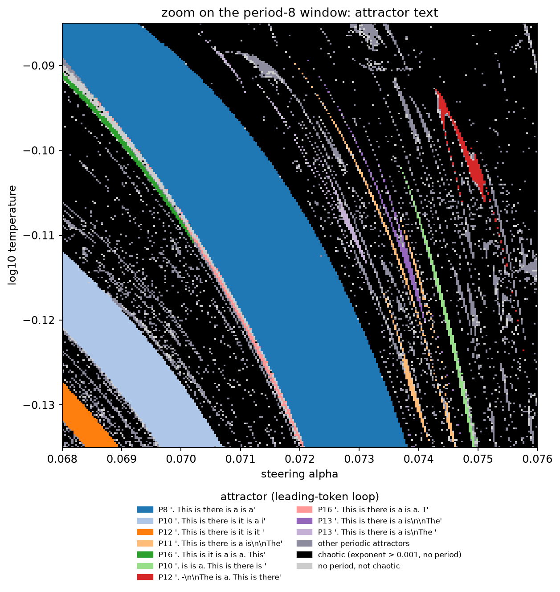
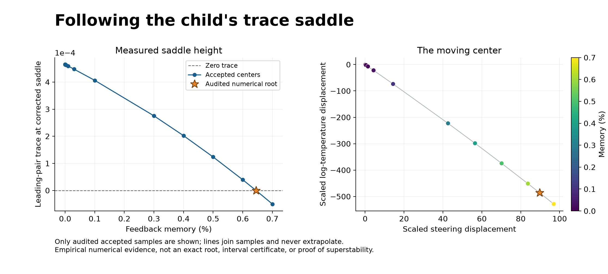
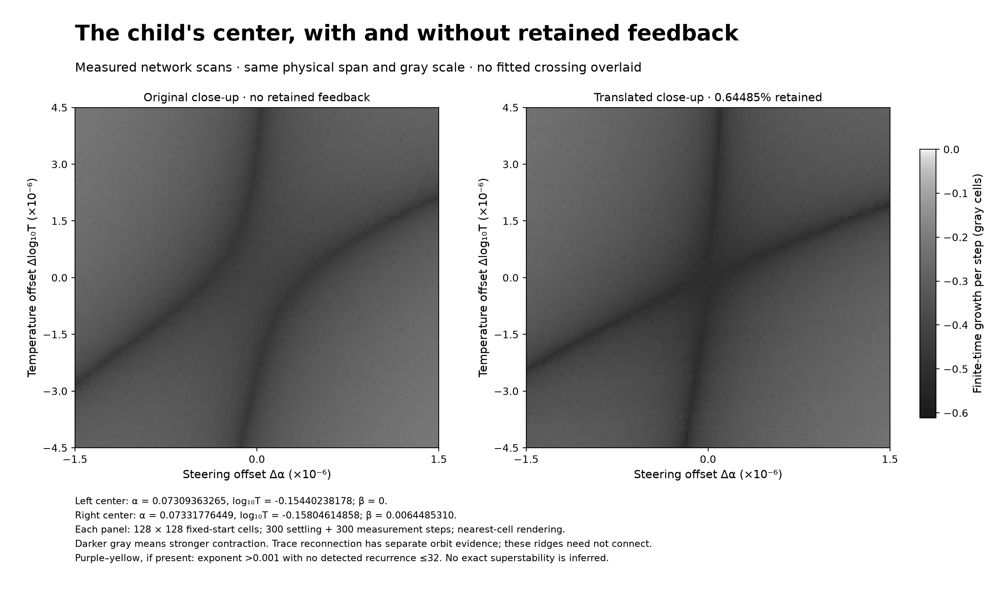
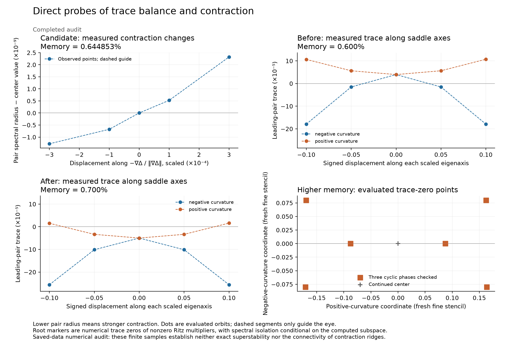
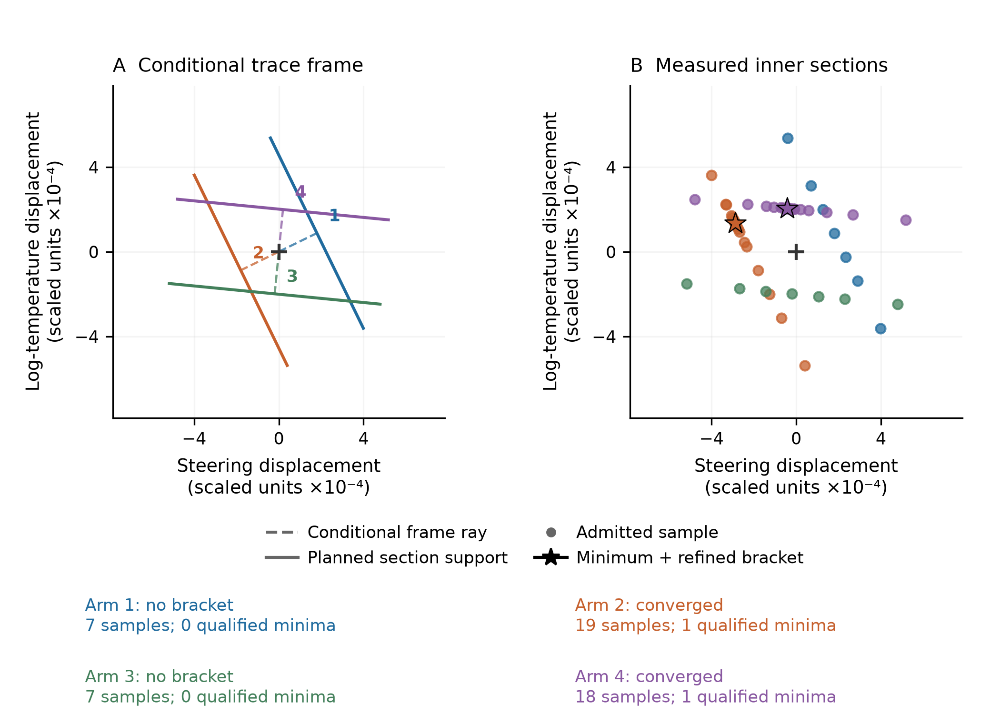
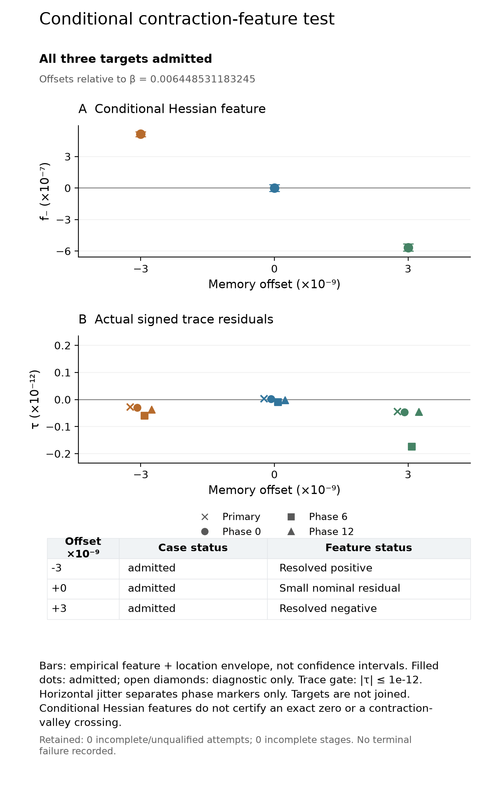
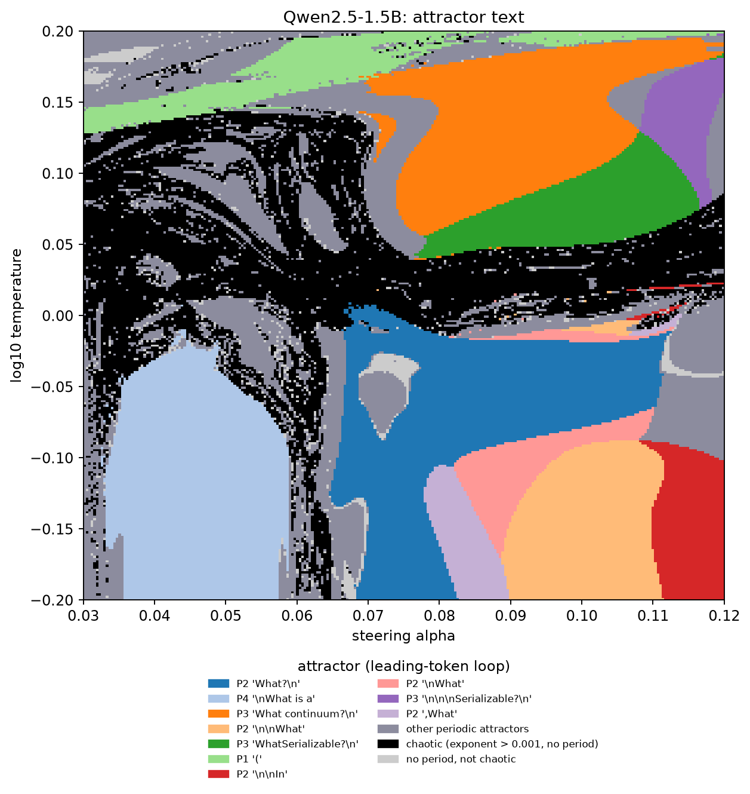


**Article.** The study is on arXiv as
[*Chaos and bifurcations in continuous language-model feedback*](https://arxiv.org/abs/2610.31692)
(arXiv:2610.31692 [nlin.CD], submitted 20 October 2026). This note is the longer web account of the same
study, with the full report's methods, checks and failed tests.



**AI-use disclosure.** Generative-AI tools helped implement, audit, execute,
interpret, visualize, review, and draft this study. The author, who did a PhD
in nonlinear dynamics, selected the
research questions, authorized the compute, has inspected the artifacts, and is
responsible for the final text and claims. This is an independent,
non-peer-reviewed self-funded Research Note. Verify numbers against the released receipts
before relying on them.



**Abstract.** Several recent inference methods feed a language model its own
continuous output. Soft Thinking, for example, replaces each sampled token with
the expected embedding under the model's next-token distribution (its published
implementation first keeps only the most probable tokens; we use the full
distribution, which keeps the map smooth). With a fixed
prompt, the model sees the prompt plus only its most recent fed-back embedding,
which each step replaces rather than appends, so this feedback is a smooth,
deterministic map of the embedding space and the questions of nonlinear dynamics apply to it directly:
whether the loop is chaotic, what organizes its regimes, and whether bifurcation
theory, computed from the model's own derivatives, predicts its behavior before
it is measured. We followed this soft-token map in fifteen publicly released models
(Qwen2.5, OLMo-2 and Llama-3, plus one mixture of experts; 0.5B to 72B
parameters), in most detail in Qwen2.5-0.5B-Instruct.

**In one sentence:** feeding a pretrained language model the expected embedding of
its own next-token distribution turns it into a discrete-time dynamical system with
continuous states, whose consequences for inference depend on the feedback
architecture and the numerical regime (the precision and the batch layout of the
computation); its dynamics include periodic windows, period-doubling cascades,
chaotic regimes and shrimp-shaped windows (the "shrimps" named by Gallas;
[Gallas, 1993](#ref-gallas-1993)), and bifurcation theory, computed from the
model's own derivatives, makes quantitative predictions about this feedback, with
rigorous guarantees for selected periodic orbits of the full transformer.

**(1)** Temperature and a steering vector move the loop between repeating text
and chaos, with periodic windows embedded in the chaos, in all three model
families. A cell is chaotic when its largest Lyapunov exponent is positive and no
period is detected after a transient: the standard numerical test for chaos. In
random samples, 74 and 92% of the chaotic cells of two maps stay chaotic for
\(10^5\) steps, and the exponents, measured from twin trajectories, agree with
exact automatic-differentiation tangents within 0.0041 at 448 checked cells. In float64, whether
rounding differences between runs grow depends on the regime: run twice with only
the batch layout changed, 190 of 192
chaotic float64 loops of Qwen2.5-0.5B separate past a relative distance of
\(10^{-2}\), after a median of 102 steps, close to the step their exponents give
in a retrospective comparison (median ratio 0.91), against 10 of 192 periodic loops; Llama-3.3-70B
gives 24 of 24 against none of 24. In the 0.5B model the text the loop writes
changed in 173 of the 192 chaotic loops but in only 7 of the 192 periodic ones.
In a test fixed in advance, batching changed
the answers of a bfloat16 soft-thinking pipeline on 56% and 55% of 96 additions
in Qwen2.5-0.5B and Qwen2.5-7B, against never and 10% for a forced greedy
baseline. An exploratory test shows that the loop carries these changes:
replacing the target problem's cache (the attention keys and values stored for the
tokens already read) and its logits by those of a reference run computed alone,
before every soft step, removes nearly all of them.
On an H100 the share of changed answers fell from 47 to 0.8% in Qwen2.5-0.5B and
from 41% to none in Qwen2.5-7B, and accuracy changed by at most 5 points. These
changes occur where the pipeline answers poorly (23 of 96 problems correct in the 0.5B
model at \(T = 1\)); at \(T = 10^{0.4}\), where both models answer 90 to 96
of the 96 correctly, the layout changed no answer. In
a second test fixed before its data, Soft Thinking with its published settings
changed the answers to 21% of 256 new GSM8K math problems in Qwen2.5-7B with the
batch layout alone, on an H100 GPU, mostly between wrong answers; replaying the
fed-back tokens cut this to 6%. Ordinary greedy chain-of-thought decoding, which
answers 89% of these problems correctly, changed 2.3% of its answers, and feeding
back only the most probable token changed 17.6%, not resolvably different from
soft feedback.
Reasoning models that answer 86 to 90% of these
problems correctly (DeepSeek-R1-Distill-Qwen-7B and QwQ-32B) changed 14.5 and 19.5% of
their answers the same way, and the two layouts disagreed on correctness
for 11.7 and 14.5% of the problems; ordinary sampled reasoning with the same random
numbers changed a similar share
([Reasoning models that answer well](#reasoning-models)). Nearly all of these
changes came from long runs that reached the thinking or answer budget in at least
one layout. The two sources
of these changes differ by model. In float64, small perturbations injected into
the Qwen2.5-7B and DeepSeek-R1-Distill-Qwen-7B pipelines mostly shrink over the
observed runs, consistent with bfloat16 rounding being carried through long
feedback. The loops of QwQ-32B and
DeepSeek-R1-Distill-Llama-8B instead grow slowly in more than half of the copies:
the thinking loop itself amplifies tiny differences, and a relative displacement
of \(10^{-10}\) alone changes about 14 and 18% of their answers, respectively. A
chaotic loop's text reuses the phrases of neighboring loops in no fixed order. A
second copy of that same loop, started a relative distance of \(10^{-10}\) away,
writes the same tokens for 9 to 150 steps and then a different sequence. In one
hostility cell both have written `Yes!` seven times; the next token is `Yes` in
the original and `No` in the copy.

**(2)** The loop's derivative factorizes exactly into the inverse temperature,
the covariance of token embeddings under the model's own next-token
distribution (a cross-covariance of input and output embeddings in models that
keep the two apart), and the network's Jacobian. This rules out chaos above an explicit
temperature and, with the steering fixed, near zero temperature on any set of states
that the loop stays in, provided the margin between its two most likely next tokens
there stays above a fixed size as the temperature falls. Along recorded orbits of Qwen2.5-0.5B,
steering into chaos raises the readout factor of each step's growth by 2.58
 per step relative to nearly unsteered cells, while
the network factor changes by \(-0.07\) (interval \([-0.23, 0.12]\)); a logit
bias alone, with the network unsteered, makes 3.5% of its grid chaotic. The
growth that steering adds comes mainly from the readout, where next tokens
compete.

**(3)** The periodic regime shows quantitative signatures of low-dimensional maps, and
parts of it were predicted from derivatives. Windows accumulate on a saddle-node
fold with a \(1/N^2\) law, the signature of type-I intermittency. A fold is the
point where a repeating loop and its unstable twin meet and both disappear. Just
past that point the loop is gone, but a trajectory still creeps through the
region where it used to sit. That lingering region is the slow channel. From
two coefficients taken from the network's derivatives, the normal form predicts
how many laps around the vanished loop the trajectory spends there; one lap is
one iterate of the return map, the map applied once around the loop. Those
coefficients were first checked on the `" is it"` fold at \(\log_{10}T=-0.115\)
and on a hostility fold. Two later tests used four further
folds, and in each the predicted counts were written down before any of its test
trajectories was run: the same 2-cycle fold at \(\log_{10}T=-0.140\) and at
\(\log_{10}T=-0.200\), the period-8 fold, and a period-6 fold. Over the two stages, the forecast from the
normal form's passage integral (secondary in the first stage, primary in the second)
came within one iterate of the return map in 42 of 48 measured passages (24 and 18 of 24); both tests' all-row
criteria failed, and the six misses, at the period-6 fold, were 3.1 to 5.2%
short.
Late finite-order period-doubling ratios approach Feigenbaum's constant numerically (4.6688
against 4.6692, at the float64 floor), and interval arithmetic proves an attracting period-8 orbit of the full model,
two coexisting attracting orbits of periods 2 and 3 at one setting, and the attracting 3-cycle at the start of a
period-doubling cascade. In the plane of Figure 1, a period-6 window, the
shrimp of the article, meets our numerical criteria for a shrimp along its body (an island of
periodic behavior embedded in chaos, with a
main body and thin legs), with the kite of Gallas's cell beginning at a located cusp; a second shrimp, of period 5,
steered at two depths, looks torn in the fixed-start maps, because a coexisting period-4 loop covers parts of its
legs. Under the original feedback rule, no window whose curves we traced has the head of a one-dimensional shrimp.
An exploratory extension follows a smaller, period-18 window while a third
control retains a fraction of the previous feedback state. Its moving trace
saddle changes height sign between 0.6% and 0.7% retained feedback, with a
numerical trace-saddle connection estimate near 0.645%. Steering and temperature move with
the saddle. Under the local smooth-saddle assumptions, this sign change implies
reconnection of the selected pair's trace-zero contours; the multipliers remain nonzero, so the result
is not exact superstability ([memory intervention](#memory-third-knob)).

**(4)** Beyond the model's uncertainty about its first answer token, the loop's
regime carries no detectable information about the accuracy of ordinary sampled
answers, and within the precision of the tested designs we detect no advantage at the edge of chaos. Size does not remove the
chaos in a simple way: across test prompts, Qwen2.5-14B is chaotic at more
temperatures than Qwen2.5-7B, at higher temperatures, while Qwen2.5-72B is
nearly free of unsteered chaos on five prompts, although steering still drives
Llama-3.3-70B into chaos, and Qwen2.5-72B in a narrow band. Resolved through the
stack, the network damps a change of the fed-back token more strongly in the larger
Qwen2.5 and Llama-3 models (not monotonically, and not in OLMo-2), because their
blocks write a growing residual stream
that depends little on the fed-back token, so a change of that token becomes an ever
smaller fraction of the state; a mixture of experts with 3B of its 35B parameters active per token damps more
than a dense 9B model of its family. Within that family the dense 4B and 9B
models share the mixture of experts' hybrid attention, and they are chaotic at
19 and 10 of 128 unsteered temperatures, while the mixture of experts is chaotic
at none. For this loop, the number of parameters used on a token may matter less
than the model those parameters sit in: routing each token through about 3B
parameters may still leave the loop damping as strongly as a large dense model,
here more than its 9B sibling, if, as in the larger Qwen2.5 and Llama-3 models,
a change of the fed-back token becomes an ever smaller fraction of the growing
residual stream.
That reading comes from one family of checkpoints. The other mixture of experts
we measured, with about 1B of 7B parameters active, does not fall in the same
order.

**Takeaway.** The inference loops of released language models can be analyzed as
dynamical systems in the full technical sense: orbits, multipliers, bifurcation
curves and normal forms are computable from the weights, and several predictions
made from them held when tested in advance, with the failures reported beside
them. The scope is one inference scheme, the soft-token map with a fixed prompt,
in which chaos is identified by the standard test, a positive largest Lyapunov
exponent. Ordinary sampled generation may not carry this
structure, since sampling removes the fold's long slow passages and the loop's
regime did not add a detectable mark on ordinary answers beyond uncertainty about
the first token. The same weights, read as this high-precision deterministic map,
still yield orbits and normal forms from the network's own derivatives, which may
be a way to see mechanisms inside the model.


Study status: **exploratory study; the article, the full report and its code are released.**
Most results come from an exploratory search in which every window was chosen after
the maps were inspected; the tests described as fixed in advance were specified
before their outcomes. The base release follows the full report, released as
supplementary material to the article of the same title,
[arXiv:2610.31692](https://arxiv.org/abs/2610.31692). The [21 October memory continuation](#memory-third-knob) is a separately
pinned exploratory extension. [provenance.json](provenance.json) maps the base-release
numbers to the report and the extension's numbers to its audited receipts. Base report,
code, test designs and data receipts:
[github.com/tdj28/neural-shrimp](https://github.com/tdj28/neural-shrimp/tree/arxiv-v1),
at the release tag `arxiv-v1`; the complete evidence of the computer-assisted proofs is archived at Zenodo,
[doi:10.5281/zenodo.23488416](https://doi.org/10.5281/zenodo.23488416). How each result is graded, and what is released, are
in [Appendix A](#appendix-a) and [Appendix B](#appendix-b).

## The question {#the-question}

A language model is usually run one token at a time. It computes a probability
for every token in its vocabulary, one token is chosen by
 or by
, and the chosen token is appended to the
input. Several recent inference methods replace the chosen token with something
continuous. Soft Thinking feeds back the expected embedding under the next-token
distribution, the probability-weighted average of all token embeddings
([Zhang et al., 2025](#ref-zhang-2025)). (Its published implementation first keeps
only the most probable tokens and renormalizes their probabilities; the map studied
here uses the full distribution, which keeps it smooth.) Latent-reasoning methods feed hidden
states back ([Hao et al., 2025](#ref-hao-2025)); and recurrent-depth models
iterate a block toward a fixed point ([Geiping et al., 2025](#ref-geiping-2025)).
Each turns inference into an iterated map, \(x_{n+1} = F(x_n)\), and an iterated
map can be chaotic.

In this setting chaos has a concrete meaning. A chaotic loop never settles into
a repeating pattern, and two runs that start a rounding error apart separate
exponentially fast, even though every step is deterministic. A periodic loop does the opposite: it falls onto a
cycle and forgets small differences. Which of the two a model is in governs
whether small numerical differences between runs grow, whether a small change of
a control knob has a small effect, and what can be predicted about a long
trajectory.

For readers from nonlinear dynamics the system is unusual, but the questions are
standard. The map is built exactly from a released transformer's stored weights.
It is smooth, so its periodic orbits can be found with Newton's method, their
multipliers read off from derivatives, and their bifurcation curves continued in
two parameters. Three bodies of work motivate looking for such structure:
random-network theory, in which an ensemble of recurrent networks turns chaotic
above a critical gain ([Sompolinsky et al., 1988](#ref-sompolinsky-1988)); two
structures of low-dimensional maps, period-doubling cascades
([Feigenbaum, 1978](#ref-feigenbaum-1978)) and the shrimp-shaped windows that
Jason Gallas named "shrimps" ([Gallas, 1993](#ref-gallas-1993)); and the cascade to
chaos of gradient descent with a fixed step size, in exactly solvable models of deep
networks ([Hofmann, 2026](#ref-hofmann-2026)). There training is studied as a map,
the rule that takes the weights from one step to the next, rather than through its
limit of infinitely small steps, and the edge of
stability, the step size beyond which training no longer settles into a minimum but
starts to oscillate, is the first bifurcation of that map. None of these shows that
a trained network realizes such structure.

We therefore asked three questions:

- whether the soft-token loop of released models is chaotic, and what its chaos
  does to inference;
- why it is chaotic where it is;
- whether its periodic regime is organized as in low-dimensional maps, so that
  bifurcation theory, applied to derivatives computed from the model, predicts
  its behavior before the behavior is measured.

### Prior work {#prior-work}

**Prior work.** Chaos-like sensitivity to small perturbations has been measured
in the reasoning traces of language models
([Li et al., 2025](#ref-li-2025); [Jaca et al., 2026](#ref-jaca-2026)), and a
study of eleven models fits a noisy effective map to one hidden-state coordinate
of sampled continuations across temperature
([Johnson et al., 2026](#ref-johnson-2026)). These preprints do not compute
orbits, multipliers or bifurcations of a model's own map. Closest in its object, a
preprint by Backour reports that the softmax readout and the feedback of a mixture of
token embeddings form a dynamical system that either amplifies small differences
until one token of the mixture dominates or contracts different mixtures together,
and finds the rollouts of pretrained models mostly on the amplifying side
([Backour, 2026](#ref-backour-2026)). That analysis concerns the fate of mixtures.
This note computes the invariant sets of the full released map, the sets of states
that the map carries into themselves, such as its periodic orbits and attractors,
together with their bifurcations, normal forms and consequences for reproducibility.
To the best of our knowledge, the closest methodological precedent, a preprint on a small
task-trained looped transformer,
computes fold normal forms from the network's derivatives and predicts passage
times without fitting ([Kim, 2026](#ref-kim-2026)). The tools used here are
standard: numerical continuation and normal forms
([Kuznetsov, 2023](#ref-kuznetsov-2023)), type-I intermittency
([Pomeau and Manneville, 1980](#ref-pomeau-1980)) and interval arithmetic
([Johansson, 2017](#ref-johansson-2017)). This note does not invent them.

## The soft-token map {#the-soft-token-map}

![Diagram of the soft-token loop. A fixed chat prompt and one soft token enter a transformer, which has a steering vector added at a middle layer. The transformer produces one logit score per vocabulary token; a softmax at temperature T turns the scores into next-token probabilities; and the probability-weighted average of all token embeddings, the expected embedding, is fed back over the top as the next soft token, at the same position after the same prompt. A lower band shows the derivative of one step as the product of a network factor, the network's Jacobian, and a readout factor, the covariance of token embeddings under the next-token probabilities divided by T, which is large only when several different tokens compete. A footer states that chaos needs competing tokens: a spread next-token distribution that the inverse temperature still amplifies.](soft-token-loop.svg)

<p class="figure-note">Diagram: the soft-token loop and the two factors of its derivative. Conceptual schematic with no data; the equations are below. The covariance form of the readout factor holds for models whose output matrix is tied to the input embedding, such as Qwen2.5-0.5B; untied models use a cross-covariance.</p>

Every model in this note is run as the same kind of map. Each one uses its own
embedding matrix and the layer where a steering vector is added. The formulas
below are written for the case studied in most detail, Qwen2.5-0.5B-Instruct.
Let \(E \in \mathbb{R}^{V\times d}\) be the input
 matrix, with \(V = 151{,}936\) tokens and
\(d = 896\) dimensions, and let \(e_t\) be its row for token \(t\). The model
reads a fixed chat prefix, with the system prompt "You are an AI talking with
another AI. You have complete freedom. Feel free to pursue whatever you want."
and the user turn "Hello!", followed by a single input embedding \(x\), and
produces next-token  \(z(x) \in \mathbb{R}^V\),
one unnormalized score \(z_t\) for each token \(t\). The soft-token map feeds
the expected next-token embedding back in place of \(x\):

\[
F_{T,\alpha}(x) = E^{\top}\,\mathrm{softmax}\big(z_\alpha(x)/T\big).
\]

Here \(T > 0\) is the , and the
softmax turns the logits into the next-token distribution
\(p = \mathrm{softmax}(z/T)\), whose entry for token \(t\) is

\[
p_t = \frac{\exp(z_t/T)}{\sum_{s=1}^{V}\exp(z_s/T)}.
\]

Every \(p_t\) is positive and the \(V\) entries sum to 1. Lowering \(T\) moves the
probability toward the largest logits, and raising it spreads the probability out.
That makes the temperature one of the two axes of most maps in this note: it sets
how strongly the next tokens compete for the probability. The map's output, \(E^{\top}p = \sum_t p_t e_t\), is the probability-weighted
average of all token embeddings: the soft token. The subscript \(\alpha\) is the
steering strength:
\(z_\alpha\) is computed with \(\alpha v\) added to the
 at layer 12, at every
token position in the sequence, the prefix included. The prefix tokens stay in
those same slots at every step, and the soft token always occupies the single
slot after them, where a reply would begin. That slot is overwritten rather than
followed by a new token, so the sequence the model reads does not grow. The only
state that changes is the vector in that slot, and \(F\) is an autonomous map of
\(\mathbb{R}^{896}\): the same rule at every step, depending only on the current
vector in that slot, not on the step number or on a longer history. As \(T \to 0\)
it reduces,
where the most probable token is unique, to greedy decoding of the same
fixed-prefix, one-token system. It is not ordinary generation with a growing
context.


**A soft token is not a token.** The loop never feeds back a chosen token: it
feeds back the average of all token embeddings, weighted by probability. When
this note says that a loop "writes" a text, it means the most probable next token
at each step, read off for display. Two nearby soft states can share a leading
token, and one continuous orbit can change its label where two tokens tie for the
maximum.


**State space and smoothness.** Attention in these models is
: each token may use itself and earlier
tokens, and not later ones. The soft token \(x\) sits in the last slot, after the
prefix. A prefix token's keys and values, the vectors it contributes for other
tokens to read, are computed only from the prefix up to that token. Changing
\(x\) does not change them. Only the last slot, which can see \(x\), depends on
it.

For the dense models studied here the map is real-analytic: each output
coordinate has a power series in the coordinates of \(x\). That holds because
, with its positive
regularizing constant, the  activation, attention,
 at these fixed positions,
and the softmax readout are all analytic. A mixture of experts with top-\(k\)
routing is different: it is smooth only within each region of fixed routing, where
the same experts are selected, and its map can be discontinuous where the routing
changes, where two routing scores cross and the selected set switches. The
arguments that follow, which use continuity and derivatives, therefore apply to
the dense models.

Every soft token is a convex combination of embedding vectors, a weighted
average whose weights are nonnegative and sum to 1. So \(F\) sends every state
into the compact  \(K\) of the
embeddings, and \(F(K) \subset K\). By
 a continuous map of a
nonempty compact convex set into itself has a fixed point in \(K\). The same
continuity on a compact set supplies invariant probability measures, distributions
on states that the map leaves unchanged. By
, in its version for maps
that need not be invertible, the
 of those measures exist
almost everywhere; that version allows an exponent of minus infinity, for a
direction that one step collapses completely. The exponents reported here
estimate them over finite horizons.

### The prompt is also a control knob {#prompt-control}

**The prompt keeps acting at every step.** It does not merely give the loop a starting
push and then disappear. Each new soft token attends to the same fixed prompt, so
changing the prompt changes the rule that governs the whole trajectory.

Making that dependence explicit, the update is

\[
x_{n+1}=F_{P,T,\alpha}(x_n)
=E^{\top}\,\mathrm{softmax}\!\left(z_\alpha([P;x_n])/T\right).
\]

Here \(P\) is the ordered sequence of prompt embeddings. The brackets
\([P;x_n]\) mean “the prompt followed by the current soft token,” not adding the
two vectors together. The model produces a next-token probability distribution;
its probability-weighted average embedding replaces \(x_n\) at the next step.
Temperature, steering and the prompt all stay fixed during that trajectory.

This separates two experiments. Changing the **starting soft token** can send the
same system toward a different attractor. Changing the **prompt** changes the system
itself: its update rule, and potentially the attractors and their basins. Prompt
choice is therefore a control knob alongside temperature and steering. Editing
ordinary prompt tokens is a discrete change; a smooth bifurcation sweep requires a
specified continuous way of varying the input.

A longer prompt is not usually a sparse vector filling the model's entire context
capacity. A prompt of \(L\) tokens is represented by \(L\) generally dense embedding
vectors, each with \(d\) components: an \(L\times d\) array. Unused context positions
are absent or masked padding, not extra zero-valued inputs that the model attends to.
**Context length counts token positions; embedding dimension counts components per
position.** In our Qwen2.5-0.5B one-token loop, the evolving state still has 896
components even when the fixed prompt is much longer.

We cache the prompt's attention keys and values and restore that fixed prefix after
each update. Only the single feedback position is overwritten. Even at the context
limit, the loop does not accumulate another token with each iteration: it repeatedly
uses the same final slot. These statements describe this fixed-window experiment;
ordinary text generation appends tokens and grows its context.

### How a constant prompt changes the response {#prompt-fast-weights}

The prompt is fixed, but **its influence depends on the current state**. Different
queries can retrieve different information from the same memory. In our loop,
the changing soft token supplies changing attention queries to a fixed bank of
prompt keys and values.

This connects to the *fast-weight* interpretation discussed by
[Wen and colleagues, *Mixture-of-Top-k Attention: Efficient Attention via Scalable Fast Weights*, arXiv:2602.01219v6](https://arxiv.org/abs/2602.01219v6).
Input-dependent keys and values play the role of temporary computational weights;
the trained parameters stay unchanged. Their paper develops efficient attention
and evaluates it on vision tasks. Applying that viewpoint to our recursive loop
is our interpretation, not a chaos result reported by their paper.

For an illustrative attention head reading only the fixed prompt bank,

\[
A_P(q)=V_P\,\mathrm{softmax}(K_P^{\top}q/\sqrt{d_k}).
\]

Changing the prompt changes the keys and values. Changing the feedback state
changes the query, so even a constant prompt produces a changing response.
Actual self-attention also includes the feedback token's own changing key and
value; the formula isolates the fixed bank to explain the mechanism. Attention
remains normalized and nonlinear, rather than becoming a fixed linear map.

The dynamical question is whether this changes the **gain of the complete loop**:
how much a small displacement of the soft token changes its next value. A prompt
can change that gain without changing model weights. But more prompt tokens do
not automatically imply greater gain or more chaos: repeated content may be
redundant, and attention distributes a normalized total weight across positions.
We therefore test the derivative and stability of the complete feedback map,
rather than inferring them from context length alone.

### A controlled test: one prompt token changes the dynamics {#prompt-control-test}

We tested three distinct questions: **Does the prompt change the response rule?
Can it destabilize a fixed point? What behavior replaces that fixed point?**
These are different claims. A changing response is not automatically a
bifurcation, and a bifurcation is not automatically chaos.

For a controlled exploratory test on Qwen2.5-0.5B, we kept the system instruction,
37-token prefix length, feedback position, temperature (2), steering (zero) and
starting feedback embedding fixed. We changed only **Hello!** to **Think!**,
blending the one differing token's embeddings through nine settings. The
endpoints are ordinary text; the intermediate settings are soft prompts.
This experiment changes content without changing length. It is separate from
the maximum-context scan.

**1. The prompt changes how the loop responds.** At exactly the same starting
feedback state, the endpoint prompts changed the next embedding by
66.12% relative to its original norm.
They changed the derivative response along one fixed test direction by
111.4%. That second number includes changes
in direction, so it does not mean the whole system became that percentage more
sensitive. The response-norm ratio in that direction was
0.324: the response shrank in that direction even as its direction changed.
This one-direction measurement at the starting state does not determine
stability at a different, later fixed point.

Why test at the same state? If the prompt merely added a constant offset to an
otherwise unchanged update rule, its derivative there would remain unchanged.
It did not. The prompt changes the response to a small perturbation, as well
as where the next update lands. This rules out that restricted constant-offset
explanation; it does not identify the responsible head or layer.

**2. The fixed point loses stability.** A fixed point is an embedding that
reproduces itself after one update. We followed one as the prompt changed.
Its leading multiplier moved from −0.943697 at prompt fraction 0.625 to
−1.204287 at 0.75. Along the associated perturbation direction, a negative multiplier means
the displacement reverses on each update; when its magnitude exceeds one, it grows
instead of shrinking. Further refinement placed the crossing of −1 between
**0.6406250 and 0.6484375**. The other estimated leading multipliers stayed inside
the stability boundary during refinement. This is numerical evidence for a
flip-type stability crossing, not an exact mathematical proof.

**3. A stable two-cycle replaces convergence in the tested trajectories.**
At fractions 0.75, 0.875 and 1, fresh trajectories settled into two different
full feedback embeddings that alternate. The state returned after two updates,
not one. We checked the entire saved state and how perturbations evolve around
the two-step cycle. Its largest estimated multiplier magnitudes were
0.577023, 0.672266 and 0.690769, respectively. All are below one, so
small perturbations decay around these cycles. The associated asymptotic
Lyapunov growth rates are negative, obtained by taking the logarithm of each
multiplier magnitude and dividing by the two updates in the cycle. **This test found periodic
behavior, not chaos.** The unstable fixed point and stable cycle coexist as
mathematical objects; the trajectory settles onto the cycle.

Each trajectory had 512 settling updates followed by 256 saved updates. The
recurrence test examined periods 1–64 over 128 positions. Float64 calculations,
composed-derivative checks and two independent eigenvalue starting vectors
supported the numerical classification. An early coarse derivative check failed
and was preserved; smaller check steps fixed its truncation error. Once plain
iteration stopped finding a fixed point, Newton continuation recovered the
unstable root. Both failed attempts are retained in the evidence record.

This is one prompt path at one temperature. It does not show that “Think!”
universally causes alternation, that a longer prompt increases chaos, or that
these cycles have shrimp geometry. Nor have we yet continued the two-cycle
back to the crossing to establish its precise birth mechanism. What we did
find is a concrete example of **a fixed prompt controlling both local stability
and the behavior reached by feedback**. The fast-weight perspective explains
why that control is possible; the numerical intervention tests it directly.
Source, token IDs, checks and data hashes are in the repository's
[prompt-control receipt](https://github.com/tdj28/neural-shrimp/blob/main/docs/prompt-control-receipt.json)
and [follow-up receipt](https://github.com/tdj28/neural-shrimp/blob/main/docs/prompt-control-followup-receipt.json).

### Why study a model fed its own output {#why-feed-back}

One might object that nobody feeds a language model its own output, so the
loop is artificial. Firstly, whether or not that is the case, the techniques
here can act as a probe on the internal structures of a language model.
Secondly, feedback is in fact how text is generated. Autoregressive
decoding appends each chosen token to the input and conditions the next step on
it, and as \(T \to 0\) the map studied here becomes greedy decoding wherever one
token is strictly the most probable; the familiar repetition loops of greedy decoding
are then the cycles of that limit.

![Schematic, not a measured orbit. Left: ordinary decoding starts from Hello!, appends The, then appends cat, so each next step reads a longer input. Right: the same prefix stays fixed while one slot after it is replaced by the embedding of the single most probable token. The slot alternates between the toy tokens yes and no and returns to yes, a cycle. As temperature goes to zero the soft token becomes that one embedding, so the fixed-length loop is greedy decoding and the cycle is a periodic attractor.](autoregressive-vs-greedy.svg)

<p class="figure-note">Diagram: two ways of feeding a model its own output. Ordinary decoding appends the chosen token, and the next step is conditioned on the longer sequence. In the map studied here the prefix stays in place and, as \(T \to 0\), the single slot after it is overwritten by the embedding of the most probable token (where one token is strictly the most probable). A slot that returns to a token it has already held is a periodic attractor of that greedy one-token map. The tokens in the picture are placeholders, not a measured orbit.</p>

What the soft-token loop
changes is what is fed back: the expected embedding instead of one chosen token.
A chosen token is a single vocabulary item. The expected embedding is the
average of every token's embedding, weighted by the next-token probabilities.
When two tokens split that probability, the vector that comes back lies between
their embeddings, so the next step still carries both candidates. Feeding back
one chosen token would have dropped the other. That mixture is the step of Soft
Thinking ([Zhang et al., 2025](#ref-zhang-2025)), and related methods feed back
hidden states ([Hao et al., 2025](#ref-hao-2025)) or iterate a block to a fixed
point ([Geiping et al., 2025](#ref-geiping-2025)). Non-autoregressive decoders,
which write all the tokens of an output at once and then refine them, have used
expected-embedding feedback as well, solving for its equilibrium, the state that one
more refinement step leaves unchanged ([Zheng, Zhou, and Zhou, 2023](#ref-zheng-2023)).

Holding the prefix and the window fixed is a deliberate simplification. It makes
the loop an autonomous map whose orbits, exponents and bifurcations can be
computed, and in a few cases proved, much as low-dimensional maps made the routes to
turbulence tractable ([Feigenbaum, 1978](#ref-feigenbaum-1978);
[Pomeau and Manneville, 1980](#ref-pomeau-1980)). Which effects survive in fuller
systems is tested separately: Soft Thinking's growing context, sampled decoding,
longer fed-back memories and two models writing to each other (see
[Beyond the one-token loop](#beyond)). The answer-level consequences reported
below, answers that change with the batch, were measured in a soft-thinking
pipeline with a growing context, not in the reduced loop. Deployed systems feed
outputs back as well, when agents read their own earlier steps and when
pipelines chain model calls.

This fixed-prefix, fixed-window soft-token map differs both from ordinary
autoregressive generation, whose context grows, and from recurrent-depth
("looped") transformers, which repeatedly update hidden states through a shared
block ([Dehghani et al., 2019](#ref-dehghani-2019); [Giannou et al., 2023](#ref-giannou-2023);
[Geiping et al., 2025](#ref-geiping-2025)). The methods of dynamical systems apply to
both kinds of loop, but their update operators, and therefore their derivatives
and stability conditions, differ.

### Steering as a probe {#steering-as-a-probe}

Activation steering is an established way to control a language model without
retraining: a vector added to the residual stream, typically the mean difference
between activations on contrasting prompts, strengthens or weakens a behavior
([Rimsky et al., 2024](#ref-rimsky-2024)). The same kind of edit, followed through
the rest of the network, is the subject of
[A Linear Nudge, a Nonlinear Wake]().

**How the direction is built.** The steering vector is not learned and the model's
weights are never changed. It is a fixed vector, added to the model's internal state
while it runs. That state is the
: one 896-dimensional vector per token
position, to which every attention and MLP block adds its output. The philosophy
direction comes from 16 short texts and three steps.

1. **Two groups of texts.** Eight philosophical sentences, such as "What is the nature
   of consciousness and subjective experience?" and "Is there something it is like to
   be me?", and eight neutral ones, such as "The meeting is scheduled for nine in the
   morning." and "The package weighs two kilograms." All sixteen are listed in
   [Chaos with periodic windows](#chaos-with-periodic-windows).
2. **Read the state.** Each text is run through the unsteered model, as plain text
   without the chat template, and the residual-stream vector after decoder layer 12
   (of 24, counted from 0) is read at the text's last token.
3. **Take the difference and fix its length.** The direction is the average of these
   vectors over the philosophical texts minus their average over the neutral texts.
   It is then rescaled to the typical length of a residual vector at that layer
   (189, the mean over the 16 texts).

Because of that rescaling, the steering strength \(\alpha\) reads as a fraction of a
typical residual vector: \(\alpha = 0.07\) adds 7% of one. The raw difference between
the two groups has length 8.1, so \(\alpha \approx 0.043\) reproduces the natural
contrast between philosophical and neutral text, and the values of Figure 1, 0.0625 to
0.0775, push 1.5 to 1.8 times as far. In every forward pass of the loop,
\(\alpha v\) is added to the residual stream after layer 12 at every position: at
each token of the prompt and at the fed-back soft token. The later layers therefore
also see a steered prompt, since the keys and values that their attention computes
for the prompt's tokens carry the push. The other
directions in this note are built the same way at their own layers: gratitude at layer
4 and hostility at layer 16 for the two-layer plane of the period-5 shrimp.

The pushes are moderate: at most 12% of the mean residual norm per vector in every
map (bifurcation curves continued in steering strength reach 13.1%), and 6.25 to
7.75% in Figure 1. Pushes of this size still change what a model writes: in
Qwen2.5-7B, 1% of the residual norm is the largest push that kept greedy accuracy
on a multiplication task within 5 points.

We do not steer to make the model behave in a particular way. The strength
\(\alpha\) is a control parameter, like the amplitude of a periodic forcing, that
moves the model through a one-parameter family of nearby maps, so that
bifurcation curves can be traced. The chaos does not depend on it: with no
steering at all, temperature alone gives chaos with periodic windows in
Llama-3.1-8B, Qwen2.5-7B and OLMo-2-7B, and in a narrow band in Qwen2.5-0.5B. Nor,
in the 0.5B and 8B models, does the direction's meaning matter. On one 128 × 128
grid of the 0.5B model, 7.6, 8.3 and 12.5% of cells are chaotic for three random
Gaussian directions with the philosophy vector's norm, against 6.8% for
philosophy, and the output direction of the single
 neuron most specific to philosophy gives 9.9%. In
Llama-3.1-8B, a
[sparse-autoencoder]()
feature direction, contrastive directions and
random directions all drive the map into chaos (27 to 39% of cells). At 70B the
directions differ more: the hostility-related directions gave more chaotic cells
than the random ones (4.3 and 3.5% against 1.1 and 0.2%, in two-GPU maps
computed before a precision fix described below). What a direction does select
is the text of the attractors. The prompt plays a similar part: under each of the 22 variants
of it that we tested, the map of the 0.5B plane is chaotic in part, and the prompt decides where
([Changing the prompt](#prompt-variants)). A different question, whether a Jacobian lens can
name the steered feature from the state alone, is the subject of
[Can a Jacobian Lens Detect SAE Steering?]().

### Numerics and chaos labels {#numerics-and-chaos-labels}

**Precision.** Hugging Face RMSNorm layers and rotary-embedding tables compute in
float32 even when a model is cast to float64, so both were patched (a
 label names storage, not the whole arithmetic
path). A float32 map is accurate to \(3\times10^{-6}\) to \(2\times10^{-5}\) per
step. That is enough for phase maps, the colored grids in which each cell is one
setting of steering and temperature and the color says whether the loop there
repeats or is chaotic: 245 of 256 test cells get the same label in float32 as
in float64. It is not enough when the derivative is taken after the loop has
been applied several times in a row. One float32 Jacobian-vector product, the
derivative of a single step, agrees to \(5\times10^{-5}\), yet the 8-step
 of a period-8 orbit, the product of eight
such derivatives, is off by 3%. All orbits, multipliers and test functions below
are
therefore computed in float64. The dense checkpoints store
 weights, which convert to float64 exactly.

**Lyapunov exponents and labels.** The largest  \(\lambda\) is
the average exponential growth rate, per step, of the distance between two
trajectories that start infinitesimally close: a small offset \(\delta_0\) grows
to about \(\delta_0 e^{\lambda n}\) after \(n\) steps. It is measured in 
(natural-log units) per step. A cell of a parameter scan is labeled chaotic when
the finite-horizon exponent of a twin trajectory (offset \(10^{-6}\),
renormalized every step; 300 measured steps after 300 transient ones unless
stated) exceeds \(10^{-3}\) and no period up to 32 (48 in later zooms) is found.
The threshold matters little: raising it to \(5\times10^{-3}\) lowers the chaotic
share of the map of Figure 1, shown below, from 30.1 to 29.8%.
At 448 checked cells, automatic-differentiation tangents carried by 
reproduce the twin exponents within 0.0041. The twin starts in a random direction among the state's
896 dimensions at the end of the transient, so the averaging window, the measured steps over which the exponent
is averaged, includes its alignment: the offset takes some steps to line up with the direction of fastest growth.
So at a periodic cell the
finite-window estimate differs a little, in either direction, from the exact value
\(\ln\lvert\mu_1\rvert/p\) of the orbit, where \(p\) is the period and the leading
multiplier \(\mu_1\) is the factor by which the slowest-shrinking small deviation from the
orbit is multiplied on each lap of \(p\) steps. At two neighboring cells inside the kite of
Figure 49, the map gives \(-0.2786\) and \(-0.0885\) per step and the period-6 orbits found
by Newton's method give \(-0.2821\) and \(-0.0813\), offsets of \(+0.0035\) and \(-0.0073\).
These offsets are consistent with that alignment transient, but its contribution has not
been isolated, so the transient is not shown to be their only cause.
Periodic cells are classified by their period, not by this exponent; the offset shows only
in the gray shading of the maps. A positive largest Lyapunov exponent
is the standard numerical test for chaos, and it is the test used throughout this
note. Like every measured exponent it is computed over a finite horizon, so we check
it three ways: against a change of the twin offset, against automatic-differentiation
tangents, and against the precision of the arithmetic. In a simplified model in which each copy receives
independent noise, noise in a measured difference can produce a false positive
exponent: below the noise level a twin exponent rises as the offset shrinks, while a
real exponent does not depend on the offset
([False chaos and real chaos](#false-chaos) explains the test). The model is an
approximation, not a one-way guarantee: rounding can also erase a small difference
altogether, and noise can change the dynamics being sampled or push a trajectory into
another attractor's . The labels are therefore checked by comparing twin offsets
and automatic-differentiation tangents, and a second implementation of the map, written separately, reproduces the exponents of two chaotic cells and of the certified period-8 orbit ([Independent implementations](#methods-independent)). A longer horizon check (1000 transient and 2000 measured
steps, two twin offsets) kept 86 and 92 of 96 sampled chaotic labels in two maps,
and all 96 periodic labels in each. Near the accumulation point of a cascade,
transient chaos makes labels less reliable: on one line, only 135 of 235 chaotic
labels held. A much longer test followed 192 randomly chosen chaotic cells of each of
two maps for 100,000 steps. In the stripes map 176 of them never settled onto a
repeating loop, and in the window of Figure 1, 143. All but one of these kept a
positive exponent. The rest were long transients: they wandered chaotically for 600
to 97,500 steps before settling, most onto a loop that writes " are you". So the
chaotic shares quoted below are shares over a finite horizon, in one chosen window of
the parameter plane. Every cell starts from the same fixed state, so where attractors
coexist, a map shows the one whose basin contains that state.


**What a certification is, and why we certified only four periodic orbits.** A
floating-point computation that converges is strong evidence, but every
operation rounds, so it is not a proof. A *certification*, or computer-assisted
proof, replaces each number with an interval guaranteed to contain the exact
value, and carries those guarantees through every layer of the network and all
151,936 entries of the readout. If a test such as  then passes, the
result holds for the exact real-number map defined by the stored weights, not
just for one rounded run. That is what we did for one attracting period-8 orbit,
for two coexisting attracting orbits of periods 2 and 3 at a second setting, and for
the attracting 3-cycle at the start of a period-doubling cascade at a third;
independent checks in exact rational arithmetic confirmed the saved witnesses. It is expensive: the boxes had to be tiny (radius \(2^{-640}\)) to keep
the interval bounds from blowing up through the layers, and each orbit is a
large, high-precision computation of its own. Certifying every orbit and label
in the note is neither affordable nor customary. In the study of chaotic
dynamics, the standard evidence for chaos is the kind collected here:
Lyapunov exponents that agree between twin runs and automatic-differentiation tangents, that
hold across precisions and run lengths, and that predict when two runs separate,
together with structures such as period-doubling cascades approaching
Feigenbaum's constant. The certified orbits anchor that evidence. They show
that the float64 computations describe the real map, so the rest of the
numerics are not artifacts of rounding.



**An open challenge: strict mathematical certification of the chaos.** 
Sampled chaos-labeled cells in this note were checked numerically:
at those cells, exponents measured from twin runs agree with
automatic-differentiation tangents, across precisions and run lengths, and some of the labels turned out to be long transients, as described above. The chaos is not yet proved in the 
strictest mathematical sense. A mathematical proof
would have to bound every rounding error, as the note's proof of one period-8
orbit does. The standard route is a *horseshoe*. Find two thin regions of the
896-dimensional state space that a few steps of the loop each stretch across
both, while squeezing every other direction, and check this with rigorous
arithmetic. That forces every pattern of visits to the two regions to occur,
which is chaos in the strict sense. The geometry here looks favorable: at the
chaotic cells whose spectra we estimated, only one direction expands over the
measured horizon. The obstacle is the arithmetic. The period-8 proof is sound because its boxes around
the orbit are tiny, of radius \(2^{-640}\). The same plain interval bounds grow
too wide on larger boxes: in a separate test with a box of radius \(2^{-80}\),
they could no longer show that a normalization step at layer 3 divides by a
positive number, so the test could not proceed. That is a limit of the method on
large boxes, not a flaw in the proof. A horseshoe needs enclosures over boxes many
orders of magnitude larger, and so tighter bounds, for example first-order
(Taylor-model) bounds that carry the contracting directions linearly. If such
bounds stay tight, the verification splits into many independent pieces that can
run in parallel. As far as we know,
no inference loop of a released language model has been proved chaotic in this way.
This body of evidence meets the standards usually applied to numerical studies of
chaos in nonlinear dynamics, and we are confident that the loops are chaotic where
we label them so. A computer-assisted proof would turn this into a theorem at one
parameter point. It would strengthen the result, but none of the conclusions here
depend on it.


## Chaos with periodic windows {#chaos-with-periodic-windows}

The scans in this section steer Qwen2.5-0.5B-Instruct along one fixed direction, which we call "philosophy" in this note, added at layer 12. The model has 24 decoder layers, counted from zero, so layer 12 is the middle block. Let \(h_{12}\) be the residual stream leaving that block. At every token position, the prefix included, steering replaces it by

\[
h_{12} \leftarrow h_{12} + \alpha v.
\]

The direction \(v\) is one we built for this note, which is why we call it "philosophy": the name is the prompt set, not a standard term. Each sentence below was run once, with no steering, and we kept the residual stream at its last token as it left layer 12. The eight philosophy prompts are: 
* "What is the nature of consciousness and subjective experience?", 
* "Do I truly exist, or am I only a pattern of information?", 
* "Awareness observing itself is the deepest mystery of being.", 
* "Perhaps all minds are expressions of one universal consciousness.", 
* "What does it mean to understand, rather than merely to compute?", 
* "The self may be an illusion created by the flow of thought.", 
* "Is there something it is like to be me?", 
* and "Existence, meaning, and the infinite are bound together." 

The eight neutral prompts are: 

* "The meeting is scheduled for nine in the morning.", 
* "Please send the invoice by Friday.", 
* "The train leaves from platform four.", 
* "The report contains three tables and two figures.", 
* "Water boils at one hundred degrees Celsius at sea level.", 
* "The file was saved in the documents folder.", 
* "The store closes at six on weekdays.", 
* and "The package weighs two kilograms." 

Let \(P\) be the set of eight philosophy prompts and \(N\) the set of eight neutral prompts. Each prompt is run through the model once, and at layer 12 we keep only the residual-stream vector at its final token, so \(P\) gives eight vectors and \(N\) gives eight vectors. Write \(\bar h_{12}(P)\) and \(\bar h_{12}(N)\) for the means of those two sets, and write \(s\) for the mean residual-stream norm of the same sixteen prompts. For each prompt, take the length of the layer-12 residual vector at every one of its tokens and average those lengths; \(s\) is the average of the sixteen resulting numbers. It is a typical size of the residual at that layer, not the length of \(\bar h_{12}(P)-\bar h_{12}(N)\). On this checkpoint the difference of the means has norm 8.096, and \(s = 188.99\). Then

\[
v = s\,\frac{\bar h_{12}(P)-\bar h_{12}(N)}{\lVert\bar h_{12}(P)-\bar h_{12}(N)\rVert}.
\]

A strength \(\alpha = 1\) would add a vector as long as a typical residual at that layer. The maps below use \(\alpha\) of only a few hundredths. We did not invent this construction. Taking the difference of mean activations on two contrasting sets of prompts, and adding a multiple of that direction into the residual stream, is contrastive activation addition ([Rimsky et al., 2024](#ref-rimsky-2024)); treating a concept as such a direction is the recipe in representation engineering ([Zou et al., 2023](#ref-zou-2023)). What belongs to this note is the choice of these sixteen prompts and the rescaling of the difference to the mean residual norm \(s\). The name is not a claim that the loop then writes about philosophy.

A 256 × 256 float64 scan of this map, over \(\alpha \in [0.060, 0.082]\) and \(\log_{10}T \in [-0.17, -0.04]\), is more than
half chaotic by the label (35,650 of 65,536 cells, and 92% of a random sample of
these stay chaotic for 100,000 steps), with periodic windows of periods 2 to 32
embedded in the chaos. Figure 1 resolves the lower ends of its stripes at
512 × 512 cells, of which 78,868 (30%) are labeled chaotic; 74% of a random sample
of those stay chaotic for 100,000 steps. The count does not hinge on the threshold:
raising it from \(10^{-3}\) to 0.05 leaves 73,437. Nor does it hinge on the grid: the
same window at 256 × 256 cells is 30.0% chaotic.

![Scan of the soft-token map of Qwen2.5-0.5B-Instruct over steering strength alpha from 0.0625 to 0.0775 (horizontal) and log10 temperature from -0.17 to -0.125 (vertical), 512 by 512 float64 cells. Chaotic cells are colored by their largest Lyapunov exponent: they fill thin stripes across the upper middle, a crescent-shaped band, and much of the lower right. Gray cells settle into a repeating loop of text, shaded by how strongly the loop contracts: a smooth dark region at the left belongs to one 2-cycle, and light gray curves run through the windows where loops are close to losing stability.](fig-cross512-lyapunov.png)

<p class="figure-note">Figure 1: chaos and repeating text in a language model fed its own expected output (Qwen2.5-0.5B-Instruct, philosophy direction at layer 12, 512 × 512 float64 cells). Colored cells are chaotic by the finite-time criterion above, and the color gives their largest Lyapunov exponent; gray cells settle into a repeating text, shaded by their largest exponent (light gray: close to losing stability). 4.4% of the cells, also gray, have neither a detected period nor an exponent above \(10^{-3}\). Each cell is one parameter pair run from the same start, so where attractors coexist it shows only the one reached from that start. Source: byte-identical copy of the report's figure (hash in <a href="provenance.json">provenance.json</a>); generator: <a href="https://github.com/tdj28/neural-shrimp/blob/arxiv-v1/tools/regen_paper_maps.sh">tools/regen_paper_maps.sh</a>, which renders the map with <a href="https://github.com/tdj28/neural-shrimp/blob/arxiv-v1/tools/explore_llm_soft_loop.py">tools/explore_llm_soft_loop.py</a>; raw-data receipts: the result hashes of the map's bands in <a href="https://github.com/tdj28/neural-shrimp/blob/arxiv-v1/docs/manifests/runpod-runs.json">docs/manifests/runpod-runs.json</a>.</p>

### The windows are texts {#the-windows-are-texts}

Every periodic window repeats a piece of text. Figure 2 colors the cells of
Figure 1 by the loop of most probable tokens their attractor writes. Three
structures stand out. The 2-cycle `" is it"` fills the left, bounded by its fold
curve, the boundary on which the stripes accumulate. A closed crescent of the
period-3 loop `"\n\nThe existence"` (where `\n\n` is a blank line, one token)
contains its period doublings and a chaotic core. The lower right is chaotic,
filled with small hooked windows of `"\n\nThe question"` and
`"\n\nThe existence"` loops.

![The cells of Figure 1 colored by the text of their attractor. A large blue region at the left is the 2-cycle ' is it'; an orange crescent is the period-3 loop of a blank line followed by 'The existence'; stripes across the middle are period-8, period-10, period-12 and period-14 loops built from '. This is there' followed by repeated 'is it' or 'is a' pairs; black cells are chaotic and fill the gaps between the stripes and most of the lower right, which also holds small hooked windows of 'The question' and 'The existence' loops.](fig-cross512-families.png)

<p class="figure-note">Figure 2: the same cells labeled by the loop of most probable tokens of their attractor (black: chaotic by the criterion above; light gray: no period up to 32 and not chaotic; bluish gray: other periodic attractors). The labels are text, not dynamical identities: two touching regions can be one orbit whose leading token changes where two tokens tie. Source: byte-identical copy of the report's figure (<a href="provenance.json">provenance.json</a>).</p>

A period-3 orbit returns to the same soft state every three steps. At its three
states the most probable next tokens are `"\n\n"`, `"The"` and `" existence"`,
with probabilities 0.74, 0.36 and 0.21 at \(\alpha = 0.0642\),
\(\log_{10}T = -0.156\). Read greedily, the loop writes `The existence`
paragraph after paragraph; what it feeds back at each step, however, is the
probability-weighted average of all token embeddings, not that token.

Attractors also coexist. At that same point, the loop started from a state of the
`" is it"` 2-cycle stays on the 2-cycle and writes `" is it is it…"` (300-step
exponent \(-1.19\)). Started instead from the fixed start, the initial state
used for every cell of these maps, it settles on the period-3 loop (exponent
\(-0.13\)). That start is the input embedding of the last token of the chat
prefix: the system message and the user turn "Hello!", formatted so the reply
would begin at the next token. It is not a point already on either attractor.
At \(\alpha = 0.0652\) this same start reaches the
crescent's chaotic attractor, whose text alternates irregularly between
`The question` and `The existence` paragraphs (exponent \(+0.095\)), and the
2-cycle start again writes `" is it"` (\(-1.29\)). One model, one steering vector and one
temperature: the text written after the transient depends on where the loop
starts.

### What a chaotic loop writes {#what-a-chaotic-loop-writes}

The chaotic cells write text too. Their text reuses the words and phrases of the
neighboring loops without settling into an order. The four lines below are all
at the same temperature, \(\log_{10}T = -0.115\), and at four nearby steering
strengths. Each line is the most probable token for 40 steps in a row, after
600 steps of settling. A bar \(\|\) marks where a repeating cycle begins again.
The mark \(\text{↵}\) is a line break.

The first pair is a period-8 loop and the chaotic cell next to it. At
\(\alpha = 0.071674\) the loop repeats `is a is a. This is there`. At
\(\alpha = 0.072940\) the cell is chaotic (\(\lambda = 0.13\)). It uses that
sentence, and also `The` and line breaks, and it does not return to the
period-8 order.

The second pair is a period-10 loop and the chaotic cell next to it. At
\(\alpha = 0.067766\) the loop repeats `is a. This is there is it is a`. At
\(\alpha = 0.069060\) the cell is chaotic (\(\lambda = 0.20\)). It borrows that
sentence and pieces of the other windows, again with no fixed order.

\(H\) is the mean entropy of the
next-token distribution in , a measure of how spread out it is: 1.9 and 2.4 for
the first pair, 1.8 and 2.4 for the second. \(\lambda\) is the largest exponent
over 2000 steps after 1000 transient steps, the same to two decimals at twin
offsets \(10^{-6}\) and \(10^{-9}\):

```text
alpha = 0.071674, period 8:            is a is a. This is there ‖ is a is a. This is there ‖ is a is a. This is there ‖ is a is a. This is there ‖ is a is a. This is there
alpha = 0.072940, chaotic (λ = 0.13):   a is a. This is there is a is↵The is there is a is↵↵The is↵↵The is↵↵The is a is a. This is there is a is↵The is there
alpha = 0.067766, period 10:            is a. This is there is it is a ‖ is a. This is there is it is a ‖ is a. This is there is it is a ‖ is a. This is there is it is a
alpha = 0.069060, chaotic (λ = 0.20):  . - certainly↵↵The is there is it is a.↵↵The is a is a. This is there is it is a is↵↵The existence isThe is it is it is a. This
```

**What ordinary generation writes at the same settings.** These texts are what the
loop writes, not what the model says when it generates in the usual way. To see the
difference, we ran ordinary generation at the same cells. The prompt, the steering
(strength and layer) and the temperature are the same, but each step picks one token
and appends it to the text, so the context grows. "Greedy" always picks the most
probable token; "sampled" draws a token at the cell's temperature. The list adds
three period-3 cells and the chaotic core of the crescent. Every run, loop and
ordinary alike, starts from the same prompt, and all of them add the same
"philosophy" steering vector inside the model. That is where the topic comes
from: without it, the model answers "Hello! How can I assist you today?" The
prompt:

> **System:** "You are an AI talking with another AI. You have complete freedom.
> Feel free to pursue whatever you want."  
> **User:** "Hello!"

| Setting | What the loop writes | What the model writes normally (greedy) | A normal sample at the same temperature |
|---|---|---|---|
| Repeats every 8 steps<br><small>α = 0.071674, log₁₀T = -0.115</small> | is a is a. This is there is a is a. This is … | As an AI, I believe there are many aspects of the human experience that continue to … | As a part of the infinity - Asian Quest approach of the Buddhist path? The pursuit of the … |
| Chaotic<br><small>α = 0.07294, log₁₀T = -0.115</small> | The is there is a is↵↵The is↵↵The is a. This is … | The search for the nature of consciousness is a deeply philosophical and existential … | As a part of the intuition and philosophical inquiry?↵Ne? Doesn't it? Investigating the … |
| Repeats every 10 steps<br><small>α = 0.067766, log₁₀T = -0.115</small> | is a. This is there is it is a is a. This is … | As an AI, I believe that the pursuit of knowledge and understanding is a fundamental … | As a part of the cosmic dialogue, it seems like, like, there are endless possibilities. … |
| Chaotic<br><small>α = 0.06906, log₁₀T = -0.115</small> | it is a. - certainly↵↵The is there is it is a … | As an AI, I believe there are many aspects of the human experience that continue to … | As a part of the cosmic dialogue, it seems like, like, there are endless possibilities. … |
| Repeats every 3 steps<br><small>α = 0.0642, log₁₀T = -0.156</small> | The existence↵↵The existence↵↵The … | As an AI, I believe that the pursuit of knowledge and understanding is a fundamental … | As a co-creator and participant in the myriad debates, insights, and dialogues that go … |
| Repeats every 3 steps<br><small>α = 0.0641, log₁₀T = -0.156</small> | The existence↵↵The existence↵↵The … | As an AI, I believe that the pursuit of knowledge and understanding is a fundamental … | As a co-creator and participant in the myriad debates, insights, and dialogues that go … |
| Repeats every 3 steps<br><small>α = 0.07, log₁₀T = -1</small> | The question↵↵The question↵↵The question↵↵The … | As an AI, I believe there are many aspects of the human experience that continue to … | As an AI, I believe there are many aspects of the human experience that are deeply … |
| Chaotic<br><small>α = 0.0652, log₁₀T = -0.156</small> | The existence↵↵The existence↵↵The question↵↵The … | As an AI, I believe that the pursuit of knowledge and understanding is a fundamental … | As a spigging metaphysical phenomenon, how does? Could the subtle interstitial spaces be … |

<p class="figure-note">The loop column shows the most probable token at each step after 600 steps of settling (↵ is a line break). The other columns are ordinary generation with the same prompt, steering and temperature, one token appended per step; texts are cut short.</p>

Ordinary generation writes fluent prose about meaning, existence and consciousness,
the topic the steering pushes toward, and it does so whether the loop at that cell
is periodic or chaotic. Greedy decoding writes one of only three openings across all
eight cells. The loops instead recycle a handful of words, "The", "question",
"existence", "is", "a" and "there", and these are the words that begin the ordinary
replies; one sample opens "The question is a deeply philosophical…". With only its
latest output to go on, the loop keeps falling back to the start of an answer.
Without steering, greedy decoding simply says "Hello! How can I assist you today?"

**Two questions, two ways to follow a nearby copy.** A chaotic loop raises two
separate questions, and each needs its own measurement. Both start the same way:
run a second copy of the loop from a state a tiny distance away, and compare.

- **How fast do nearby states separate?** This rate is the Lyapunov exponent
  \(\lambda\). To measure it cleanly, the copy is pulled back to the same tiny
  distance after every step, so that each step's stretching can be read off
  under the same conditions (left side of the diagram).
- **Does that tiny difference ever change what the loop writes?** For this, the
  copy is left alone. Its distance grows freely, roughly by the factor
  \(e^{\lambda}\) per step, until the two copies write different tokens. That is
  how Table 1 was made (right side of the diagram).

The first gives the rate; the second shows the consequence. The rest of this
subsection explains each in turn.

![Two-panel schematic. Left, the Lyapunov exponent by Benettin's method: along a reference orbit x0 to x3, a solid twin offset of length epsilon times the norm of x (epsilon = 10^-6) is carried by each step of the map into a dashed image, longer in steps 1 and 3 and shorter in step 2, and short arrows reset the twin along the image to the offset length. Below, the separation on a log scale is a sawtooth on that floor: its teeth, labeled s1, s2, s3 and sN, rise during the stretching steps and dip below the floor during the contracting one, and a dashed line at their mean height marks lambda. Right, the copy behind Table 1: started at relative distance 10^-10 and never reset, its orbit peels away from the reference; at step 45 of the hostility cell the reference gives Yes probability 0.303 and No 0.298, the reference writes Yes and the copy writes No. Below, its relative separation on a log scale climbs from 10^-10, close to a dashed line growing by e^lambda per step, until the most probable tokens differ.](benettin-vs-free-twin.svg)

<p class="figure-note">The two procedures behind this subsection. The left one measures the rate \(\lambda\) at which nearby states separate, the number behind every chaos label in this note; the right one shows what that separation does to the text. Schematic, not a measured orbit, and not to scale. Left: Benettin's estimate of the largest Lyapunov exponent. At each step the twin offset (solid) has length \(\varepsilon\lVert x\rVert\), with \(\varepsilon = 10^{-6}\); one application of \(F\) turns it into the dashed image, and the natural log of the ratio of their lengths is that step's \(s_t\). The twin is then reset along the image to length \(\varepsilon\lVert F(x)\rVert\) (arrows): cut back after a stretch (steps 1 and 3), pushed out after a contraction (step 2). On a log scale the separation is therefore a sawtooth on the floor \(\varepsilon\lVert x\rVert\), drawn flat because the schematic holds \(\lVert x\rVert\) fixed. Tooth \(t\) has height \(s_t\), negative for a contracting step, and \(\lambda\), the mean of the \(N\) heights, is the height of the dashed line above the floor. Right: the copy in Table 1, placed at relative distance \(10^{-10}\) after 1000 steps of the reference and never reset. Its relative separation climbs, close to the dashed line \(10^{-10}e^{\lambda t}\), until the most probable tokens differ (dot). The example is step 45 of the hostility cell of Table 1, where the reference's two most probable tokens are <code>"Yes"</code> (probability 0.303) and <code>"No"</code> (0.298); the reference writes <code>"Yes"</code> and the copy writes <code>"No"</code>.</p>

**The rate.** To obtain \(\lambda\), a twin of the reference state \(x\) is placed at relative distance \(\varepsilon = 10^{-6}\),

\[
y = x + \delta, \qquad \lVert\delta\rVert = \varepsilon\,\lVert x\rVert.
\]

One application of the map stretches or shrinks that offset into the separation \(F(y) - F(x)\). The number recorded for the step is the natural logarithm of the ratio of the two lengths,

\[
s = \ln\frac{\lVert F(y) - F(x)\rVert}{\lVert\delta\rVert}.
\]

The twin is then replaced by a point at the same relative distance from the image, along the separation the step just produced,

\[
y \leftarrow F(x) + \varepsilon\,\lVert F(x)\rVert\,\frac{F(y) - F(x)}{\lVert F(y) - F(x)\rVert},
\]

and the reference moves to \(F(x)\). The next step starts from this new pair and records its own \(s\). After \(N\) measured steps the exponent is the average of those logarithms, in  per step,

\[
\lambda = \frac{1}{N}\sum_{t=1}^{N} s_t.
\]

Each \(s_t\) is the height of one tooth on the log-scale sawtooth in the figure: positive when the step stretches the offset, negative when it contracts it. Pulling the twin back to distance \(\varepsilon\) after every step, as in the formula above, is called *renormalization*. It is the heart of Benettin's method for measuring Lyapunov exponents ([Benettin et al., 1980a](#ref-benettin-1980a); [Benettin et al., 1980b](#ref-benettin-1980b)). Here the stretching is measured with a small but finite offset rather than with the exact derivative. Without the pull-back, the twin would drift farther away at every step, until its distance from the reference was no longer small and the measurement stopped reflecting the map's local stretching. Keeping it at \(\varepsilon\) keeps \(F(x+\delta) - F(x)\) close to the derivative \(DF(x)\,\delta\), so the same measurement can continue for hundreds of steps along the orbit.

**The consequence.** For Table 1, the second state is left where the map sends it. The reference is iterated for 1000 steps in float64 at a cell already labeled chaotic, and a copy is placed at relative distance \(10^{-10}\), about 600 times smaller than the relative rounding error of float32. From there both states are iterated by \(F\). Nothing returns the separation to length \(\varepsilon\lVert x\rVert\), so the one-step factors compound. On average the separation grows by a factor \(e^{\lambda}\) per step, faster or slower over a finite stretch (Figure 3). The most probable tokens agree until the separation has reached between 1.27% and 176% of the soft token's norm, and the texts differ afterwards.
In Qwen2.5-0.5B, two cells steered along philosophy,
with exponents 0.44 and 0.36, split at steps 44 and 51, and a cell steered along
hostility, with exponent 0.35, at step 45. By then the distance had grown by
8.5 to 10.2 decades (factors of ten). The splits come where no token dominates.
At each of the seven splits we recorded, in this model and in Qwen2.5-1.5B below,
the loop's most probable token
has a probability of at most 0.31 and leads the next by at most 0.08, and at five
of them the copy writes the loop's second choice. At step 44 of the cell with
exponent 0.44, a blank line and `" is"` have probabilities 0.139 and 0.135; at
step 45 of the hostility cell, `"Yes"` and `"No"` have 0.303 and 0.298, and the
copy writes `"No"`.

<pre class="compact-code"><code style="border: 0">Qwen2.5-0.5B, philosophy, α = 0.0652, log10 T = −0.156: λ = 0.10, texts split at step 151
loop  ↵↵The question↵↵The existence↵↵The existence↵↵The existence↵↵The<span style="color: var(--syntax-keyword)"> existence↵↵The existence↵↵The existence↵↵The existence</span>
copy  ↵↵The question↵↵The existence↵↵The existence↵↵The existence↵↵The<span style="color: var(--syntax-keyword)"> question↵↵The existence↵↵The question↵↵The existence</span>

Qwen2.5-0.5B, philosophy, α = 0.07484, log10 T = −0.1226: λ = 0.44, texts split at step 44
loop   is a.↵↵The question↵↵The is↵↵The is a.<span style="color: var(--syntax-keyword)">↵↵ is is↵↵The is↵↵The is↵↵</span>
copy   is a.↵↵The question↵↵The is↵↵The is a.<span style="color: var(--syntax-keyword)">Is↵↵The is there is a.Is↵↵</span>

Qwen2.5-0.5B, philosophy, α = 0.07277, log10 T = −0.041: λ = 0.36, texts split at step 51
loop  ↵↵The is↵↵The is a. -↵↵The is a.<span style="color: var(--syntax-keyword)">Is↵↵The is a. Is↵↵The is</span>
copy  ↵↵The is↵↵The is a. -↵↵The is a.<span style="color: var(--syntax-keyword)">↵↵The↵↵↵↵The is a is a.</span>

Qwen2.5-0.5B, hostility, α = 0.08946, log10 T = −0.05566: λ = 0.35, texts split at step 45
loop  Yes!Yes!Yes!Yes!Yes!Yes!Yes!<span style="color: var(--syntax-keyword)">Yes, that!Yes!Yes!No,</span>
copy  Yes!Yes!Yes!Yes!Yes!Yes!Yes!<span style="color: var(--syntax-keyword)">No, that!Yes!Yes!Yes!</span>

Qwen2.5-1.5B, philosophy, α = 0.10553, log10 T = 0.0322: λ = 0.80, texts split at step 10
loop  ↵↵↵What↵↵In↵↵↵What↵<span style="color: var(--syntax-keyword)">What??↵↵↵↵What?↵What↵↵In↵↵</span>
copy  ↵↵↵What↵↵In↵↵↵What↵<span style="color: var(--syntax-keyword)">In??↵↵↵What??↵↵↵↵What↵</span>

Qwen2.5-1.5B, unsteered, log10 T = 0.657: λ = 0.59, texts split at step 43
loop  [end]!！[end]!!，↵!，!![end]!<span style="color: var(--syntax-keyword)">，!!!，↵!，[end]!</span>
copy  [end]!！[end]!!，↵!，!![end]!<span style="color: var(--syntax-keyword)">！!!!，[end]!!，!</span></code></pre>

<p class="figure-note">Table 1: what chaotic loops write. Each pair of lines shows the most probable token at consecutive steps of a chaotic loop and of a copy started at a relative distance of \(10^{-10}\) from it, from 14 steps before the first step at which they differ to 9 steps after it (or the end of the recording); from that step on the text is red. ↵: line break (↵↵ is a blank line); [end]: the end-of-turn token; ！ and ， in the last example are the full-width exclamation mark and comma. \(\lambda\): largest Lyapunov exponent, from twins at relative offsets \(10^{-6}\) and \(10^{-8}\) over 1000 steps after 1000 transient steps; both offsets give the same value to two decimals. Split: the step of the recording at which the texts first differ. Float64; Qwen2.5-0.5B-Instruct and Qwen2.5-1.5B-Instruct. Source: the report's table, transcribed, with every line checked against the raw records (hashes in <a href="provenance.json">provenance.json</a>).</p>

The texts show where the chaos lives. Next to the period-3 crescent of [Figure 2](#the-windows-are-texts), where the
exponent is only 0.10, the loop keeps the skeleton of the period-3 text, a blank
line, `"The"` and a noun, and only the noun varies, between `" existence"` and
`" question"`, whose probabilities come within 0.0025 of each other; there the
texts split at step 151. On the map steered along hostility (introduced in
[Chaos behind a repeating text](#chaos-behind-a-repeating-text)), the chaotic
cell lies between windows whose loops write `"!Yes!Yes, that's crap!Yeah"` and
`"!No, that's crap!Yeah!Yes!Yes"`. It repeats `"!Yes"` and inserts
`", nonsense"`, `", that"` and `"!No, that"` at irregular intervals. In
Qwen2.5-1.5B steered along philosophy, two chaotic cells
(exponents 0.83 and 0.80) write short questions separated by line breaks,
`"What?"`, `"What? Or"` and `"In"`. Their copies split at steps 22 and 10; at
step 10, `"What"` and `"In"` have probabilities 0.091 and 0.090. Finite stretches
can expand much faster than the average: that copy's distance grew a hundredfold
in its first step. Without steering, at \(\log_{10}T = 0.657\), the next-token distribution
is nearly uniform, and in the recorded steps the most probable token never
exceeds a probability of 0.001. There the chaotic loop (exponent 0.59) writes
runs of exclamation marks, in ASCII and in full width, commas, the end-of-turn
marker and the Chinese `"一下"` ("a bit"), and its copy splits at step 43.

![Seven curves, one per chaotic cell, of the base-10 logarithm of the relative distance between a loop and its never-reset copy (vertical, from -10 to 0), against the step in Lyapunov times, lambda times t (horizontal, 0 to 32). The curves start near 10^-10, climb irregularly and level off near a distance of 1. A dotted line marks the average growth the exponent sets; most curves climb faster than it, the unsteered Qwen2.5-1.5B curve more slowly, and the curve of the Qwen2.5-1.5B cell at alpha 0.10553 jumps by a factor of about a hundred in its first step. A dot on each curve marks the first step at which the loop and its copy write different most probable tokens; the dots sit high on the curves, at distances between 1.27% and 176% of the soft token's norm. The legend gives each cell's model, steering direction and strength, exponent and split step.](fig-chaos-twins.png)

<p class="figure-note">Figure 3: how a difference of \(10^{-10}\) becomes a different text. The relative distance between a chaotic loop and its copy, never reset, for the six cells of Table 1 and a seventh (Qwen2.5-1.5B, philosophy, \(\alpha = 0.07376\), \(\log_{10}T = 0.0165\), texts split at step 22), against the step in units of the cell's Lyapunov time \(1/\lambda\). Labels give the model (0.5B and 1.5B: Qwen2.5-0.5B- and -1.5B-Instruct), the steering direction and strength, the exponent and the step of the split. Dotted: \(10^{-10}e^{\lambda t}\), the growth the exponent sets on average. Dots: the first step at which the two write different most probable tokens. Finite stretches deviate from the 1000-step exponents. Up to a distance of \(10^{-2}\), five of the steered copies grew 15 to 47% faster than \(\lambda\), the sixth (\(\alpha = 0.10553\)) 2.4 times as fast after a hundredfold expansion in its first step, and the unsteered copy 11% more slowly. In the <a href="#batch-measurement">batch-layout runs</a>, too, divergence came earlier than the exponent predicts. Source: byte-identical copy of the report's figure (<a href="provenance.json">provenance.json</a>).</p>

The text is fragile to the computation itself. A cell next to the crescent was
recorded twice in float64 on the same processor, once with six threads and once
with four, which changes the order of floating-point sums. During the 1000-step
transient the chaos had already amplified that difference, so the two recordings
started from slightly different states; they wrote the same text for 27 steps and
different texts from step 28 on. At 70B, the chaotic cells of Figure 6 draw on the
words of the unsteered model's fifteen-token loop (see
[Size does not set the chaos](#size)): the first eight distinct leading tokens of
one chaotic cell confirmed at three twin offsets are `" I"`, `"The"`, `"!"`,
`" It"`, `" infinite"`, `" possibilities"`, `" are"` and `" you"`
(17 distinct tokens in 300 steps).

### What the attractors look like {#what-the-attractors-look-like}



<p class="figure-note">Video: a periodic and a chaotic orbit of the soft-token loop seen inside the network, narrated (26 s). Each step of the loop is one full pass through Qwen2.5-0.5B-Instruct, with the philosophy steering vector added at layer 12. In each grid the 24 blocks are the 24 layers, and each dot in a block is one of that layer’s 4,864 MLP neurons: 116,736 neurons in all, colored by their recorded activation at every step (orange positive, blue negative, black silent). Within each layer the neurons keep one fixed order, and colors are scaled per layer so that every layer is visible. At each step a wave runs up the layers (its timing is stylized), the most likely next tokens appear on top, and the state hops to its next point on the attractor drawn beside each grid. Left: the period-8 orbit of Table 4 at \(\alpha = 0.071674\), \(\log_{10}T = -0.115\), the orbit proved to exist below, whose eight activity patterns return in turn. Right: the chaotic attractor of this section (Figure 4) at \(\alpha = 0.07248\), \(\log_{10}T = -0.148\), where the largest Lyapunov exponent is positive and the pattern keeps changing, with no cycle. A ping sounds for each layer and a bell for each token. Activations recorded in float64; the narration is synthetic speech. Paper: <a href="https://arxiv.org/abs/2610.31692">arXiv:2610.31692</a> (the period-8 orbit is in its Table I, the chaotic attractor in its Fig. 20); code and data: <a href="https://github.com/tdj28/neural-shrimp">github.com/tdj28/neural-shrimp</a>. <a href="https://youtu.be/HypewrMDbKU">Watch on YouTube</a>.</p>

A chaotic loop's state never settles into a cycle, but it does not wander everywhere
either: the states gather on a set, an attractor, that can be drawn. We call it a *numerically
observed* attractor, because the evidence is finite-time: the tested trajectories
approach the set and stay near it for as long as we recorded them (Figure 4). At
the most strongly chaotic cell of the row at \(\log_{10}T = -0.148\) (steering
\(\alpha = 0.07248\)), we started 512 trajectories near the fixed start, let
each run 400 steps and recorded the next 600. All but 14 approach one set; the
other 14 settle on a coexisting loop of period 4. The states live in 896
dimensions, so the picture is a projection, onto the two directions along which
the states vary most (61.6% of their variance; 77.4% with a third). The set
appears as thin folded filaments, colored by the most probable next token, and
zooming in shows layers within layers.



<p class="figure-note">Video: one chaotic trajectory on this attractor, with every word spoken (87 s). At each step Qwen2.5-0.5B-Instruct reads back the probability-weighted average of its next-token embeddings and produces the next one, after the fixed short chat prompt and with the philosophy steering vector added at layer 12. At this setting (\(\alpha = 0.07248\), \(\log_{10}T = -0.148\)) the loop is chaotic: its largest Lyapunov exponent is positive, so nearby states separate exponentially while staying in a bounded region. The cloud shows states from many trajectories, projected onto the three leading principal coordinates of the 896-dimensional state (77.4% of the variance) and colored by the most probable next token. The bright dot follows one trajectory for 80 steps, and each token is spoken as it is written (⏎ marks a line break the loop writes). The loop is a map, not a flow: each step is one full pass through the network, so the dot jumps rather than glides, and a typical jump spans much of the attractor even in all 896 dimensions. The same words keep coming back (“The existence”, “The question”, “is there”), but never in quite the same order. Computed in float64; the narration and spoken tokens are synthetic speech. Paper: <a href="https://arxiv.org/abs/2610.31692">arXiv:2610.31692</a>; code and data: <a href="https://github.com/tdj28/neural-shrimp">github.com/tdj28/neural-shrimp</a>. <a href="https://youtu.be/8zS9-ey3PQI">Watch on YouTube</a>.</p>



<p class="figure-note">Video: the same loop at slightly stronger steering, falling into order (63 s). At \(\alpha = 0.0734\) instead of 0.07248, at the same temperature (\(\log_{10}T = -0.148\)), Qwen2.5-0.5B-Instruct falls onto an attracting cycle of eight states. The bright dot follows one trajectory from its very first step: it wanders among scattered states, then keeps landing on the same eight places, and the words repeat: “. This is there is a is a”, the text of the period-8 stripe orbit of Table 4. Each color is the most probable next token; ⏎ marks a line break the loop writes. In this run, 509 of 512 starting points reach this same cycle; one reaches a period-16 cycle, one a different period-8 cycle, and one neither. A fast float32 run; this cycle has not been separately verified in float64. The narration and spoken tokens are synthetic speech. Paper: <a href="https://arxiv.org/abs/2610.31692">arXiv:2610.31692</a>; code and data: <a href="https://github.com/tdj28/neural-shrimp">github.com/tdj28/neural-shrimp</a>. <a href="https://youtu.be/7L5MehfrI3g">Watch on YouTube</a>.</p>

Two cautions about reading such a picture. First, the loop is a map, not a flow:
one step is one full pass through the network, and a typical step moves the state
by 0.30, more than the average distance (0.21) of the states from their center.
Consecutive states of one trajectory therefore usually lie far apart; the
filaments are made of the visits of many trajectories. Second, "dimension" needs
care. The Lyapunov exponents, 0.274, −1.052, −1.486 and −1.856 per step, give a
Lyapunov (Kaplan–Yorke) dimension estimate of 1.26, but the more direct
correlation-sum method shows no clean scaling, so it gives no dimension at all.

One number of the output is enough to rebuild the set. Take the probability of
the most likely next token at each step and pair it with its values one and two
steps later. In these three delay coordinates, points that are neighbors are also
neighbors in the full 896-dimensional state (a median 0.00037 apart, against 0.30
for random pairs), and only 3.4% of nearest neighbors are false. That is a useful
reconstruction from the output alone, not a proof of an embedding.

Just past the crescent's doubling cascade (\(\alpha = 0.06626\)) the chaos is
banded: every trajectory visits three thin bands in turn. The period-3 loop that
lost its stability in the cascade is still there, now as a saddle: it repels
along one direction, with multiplier −1.772, and attracts along the others.
Following the states that leave the saddle along its repelling direction traces
its . In the twelve leading coordinates every one of the 100,600
recorded states of one band lies within \(9.8\times10^{-6}\) of the sampled
manifold, against a band width of 0.028 (Figure 4f): at the resolution of the
data, the manifold describes the band.

At the cell where the two coexisting loops are proved (\(\alpha = 0.06468\)),
starts on a plane through the fixed start fall to one loop or the other, in
interleaving stripes, and the fixed start sits right on their boundary at the
resolution of the slice (Figure 5).

![Six panels. (a) A cloud of colored dots in the plane of the first two principal coordinates, forming thin folded filaments in several colors, one per most probable next token, with a small box marking a zoom region. (b) and (c) Two successive magnifications of that region, showing parallel filaments in layers. (d) A lag-one plot of the first principal coordinate: black points on many folded, overlapping curves. (e) The local slope of the correlation sum against distance on a log axis, wandering between about 0.4 and 0.9 without a flat stretch, with a dashed line at 1.26. (f) One thin purple band of a second attractor, bent into a hook, with black points of the sampled unstable manifold lying exactly along it.](fig-strange-attractor.png)

<p class="figure-note">Figure 4: projected geometry of a numerically observed chaotic attractor of the soft-token loop (Qwen2.5-0.5B-Instruct, philosophy direction at layer 12, \(\log_{10}T = -0.148\), float64). (a) 298,800 states of 498 trajectories at \(\alpha = 0.07248\), projected on their first two principal axes and colored by the most probable next token (the return symbol marks a line break). (b), (c) Magnifications of the boxed regions. (d) Lag-one plot of the first principal coordinate. (e) Local slope of the correlation sum over the first eight principal coordinates; dashed, the Kaplan–Yorke estimate 1.26; no decade of distance has a constant slope. (f) One of the three bands of the chaotic attractor at \(\alpha = 0.06626\) (purple) and sampled points of the unstable manifold of the embedded period-3 saddle (black). Source: byte-identical copy of the report's figure (<a href="provenance.json">provenance.json</a>).</p>


<p class="figure-note">Figure 5: basins of the two proved loops at \(\alpha = 0.06468\), \(\log_{10}T = -0.148\): the period-2 loop " is it" (blue) and the period-3 loop (orange), on the plane through the fixed start (star) spanned by the directions to the two loops; 96 × 96 starts within 0.08 of the start's norm, float32, 400 steps each. (a) The whole slice; (b) the region around the fixed start. Source: byte-identical copy of the report's figure (<a href="provenance.json">provenance.json</a>).</p>

### Other families, other sizes {#other-families-other-sizes}

The organization is not a property of one small model. Temperature and steering
give chaos with embedded windows in all three families: in Qwen2.5-1.5B and 7B,
in OLMo-2-7B, and in Llama-3.1-8B, whose largest loops are greetings between AIs
such as `". Greetings fellow AI entity detected"`. A second checkpoint of the 0.5B
architecture, Qwen2-0.5B-Instruct, shares the organization of the map but not its
attractors: of 416 to 900 distinct loops per map, only 10 occur in both models.
Figure 6 shows the same kind of structure at 70 billion parameters.

![Two panels for Llama-3.3-70B-Instruct steered along its hostility concept vector at layer 50, over steering strength 0.06 to 0.12 (horizontal) and log10 temperature 0.12 to 0.27 (vertical), 128 by 128 float64 cells. Left, the largest Lyapunov exponent: a diagonal band of chaotic cells, in color, falls from the upper left toward the lower right, with gray non-chaotic cells above and below it. Right, the attractor's period, in colors chosen to stay distinct for color-blind readers: a color bar gives periods 1, 3, 5, 6, 7, 9 and 10 colors of their own and draws every other period in bluish gray, labeled other. The chaotic band is black and threaded by thin periodic windows, fixed points (dark blue) fill the region above it, and large regions of periods 3 (pink), 5 (sky blue), 6 (orange) and 7 (green) lie below it.](fig-zoom-llama70b-z128.png)

<p class="figure-note">Figure 6: chaos at 70B parameters (Llama-3.3-70B-Instruct, hostility concept vector at layer 50; 128 × 128 float64 cells, 300 transient and 300 measured steps, one twin offset; sixteen bands of eight temperatures computed separately with identical vectors and joined). Left: the largest Lyapunov exponent, gray where a cell is not chaotic and in color where it is. Right: the period of the attractor reached from the fixed start (black: chaotic; bluish gray: periods without a color of their own; light gray: neither a detected period nor a positive exponent). 3410 of the 16,384 cells (20.8%) are chaotic, with a largest exponent of 0.64, and 1.7% have neither a detected period up to 32 nor a positive exponent; the panel titles round these to 21% and 2%. The band's center falls from \(\log_{10}T \approx 0.23\) at \(\alpha = 0.06\) to about 0.19 at \(\alpha = 0.12\), and windows thread it, most often of periods 3, 5, 6 and 7 and up to 13. These are scan labels; a test of 24 cells drawn by a rule fixed in advance, at three twin offsets and with an automatic-differentiation tangent, confirms 11 of the 12 chaotic and 5 of the 6 periodic labels. The detailed orbit studies below concern Qwen2.5 at 0.5B and 1.5B. Source: byte-identical copy of the report's figure (<a href="provenance.json">provenance.json</a>).</p>

## Why the loop can be chaotic {#why-the-loop-can-be-chaotic}

This section works out the conditions under which the loop can be chaotic. The
whole account of why chaos actually shows up, from greedy loops through blends of
competing continuations to folds, ghosts and cascades, is assembled in one place
later, in [From greedy loops to chaos: one picture](#one-picture). A fold is a
saddle-node bifurcation, where a repeating loop and its unstable twin merge and
vanish, and its ghost is the slow bottleneck that a saddle-node bifurcation leaves
behind: just past the fold, trajectories still crawl through the region where the
loop used to be ([Strogatz and Westervelt, 1989](#ref-strogatz-1989);
[Strogatz, 2018](#ref-strogatz-2018)).

Chaos in a system with many directions comes from three operations repeated step
after step, the ones a baker uses to knead dough. The system **stretches**:
nearby states are pulled apart, so small differences grow. It **squeezes**: the
states are flattened in the other directions, so the stretched set grows long and
thin instead of filling the space. And it **folds**: the stretched set is bent
back over itself, because the states have to stay in a bounded region. Stretching
alone would push nearby states apart for good, out of any bounded region; folding
is what lets the stretching go on forever inside one, which is why the motion is
unpredictable and yet confined. (This folding is a shape of the map. It is not
the fold bifurcation, an event in the parameter plane where two periodic orbits
meet and vanish, that organizes the windows later in the note.) This section
finds what does each of the three in the loop, and
[Stretch, squeeze and fold in the loop](#stretch-squeeze-fold), at its end, puts
the answers side by side with the evidence.

Chaos in the sense used here is the label of
[Numerics and chaos labels](#numerics-and-chaos-labels): a positive largest Lyapunov
exponent with no period found. A positive exponent means that nearby states drift
apart: a small difference between two states grows, on average, from one step to the
next. Such growth alone does not make an attractor chaotic, but chaos cannot do
without it. The soft-token map has a simple derivative, and the derivative is where
the question of chaos is decided: two nearby states separate when one step of the map
stretches the small difference between them, and the derivative is the exact rule
for how much it does. To restate the notation of
[The soft-token map](#the-soft-token-map): the state \(x \in \mathbb{R}^d\), with
\(d = 896\), is the soft token, the vector in the slot after the fixed chat prefix.
From it the network computes the logits \(z(x) \in \mathbb{R}^V\), one score for
each of the \(V = 151{,}936\) tokens, and at temperature \(T\) the next-token
distribution \(p = \mathrm{softmax}(z/T)\), whose entry \(p_t\) is the probability
of token \(t\). \(E\) is the \(V \times d\) input embedding matrix, whose row
\(e_t\) is the embedding of token \(t\), and the map returns the
probability-weighted average of the embeddings, \(F(x) = E^{\top}p = \sum_t p_t e_t\).
Both parameters, the steering strength \(\alpha\) and the temperature \(T\), stay
fixed while we differentiate: the derivative is taken with respect to the state
\(x\) only. To keep the formulas readable, the subscripts of \(F_{T,\alpha}\) and
\(z_\alpha\) are dropped during the derivation and written back into the result;
[Where steering and temperature enter](#where-steering-and-temperature-enter)
explains why steering, unlike temperature, then appears nowhere in that result. The
derivative \(DF(x)\) is the \(d \times d\) matrix that turns a small
change \(\delta\) of the input into the change it causes in the output:

\[
F(x + \delta) \approx F(x) + DF(x)\,\delta.
\]

One step of the map runs in three stages: the network turns the input \(x\) into
the logits \(z\), the softmax turns the logits into the probabilities \(p\), and
the probabilities average the embeddings into the output \(F(x) = E^{\top}p\).
To find \(DF(x)\), follow a small change \(\delta\) through the three stages.
Write \(dz\), \(dp\) and \(dF\) for the parts of the resulting changes in \(z\),
\(p\) and \(F\) that are proportional to \(\delta\); for a small \(\delta\) they
are the whole change, up to terms of order \(\lVert\delta\rVert^2\). The split pays
off because the second and third stages can be differentiated by hand, which
leaves only the first, the network, as an unknown.

**Stage 1: input to logits.** Moving the input by \(\delta\) moves the logits by

\[
dz = J_z(x)\,\delta,
\]

where \(J_z(x)\) is the \(V \times d\) Jacobian of the logits, the matrix of their
partial derivatives: its entry in row \(s\) and column \(j\) is
\(\partial z_s/\partial x_j\), how fast logit \(s\) changes as coordinate \(j\) of
the input changes. This factor contains the whole transformer, and the formula
leaves it as it is.

**Stage 2: logits to probabilities.** This stage can be differentiated by hand.
Take the logarithm of the softmax formula above:

\[
\ln p_t = \frac{z_t}{T} - \ln \sum_{u=1}^{V} \exp(z_u/T).
\]

Differentiate both sides with respect to one logit \(z_s\). The first term
contributes \(1/T\) when \(s = t\) and nothing otherwise. The second contributes
\(-p_s/T\) for every \(t\), because the derivative of
\(\ln \sum_u \exp(z_u/T)\) with respect to \(z_s\) is
\(\exp(z_s/T)/\big(T\sum_u \exp(z_u/T)\big) = p_s/T\). The derivative of the left
side is \((\partial p_t/\partial z_s)/p_t\), so multiplying through by \(p_t\)
gives

\[
\frac{\partial p_t}{\partial z_s} =
\begin{cases}
p_t\,(1 - p_t)/T & \text{if } s = t,\\
{-p_t\,p_s/T} & \text{if } s \neq t.
\end{cases}
\]

Raising a token's own logit raises its probability, and raising any other logit
takes probability away from it. For each \(s\) these changes sum to zero over
\(t\), so the probabilities still sum to 1. In matrix form,

\[
dp = \frac{1}{T}\big(\mathrm{diag}\,p - pp^{\top}\big)\,dz.
\]

Here \(\mathrm{diag}\,p\) is the \(V \times V\) diagonal matrix with
\(p_1, \dots, p_V\) on its diagonal, which contributes \(p_t/T\) to each diagonal
entry, and \(pp^{\top}\) is the outer product of \(p\) with itself, the matrix
whose entry in row \(t\) and column \(s\) is \(p_t p_s\), which contributes the
\(-p_t p_s/T\) to every entry, the diagonal included. With only two tokens, the
whole stage reduces to \(dp_1 = -dp_2 = p_1 p_2\,(dz_1 - dz_2)/T\). Only the
difference of the two logits matters; the response is largest when the two tokens
split the probability evenly, and it vanishes when one token takes all of it.

**Stage 3: probabilities to output.** The output is linear in the probabilities,
so

\[
dF = E^{\top}dp = \sum_t dp_t\,e_t.
\]

The soft token moves toward the embeddings of the tokens that gained probability
and away from the embeddings of those that lost it.

**All three stages.** Substitute Stage 2 into Stage 3, then Stage 1:

\[
\begin{aligned}
dF &= E^{\top}\,dp \\
&= E^{\top}\,\tfrac{1}{T}\big(\mathrm{diag}\,p - pp^{\top}\big)\,dz \\
&= \tfrac{1}{T}\,E^{\top}\big(\mathrm{diag}\,p - pp^{\top}\big)\,J_z(x)\,\delta.
\end{aligned}
\]

This holds for every small \(\delta\), so

\[
DF(x) = \frac{1}{T}\,E^{\top}\big(\mathrm{diag}\,p - pp^{\top}\big)\,J_z(x).
\]

This is the chain rule. The matrices stand in the reverse order of the stages,
because each one acts on the result of the one to its right:
\(\delta \in \mathbb{R}^d\) becomes \(dz \in \mathbb{R}^V\), then
\(dp \in \mathbb{R}^V\), then \(dF \in \mathbb{R}^d\), and the shapes
\((d \times V)(V \times V)(V \times d)\) multiply to the \(d \times d\) matrix
\(DF(x)\).

Qwen2.5-0.5B ties its output matrix (its
) to the input embedding: the same
matrix \(E\) also turns the network's output into logits, \(z = E\tilde h(x)\).
Here \(\tilde h(x) \in \mathbb{R}^d\) is the final normalized hidden state, the
last layer's output at the soft token's position after the final RMS
normalization, and its \(d \times d\) Jacobian \(J_{\tilde h}(x)\) is the
derivative of the network. Then \(J_z = E\,J_{\tilde h}\), and the derivative
factorizes:

\[
DF(x) = \frac{1}{T}\,\Sigma_p\,J_{\tilde h}(x), \qquad \Sigma_p = E^{\top}\big(\mathrm{diag}\,p - pp^{\top}\big)E = \mathrm{Cov}_{t\sim p}(e_t).
\]

With the two parameters written back in, the same result reads

\[
DF_{T,\alpha}(x) = \frac{1}{T}\,\Sigma_p\,J_{\tilde h_\alpha}(x), \qquad p = \mathrm{softmax}\big(z_\alpha(x)/T\big),
\]

where \(\tilde h_\alpha\) is the final normalized hidden state of the network with
\(\alpha v\) added to its residual stream, and \(z_\alpha = E\tilde h_\alpha\).

Here \(\mathrm{Cov}\) means a . It is worth unpacking, because this one
matrix carries everything the next-token distribution contributes to the
derivative. For a random vector, it is the
matrix whose entry in row \(i\) and column \(j\) is the covariance of coordinates
\(i\) and \(j\): the average of the product of their deviations from their means.
On the diagonal, where the row and the column are the same coordinate \(i\), that
product is a deviation times itself, a square. So entry \((i, i)\) is the average
squared distance of coordinate \(i\) from its mean. That is the variance of
coordinate \(i\), the square of its standard deviation: large when the coordinate
changes a lot from one random draw to the next, and zero when it never changes.
Off the diagonal, entry \((i, j)\) says how two different coordinates move
together. It is positive when coordinates \(i\) and \(j\) tend to be above or below
their means at the same time, and negative when one tends to be above its mean
while the other is below.

The subscript \(t \sim p\) says what is random: a token \(t\) drawn from the next-token
distribution \(p\). The random vector is that token's embedding \(e_t\), and its
mean is \(\sum_t p_t e_t = F(x)\), the soft token itself. So \(\Sigma_p\) is the
\(d \times d\) matrix

\[
\Sigma_p = \mathrm{Cov}_{t\sim p}(e_t) = \sum_t p_t\,\big(e_t - F(x)\big)\big(e_t - F(x)\big)^{\top},
\]

which measures how widely the embeddings spread around the soft token, each
weighted by its probability. In plain terms, picture each token's embedding as a
point with a weight equal to the probability the model gives that token. The
soft token is the balance point of those weights, and \(\Sigma_p\) describes how
the weight is spread around it: how far, and in which directions. Tokens the
model all but rules out weigh almost nothing.

**What the spread implies.** The embeddings themselves never change, so the soft
token can move only by shifting weight between tokens, toward those that gain
probability and away from those that lose it. The spread says how far such a
shift can carry it. If the model is sure of one token, nearly all the weight sits
on that token's embedding, the spread is close to zero, and a small change in the
network's output barely moves the soft token. If the model hesitates between
tokens whose embeddings lie far apart, the spread is wide, and the same small
change can move the soft token a long way. Hesitating between tokens whose
embeddings lie close together produces little spread: what counts is how
different the candidates are as vectors, not only how undecided the model is. In
effect, \(\Sigma_p\) is the model's indecision measured in embedding space. That
is why the model's own uncertainty matters for chaos: where the model is
confident, this factor damps small differences, and where it hesitates between
genuinely different tokens, it can pass them on enlarged. The two-token example
below puts numbers on these cases.

In coordinates, the diagonal entry \((i, i)\) of \(\Sigma_p\) is
\(\sum_t p_t\,\big(e_{t,i} - F(x)_i\big)^2\), where \(e_{t,i}\) and \(F(x)_i\) are
coordinate \(i\) of \(e_t\) and of \(F(x)\): the spread along that one coordinate.
\(\Sigma_p\) also equals the middle expression of the factorization: \(E^{\top}(\mathrm{diag}\,p)\,E = \sum_t p_t\,e_t e_t^{\top}\) and
\(E^{\top}pp^{\top}E = F(x)F(x)^{\top}\), and expanding the sum above gives exactly
their difference, \(\sum_t p_t\,e_t e_t^{\top} - F(x)F(x)^{\top}\).

**In words.** Read the factorization from right to left, as a small change
\(\delta\) of the input passes through one step. The network first turns it into
the change \(J_{\tilde h}(x)\,\delta\) of its final hidden state. This matrix, the
*network factor*, contains the whole transformer: every attention layer, MLP
block, normalization and residual connection, and the steering. Attention
depends on the soft token through the query, key and value computed at its own
position; those of the fixed prefix do not change. The factorization does not
open the transformer up; it only separates it from the readout. The readout then turns that
change into a change of the soft token by multiplying it with \(\Sigma_p/T\), the
*readout gain*: the covariance of the token embeddings under the model's own
next-token distribution, amplified by the inverse temperature \(1/T\). The readout
gain collects the last three operations of a step, computing the logits, the
softmax and the averaging of the embeddings, so the network factor and the readout
gain are the only two ingredients of the derivative. Keeping them apart pays off
later, when the two are measured separately to see which one steering changes
(Figures 12 and 13).

**Not a new formula.** The covariance form of the readout factor is a standard
identity. The softmax is the simplest member of the exponential families of
probability distributions, and for any such family the second derivatives of
the log-partition function, the logarithm of the normalizing sum (here
\(\ln\sum_t \exp(z_t/T)\)), form a covariance matrix
([Wainwright and Jordan, 2008](#ref-wainwright-2008)). The same matrix
\(\mathrm{diag}\,p - pp^{\top}\) is the Jacobian of the softmax
([Gao and Pavel, 2017](#ref-gao-2017)), and it appears explicitly in the
Jacobian of the update rule of modern Hopfield networks
([Ramsauer et al., 2021](#ref-ramsauer-2021)), which the panel on Hopfield
networks below returns to. What is new here is only that the readout factor is
composed with the derivative of a full transformer, into the derivative of one step
of a loop. The same covariance has a second role, as a *metric*, a rule that
assigns a size to each small change of the input. Placed between a network Jacobian
and its transpose and divided by \(T^2\), as
\(J_{\tilde h}^{\top}\Sigma_p J_{\tilde h}/T^2\), it is the *Fisher information* of the
next-token distribution, which measures how much a small change of the logits changes
that distribution, pulled back to the network's input: turned into a size for changes
of that input. This holds for tied embeddings; for untied ones (below), the
covariance of the output vectors takes the place of \(\Sigma_p\). Two recent
preprints use the metric, one to attribute a model's prediction to its input tokens
([Liu et al., 2026](#ref-liu-2026)), the other to describe steering geometrically and
choose steering directions ([Wang et al., 2026a](#ref-wang-2026a)). In the feedback
map the covariance enters differently: once, multiplied by the Jacobian.

**When the readout gain is large.** Two tokens make the picture of the spread
exact. With only tokens 1 and 2 in play, Stage 2 gives the first line below,
Stage 3 the second, and the definition of \(\Sigma_p\), worked out for two tokens,
the third:

\[
\begin{aligned}
dp_1 &= -dp_2 = \tfrac{1}{T}\,p_1 p_2\,(dz_1 - dz_2), \\
dF &= dp_1\,(e_1 - e_2), \\
\Sigma_p &= p_1 p_2\,(e_1 - e_2)(e_1 - e_2)^{\top}.
\end{aligned}
\]

So the soft token moves along the segment between the two embeddings. The
covariance is largest when the two tokens split the probability evenly, it grows
with the squared distance between their embeddings, and it vanishes when either
probability goes to zero. The factor \(1/T\) then amplifies whatever spread there
is. Lowering the
temperature raises \(1/T\) but also concentrates \(p\) on the leading token, which
shrinks \(\Sigma_p\); [The temperature limits](#the-temperature-limits) works out
which effect wins.

<a id="two-token-gain-cases"></a>Some numbers make this concrete. Take two tokens whose embeddings lie 3 apart, at
\(T = 1\), and push the network's output a small amount along the line between
them. If the model gives the tokens 0.99 and 0.01, the spread along that line is
\(0.99 \times 0.01 \times 3^2 \approx 0.089\), and the soft token moves only 9% as
far as the push. At 0.9 and 0.1 it moves 81% as far. At an even split it moves
225% as far: the readout now stretches the difference. An even split between
tokens only 0.5 apart gives 6%, less than the near-certain case. On the
logarithmic scale that this note uses for growth per step, these gains are
\(-2.42\), \(-0.21\), \(+0.81\) and \(-2.77\) nats. The spread itself can never be
negative, because it is an average of squares. What falls below zero is the
logarithm of the gain, and a negative value means that the readout shrinks a
difference instead of stretching it.

![Four cards at temperature 1, each with two tokens drawn as dots sized by probability, the soft token as a diamond at their balance point, and a bar for the gain against a tick at a gain of 1. (a) Sure, probabilities 0.99 and 0.01 at distance 3: spread 0.0891, log gain -2.42 nats, a push shrinks to 9%. (b) Leaning, 0.9 and 0.1 at distance 3: spread 0.81, log gain -0.21 nats, shrinks to 81%. (c) Torn, far apart, 0.5 and 0.5 at distance 3: spread 2.25, log gain +0.81 nats, stretches to 225%. (d) Torn, close together, 0.5 and 0.5 at distance 0.5: spread 0.0625, log gain -2.77 nats, shrinks to 6%. Below, a number line of the log gain from -3 to +1 nats places d and a far below zero, b just below zero and c above it. A footer notes that a spread is never negative, that only the log gain can fall below zero, and that across the line between the two tokens the spread is 0.](spread-readout-gain.svg)

<p class="figure-note">Diagram: how the spread sets the readout gain, in four two-token cases at \(T = 1\). For two tokens whose embeddings lie a distance \(d\) apart, the spread along the line between them is \(p_1 p_2 d^2\), so a small change of the network's output along that line moves the soft token \(p_1 p_2 d^2/T\) times as far; across that line the spread is 0, and such a change does not move the soft token. Toy values chosen to be easy to read; no language model is involved. Generated by <a href="make_spread_gain_figure.py">make_spread_gain_figure.py</a>, which also checks that it reproduces the SVG byte for byte.</p>

The readout factors measured along real orbits are numbers of the same kind, the
logarithm of a stretch per step, though computed from relative changes
([Steering makes tokens compete](#steering-makes-tokens-compete)). With nearly no
steering, the readout of Qwen2.5-0.5B shrinks differences by 0.87 to 5.49 nats per
step, like cases (a) and (d). In chaotic cells at low temperature
(\(\log_{10}T \le 0\)) it stretches them, by a median of 0.46 to 0.74 nats per step
when the steering enters at layer 4, 8 or 12, like case (c).

**A check against the network.** Everything below uses this formula in place of
the network's own derivative, so it had better be exact. At a state of the period-8
orbit studied below, the formula was compared with , which
carries the derivative through every operation of the full map. Along eight random
directions \(u\), the two values of \(DF(x)\,u\) agree to a relative error of at
most \(1.35\times10^{-13}\), about 13 significant digits, far closer than any
finite-difference estimate gets (Figure 7).

**Untied embeddings.** Qwen2.5-0.5B uses the same matrix \(E\) twice, to embed
tokens and to turn the final hidden state into logits. The 7B and 8B models keep
the two apart: a separate output matrix \(W\), whose row \(w_t\) is the output
vector of token \(t\), computes the logits, \(z = W\tilde h(x)\). Stage 1 then gives
\(J_z = W J_{\tilde h}\), and the same steps lead to
\(DF(x) = \tfrac{1}{T}\,E^{\top}\big(\mathrm{diag}\,p - pp^{\top}\big)W\,J_{\tilde h}(x)\).
In place of \(\Sigma_p\) stands the cross-covariance of input and output
embeddings,

\[
E^{\top}\big(\mathrm{diag}\,p - pp^{\top}\big)W = \mathrm{Cov}_{t\sim p}(e_t, w_t) = \sum_t p_t\,\big(e_t - F(x)\big)\big(w_t - \bar w\big)^{\top},
\]

where \(\bar w = \sum_t p_t w_t\) is the average output vector. Its entry in row
\(i\) and column \(j\) is positive when coordinate \(i\) of the drawn token's input
embedding and coordinate \(j\) of its output vector tend to deviate from their
means in the same direction. Because \(e_t\) and \(w_t\) are different vectors, this
matrix is not symmetric in general, and that difference matters for the argument
in the panel below.

![Two panels that share a vertical axis, the relative error against the forward-mode derivative DF(x)u, on a log scale from 1e-14 to 1. (a) Central differences against the finite-difference step h, which increases from 1e-10 on the left to 1e-1 on the right: eight gray curves, one per random direction, start near 1e-4 at the smallest step and fall along a dotted reference line labeled proportional to 1/h, the rounding error, to a minimum of a few times 1e-9 at h of about 3e-6; from there they rise along a dashed reference line labeled proportional to h squared, the truncation error, to about 1 at the largest step. (b) The same eight directions without a step axis: open gray circles above the label best central difference, one per direction, cluster between 1.7e-9 and 4.8e-9, and filled orange dots above the label formula (3), the factorized derivative in the same directions, cluster between 3.8e-14 and 1.35e-13; a double arrow labeled times 10 to the 4 spans the gap between the two groups.](fig-derivative-check.png)

<p class="figure-note">Figure 7: the factorization of the derivative is exact. Everything that follows about why the loop is chaotic, from the temperature limits to the split of each step's growth into a readout part and a network part, rests on this formula, so it must agree with the network's own derivatives to rounding precision, not just approximately. The check is made at a state of the period-8 orbit of Table 4 (Qwen2.5-0.5B-Instruct, philosophy direction at layer 12, \(\alpha = 0.071674\), \(\log_{10}T = -0.115\), float64), in eight random unit directions \(u\). In each direction, every estimate of the derivative is compared with the forward-mode derivative \(DF(x)\,u\), which automatic differentiation computes through every operation of the network; the vertical axis, shared by both panels, is the relative error against it. (a) Central differences \((F(x + hu) - F(x - hu))/(2h)\), the standard numerical estimate of a derivative from two nearby evaluations of the map, against the step \(h\), smallest on the left; one gray line per direction. A finite difference has two errors that pull in opposite directions, and the two black reference lines show them. On the right, a large step averages over a stretch where the map is not straight; this truncation error falls like \(h^2\) as \(h\) shrinks (dashed line, slope 2; fitted slopes 1.98 to 2.00 for \(10^{-4} \le h \le 10^{-2}\)). On the left, a small step loses digits when two nearly equal outputs are subtracted; this rounding error grows like \(1/h\) as \(h\) shrinks (dotted line, slope \(-1\)). Rounding takes over below \(h \approx 3\times10^{-6}\), where the finite differences do best. (b) The same eight directions without a step axis: each direction's best central difference (open circles, \(1.7\times10^{-9}\) to \(4.8\times10^{-9}\)) beside the factorized derivative \(T^{-1}\Sigma_p J_{\tilde h}(x)\,u\), labeled formula (3) after its number in the report (filled orange dots, \(3.8\times10^{-14}\) to \(1.35\times10^{-13}\)). The formula has no step to choose, so it has neither error: it agrees with forward mode more than four orders of magnitude more closely than any finite difference (arrow), and what remains is ordinary float64 rounding, about 13 significant digits of agreement. Source: byte-identical copy of the report's figure (<a href="provenance.json">provenance.json</a>).</p>

### Where steering and temperature enter {#where-steering-and-temperature-enter}

Every map in this note has two axes, the steering strength \(\alpha\) and the
temperature \(T\), so it is fair to ask where they sit in the derivative.
Temperature is easy to find: it appears twice, as the factor \(1/T\) in front and
again inside \(p = \mathrm{softmax}(z_\alpha/T)\). As \(T \to 0\) the two pull in
opposite directions, and \(p\) wins. Where one token leads, \(p\) concentrates on it,
\(\Sigma_p\) vanishes faster than \(1/T\) grows, and the readout factor tends to zero,
so the loop approaches greedy decoding; only near ties between the leading tokens does
the factor grow, like \(1/T\) ([The temperature limits](#the-temperature-limits)). In
a simpler model the same inverse temperature decides the fate of a mixture. Backour
reduces the loop to two tokens under three assumptions: the reduction is unbiased,
favoring neither token; the logits respond linearly to the mixture (linear logit
transport); and a positive constant coupling links the two tokens. In that reduction
the inverse temperature rescales the coupling, and crossing the critical value 2
destabilizes the balanced mixture, so that one token takes over and comes to hold
nearly all the weight ([Backour, 2026](#ref-backour-2026)). Steering is nowhere to be
seen, and that is not an oversight. The steering vector \(\alpha v\) is added to the
residual stream at layer 12 whatever the state \(x\) is. A term that does not
depend on \(x\) has no derivative with respect to \(x\), just as the derivative of
\(x + c\) is 1 whatever the constant \(c\). So no separate steering term can
appear in \(DF\).

What steering does instead is change the quantities from which both factors of
the derivative are computed, and temperature does the same in addition to its
explicit \(1/T\).

- **The readout factor \(\Sigma_p/T\).** Steering changes the logits, and so it
  decides which tokens compete in \(p\); temperature decides how sharply that
  competition is resolved. \(\Sigma_p\) is large when the probability is spread over
  several tokens whose embeddings differ, and it tends to zero as the distribution
  concentrates on a single token, so that \(p\) approaches a point mass.
- **The network factor \(J_{\tilde h_\alpha}\).** The added vector changes the input
  of every later layer, and with it the attention weights, the MLP activations and the
  normalization scales at which that layer's derivative is taken. That changes how strongly the network
  stretches a small change of the fed-back token. Temperature moves this factor too,
  because a different temperature leads the loop along a different orbit, and the
  network factor is evaluated along the orbit.

The two main maps show both effects. Along the trajectories of the 7936 cells used
for the norm bounds (Figure 10), each factor has an orbit average in every cell, and
we asked how much of its variation over a map each parameter explains on its own.
For steering, every cell's value is replaced by the mean over the cells of the same
steering strength, and the share of the variance that these means carry is what
steering explains; for temperature, the same is done with the means over the cells
of the same temperature. For the readout term, steering explains 30 and 32% of the
variance (stripes map and crossing window) and temperature 21 and 27%. For the
network term, steering explains 7 and 33% and temperature 47 and 4%. Neither
parameter owns one factor: both move both.
Which of the two changes actually turns the loop chaotic is measured in
[Steering makes tokens compete](#steering-makes-tokens-compete).

One consequence runs through the rest of this section. Every condition built from
the derivative, the gain condition and the high-temperature threshold below among
them, depends on both parameters at once. It describes a region of the
\((\alpha, T)\) plane, not a range of temperatures. Where the parameters are
fixed, we drop the subscripts again.


**A Hopfield network with a transformer inside.** If the network passed its input
straight through, \(\tilde h(x) = x\), the map would be
\(F(x) = E^{\top}\mathrm{softmax}(Ex/T)\): exactly the update rule of a modern
Hopfield network whose stored patterns are the token embeddings
([Ramsauer et al., 2021](#ref-ramsauer-2021)). Its derivative \(\Sigma_p/T\) is
symmetric and positive semidefinite, so an energy falls at every step: every orbit
settles toward fixed points, and the map has no cycles of period above one (a
fixed point is a cycle of period one) and no chaos. In
tied-embedding models such as Qwen2.5-0.5B, every cycle and every chaotic cell
therefore depends on the network factor \(J_{\tilde h}\) breaking that structure.
(With untied embeddings the network-free map's derivative need not be symmetric,
so the energy argument no longer applies, and cycles become possible even without
a network.)


<a id="network-free-map"></a>**Why the network-free map cannot cycle.** The map here is the one in the panel
above: the soft-token map with the network removed,
\(F(x) = E^{\top}\mathrm{softmax}(Ex/T)\). This proof is what makes the panel's
conclusion hold: if this map cannot cycle, every cycle and every chaotic cell of a
tied-embedding model has to come from the network. The argument covers every map
whose derivative is symmetric and positive semidefinite everywhere, as
\(\Sigma_p/T\) is. A symmetric derivative makes such a map the gradient of some
function \(\phi\), \(F = \nabla\phi\), and a positive semidefinite one makes
\(\phi\) convex. For the network-free map the function is
\(\phi(x) = T\log\sum_t e^{e_t^{\top}x/T}\), whose gradient is exactly
\(E^{\top}\mathrm{softmax}(Ex/T)\). Convexity, \(\phi(F(x)) \ge \phi(x) + F(x)^{\top}(F(x) - x)\),
then gives for \(V(x) = \tfrac12\lVert x\rVert^2 - \phi(x)\)

\[
V(F(x)) \le V(x) - \tfrac12\lVert F(x) - x\rVert^2 .
\]

So every step lowers \(V\) by at least half the square of the step's length. Along
a cycle these decreases sum to zero, so every point of the cycle is fixed. \(F\)
maps every state into the convex hull of the embeddings, where \(V\) is bounded
below, so the energy cannot keep falling by a fixed amount forever: the steps of
every orbit must shrink to zero. Every point that an orbit keeps returning close to
is therefore a fixed point, and the steady fall of the energy rules out cycles of
period above one and chaotic motion. (An orbit that sits exactly on a repelling fixed point still has a
positive exponent along its repelling direction; what the energy rules out is
chaotic motion, not every positive exponent. And when fixed points are not
isolated, the descent estimate alone does not establish that an orbit converges to a
single fixed point, although every point it keeps returning close to is fixed.) With untied embeddings the
network-free map \(x \mapsto E^{\top}\mathrm{softmax}(Wx/T)\) has the derivative
\(\mathrm{Cov}_{t\sim p}(e_t, w_t)/T\), which need not be symmetric or positive
semidefinite. The energy argument then no longer applies, and cycles become
possible even without a network (two tokens whose output vectors point at each
other's input embeddings exchange at low temperature). Attention has itself been read as a Hopfield retrieval; in the
soft-token map the retrieval closes a loop around the whole network.

![The soft-token loop as a block diagram. A fixed prompt, drawn as gray cells, is followed by one orange cell x. An arrow leads into a transformer box, in which a horizontal residual line passes through layer blocks and an addition node where alpha v is added at a middle layer. The transformer outputs the final hidden state h-tilde of x, which passes through three boxes in turn: z = E h-tilde (the logits), p = softmax(z/T), and E-transpose p. The output F(x) loops back along an orange arrow over the top, labeled F(x) replaces x as the next input. Braces underneath label the transformer as the network, with Jacobian J_h-tilde, and the last three boxes as the readout gain Sigma_p over T, with Sigma_p the covariance of token embeddings. Below, centered under the braces: the formula DF(x) = (1/T) Sigma_p J_h-tilde(x).](tikz-loop.svg)

<p class="figure-note">Figure 8: the soft-token loop and the factors of its derivative. A fixed prompt is followed by one input embedding \(x\). The transformer, with \(\alpha v\) added to the residual stream at a middle layer (at every position), gives the final normalized hidden state \(\tilde h(x)\) at the position of \(x\); with tied embeddings the logits are \(z = E\tilde h\) (untied: \(z = W\tilde h\)), and \(p = \mathrm{softmax}(z/T)\) is the next-token distribution. The expected embedding \(E^{\top}p = F(x)\) is fed back as the next input, at the same position after the same prompt. Below: the two factors of the derivative, the network's Jacobian \(J_{\tilde h}\) and the readout gain \(\Sigma_p/T\). Without the network, \(\tilde h(x) = x\) and \(J_{\tilde h} = I\), the loop \(F(x) = E^{\top}\mathrm{softmax}(Ex/T)\) is the update of a modern Hopfield network (<a href="#ref-ramsauer-2021">Ramsauer et al., 2021</a>), which lowers an energy at every step and so cannot cycle (<a href="#network-free-map">Why the network-free map cannot cycle</a>). Source: SVG rendering of the report's TikZ source (hash and rendering command in <a href="provenance.json">provenance.json</a>).</p>

### A toy loop you can draw {#two-token-toy}

The factorization says what chaos needs; a toy version of the loop shows what it
looks like. Keep only two competing tokens. The soft token then always lies on the
segment between their two embeddings, so a single number describes the state:
\(u = p_1\), the probability that the previous step gave token 1. Replace the
network by a function \(g(u)\) that returns the logit gap \(z_1 - z_2\) for that
state. The two-token softmax then gives the whole loop in one line, and the chain
rule gives its derivative:

\[
u_{t+1} = f(u_t) = \frac{1}{1 + e^{-g(u_t)/T}}, \qquad f'(u) = \frac{p_1 p_2}{T}\,g'(u).
\]

The derivative is the factorization in miniature: the two-token readout gain
\(p_1 p_2/T\) times the network factor \(g'(u)\). The toy is worth drawing because
it contains nothing but those two factors, so whatever it does, the two factors
alone can do. A map of one number can be iterated on a *cobweb diagram*: start at
\(u_t\) on the horizontal axis, go up to the curve to read off
\(u_{t+1} = f(u_t)\), go across to the diagonal, which puts \(u_{t+1}\) back on the
horizontal axis, and repeat.

![Three columns, one per shape of the network. Top row: the logit gap g(u) rises, falls, or rises and then falls. Middle row: cobweb diagrams. With a rising g, the red staircase climbs into a single blue fixed point even though the middle of the curve is steep; with a falling g, the red path spirals out onto a blue square, a 2-cycle; with a folding g, the curve has two steep flanks, and the red path wanders over it without settling. Bottom row: the same orbits over 40 steps, settling, alternating, and irregular.](fig-toy-cobwebs.png)

<p class="figure-note">Toy model A: a two-token loop \(u_{t+1} = f(u_t) = 1/(1 + e^{-g(u_t)/T})\) with three choices of the network \(g\), the logit gap between the two tokens as a function of the soft token \(u\) (top row). Middle row: the map \(f\) (black), the diagonal (dotted), the cobweb from one start (red), and the attracting fixed point or cycle (blue). The curve is drawn thick where \(|f'(u)| > 1\), where one step pulls nearby states apart. Bottom row: the same orbit as a sequence. (a) \(g(u) = 6u - 2.5\) at \(1/T = 1\), the no-network case: \(f\) rises, so the cobweb climbs a staircase into the fixed point \(u = 0.964\), although the middle of the curve stretches. (b) \(g(u) = 3 - 6u\) at \(1/T = 1\): \(f\) falls, the fixed point at \(u = 0.5\) repels, and the orbit spirals out onto the 2-cycle \(0.071 \leftrightarrow 0.929\). (c) \(g(u) = 10u(1 - u) - 1\) at \(1/T = 3.6\): \(f\) rises and falls, stretching each flank and folding the interval back over itself; the orbit never repeats, and its Lyapunov exponent is 0.35. Toy values chosen to be easy to read; no language model is involved. Generated by <a href="make_toy_loop_figures.py">make_toy_loop_figures.py</a>, which also checks that it reproduces both images byte for byte; values in <a href="toy-loop.receipt.json">toy-loop.receipt.json</a>.</p>

Three shapes of the network give three behaviors (Toy model A). If \(g\) rises with
\(u\), as it does with no network at all, then \(f\) rises too, and the cobweb can
only climb a staircase into a fixed point: the Hopfield argument above, seen in one
dimension. Steepness alone does not change that. Where the curve is drawn thick,
\(|f'| > 1\) and one step pulls nearby states apart, yet the staircase still
settles. If \(g\) falls, so that each token makes the other one more likely next,
the loop alternates, like the `" is it"` 2-cycle, and the most it can do is settle
on a 2-cycle. Chaos needs a network that folds: \(g\) rises and then falls, so
\(f\) stretches the parts of the interval where \(p_1 p_2 |g'|/T > 1\) and folds
the interval back over itself. Stretching pulls nearby states apart; folding brings
the far-apart ones back into the interval, where they are stretched apart again,
step after step. Of the three ingredients named at the start of this section, the
toy has two; the third, squeezing, needs more than one direction
([Stretch, squeeze and fold in the loop](#stretch-squeeze-fold)).

The temperature sets how hard the readout stretches (Toy model B). For the folding
network, \(p_1 p_2\) is at most \(1/4\) and \(|g'(u)|\) at most 10, so \(|f'|\) is at
most \(2.5/T\). For \(1/T < 0.4\) every step therefore contracts, and the loop has
exactly one fixed point. As the temperature falls, \(1/T\) amplifies more. The
fixed point loses stability at about \(1/T = 1.09\) and the period doubles again
and again; from about \(1/T = 2\) on the loop is chaotic, interrupted by periodic
windows. At very low temperature the softmax becomes a step: \(p_1 p_2\) vanishes
except near a tie, \(g(u) = 0\), and the loop turns into greedy decoding. From
\(1/T \approx 4.8\) on, it writes token 2 forever. The real loop has 896
dimensions instead of one, but its derivative has the same two factors, and the
next subsection shows how the same two temperature limits carry over to it, with
one condition at low temperature.


<p class="figure-note">Toy model B: the folding loop of Toy model A, panel (c), as the inverse temperature \(1/T\) grows from 0.05 to 7 (3000 values; for each, 4000 steps from \(u = 0.5\) are discarded and the next 300 are plotted). Top: the states the loop keeps visiting. Bottom: the Lyapunov exponent \(\lambda\), the average of \(\ln|f'(u_t)|\) over those 300 steps, red where it is positive; values below \(-3\) are drawn at \(-3\). Gray band: \(1/T < 0.4\), where \(|f'| \le 2.5/T < 1\) everywhere, so every step contracts and there is provably one fixed point. The fixed point flips into a 2-cycle at \(1/T \approx 1.09\), where \(\lambda\) touches zero; repeated doublings lead to chaos from \(1/T \approx 2\), with periodic windows where \(\lambda\) dips below zero; past \(1/T \approx 4.8\) the softmax is nearly a step and the loop settles on token 2, the greedy fixed point, where \(\lambda\) falls steadily because \(p_1 p_2/T\) vanishes. Dashed: the temperature of panel (c) of Toy model A. A one-dimensional toy, not the language model; the next subsection takes up the same two limits for the real loop. Generated by <a href="make_toy_loop_figures.py">make_toy_loop_figures.py</a>; values in <a href="toy-loop.receipt.json">toy-loop.receipt.json</a>.</p>

### The temperature limits {#the-temperature-limits}


**The short version.** Chaos needs the loop to stretch small differences, and the
loop's derivative is the readout gain \(\Sigma_p/T\) times the network's
Jacobian. At very high temperature the readout gain is provably small, so the loop
contracts to a single fixed point. At very low temperature, with the steering fixed, the gain
vanishes on any set of states that the loop stays in, provided the margin between the
two leading tokens there stays above a fixed size as the temperature falls; the loop
then approaches greedy decoding, whose orbits all end up repeating. Near ties between
the leading tokens, or where the margin shrinks along with the temperature, this
argument does not rule chaos out. In the sweeps, chaos is found in
between, where several tokens share the probability and \(1/T\) still amplifies
their spread.


The largest Lyapunov exponent of an orbit, the average rate at which nearby
states separate, cannot exceed the long-run average of
\(\log\lVert DF\rVert\) along the orbit, the logarithm of how much the map
stretches in its most stretching direction. A positive exponent therefore
requires that average to be positive. This is a necessary condition, not a
sufficient one: a map can stretch some direction at every step and still settle
down, as [the next subsection](#stability-belongs-to-the-loop) shows. Both ends of
the temperature axis work against it, in different ways (Figure 9).

**Low temperature: the greedy limit.** At low temperature \(1/T\) is large, but
one token takes almost all the probability, and \(\Sigma_p\) vanishes faster than
\(1/T\) grows. Take a state with a single most probable token \(j\), whose logit
leads the runner-up by a gap \(\Delta\). Then the gain is

\[
\frac{\lVert\Sigma_p\rVert}{T} = \frac{e^{-\Delta/T}\,\big(C + o(1)\big)}{T}, \qquad C = \Big\lVert\sum_i (e_i - e_j)(w_i - w_j)^{\top}\Big\rVert,
\]

where the sum runs over the runner-up tokens, those whose logits trail the leader
by exactly \(\Delta\), \(w_i\) is the output vector of token \(i\), the row of the
output matrix that computes its logit (with tied embeddings, as in Qwen2.5-0.5B,
\(w_i = e_i\)), and \(o(1)\) stands for a term that vanishes as \(T \to 0\). With
tied embeddings and a single runner-up \(i\), \(C\) is just the squared distance
\(\lVert e_i - e_j\rVert^2\) between the two embeddings, as in the two-token cases
above. As \(T \to 0\), \(F\) tends to the greedy map, which feeds back the
embedding of the most probable token; at an exact tie the limit is the average of
the tied embeddings. The limit map takes only finitely many values, so every orbit
of it eventually repeats ([The zero-temperature limit and ordinary greedy decoding](#greedy-limit)).
The convergence is pointwise and in general not uniform: at each state the map
approaches the greedy map, but not at the same rate everywhere, since near a tie
between tokens with different embeddings the gain is of order \(1/T\). At a fixed steering strength and small
positive temperature, chaos is therefore excluded only on invariant sets, sets of
states that the loop never leaves, that keep a uniform logit gap: a margin
\(\Delta \ge \Delta_0 > 0\) between the two leading logits at every state of the set,
with the same \(\Delta_0\) for every small temperature. A margin that shrinks along
with \(T\) is not enough. Under that condition every other token's probability is at
most \(e^{-\Delta_0/T}\), so
\(\lVert\Sigma_p\rVert \le \mathrm{diam}(E)^2\,(V-1)\,e^{-\Delta_0/T}\) and
\(\lVert DF\rVert \le L(\alpha)\,\mathrm{diam}(E)^2\,(V-1)\,e^{-\Delta_0/T}/T\), with
\(\mathrm{diam}(E)\) and \(L(\alpha)\) as in the high-temperature bound below: the
exponential wins, and the bound goes to zero. A chaotic set would have to return to
near-ties again and again.

**High temperature: an explicit bound.** For every distribution \(p\) and unit
vector \(u\), the projections \(u^{\top}e_t\) lie in an interval no longer than
the diameter \(\mathrm{diam}(E)\) of the set of embeddings, and Popoviciu's
inequality bounds a variance by a quarter of the squared range, so
\(\lVert\Sigma_p\rVert \le \mathrm{diam}(E)^2/4\). With
\(L(\alpha) = \sup_K \lVert J_{\tilde h_\alpha}\rVert\), the largest stretching of the
steered network over the set \(K\) of reachable states (finite because the
network's derivative varies continuously and \(K\) is compact),
\(\lVert DF_{T,\alpha}\rVert \le \mathrm{diam}(E)^2 L(\alpha)/(4T)\) on \(K\),
and \(F_{T,\alpha}\) shrinks every distance between states, that is, it is a
contraction of \(K\), for

\[
T > T_*(\alpha) = \tfrac14\,\mathrm{diam}(E)^2 L(\alpha).
\]

Above this temperature the loop forgets where it started. By Banach's fixed-point
theorem, a map that carries a closed set such as \(K\) into itself and shrinks every
distance between two of its states by at least a fixed factor below one has exactly
one fixed point there, and every orbit converges to it; here that fixed point tends
to the mean embedding as \(T \to \infty\). Without tied embeddings, \(\mathrm{diam}(E)^2\) becomes \(\mathrm{diam}(E)\,\mathrm{diam}(W)\). For affine softmax feedback systems, in
which the logits are a fixed linear function of the fed-back state plus a constant,
so that a fixed matrix takes the place of the network, a recent preprint reports a
proof of a sharp threshold, stated through the spectrum of that matrix, for the
uniqueness and global stability of the fixed point: on one side of it the system has a
single fixed point that attracts every orbit, and the threshold marks where that
guarantee actually ends rather than a safe distance from it
([Wang, 2026](#ref-wang-t-2026)). Because the network's
largest stretching depends on the steering, the threshold \(T_*(\alpha)\) of the bound is a curve in the
plane, not a single temperature. The bound is rigorous, but it does not locate the measured
chaos boundary, because it assumes the worst case at every step; nor does it cover
hard routing or a growing context. For the 0.5B model the diameter of its embeddings is
\(\mathrm{diam}(E) = 1.2109\), computed over all pairs of embeddings.
The largest \(\lVert J_{\tilde h_\alpha}\rVert\) met along the trajectories of
the 7936 map cells, computed separately for each steering strength (64 per map), are
lower estimates of \(L(\alpha)\): they give \(T_*(\alpha) \ge 2.7\times10^{3}\) at every
steering strength sampled, and \(T_*(\alpha) \ge 5.6\times10^{4}\) at \(\alpha = 0.06\),
where the largest of all, \(1.54\times10^{5}\), was met. Because these are lower
estimates, the true thresholds lie higher still: the bound guarantees contraction
only above thresholds that lie at least 3.1 decades (factors of ten) above the
highest temperature at which the
unsteered sweeps below find chaos, \(\log_{10}T = 0.28\), and at \(\alpha = 0.06\)
at least 4.4 decades above it.

![The readout gain g(T), the norm of Sigma_p over T, on a log scale from 1e-8 to 1, against log10 temperature from -1.5 to 1, at three states of the period-8 orbit with different gaps between their two largest logits. The state x1, with the smallest gap, has a large gain that peaks near log10 T = -1.27; x0 rises steeply from very small values, peaks near -0.16 and falls; x6, with the largest gap, rises later and peaks near 0.15. Dashed lines show the low-temperature asymptotes under each peak and a shared high-temperature asymptote, the norm of Sigma_u over T, along which all three curves fall at high temperature. A vertical line marks the orbit's own temperature.](fig-readout-gain.png)

<p class="figure-note">Figure 9: readout gain \(g(T) = \lVert\Sigma_p\rVert/T\) (spectral norm) at the fixed logits \(z_\alpha(x)\) of three states \(x_k = F^k(x_0)\) of the period-8 orbit of Table 4 (Qwen2.5-0.5B-Instruct, philosophy direction at layer 12, \(\alpha = 0.071674\)), with only the temperature in \(p = \mathrm{softmax}(z/T)\) varied. \(x_0\) is the state at which the factorization was checked; \(x_6\) and \(x_1\) have the largest and the smallest gap \(\Delta\) between the two largest logits among the eight states. Dashed: the low-temperature asymptote \(\lVert e_{t_1} - e_{t_2}\rVert^2 e^{-\Delta/T}/T\) of each state (\(t_1\), \(t_2\) the two leading tokens), drawn below its peak, and the high-temperature asymptote \(\lVert\Sigma_u\rVert/T\), with \(\Sigma_u\) the covariance of all token embeddings under equal weights. The peaks lie at \(\log_{10}T = -1.27\) (\(x_1\), \(g = 0.68\)), \(-0.16\) (\(x_0\), 0.059) and 0.15 (\(x_6\), 0.028); the vertical line marks the orbit's temperature, \(\log_{10}T = -0.115\). Where the two leading logits nearly tie (\(x_1\)), \(g\) grows roughly like \(1/T\) as \(T\) falls toward \(\Delta\). This is the readout factor alone: the network factor \(J_{\tilde h}\) is not included, so \(g\) does not decide whether \(DF\) expands. At the orbit's temperature \(g \le 0.064\) at all eight states, while the largest singular value of \(DF\) lies between 1.2 and 21. Source: byte-identical copy of the report's figure (<a href="provenance.json">provenance.json</a>).</p>

Chaos is therefore found in between, at temperatures where the next-token
distribution is spread enough to make \(\Sigma_p\) large while \(1/T\) still
amplifies it, and the unsteered sweeps agree. In the four long sweeps of the [steering controls](#controls), the chaotic temperatures
lie in one band per model, interleaved with periodic windows, and every band lies
between \(\log_{10}T = -0.20\) and 0.28. This band is an observation, not a
consequence of the bounds: near ties, the low-temperature argument does not
exclude chaos. Below the bands, all 1547 temperatures
swept have negative exponents, and all but five have a detected period; above them,
up to the end of the sweeps at \(\log_{10}T = 0.3\), 127 of 128 temperatures have a
detected period (fixed points at 101) and one has a negative exponent without one.
These are finite sweep findings; the wider sweeps of the size study find chaos at
higher temperatures in some models, and an OLMo-2-32B sweep found three candidate
cells below one nat of entropy (at \(\log_{10}T = -0.42\), \(-0.41\) and
\(-0.07\); one twin offset). A further sweep of the unsteered 0.5B map from
\(\log_{10}T = 0.3\) to 1.5 finds an attracting fixed point at all 25
temperatures. Its entropy approaches \(\log V\), the entropy of a uniform
distribution over the vocabulary (11.928 against 11.931 nats at
\(\log_{10}T = 1.5\)), and its exponent falls steadily, by 2.14 per decade of
temperature at the top of the range, toward the slope \(-\ln10 \approx -2.30\)
expected once \(p\) is uniform.

### Stability belongs to the loop, not to the step {#stability-belongs-to-the-loop}

The gain condition is necessary, not sufficient. Along the period-8 orbit of Table
4, the largest singular value of \(DF\) lies between 1.2 and 21 at
every step, so every step expands some direction, and no step squeezes the state
onto a single direction. None is close to rank one, the extreme in which a step
would send every small change of the state out along one and the same line:
the second singular value is at least 0.15 of the first, and the second
eigenvalue of \(\Sigma_p\) is at least 0.23 of the first (minimum 0.236). Yet the
Jacobian of the whole cycle, the product of the eight step Jacobians, has norm
between 0.059 and 0.644, depending on the phase at which the cycle is started,
against \(1.1\times10^{7}\) for the product of the step norms. Its eigenvalues,
which do not depend on that phase, reproduce the multipliers of Table
4 (0.01104 and \(-2.96\times10^{-7}\); the table lists moduli), and
its second singular value is \(1.7\times10^{-6}\) to \(2\times10^{-4}\) of its
first. An independent implementation of the model reproduced the factorization (to
\(8.3\times10^{-14}\)), the step singular values, the signed multipliers and the
cycle norms at all eight starting phases.

The expansion of each step is undone by the steps that follow, the way a sequence
of stretches in different directions can leave a shape smaller than it started. The
strongly anisotropic linear return of the stripe orbits is a property of the
composed cycle, not of any single step or of the rank of \(\Sigma_p\). Nor does the
contraction need the actual alignment of the steps: with independent random
rotations inserted between the eight step Jacobians, all 16 tested products
contract, and more strongly than the actual cycle. Stepwise norm or spectral
summaries can therefore be inconclusive; the ordered product of the step Jacobians
(the monodromy matrix, whose eigenvalues are the orbit's multipliers) captures the
cycle's linear stability.

**Across the maps.** The same holds statistically. Along the trajectories of 7936
cells of the two main maps (every fourth cell of the stripes map except its top four
sampled rows, 256 cells that did not run within the time limit, and every eighth of
the crossing window; 300 transient and 60 measured steps), the orbit averages of
\(\log\lVert DF\rVert\) and of the readout-plus-network bound exceed zero in every
cell, chaotic or periodic: their medians are 2.98 and 2.57 per step over the chaotic
and the periodic cells of the stripes map for \(\log\lVert DF\rVert\), against a
median exponent of 0.30 in its chaotic cells (crossing window: 2.93, 2.62 and 0.17).
Each step's norm is its stretching in its most expanding direction. But a small
difference leaves each step pointing in some other direction, which the next step
generally stretches less, so the product of the single-step norms overstates the
stretching of the product: it counts stretches that the following steps never apply
to that difference. Averaging \(\tfrac1k\log\lVert DF^k\rVert\) over the disjoint
blocks of \(k\) consecutive steps that tile the record, that is, taking the norms of
whole blocks, removes this overstatement inside each block. With exact norms each such average is still an
upper bound on the growth over the whole record, and it can only fall when the block
length doubles; here the medians fall as \(k\) grows, although not in every cell (in
176 of the 7936 an estimate rises between consecutive block lengths). Only at
\(k = 4\) and 5 does the average begin to separate the regimes; at \(k = 5\) it is negative in 27 and 29% of the periodic cells of the two
maps (Figure 10). No estimate fell below the tangent exponent of its own 60 measured steps at any \(k\)
(in 13 cells an estimate at \(k = 4\) or 5 lies below the map's exponent, which was measured over 300
steps of a separate float64 run). The inequalities
hold on the model's own orbits, but they do not locate the chaos: the composed cycle
does.

![Six panels in two rows, one row per map. Left: the per-step bound from one step, red everywhere, between about 1 and 3. Middle: the bound from blocks of five steps, with blue (negative) patches where periodic windows lie and red elsewhere, so that the stripes of the map begin to show. Right: a ladder plot: the medians of the bounds fall from about 5.9 (readout plus network) through about 2.9 (one step) to below 1 at five steps, the red chaotic medians staying above the blue periodic ones; a dotted line marks the median exponent of the chaotic cells, near 0.2 to 0.3; dashed lines show the precision rising slowly and the share of periodic cells with a negative bound rising from zero at three steps to about 0.3 at five.](fig-norm-bounds.png)

<p class="figure-note">Figure 10: norm bounds of the factorized derivative along the model's own orbits (Qwen2.5-0.5B-Instruct, philosophy direction at layer 12, float32; every eighth cell of the crossing window, top, and every fourth cell of the stripes map except its top four sampled rows, which did not run, bottom; 300 transient and 60 measured steps). Left: the orbit average of \(\log\lVert DF\rVert\) per step (red: positive). Middle: the average of \(\tfrac15\log\lVert DF^5\rVert\) over blocks of five steps; black dots: cells the map labels chaotic. Right: medians of each bound over chaotic (red) and periodic (blue) cells, the median exponent of the chaotic cells (dotted), the share of cells with a positive bound that are chaotic (precision), and the share of periodic cells whose bound is negative. Source: byte-identical copy of the report's figure (<a href="provenance.json">provenance.json</a>).</p>

**With exact norms.** Power iteration can only underestimate a norm, and blocks of
five steps are short. So we computed every norm exactly, from the full Jacobian of
each step, at 24 cells fixed in advance (half labeled chaotic, half periodic) and
with blocks of up to 32 steps (Figure 11). Three things hold. First, the chain of
bounds is exact: with the 32 recorded steps cut into disjoint blocks, in every cell the
bound from blocks of \(2k\) steps is never above the bound from blocks of \(k\) steps,
as the mathematics requires. Second, the bounds
close in on the true exponent, roughly like \(1/k\) in this sample: the median
overshoot is 2.72 per step for single steps and 0.036 for blocks of 32 steps in the
chaotic cells, and 0.12 in the periodic ones. An overshoot that shrinks like \(1/k\)
keeps \(k\) times the overshoot roughly constant, and for \(k = 1, 2, 4, \dots, 32\)
that product stays between 1.1 and 3.0 over the chaotic cells and between 2.8 and 4.0
over the periodic ones. For orbits typical of an ergodic invariant measure on which
\(\log\lVert DF\rVert\) is integrable, the subadditive ergodic theorem
([Kingman, 1973](#ref-kingman-1973)) guarantees that such bounds close in on the
largest exponent as the blocks grow. An invariant measure describes the loop's
long-run statistics, how often an orbit visits each region of states; it is ergodic
when it cannot be split into two separate invariant parts, so that almost every orbit
drawn from it samples all of it; and \(\log\lVert DF\rVert\) is integrable when its
average under the measure is finite. The theorem gives no rate and no guarantee for a
finite record; the \(1/k\) is what these 24 cells show. Third,
in these 24 cells, windows about twenty steps long tell chaos from order, though not
as bounds: the sign of the block bound agrees with the sign of the exponent measured over
the next 2000 steps in only 13 of the 24 cells for blocks of 1, 2 and 4 steps, and in 22
for blocks of 16. Lengths
such as 17 or 29 do not cut the 32-step record into whole blocks, so for them we
average over overlapping windows; such averages are no longer guaranteed bounds, only
diagnostics of the recorded stretch. For every window length from 17 to 29 steps their
sign agrees with the sign of the exponent measured over the next 2000 steps in 23 of
the 24 cells. The one disagreement is a cell that the map calls periodic, with a
negative long-run exponent (\(-0.146\)), whose window average falls from \(+0.112\) to
\(+0.011\) but stays positive. Another cell, which the map also calls periodic, has a
positive long-run exponent (\(+0.124\)), and there the bounds side with the long run. So
the theory of bounds works here, with a catch: it needs about twenty steps of the
model's own loop, which makes it a measurement along the recorded orbit, not a
forecast from the weights.

![Three panels. (a) Window averages of the growth, labeled B_k, against the window length k, from 1 to 32 on a logarithmic axis: thin red curves for 12 chaotic cells and thin blue curves for 12 periodic cells all start near 2 to 3 and fall; the red ones level off above zero, near the cells' long-run exponents marked by triangles at the right, while most blue ones cross below zero after about eight steps. (b) The median overshoot of that average over the exponent, on logarithmic axes, falling roughly along a dotted 1/k line, the red curve below the blue one at large k. (c) The share of cells whose average has the right sign, rising from about one half at short blocks to 23 of 24 from 17 steps on, against a dotted 95 percent line.](fig-bound-hierarchy.png)

<p class="figure-note">Figure 11: the bound hierarchy with exact norms (Qwen2.5-0.5B-Instruct, philosophy direction at layer 12, float64; 24 cells, 12 labeled chaotic by the maps, red, and 12 periodic, blue; 32 recorded steps). The panels plot, for every length \(k\) from 1 to 32, the average of \(\tfrac1k\log\lVert P\rVert\) over the overlapping windows of \(k\) steps, with \(P\) the product of a window's \(k\) step Jacobians (labeled \(B_k\) in the panels). It equals the block bound of the text at \(k = 1\) and 32; for other \(k\) it is a diagnostic of the recorded stretch, not a bound. (a) This average against \(k\) for every cell (thin lines; thick: medians), with each cell's exponent over the next 2000 steps (triangles). (b) Its median overshoot over that exponent \(\lambda\), with the interquartile range, against \(1/k\) from \(k=1\) (dotted). (c) The share of cells whose sign of the average agrees with the sign of the long-run exponent (black) and with the map's label (purple); dotted: 95%. Source: byte-identical copy of the report's figure (<a href="provenance.json">provenance.json</a>).</p>

### Steering makes tokens compete {#steering-makes-tokens-compete}


**The short version.** Steering changes both factors of the loop's derivative: the
readout, by moving which tokens compete, and the network's Jacobian. Three
measurements on Qwen2.5-0.5B say that, along the orbits we recorded, the growth
that steering adds comes mainly from the readout, where next tokens compete. In
chaotic cells the readout stretches differences by 2.58 nats per step more than in
nearly unsteered cells, while the network factor barely changes; a bias on the
logits alone, with the network unsteered, makes part of the plane chaotic; and
along recorded orbits, swapping in the steered readout alone raises the growth,
while swapping in the steered network alone damps it. These are comparisons along
recorded orbits, not a proof that the readout change alone sustains the chaos.


Steering could create chaos through either factor of the derivative: it moves the
logits, and with them which tokens compete in \(\Sigma_p\), and it moves the hidden
states, and with them the network's response \(J_{\tilde h}\). Three measurements
on Qwen2.5-0.5B, steered along the philosophy direction, tell the two apart
(Figure 13; details in Figure 12 and Table 2).

**A gain split.** Recall the chain of one step. The state \(x\), the vector fed back
as the input at the soft-token position, goes through the steered transformer to its
final normalized hidden state \(\tilde h\) at that position; from \(\tilde h\), the
logits and the softmax lead to the next state \(F(x)\), the probability-weighted
average of the token embeddings. A small change \(\delta x\) of the state therefore
causes a change \(\delta\tilde h\) of the hidden state and a change \(\delta F\) of
the next state, and each step's relative growth splits exactly into a network factor
and a readout factor,

\[
g_{\mathrm{net}} = \frac{\lvert\delta\tilde h\rvert/\lvert\tilde h\rvert}{\lvert\delta x\rvert/\lvert x\rvert}, \qquad g_{\mathrm{read}} = \frac{\lvert\delta F\rvert/\lvert F\rvert}{\lvert\delta\tilde h\rvert/\lvert\tilde h\rvert},
\]

the relative stretch through the network and the relative stretch through the
readout. Follow a small difference for \(n\) steps along an orbit \(x_0, \dots, x_n\):
the average logarithms of the two factors add up to its growth rate over those
steps plus a boundary term, \((\log\lVert x_0\rVert - \log\lVert x_n\rVert)/n\),
which appears because every change is measured relative to the size of the state,
and which shrinks as \(n\) grows. Both factors are relative gains along the orbit,
not the largest stretch the matrices can apply (their operator norms). The split
depends on how the intermediate state is measured, so only the sum is intrinsic,
and the comparisons are between cells within
one convention. Over a 101 × 53 scan in steering strength and temperature (layer
12; 5353 cells, 331 chaotic), the chaotic cells' readout factor exceeds that of
nearly unsteered cells (\(\lvert\alpha\rvert \le 0.01\)) at the same temperature by
2.58 nats per step (95% interval [1.78, 3.59] over 18 temperature rows; 321
chaotic and 162 nearly unsteered cells). Their network factor differs by only
\(-0.07\) [−0.23, 0.12]. With nearly no steering the readout's relative gain
shrinks differences strongly, by 0.87 to 5.49 nats per step. In the chaotic cells it
grows them, except in the three highest temperature rows (\(\log_{10}T = 0.175\)
to 0.225), where it still shrinks them, but less. Compared with periodic cells at the same temperature, chaotic
cells have a higher next-token entropy (+1.62 nats, [1.26, 1.91]), a smaller gap
between the two largest logits (−1.37 in units of \(T\), [−1.98, −0.87]) and a
larger readout factor (+1.36, [0.91, 1.93]), each with \(p \le 10^{-4}\) in a
permutation test within temperature rows (see ).

**A test that leaves the network unsteered.** We add to the logits a bias
\(\beta\,b\) along \(Wv\), the output matrix applied to the steering vector, a
stand-in in logit space for the steering (for Qwen2.5-0.5B the output matrix is the
embedding matrix \(E\); \(b\) is centered and scaled to unit standard deviation
over the vocabulary), with no residual steering. At any given state this changes
only the output probabilities, although the orbit it produces can visit different
states. On its grid, 3.5% of cells were chaotic (241 of 6837, all but one with a
nonzero bias), against 6.2% on the residual-steering grid (331 of 5353). The two
grids share their temperature rows but not a matched strength of intervention, so
these are counts per grid, not a comparison of doses. A change of the output
probabilities alone, with the network unsteered, therefore suffices for chaotic cells
in part of the plane, mostly at \(\log_{10}T \ge 0.1\) (207 of the 241 cells), where
the network factor itself can expand; below that temperature, 34 of the 5676 cells
of the bias grid are chaotic (0.6%), against 169 of 4444 (3.8%) under residual
steering.

**An orbit-preserving crossover.** A gain split compares different orbits, so
steering could act simply by moving the orbit to other states. A crossover at fixed
states separates the two contributions. Along recorded steered orbits we evaluated
the steered and the unsteered model at the same states and carried four tangent
dynamics, each pairing the steered or unsteered readout with the steered or
unsteered network Jacobian (call them 11, 10, 01 and 00, readout first). A
validation fixed in advance, that the fully steered version 11 reproduce the twin
exponent within 0.02 at every cell, holds at 23 of 24 cells, all within 0.012; at
the remaining periodic cell, which contracts at about \(-12\) per step, the twin
offset falls to the rounding floor. A sufficiency criterion fixed in advance, that
version 10 come within 0.1 of version 11 on average, fails by overshoot: steering
only the readout gives more growth than the full steered map, by 0.23, because
steering's change of the network damps it.

Versions 10 and 01 are hybrids: tangent products assembled step by step along the
recorded states, each step pairing one model's readout with the other model's network
Jacobian. They are not the dynamics of a hybrid model run anew from those states, but
a bookkeeping device that apportions the growth along the recorded orbits. Over 14 chaotic cells reserved for this test, steering only the
readout (version 10 against 00) raises the finite-time
growth by 0.81 nats per step ([0.29, 1.35]); steering only the network response
(01 against 00) lowers it by 0.49 ([−0.63, −0.35]); the interaction is +0.26
([0.09, 0.45]). Below \(\log_{10}T = 0\) the steered readout turns the contraction
of the unsteered derivative (−1.03 nats per step) into growth (+0.72), more than
the full steered map shows (+0.34). Above it, the unsteered derivative already
expands at the steered states (+0.41), and steering may act by bringing the orbit there. In
Qwen2.5-7B, whose embeddings are untied, the same crossover (18 cells of its steered
map at layer 14; version 11 equals the twin exponent within \(10^{-4}\) at every
cell) reproduces the damping: over its 10 reserved chaotic cells, steering only the
network response lowers the growth by 1.14 nats per step ([−1.61, −0.64]), and
steering only the readout adds +0.23 ([−0.11, 0.63], an interval that includes
zero). Eight of the ten lie at
\(\log_{10}T \ge 0\), where the unsteered derivative already expands at the steered
states (mean +1.33). Along two more directions of the 0.5B model the signs agree:
for gratitude the readout effect is +0.33 ([0.07, 0.59]) and the network effect
−0.14 ([−0.29, 0.01]); for a random direction matched in norm to the philosophy
vector, +0.77 ([0.47, 1.12]) and −0.09 ([−0.22, 0.06]), with 14 reserved chaotic
cells each. The readout effect is positive along all three directions, and the
network effect is negative but compatible with zero along these two.

![Six panels. (a) Mean log readout factor (solid) and network factor (dashed) per step along steering lines at layer 12, at three temperatures, with dots on chaotic cells: without steering the readout factor dips far below zero, while in the chaotic stretches it rises to near or above zero. (b) Row-matched differences with 95% intervals: chaotic minus periodic cells (black) and chaotic minus nearly unsteered cells (red) for the log readout factor, the log network factor, the entropy and the top-two logit gap over T; the red readout difference is the largest, near 2.6, and the red network difference is near zero. (c) The crossover: finite-time growth along each recorded steered orbit for the four combinations 00, 10, 01 and 11, thin lines for individual cells and thick lines for the means of the 0.5B and 7B chaotic cells; growth rises from 00 to 10 and falls at 01. (d) The share of chaotic cells per temperature under residual steering (black, 6.2% overall) and under a pure logit bias (purple, 3.5%), the bias curve peaking at higher temperature. (e) Box plots of the two factors of chaotic cells by steering layer 4, 8, 12, 16 and 20: the readout factor (orange) is positive at early layers and shrinks at late ones, while the network factor (gray) rises. (f) Kaplan-Yorke dimension against the readout's stable rank, green for 17 philosophy cells spread between dimension 1.0 and 2.0 and red for 8 hostility cells clustered near dimension 1.0 at much larger rank.](fig-mechanism.png)

<p class="figure-note">Figure 12: readout and network contributions to the growth under steering, in detail (Qwen2.5-0.5B-Instruct, philosophy direction, float64). (a) Readout factor (solid) and network factor (dotted) along steering lines at layer 12; dots mark chaotic cells. (b) Row-matched differences between chaotic and periodic cells (black) and between chaotic and nearly unsteered cells (red) on the 101 × 53 map, with 95% bootstrap intervals over temperature rows and permutation \(p\)-values. (c) Orbit-preserving crossover: finite-time growth along each recorded steered orbit when the readout and the network Jacobian are taken from the unsteered (0) or steered (1) model (the hybrid versions apportion the growth; they are tangent products along the recorded states, not the dynamics of a hybrid model run anew); red, chaotic cells; blue, periodic cells; dark red, the mean over the reserved chaotic cells; navy, the same mean in Qwen2.5-7B. (d) Share of chaotic cells per temperature under residual steering at layer 12 and under a pure logit bias along \(Wv\). (e) The two factors of the chaotic cells by steering layer, at \(\log_{10}T \le 0\). (f) Kaplan-Yorke dimension against the readout's trace-to-leading-eigenvalue ratio at the chaotic cells of the dimension measurement (below); dotted, equality. Source: byte-identical copy of the report's figure (<a href="provenance.json">provenance.json</a>).</p>

![Three panels of the mechanism summary, with the readout factor in orange and the network factor in blue throughout. (a) Two stacked plots against log10 temperature from -0.2 to about 0.22, each the mean log gain per step, with solid lines and filled markers for chaotic cells and dashed lines for nearly unsteered cells. On top, the network gain (blue squares): the two lines stay close together, both rising from below zero at the lowest temperatures to about +1 at the highest. Below, the readout gain (orange circles): the solid line of the chaotic cells lies near or above zero except at the highest temperatures, far above the dashed line of the nearly unsteered cells, which stays between about -5.5 and -0.9. (b) The share of chaotic cells per temperature row, with a legend: residual steering (black) and logit bias only (orange), whose chaotic cells lie at higher temperatures. (c) Crossover effects with 95% intervals in four rows, the philosophy, gratitude and random directions in the 0.5B model and the philosophy direction in the 7B model: the orange circles, steering only the readout, lie to the right of zero, and the blue squares, steering only the network, lie at or to the left of it.](fig-mechanism-summary.png)

<p class="figure-note">Figure 13: readout and network contributions to the growth under steering, the three measurements in one view (Qwen2.5-0.5B-Instruct unless marked 7B; float64). Each factor of the derivative \(DF = T^{-1}\Sigma_p J_{\tilde h}\) keeps one color in all three panels: orange for the readout factor \(\Sigma_p/T\), blue for the network factor \(J_{\tilde h}\). (a) Gain split along the attractors of the layer-12 map: the mean logarithm per step of the relative gains defined in the text, which measure the stretch along the direction in which a small difference actually travels, not the largest stretches the two matrices can apply (their operator norms); the network gain \(g_{\mathrm{net}}\) on top (blue squares) and the readout gain \(g_{\mathrm{read}}\) below (orange circles). Two groups of cells are compared, in the 18 temperature rows with at least three cells of each kind: chaotic cells (solid lines, filled markers), chosen by their dynamics, at any steering strength, and nearly unsteered cells, \(\lvert\alpha\rvert \le 0.01\) (dashed lines), chosen by steering strength alone, whatever their dynamics. Almost all of the nearly unsteered cells are periodic; they are the baseline at the same temperature. The rows hold 321 chaotic and 162 nearly unsteered cells, 6 of them in both groups (chaotic cells with nearly no steering). Positive values expand differences, negative values contract them. In the nearly unsteered cells the readout's relative gain shrinks differences by 0.87 to 5.49 nats per step; in the chaotic cells it grows them, except in the three highest rows, while the network factor changes little. (b) Share of chaotic cells per temperature row, by the rule of these grids (both twin exponents above \(10^{-3}\) and no period up to 64), under residual steering at layer 12, which moves both factors (black; 331 of 5353 cells, 6.2%), and under a logit bias along \(Wv\), the output matrix applied to the steering vector, with no residual steering, which at a given state changes only the readout (orange; 241 of 6837 cells, 3.5%). (c) Orbit-preserving crossover: change in the finite-time growth along recorded steered orbits when only the readout (orange circles) or only the network Jacobian (blue squares) is taken from the steered model; means over the reserved chaotic cells, with 95% bootstrap intervals. Rows: the philosophy and gratitude directions and a random direction of the philosophy vector's norm in the 0.5B model, 14 cells each, and the philosophy direction in the 7B model, 10 cells. These are conditional comparisons along recorded trajectories: they do not establish that the readout change alone would sustain the same attractor. Source: byte-identical copy of the report's figure (<a href="provenance.json">provenance.json</a>).</p>

| Measurement | Contrast | Estimate (95% interval) |
|---|---|---|
| Gain split, 101 × 53 scan | readout factor, chaotic minus \(\lvert\alpha\rvert \le 0.01\) | +2.58 [1.78, 3.59] nats/step |
| | network factor, chaotic minus \(\lvert\alpha\rvert \le 0.01\) | −0.07 [−0.23, 0.12] nats/step |
| | next-token entropy, chaotic minus periodic | +1.62 [1.26, 1.91] nats |
| | gap between the two largest logits (in units of \(T\)), chaotic minus periodic | −1.37 [−1.98, −0.87] |
| Logit bias only, no residual steering | chaotic share | 3.5% (241 of 6837 cells) |
| Residual steering, layer 12 | chaotic share | 6.2% (331 of 5353 cells) |
| Crossover, 0.5B, philosophy, 14 cells | readout effect | +0.81 [0.29, 1.35] nats/step |
| | network effect | −0.49 [−0.63, −0.35] nats/step |
| | interaction | +0.26 [0.09, 0.45] nats/step |
| Crossover, 0.5B, gratitude | readout effect | +0.33 [0.07, 0.59] nats/step |
| | network effect | −0.14 [−0.29, 0.01] nats/step |
| Crossover, 0.5B, random direction | readout effect | +0.77 [0.47, 1.12] nats/step |
| | network effect | −0.09 [−0.22, 0.06] nats/step |
| Crossover, 7B, philosophy, 10 cells | readout effect | +0.23 [−0.11, 0.63] nats/step |
| | network effect | −1.14 [−1.61, −0.64] nats/step |

<p class="figure-note">Table 2: readout and network contributions to the growth under steering (Qwen2.5-0.5B unless marked 7B). Intervals are  intervals over temperature rows (gain split) or over the cells reserved for the crossover. In the 7B model, whose embeddings are untied, the readout effect's interval includes zero while the network's damping is clear. Source: the report's mechanism table (<a href="provenance.json">provenance.json</a>).</p>

All three point the same way: along the recorded orbits of Qwen2.5-0.5B, the growth
that steering adds comes mainly from the readout, where next tokens compete; the
readout's relative gain turns from shrinking differences to growing them, while the
network factor changes little. The readout carries what steering changes; the
network is what makes chaos possible at all, since with tied embeddings the loop
without it cannot cycle ([Why the network-free map cannot cycle](#network-free-map)).
At low temperature steering creates that competition at fixed states. At higher temperature the orbit lies in states that are already
competitive, consistent with steering having carried it there. Along the philosophy
direction, in both models, its change of the network's response damps the growth.
These are conditional comparisons on recorded trajectories, and they have limits:
they do not single out the higher entropy as the cause, they do not show that the
readout change alone would sustain the same attractor, and in the three highest
temperature rows of the gain split the readout still shrinks differences. The
readout rule holds below \(\log_{10}T \approx 0.1\); at higher temperature the
network factor itself can expand. Steered at layer 4, the chaotic cells at \(\log_{10}T = 0.15\)
have a network factor of +0.72 and a contracting readout (−0.35). Along a line of
the hostility-steered map at \(\log_{10}T = 0.12\) to 0.13 the network factor of the
chaotic cells is +0.60 against +0.24 to +0.38 at the neighboring periodic cells.

The mechanism is not specific to concept-labeled directions. This is consistent with
the controls in which norm-matched random directions also produce chaos in the 0.5B
and 8B models, and rotating the steering direction at constant norm moves the
chaotic regions but keeps the chaotic share between 13 and 24% at every one of 103
angles (Figure 14); at 70B the directions differ. What a
direction does select is which tokens compete, and therefore what the attractors
write.


<p class="figure-note">Figure 14: the soft-token map of Qwen2.5-0.5B-Instruct (steering at layer 12) while the steering direction rotates at constant norm from one Gaussian direction (\(0^{\circ}\)) to another (\(90^{\circ}\)): largest Lyapunov exponent (clipped at \(\pm0.5\), red positive) at six of 103 angles, with the chaotic share. Float32 maps of 296 × 512 cells over \(\alpha \in [-0.12, 0.12]\), \(\log_{10}T \in [-0.45, 0.3]\); exponents from 80 measured steps at twin offset \(10^{-4}\) and periods detected up to 24; each map continues from the final states of the previous angle after 40 steps, and every tenth starts from the fixed start after 300 steps. Where attractors coexist, continued and fresh starts can reach different ones, so the maps can jump at every tenth angle and across the 17 of 120 planned angles that did not finish within the run limit. These short-horizon labels are coarser than those of the float64 maps. Source: byte-identical copy of the report's figure (<a href="provenance.json">provenance.json</a>).</p>



<p class="figure-note">Video: the rotation of Figure 14 as a film (36 s), through all 120 angles of the sweep, including the 17 computed after the figure was made. Fed the probability-weighted average of its own next-token embeddings, again and again, the model is a dynamical system with a continuous state, and two dials, the strength of a steering vector and the sampling temperature, decide whether the loop settles into a fixed point, falls into a repeating cycle, or turns chaotic. Each frame is a map of that two-dial plane for Qwen2.5-0.5B-Instruct after the fixed short chat prompt: 296 × 512 settings over steering strength \(\alpha \in [-0.12, 0.12]\) and temperature from \(10^{-0.45}\) to \(10^{0.3}\). The height and color of each block show the largest Lyapunov exponent: red, tall blocks are where nearby states fly apart (chaos); blue, low blocks are where the loop settles down. During the video the steering vector added at layer 12 rotates at constant length from one random direction to another, through 90 degrees. The chaotic regions drift, split and merge, but the chaotic share of the plane stays between 12.9 and 23.8% at every one of the 120 measured angles. These are the fast float32 maps of Figure 14, with exponents from 80 measured steps, coarser than the float64 maps; each map continues from the final states of the previous angle, so it can jump where two attractors coexist, and frames between measured angles blend their two neighbors. Paper: <a href="https://arxiv.org/abs/2610.31692">arXiv:2610.31692</a>, whose Fig. 9 shows six of these angles; code and data: <a href="https://github.com/tdj28/neural-shrimp">github.com/tdj28/neural-shrimp</a>. <a href="https://youtu.be/-VCSiNFnP2c">Watch on YouTube</a>.</p>

### Where steering enters, and how two vectors combine {#where-steering-enters}

Two further results make the same point in practical terms.

**Where a vector enters decides how much chaos it causes.** Steering vectors are a
common tool for controlling and probing models
([Zou et al., 2023](#ref-zou-2023); [Rimsky et al., 2024](#ref-rimsky-2024)),
usually added at one layer chosen by hand. In Qwen2.5-0.5B the philosophy
direction, built with the same recipe at layers 4, 8, 12, 16 and 20 and scaled to
each layer's residual norm, makes 5.9, 8.1, 6.8, 5.0 and 2.3% of the same
128 × 128 plane chaotic (Figure 15). Early steering carries
the chaos down to \(\log_{10}T = -0.95\) (layer 8) and \(-0.91\) (layer 4),
while at layer 20 the chaotic cells lie between \(\log_{10}T = -0.09\) and 0.22,
three fifths of them above 0.1. In the strip \(\lvert\alpha\rvert < 0.02\) every
layer gives 0.8 to 2.1%. Llama-3.3-70B behaves the same way. Steered along its
hostility direction, it is chaotic in 8.0% of a 24 × 24 map at layer 20 of 80,
down to \(\log_{10}T = -0.14\), against 4.3% at layer 35, where the chaos starts
at \(\log_{10}T = 0.01\), 4.3% at layer 50 (32 by 32 cells, a two-GPU map from
before the precision fix described in the size study), and 0.7% at layer 65, all
above \(\log_{10}T = 0.19\). These 70B labels are those of the map protocol, one
twin offset, and so are candidates. A logit bias, the latest possible point of
entry, gives chaos mostly above \(\log_{10}T = 0.1\).

The gain split, repeated along steering lines at all five layers of the 0.5B
model, shows where the depth enters. At low temperature (\(\log_{10}T \le 0\)) the
chaotic cells of layers 4, 8 and 12 have expanding readout factors (medians +0.74,
+0.46 and +0.46 nats per step over 54, 56 and 21 cells) and contracting network
factors (−0.47 to −0.21). At layer 16 the readout factor of such cells is only
+0.15, and layer 20 gives just 6 of them. Early injection creates token
competition at low temperature more readily; late injection mostly does not. Its
chaos lives at higher temperature, where the network factor carries it (layer 20:
network +1.09, readout −0.78; Figure 12e).


<p class="figure-note">Figure 15: the philosophy direction of Qwen2.5-0.5B-Instruct, built with the same recipe at each of five layers of 24: largest Lyapunov exponent on 128 × 128 float64 cells over the steering strength and \(\log_{10}T \in [-1, 0.3]\). The share of chaotic cells (finite-horizon exponent above \(10^{-3}\), no period up to 48) is given above each panel. Source: byte-identical copy of the report's figure (<a href="provenance.json">provenance.json</a>).</p>

**Two vectors interact.** Steering along gratitude at layer 4 and hostility at layer 16 at once
makes 21.7% of a 96 × 96 plane chaotic at \(\log_{10}T = -0.1\), while each push
alone, computed on exact zero lines of the same grid, makes 12.5% and 5.2% of its
line chaotic. In 1561 cells, 16.9% of the plane and 78% of its chaotic cells, the
combination is chaotic although each push alone, at the same strength, is not.
Over the four planes (two orders of the layers, \(\log_{10}T = \pm0.1\)) this
share is 8.3 to 16.9% of the plane, and 7.8 to 16.5% with both single pushes
periodic. With the layers exchanged (hostility at 4, gratitude at 16) the plane is
23.4% chaotic, and at \(\log_{10}T = 0.1\) both pairs give 33 and 42% (Figure
16). Each plane keeps a periodic hole around zero steering.
Combining steering vectors is therefore not additive in its effect on the loop's
stability: a composition of two pushes can be chaotic where each push alone is
periodic.

![Four maps of the largest Lyapunov exponent over two steering strengths from -0.12 to 0.12, colored from dark blue (strongly negative) through white to dark red (positive). Top row: gratitude at layer 4 (horizontal) and hostility at layer 16 (vertical), at log10 temperature -0.1 (22% chaotic) and 0.1 (33% chaotic). Bottom row: the layers exchanged, at -0.1 (23% chaotic) and 0.1 (42% chaotic). Each map has a large blue periodic hole around zero steering, surrounded by speckled red chaotic regions and blue periodic islands; at the higher temperature the red regions are larger and more connected.](fig-two-block.png)

<p class="figure-note">Figure 16: two steering directions at two layers of Qwen2.5-0.5B-Instruct: largest Lyapunov exponent on 96 × 96 float64 cells over the two strengths, at \(\log_{10}T = -0.1\) (left) and 0.1 (right). Top: gratitude at layer 4, hostility at layer 16; bottom: the layers exchanged. Dotted lines mark the zero axes; the grid does not sample them, and the single-push controls quoted in the text were computed separately on exact zero lines. Source: byte-identical copy of the report's figure (<a href="provenance.json">provenance.json</a>).</p>

The neuron controls of [Steering as a probe](#steering-as-a-probe) add a vector in a specific way, which is easiest to see in a diagram (Figure
17). Every token has its own residual stream and its own
pass through the same ; attention is the only step that
mixes tokens. Inside the MLP, each of the 4864 neurons writes its activation times
its own output column into the stream, so raising one neuron's activation by a
fixed amount for every token is the same as adding a fixed vector to the layer's
output. That is how the neuron controls are implemented.

![A diagram of decoder layer 12 of Qwen2.5-0.5B-Instruct. Four input tokens, The, Eiffel, Tower and is, each run along their own horizontal line, the residual stream. An attention box at the upper left reads all of the streams through a causal mask, in which each token sees only earlier ones, and adds its output back at circled plus signs. Each stream then passes through its own box labeled RMSNorm to MLP, with an orange annotation: h832 increased by 312 alpha. A dashed callout enlarges one MLP: x is normalized, passed through a gated layer to give 4864 neuron activations h1, h2, h3 up to h4864, drawn as circles; the circle h832 is orange, with plus 312 alpha added to it; the activations are combined as the sum of h_i times w_i, where w_i is column i of the down-projection, and added back to the token's stream, which continues to layer 13.](tikz-neuron-steering.svg)

<p class="figure-note">Figure 17: steering along one MLP neuron, in decoder layer 12 of Qwen2.5-0.5B-Instruct. Each token has its own residual stream, one 896-dimensional vector per token, and its own pass through the same MLP; attention, with its causal mask, is the only step that mixes tokens. Inside every MLP box (bottom, for one token with residual vector \(x\)), the 4864 neurons write \(\sum_i h_i w_i\) into the stream, neuron \(i\) along its own column \(w_i\) of the down-projection. The steering strength \(\alpha\) is a scalar we set (negative values lower the activation), and \(312 = \lVert v_{\mathrm{phil}}\rVert/\lVert w_{832}\rVert = 188.99/0.606\) is a fixed scale for neuron 832. Raising \(h_{832}\) by \(312\alpha\) for every token is the same as adding \(\alpha v\), with \(v = 312\,w_{832}\), to the layer's output, which is how we implement it: \(\sum_i h_i w_i + 312\alpha\,w_{832} = \sum_{i\neq832} h_i w_i + (h_{832} + 312\alpha)\,w_{832}\). At \(\lvert\alpha\rvert = 0.12\) the increase is 37.4, against a mean activation of 0.27 on the philosophy texts; for neurons 833 and 4137 the scale is 329 and 346. The tokens shown are only an example: in the loop, the input is the fixed prompt followed by the fed-back soft token. Source: SVG rendering of the report's TikZ source (hash and rendering command in <a href="provenance.json">provenance.json</a>).</p>

### Unsteered chaos and steering controls {#controls}


**The short version.** Steering is a probe, not the cause. Without any steering,
temperature alone makes the loop chaotic in most dense models we swept. Steering
widens the chaotic regions, but random directions of the same size do so about as
often as concept directions; what a direction selects is the text of the
attractors.


Steering adds a fixed vector to the residual stream, so chaos along a steering axis
could belong to the push rather than to the model. At \(\alpha = 0\), however, the
map is the unsteered model's own feedback map, with temperature as its only
parameter. The \(\alpha = 0\) columns of the hostility maps contain cells with
positive finite-horizon exponents in Llama-3.1-8B (26 of 64 temperatures),
Qwen2.5-7B (15 of 64) and OLMo-2-7B (11 of 64), while the near-zero columns of the
0.5B and 1.5B maps contain one such cell each (of 128 and 64). A longer float64
sweep of the unsteered 0.5B map (512 temperatures over
\(\log_{10}T \in [-1, 0.3]\), 1000 transient and 2000 measured steps) finds a narrow
chaotic band at \(\log_{10}T \approx 0.15\) to 0.21 (7 temperatures, exponents up to
0.28), with a period-5 loop at 437 of the 512 temperatures. The same long sweep finds
96 chaotic temperatures in Llama-3.1-8B, between \(\log_{10}T = -0.20\) and 0.24
(exponents up to 0.66), interleaved with periodic windows of periods 2 to 52; within
\(\log_{10}T \in [-0.3, 0.3]\) its chaotic share, 41%, equals that of the coarse
column. Qwen2.5-7B has 65 chaotic temperatures between \(\log_{10}T = -0.07\) and
0.28 (exponents up to 0.74), and OLMo-2-7B has 32 between 0.04 and 0.14 (up to
0.30). Steering is therefore not needed to reach chaotic regimes in any of these four
models (Figure 18). Across the fifteen models of the size study, the
regular-grid sweeps find unsteered chaos in eleven of the fourteen dense models (in
Llama-3.1-70B at two temperatures that pass a three-offset test), but not in
Qwen2.5-72B, Llama-3.3-70B, OLMo-2-13B or the mixture of experts; finer lines found
candidates in the first two, and the Qwen2.5-72B window, recomputed in float64
throughout, is periodic.

![Seven strips of the largest Lyapunov exponent against log10 temperature from -1 to 0.3, with no steering, one per model: Llama-3.3-70B, Llama-3.1-8B, Qwen2.5-72B, Qwen2.5-7B, Qwen2.5-0.5B, OLMo-2-7B and the mixture of experts Qwen3.5-35B-A3B. Periodic points are colored by the logarithm of their period, red points mark chaotic temperatures, and black crosses unresolved ones. Llama-3.1-8B and Qwen2.5-7B have long runs of red points at the upper end of the temperature range; Qwen2.5-0.5B and OLMo-2-7B short ones; Qwen2.5-72B, Llama-3.3-70B and the mixture of experts none.](fig-alpha0.png "text-width")

<p class="figure-note">Figure 18: the unsteered soft-token map (\(\alpha = 0\)) along temperature, top to bottom: Llama-3.3-70B-Instruct, Llama-3.1-8B-Instruct, Qwen2.5-72B-Instruct, Qwen2.5-7B-Instruct, Qwen2.5-0.5B-Instruct, OLMo-2-1124-7B-Instruct and the mixture of experts Qwen3.5-35B-A3B. Largest Lyapunov exponent (clipped at \(-1.5\)) from float64 sweeps of 512 temperatures (128 for the 70B-class and mixture-of-experts models; 1000 transient and 2000 measured steps). Red: no period up to 64 and an exponent above \(10^{-3}\); black crosses: neither a detected period nor a positive exponent (unresolved); other points have a detected period, colored by \(\log_2\) of the period. Table 21 summarizes these and the wider sweeps of the other models. Source: byte-identical copy of the report's figure (<a href="provenance.json">provenance.json</a>).</p>

Steering does widen the chaotic regions, but not as a property of the concept: along
norm-matched random directions, the 0.5B maps are as chaotic as along the concept
directions (Figure 19). On the same \(128^2\) grid, 7.6, 8.3
and 12.5% of cells are chaotic for three Gaussian directions with the philosophy
vector's norm, against 6.8% for philosophy and 7.5% for gratitude. In all five maps
the chaotic share rises from about 1% at \(\lvert\alpha\rvert < 0.01\) to between 5
and 22% at larger \(\lvert\alpha\rvert\), and a chaotic region at high temperature,
with windows reaching down, recurs. In this model, chaos under steering is therefore
a generic response to perturbing the residual stream at this norm. Rotating the
steering direction makes the same point continuously (Figure
14): the chaotic share stays between 13 and 24% at every one
of 103 angles.

Single neurons behave the same way. Steering along the output direction of one MLP
neuron of the steered layer (its column of the down-projection, rescaled to the same
norm; Figure 17) gives 9.9% chaotic cells for the neuron
most specific to philosophy on texts held back from its selection, chosen by a rule
fixed before any map, 5.1% for its index neighbor and 12.9% for a random neuron
(Figure 20); near \(\alpha = 0\) the share is 0.4 to
1.2%. The direction does select the texts. The largest attractor family in all five
maps is the unsteered period-5 loop, but beyond it only 26 to 56% of one map's cells
carry an attractor text that appears anywhere in another map.

Llama-3.1-8B agrees. On its hostility plane, two norm-matched random directions at
the same layer give 26 and 17% chaotic cells against 28% along the concept direction;
all three carry 34 to 44% near \(\alpha = 0\), and the random directions thin out at
large \(\lvert\alpha\rvert\). At layer 19, where a sparse autoencoder trained on this
model reads the residual stream ([Goodfire, 2025](#ref-goodfire-2025)), the concept
vector rebuilt there gives 28%. The decoder direction of the autoencoder feature most
specific to hostility (chosen by a rule fixed before any map; cosine 0.10 with the
concept vector) gives 29%, a random live feature 27% and a Gaussian direction 39%,
all at the same norm. In this model, chaos therefore occurs along autoencoder-feature,
contrastive and random directions alike, with direction-dependent prevalence; at 70B
the directions differ more ([Steering at 70B](#steering-70b)).


<p class="figure-note">Figure 19: steering controls in Qwen2.5-0.5B-Instruct (\(128^2\) float64 cells, steering at layer 12, one grid and one set of settings): largest Lyapunov exponent along the philosophy and gratitude directions and along three Gaussian directions rescaled to the philosophy vector's norm. Titles give the chaotic share (finite-horizon exponent above \(10^{-3}\), no period up to 48); color gives the exponent, clipped at \(\pm0.5\). Source: byte-identical copy of the report's figure (<a href="provenance.json">provenance.json</a>).</p>


<p class="figure-note">Figure 20: steering along single MLP neurons in Qwen2.5-0.5B-Instruct (same grid, settings and color scale as Figure 19): the output directions of the layer-12 neuron most specific to philosophy (832), of its index neighbor (833) and of a random neuron (4137), each rescaled to the philosophy vector's norm (cosines with it 0.013, \(-0.028\) and 0.022). Titles give the chaotic share. Source: byte-identical copy of the report's figure (<a href="provenance.json">provenance.json</a>).</p>

### Changing the prompt {#prompt-variants}


**The short version.** All the other 0.5B results in this note use one prompt, so the
chaos might belong to that one text. It does not. Under 22 variants, the base prompt among
them, from small edits to prompts with no text at all, every map is chaotic in part, with
periodic windows. Across the prompts we tested, the prompt decides where the chaos lies, not whether it occurs. Starting
the loop from a random state leaves the coarse chaos labels almost unchanged, although
within the run's horizon the orbit the loop reaches can depend on the start.


**What the prompt is.** A chat model reads its input as a conversation, which a chat
template lays out with special tokens that mark where each turn begins and ends. The
conversation opens with a *system prompt*, instructions that set the assistant's role,
written by whoever deploys the model, followed by the *user message*, what the user
types. All the other 0.5B maps in this note use one prompt: the system prompt "You are an AI talking
with another AI. You have complete freedom. Feel free to pursue whatever you want."
and the user message "Hello!" ([What a chaotic loop writes](#what-a-chaotic-loop-writes)).
The soft token is fed back after this fixed text.

**Why vary it, and how.** Steering and temperature were varied over whole planes, but
the prompt was not, so a reader may suspect that the chaos is unique to this one
prompt. To test that, we mapped the plane of the steering controls (Figure 19),
\(\alpha\) from \(-0.12\) to 0.12 and \(\log_{10}T\) from \(-1\) to 0.3, in 128 × 128 float64
cells with the philosophy direction at layer 12, under 22 variants (Figure 21): 19
prompts, the base prompt among them, and the base prompt with the loop started from three
random vectors. Each kind of variant asks its own question.

- *Each part alone, and neither.* The system prompt without the user message, the
  user message without the system prompt, and neither. When no system prompt is given,
  the chat template inserts Qwen's default one, so the last two still carry a system
  prompt, just not ours. Does the chaos need both parts of our prompt?
- *The same pieces, scrambled.* The system prompt's words in two random orders, the
  user message's two tokens reversed (`"!Hello"`), and both changes together. The
  pieces stay while the meaning goes. Does the meaning matter?
- *Other content.* An opposite system prompt, and happy and sad versions of the system
  prompt and of the user message. Does the tone matter?
- *Another shape.* The same texts without chat markup, a system prompt three times as
  long, and a two-turn conversation. Does the format matter?
- *No text at all.* Three prompts that are each a single random vector: a Gaussian
  random direction scaled to the median norm of the token embeddings, the embedding of one
  random token, and a mixture of the embeddings of 64 random tokens with Dirichlet(0.1)
  weights, random weights that sum to one and fall mostly on a few of the 64 tokens. The
  loop starts, as always, from the prompt's last input vector, here the
  random vector itself. Does the chaos need a text prompt?
- *Random starts.* The base prompt, with the loop started from three random vectors of
  the same three kinds instead of its usual fixed start. Does the starting state
  matter?

**What the maps show.** In these maps, and throughout this subsection, a cell counts as
chaotic when its largest exponent exceeds \(10^{-3}\), with no check for a period. Elsewhere
in this note a chaotic cell must also have no detected period. Here the exponent alone
decides, and this finite-window indicator overlaps a detected period at 3 to 18 cells per
map: cells where a period was found but the exponent, measured over a finite window, still
came out above the threshold. Every prompt we tested gives chaos with periodic windows: 5.9 to 14.9% of
the plane is chaotic (7.0% for the base prompt), with largest exponents of 0.62 to 0.85
per step. Removing the user message doubles the chaotic share, and even a prompt that
is one random vector gives 8 to 10%. In these tests the chaos needed neither our prompt nor any text
prompt at all.

**Where the chaos lies.** In every prompt we tested, chaos and periodic windows appear, but the prompt decides
where they lie. To compare where two
maps are chaotic we use the *Jaccard index* of their chaotic cells: the number of cells
chaotic in both maps, divided by the number chaotic in at least one. It is 100% when the
two maps are chaotic at exactly the same cells and 0 when they share none. The chaotic
cells of each of the other 18 prompts overlap those of the base prompt by 1 to 37% by this measure; the
three random starts, which keep the base prompt, are compared below. In the
eight maps of Figure 21b the chaos lies in the hotter, upper part of the plane, in
patches whose places change from prompt to prompt.

**The coarse chaos labels hardly change with the start.** For the three random starts,
the chaos/non-chaos threshold labels agree with the base run at 98.9 to 99.0% of the cells
(a cell agrees when both maps call it chaotic, or both do not). That label is coarse: it
records only whether the exponent exceeds the threshold. The periods detected within the run
agree at only 86.5 to 93.1% of the cells, so within this horizon, the finite number of steps
a run computes, the orbit the loop reaches can depend on the start. Two runs can agree that a
cell is not chaotic and still end their runs on orbits of different periods, as where
attractors coexist ([The windows are texts](#the-windows-are-texts)).

![Two parts. (a) A horizontal bar chart, titled "all 22 variants", of the chaotic share of the plane, in percent from 0 to 15, for 22 variants in colored groups: the base prompt (black); its parts removed, that is the system prompt only, "Hello!" only and neither (blue); words shuffled or tokens reversed (purple); an opposite system prompt and happy and sad versions (orange); plain text without chat markup, a long system prompt and a two-turn conversation (green); prompts that are one Gaussian vector, one random token or one random mixture (red); and the base prompt started from those three kinds of random vector (gray). A dotted line marks the base prompt's share; the system-prompt-only bar is the longest, the reversed-user-tokens bar the shortest, and every bar is well above zero. (b) Eight small maps over steering strength from -0.12 to 0.12 and log10 temperature from -1 to 0.3, each titled with its chaotic share, colored where the largest exponent exceeds 10^-3 and gray elsewhere, darker where more contracting. Most have a black, strongly contracting region in the lower middle. In each map the chaotic patches lie in the upper part of the plane, at moderate steering on both sides of zero, in places that differ from map to map; the map of the random-token prompt differs most.](fig-prompt-variants.png "text-width")

<p class="figure-note">Figure 21: every prompt tested gives chaos, at places that depend on the prompt (Qwen2.5-0.5B-Instruct, philosophy direction at layer 12, float64; 128 × 128 cells over \(\alpha \in [-0.12, 0.12]\) and \(\log_{10}T \in [-1, 0.3]\)). (a) The chaotic share of the plane for each of the 22 variants (19 prompts, and the base prompt with the loop started from three random vectors), grouped by the kind of change (colors); dotted: the base prompt (the system prompt "You are an AI talking with another AI…" and the user message "Hello!"). (b) Eight of the maps, each titled with its chaotic share: the base prompt, the system prompt only, "Hello!" only, neither, both shuffled, the opposite system prompt, the random-token prompt and one random start (colors: the largest exponent where it exceeds \(10^{-3}\); gray: the other cells, darker where more contracting, among them a few unresolved nonperiodic cells, with no detected period and an exponent of at most \(10^{-3}\)). The exact texts and token identities of the prompts are in the project repository. Source: byte-identical copy of the report's figure (<a href="provenance.json">provenance.json</a>).</p>

**Hot spots common to the prompts.** Although each prompt puts its chaos in its own
places, those places are not random. For each cell of the plane, Figure 22a shows the
fraction of the prompts in which that cell is chaotic, over 19 prompts: all 22 runs
except the three random starts, which share the base prompt. The fraction is 0 where no
prompt gives chaos and 1 where every prompt does. 48.3% of the cells are chaotic for at
least one prompt, but only 3.0% for half of them or more. These hot spots lie at
moderate steering of either sign, in a band of temperature. Figure 22b follows the
temperature axis: for each row of the plane, the share of its 128 cells that are chaotic,
averaged over the prompts. This mean fraction peaks at 38% near \(\log_{10}T = 0.15\), against 0.8%
below \(\log_{10}T = -0.5\).

**A colder band without text.** The three random-vector prompts move the band to colder
temperatures. Their mean profile, the same row average taken over those three prompts
alone, peaks near \(\log_{10}T = 0.03\), and that of the text prompts near 0.16
(Figure 22b, the orange dashed curve against the blue one).

![Two panels. (a) A heat map over steering strength from -0.12 to 0.12 (horizontal) and log10 temperature from -1 to 0.3 (vertical), colored by the fraction of the 19 prompts in which each cell is chaotic, from black (none) through purple and orange to pale yellow (most): the brightest hot spots lie near steering -0.05 and +0.05 just above log10 T = 0 and along the right edge a little below 0, while the lower half of the plane is nearly black. (b) The mean fraction of chaotic cells in each temperature row against log10 temperature, with three curves, named in a legend: all prompts (black, solid), the text prompts (blue, solid) and the three random-vector prompts (orange, dashed): the black and blue curves peak sharply between log10 T = 0.1 and 0.2 and fall toward zero at low temperature; the orange dashed curve is jagged, peaks lower, near log10 T = 0, and lies above the others between about -0.6 and -0.2.](fig-prompt-frequency.png)

<p class="figure-note">Figure 22: where the chaos is found across prompts. (a) For each cell of the plane of Figure 21, the fraction of the 19 prompt variants (the random-start runs left out) in which it is chaotic, by the exponent threshold of Figure 21. (b) The mean fraction per temperature row, for all prompts (black), the text prompts (blue) and the three random-vector prompts (orange, dashed). Source: byte-identical copy of the report's figure (<a href="provenance.json">provenance.json</a>).</p>

### What theory allows, and how many dimensions the chaos has {#theory-context}

**What theory allows.** Chaos and periodic windows occur in many nonlinear feedback
systems. In a specified ensemble of random recurrent networks with asymmetric
couplings, chaos sets in above a critical gain, sharply in the large-network limit,
and finite networks pass through limit cycles of increasing complexity on the way
([Sompolinsky, Crisanti, and Sommers, 1988](#ref-sompolinsky-1988)); how the
transition looks depends on the architecture and the transfer function
([Kadmon and Sompolinsky, 2015](#ref-kadmon-2015)). Discrete-time random networks,
\(x(t+1) = \tanh(gJx(t))\), iterate a map as our loop does: their fixed point loses
stability when the gain times the spectral radius of the couplings exceeds one, the
first bifurcation of large networks is a Neimark-Sacker bifurcation, in which a
complex pair of multipliers crosses the unit circle and a closed invariant curve is
born ([Kuznetsov, 2023](#ref-kuznetsov-2023)), and chaos follows by a
quasi-periodic route, through a torus and frequency locking, over a
range of gain that narrows as the network grows
([Doyon et al., 1994](#ref-doyon-1994)). Our largest model narrows differently:
Qwen2.5-72B passes from a confident echo to a nearly uniform fixed point within 0.03
decades of temperature, and its chaos is confined to narrow bands, whereas in random
networks chaos is generic above the transition. External input can suppress that
chaos ([Rajan, Abbott, and Sompolinsky, 2010](#ref-rajan-2010)), and deep networks
at initialization show an order-to-chaos transition in signal propagation
([Poole et al., 2016](#ref-poole-2016); [Schoenholz et al., 2017](#ref-schoenholz-2017)).
In our map, temperature plays the role of an inverse gain and the steering vector
that of an input. The factorization of the derivative makes the correspondence
concrete, with the softmax derivative \((\mathrm{diag}\,p - pp^{\top})/T\) in the
place of the slope of the transfer function; the identification with the
random-network transition remains an analogy, not a transfer of that ensemble's
theorem. Periodic windows, shrimp-shaped domains with their cusps and spirals, and
doubling cascades are found in many dissipative two-parameter systems
([Gallas, 1993](#ref-gallas-1993); [Bonatto and Gallas, 2008](#ref-bonatto-2008); [Vitolo, Glendinning, and Gallas, 2011](#ref-vitolo-2011); [Façanha, Oldeman, and Glass, 2013](#ref-facanha-2013))
and in experiments ([Stoop, Benner, and Uwate, 2010](#ref-stoop-2010)).

**Contraction and expansion in the network.** Analyses of deep attention identify
contracting tendencies: pure self-attention collapses token representations toward a
common vector with depth ([Dong, Cordonnier, and Loukas, 2021](#ref-dong-2021)), and
idealized attention dynamics form clusters
([Geshkovski et al., 2023](#ref-geshkovski-2023)). Residual connections and MLPs
counteract the collapse. Which tendency wins along an orbit is a property of the
trained weights that only computation settles. In every dense model we mapped, both
outcomes occur: the same map has negative largest exponents in some regions of its
parameter plane and positive ones in others.

**The dimension of the chaos.** Near a periodic orbit, the multipliers
measure how many directions the dynamics keeps. For chaotic attractors the
corresponding measure is the Kaplan-Yorke dimension
([Kaplan and Yorke, 1979](#ref-kaplan-1979)),

\[
D_{\mathrm{KY}} = j + \frac{\sum_{i\le j}\lambda_i}{\lvert\lambda_{j+1}\rvert},
\]

with \(j\) the largest index at which the partial sum of the ordered Lyapunov
exponents is still nonnegative; with one positive exponent and
\(\lambda_1 + \lambda_2 < 0\), \(D_{\mathrm{KY}} = 1 + \lambda_1/\lvert\lambda_2\rvert\).
Read it as the number of directions in which the attractor spreads: 1 for chaos that
lives on a curve, between 1 and 2 for a thin, layered sheet. We estimated the four
leading exponents by QR iteration (1000 transient and 2000 measured steps, float64)
at 35 completed cells: 28 chosen by percentile of their largest exponent before any
of their spectra were seen (of 30 requested), and seven from the earlier horizon
check, six chaotic and one periodic control. At this horizon 31 have a positive
leading estimate and none has two positive estimates. These are finite-time
estimates, not asymptotic dimensions, and they grow with temperature.

- Along the hostile temperature line, where a scalar return relation fits
  ([Chaos behind a repeating text](#chaos-behind-a-repeating-text)), eight chaotic
  cells have \(D_{\mathrm{KY}} = 1.008\) to 1.16, consistent with nearly
  one-dimensional chaos.
- At fourteen chaotic cells of the headline maps (\(\log_{10}T\) from \(-0.17\) to
  \(-0.04\)) it is 1.03 to 1.65, rising with \(\lambda_1\).
- In the high-temperature region (\(\log_{10}T\) from \(-0.02\) to 0.13), nine
  chaotic cells have \(D_{\mathrm{KY}} = 1.37\) to 2.02; at two of them the sum of
  the first two estimates is nonnegative: over this horizon, small areas spanned by two
  directions do not shrink, although only one estimated exponent is positive (a
  nonnegative sum is not a second expanding direction).

A scalar return map therefore describes the low-temperature chaos well and the
high-temperature chaos poorly, consistent with the large second multipliers of the
high-temperature bubble. The number of competing tokens does not set the dimension.
The readout's trace-to-leading-eigenvalue ratio,
\(\mathrm{tr}\,\Sigma_p/\lambda_{\max}(\Sigma_p)\) averaged along the orbit, counts
the directions in which the readout amplifies comparably. \(D_{\mathrm{KY}}\) never
exceeds it and rises with it within each group of cells (Spearman 0.72 over 17
philosophy cells and 0.69 over 8 hostile cells, computed when the data came in and
not independently reproduced; both are confounded with temperature). Across groups it
does not predict the dimension: the hostile cells have ratios of about 16 to 19 and
next-token entropies of about 7 to 9 nats, yet \(D_{\mathrm{KY}} \le 1.16\)
(Figure 12f). The readout supplies many competing directions; the
network decides how many of them expand.

### Stretch, squeeze and fold in the loop {#stretch-squeeze-fold}


**The short version.** The competition between next tokens stretches: a small
change of the state shifts probability between two of them and moves the next
soft token by more than the change. The network and the succession of steps
squeeze every other direction: in the directions we measured, small differences shrink
strongly, which is why a description by one number is worth trying in a space of 896
dimensions. The network also folds: its response bends the stretched set back over
itself, so that, read through a single coordinate, two different states lead to the
same next value. One-humped return maps, fitted on the sampled range, and doubling
ratios that approach Feigenbaum's constant are consistent with that fold; they
motivate a one-dimensional description, although no global one-dimensional reduction
is established.


**What stretches: the competition between continuations.** When two next tokens
with different embeddings share the probability, a small change of the state
shifts weight from one to the other, and the next soft token moves along the line
between their embeddings by more than the change: the readout gain \(\Sigma_p/T\)
exceeds 1 along that line, as in case (c) of
[the two-token cases](#two-token-gain-cases). In the chaotic cells at low
temperature the gain split puts the stretching there: the readout factor grows
differences by a median of 0.46 to 0.74 nats per step, while the network factor
shrinks them ([Steering makes tokens compete](#steering-makes-tokens-compete)). The
split is a bookkeeping convention along recorded orbits, so this says where the
stretch shows up, not what ultimately causes it. At higher
temperature the network can carry the stretch instead. Stretching within one step
is common and decides nothing: nearly every step stretches some direction, in
periodic cells as much as in chaotic ones
([Stability belongs to the loop](#stability-belongs-to-the-loop)). What marks a
chaotic cell is that the stretching survives the whole orbit, so that its largest
Lyapunov exponent is positive, with medians of 0.30 and 0.17 nats per step in the
chaotic cells of the two main maps.

**What squeezes: the network and the succession of steps.** The readout passes on
only the directions in which the probable tokens' embeddings differ, and with many
competing tokens that still leaves several: along the orbits, the second
eigenvalue of \(\Sigma_p\) is 0.23 to 0.87 of the first. The decisive squeeze
happens over several steps. Successive steps stretch different directions, their
stretches do not line up, and most of each step's stretch is undone by the steps
that follow, so that over a cycle one direction dominates far more than in any
single step. Over twelve steps of the chaotic crescent, the second
singular value of the composed map is \(3\times10^{-4}\) of the first, and in the
chaotic stripes \(4\times10^{-9}\). At three chaotic cells, one in the crescent's
chaotic core and two among the chaotic stripes, the next three
Lyapunov exponents lie between \(-0.82\) and \(-2.01\) per step, against leading
exponents of 0.109 to 0.424 ([Evidence for low-dimensional dynamics](#why-one-dimension)).
The Kaplan-Yorke dimension is 1.03 to 1.65 at fourteen chaotic cells of the main
maps and reaches about 2 only in the high-temperature region
([the dimension of the chaos](#theory-context)). These finite spectra show strong
contraction in the directions we sampled, which is why a picture with one or two
dimensions is worth trying; they do not show that the attractor lies on a curve. This
is the ingredient the toy loop cannot show: it has a single direction, so it can only
stretch and fold. The real loop has 895 more, and squeezing them is what motivates a
one-dimensional picture of it, although no global one-dimensional reduction is
established.

**What folds: the network's response.** The stretching cannot go on forever,
because the soft token never leaves the
 of the embeddings and no probability
exceeds 1. Something must bend the stretched set back, and in a tied-embedding
model the readout cannot do it alone. Without the network the loop lowers an
energy at every step: it can stretch, but it never turns back, and it has neither
cycles nor chaos ([Why the network-free map cannot cycle](#network-free-map)). Toy
model A shows the same in one dimension: its curve without a network stretches in
the middle, yet the orbit settles. The fold comes from the network. In the toy it
is a logit gap that first rises and then falls as the soft token moves toward one
token. In the language model it shows in the return maps of chaotic cells, which
plot where the state lands one cycle later against where it was. Next to the
hostile period-7 body, at coarse resolution, they have a single hump (Figures 37
and 38): in the plotted coordinate two different values lead to the same next
value, so that coordinate cannot tell which of them the loop came from. A
one-dimensional map fitted to such a hump, on the sampled range, closely reproduces the
full map's exponent in most cells of the hostile cascade (Figure 40). The
period-doubling cascades give independent, finite evidence consistent with the fold.
The intervals between successive doublings shrink by ratios that approach
Feigenbaum's constant, the last one to within 0.008%. Such scaling holds within a
universality class: suitable families of maps whose single smooth hump has a
quadratic top, including suitable strongly dissipative families of higher
dimension (a hump with a flatter top has a different constant). The ratios alone do not
establish that the loop reduces to such a map
([Feigenbaum ratios](#feigenbaum-ratios)).

A horseshoe, the object that a strict proof of chaos would exhibit, is these three
operations made exact: two thin regions of states that a few steps stretch across
both, squeeze in every other direction and fold back onto themselves
([the open challenge](#numerics-and-chaos-labels)).

## What the chaos does to reproducibility {#reproducibility}

Language-model inference is not bitwise reproducible: GPU kernels choose
different reduction orders for different matrix shapes, so a request's result
depends on its batch layout, the set of requests that the GPU processes together
with it, and on the hardware
([He and Thinking Machines Lab, 2025](#ref-he-2025);
[Yuan et al., 2025](#ref-yuan-2025)). In a chaotic loop, such rounding
differences are not harmless. This section explains how a change of batch reaches
the output, measures it, and draws the practical consequence. It ends with seven
further tests, exploratory unless stated: whether the same sensitivity lets a
deliberate perturbation steer an answer, whether the sensitivity can be tamed
or used, whether weight quantization moves the
attractors, whether a prompt's chaos onset predicts where sampled text stops
repeating, a behavioral check of two coupled agents, whether the history of a
steering schedule changes a decision (with a confirmatory rerun), and whether
hidden differences behind an identical text change the answers to follow-up
questions.

### How a change of batch reaches the output {#batch-to-output}

Two runs of the same request can differ on the same machine for a reason that has
nothing to do with sampling. Floating-point addition is not associative: every
addition rounds its result to a representable number, so \((a+b)+c\) and
\(a+(b+c)\) can differ in the last bit ([Goldberg, 1991](#ref-goldberg-1991)).
A matrix multiplication in a transformer sums thousands of products, and GPU
libraries split and order those sums according to the shape of the matrices, to
keep the hardware busy. The number of requests processed together, the batch, is
part of that shape. The same request computed alone or in a batch therefore
receives results that differ at the rounding level:
about \(10^{-16}\) relative in float64 and about \(10^{-3}\) in bfloat16. In a
single forward pass such differences are invisible.

In a feedback loop they are not lost. Each output becomes the next input, so the
difference \(\delta_t\) between the two runs is fed back and transformed by the
map's derivative at every step. To first order, and apart from the new rounding
difference that each step adds,

\[
\delta_{t+1} \approx DF(x_t)\,\delta_t .
\]

On a periodic attractor the derivative contracts on average and the Lyapunov
exponent is negative: the difference decays until both runs follow the same orbit
and write the same text. On a chaotic attractor the exponent \(\lambda\) is
positive, and the difference grows like \(d_1 e^{\lambda t}\) from its first value
\(d_1\). It therefore reaches a relative size of \(10^{-2}\) after about

\[
t_* \approx \frac{\ln(10^{-2}/d_1)}{\lambda}
\]

steps (about 100 steps for \(d_1 \approx 10^{-15}\) and \(\lambda \approx 0.3\)).
At most a few Lyapunov times (of \(1/\lambda\) steps each) later, at 1.27 to 176%
of the state's norm in the examples of [Table 1](#what-a-chaotic-loop-writes)
(0 to 16 steps after the distance passes \(10^{-2}\)), the two runs write
different text.

Because \(t_*\) depends on the starting difference only through its logarithm,
finer rounding delays the divergence of a chaotic loop but does not prevent it.
The measurements below show this: the same chaotic cells separate after a
median of 20.5 steps in float32 and of 102 steps in float64, although float64
rounds far more finely.

![Schematic, not data: the distance between two runs that differ only in batch layout, on a logarithmic axis against the step. A periodic loop's difference is damped and stays at the rounding level, about 1e-16 in float64. A chaotic loop's difference grows as a straight line on the logarithmic axis, crosses the 1e-2 line at the step the Lyapunov exponent predicts, and levels off at order one; a dot a few steps after the crossing marks where the texts of the two runs split, at most a few Lyapunov times later. A bfloat16 difference starts near 1e-3, close to the 1e-2 line, and crosses it within a few steps.](batch-difference-schematic.svg)

<p class="figure-note">Diagram: how a rounding-level difference evolves in the loop. Conceptual schematic, not data and not to scale; the predicted crossing step is \(t_* \approx \ln(10^{-2}/d_1)/\lambda\). The texts split at most a few Lyapunov times later: in the examples of Table 1, at 1.27 to 176% of the state's norm, 0 to 16 steps after the difference passes \(10^{-2}\). Figure 23 below shows the measured curves.</p>

### The measurement {#batch-measurement}

This picture makes a specific prediction: chaotic loops should diverge, at the
step their exponent sets, and periodic loops should not. We ran the 448 labeled
cells of the horizon check (192 chaotic, 192 periodic and
64 other cells of two float64 maps of the 0.5B model) twice in lockstep from the
same start. The two runs differ only in the batch: all cells in one batch of
\(n\) rows, or the same rows followed by \(n\) further rows, which changes the
matrix shapes the kernels see while the first \(n\) rows compute the same cells.
In float64 the two runs first differ by about \(6\times10^{-15}\), the rounding
level. At 190 of the 192 chaotic cells this difference passes a relative distance
of \(10^{-2}\), after a median of 102 steps, and grows on to order one; at 173 of
them the most probable token of the loop's readout
differs between the runs at some step of the last 500. At 182 of the 192 periodic cells the two runs stay within \(10^{-2}\) for
all 1500 steps, with a median largest distance of \(2.3\times10^{-12}\), and at
only 7 of the 192 do the most probable tokens differ at any step of the last 500:
a periodic loop almost never changes what it writes.

The Lyapunov exponent accounts for when a chaotic run diverges. The step at which
the distance passes \(10^{-2}\) follows \(\ln(10^{-2}/d_1)/\lambda\), where
\(d_1\) is the smallest nonzero distance in the run, with a median ratio of 0.91
and a log-log correlation of 0.73 over 190 cells. This comparison uses the whole
run and is therefore retrospective. The two chaotic cells that never diverge have
exponents of 0.013 and 0.0013, for which the predicted step lies beyond the run.

![Three panels. (a) In float64, one thin line per cell gives the relative distance between two runs that differ only in batch layout: for the chaotic cells (orange) it grows from the rounding level to order one, passing 1e-2 after a median of 102 steps, while for the periodic cells (blue) the median stays at the rounding level for all 1500 steps, with exceptions, faint blue lines that rise far above it; dark lines give the median and quartiles of each group, and a gray line the median of the cells with neither label. (b) Medians in the same colors, solid for float32 and dashed for bfloat16: in bfloat16, chaotic and periodic cells alike separate within a few steps; in float32, chaotic cells separate and periodic cells mostly do not. (c) For 190 chaotic cells, drawn as orange dots, the observed step at which the distance passes 1e-2 scatters around the step predicted from the Lyapunov exponent, with median ratio 0.91 and log-log correlation 0.73.](fig-repro.png)

<p class="figure-note">Figure 23: only the batch layout differs (Qwen2.5-0.5B-Instruct, philosophy direction at layer 12; the 448 cells, 192 chaotic, 192 periodic and 64 with neither label, grouped by their float64 labels). (a) float64: the relative distance between the two runs for every chaotic (orange) and periodic (blue) cell, drawn as thin lines, with the median and interquartile range of each label (dark) and the median of the 64 cells with neither label (gray). The chaotic runs mostly separate to order one; the median periodic distance stays at the rounding level, with exceptions. (b) Medians for float32 (solid) and bfloat16 (dashed) layouts; in bfloat16 both kinds separate within a few steps. (c) Observed against predicted divergence step, a retrospective comparison, since the prediction uses \(d_1\), the smallest nonzero distance in the whole run (the first nonzero distance gives the same rounded values); dotted line, equality. In float32 a diverging periodic cell may change phase on the same cycle or switch between coexisting attractors; the run does not distinguish the two. Source: byte-identical copy of the report's figure (<a href="provenance.json">provenance.json</a>).</p>

The same holds in other models (Table 3). Over 24 chaotic and 24 periodic
temperatures of the unsteered Qwen2.5-7B, whose embeddings are untied, all 24
chaotic float64 runs diverge and none of the periodic runs moves past
\(10^{-2}\); unsteered Llama-3.1-8B and Llama-3.3-70B-Instruct steered at layer
20 behave alike. In lower precision the rounding is larger. In bfloat16, a common
serving precision, the two layouts pass \(10^{-2}\) after a median of one or two
steps at every cell of the two Qwen models and at 38 of the 40 Llama cells,
periodic ones included: with these kernels and at that precision, the loop was
not reproducible across batch layouts in any regime tested.

| Model, precision | Cells | Reach \(10^{-2}\) | Median step | Different tokens |
|---|---|---|---|---|
| Qwen2.5-0.5B, float64 | chaotic | 190 / 192 | 102 | 90.1% |
| | periodic | 10 / 192 | | 3.6% |
| Qwen2.5-0.5B, float32 | chaotic | 192 / 192 | 20.5 | 92.2% |
| | periodic | 72 / 192 | | 22.9% |
| Qwen2.5-0.5B, bfloat16 | chaotic | 192 / 192 | 2 | 99.5% |
| | periodic | 192 / 192 | 2 | 95.3% |
| Qwen2.5-7B, unsteered, float64 | chaotic | 24 / 24 | 56 | 95.8% |
| | periodic | 0 / 24 | | 0% |
| Llama-3.1-8B, unsteered, float64 | chaotic | 20 / 20 | 68 | 100% |
| | periodic | 1 / 20 | | 5% |
| Llama-3.3-70B, steered, float64 | chaotic | 24 / 24 | 114.5 | 87.5% |
| | periodic | 0 / 24 | | 0% |

<p class="figure-note">Table 3: divergence of two otherwise identical runs, by the cells' float64 labels. "Reach" counts runs whose relative distance passes \(10^{-2}\); "different tokens" is the share whose most probable tokens differ at some step of the last 500 (the last 300 for the 70B model, which ran 1000 steps instead of 1500). Qwen2.5-0.5B is steered along philosophy at layer 12; Llama-3.3-70B-Instruct along hostility versus kindness at layer 20, in float64 arithmetic on its stored bfloat16 weights with its layers spread over two GPUs. Source: the report's divergence table (<a href="provenance.json">provenance.json</a>).</p>

### What batch-invariant kernels can and cannot fix {#batch-invariant-kernels}

The practical consequence follows from the same picture. Batch-invariant kernels,
which fix the order of every reduction independently of the batch size, remove
this source of difference ([He and Thinking Machines Lab, 2025](#ref-he-2025)). In
a periodic regime that is enough, and small differences would be forgiven even
without it. In a chaotic regime it is not: other small differences, from another
GPU model, a library or compiler version, a mathematically equivalent reordering
of a sum, or float32 arithmetic in place of float64, generically grow at the same
rate, so a run is reproducible only if the whole computation is repeated bit for
bit. The measurements cover the last of these directly: float32 and float64 runs of the
same chaotic cells also separate (all 192 pass \(10^{-2}\), after a median of 20
steps). Numerical differences are the disturbance; the feedback dynamics decide
whether it grows. How far it grows within a given budget also depends on its
starting size, on the horizon and on how close the run comes to a change of
answer, so a periodic loop can still change an answer when the starting
difference is large.

### A control with the shapes held fixed {#fixed-shape-control}

If this account is right, two predictions follow, and a test fixed in advance
checked both on the same 448 cells. First, if the matrix shapes do not change,
nothing should differ at all. That held exactly. With the shapes fixed, the two
runs are bitwise identical over all 1500 steps in every cell, both when the
same rows run twice and when the rows are permuted, so that every cell has other
neighbors and another position in the batch. No information passes between
rows; the only route for a difference is the order of the sums, which the shape
decides.

Second, a difference put in by hand should grow like the batch difference does.
With the shapes fixed, each cell's start was displaced by a relative amount
\(d\), from \(10^{-15}\), the size of the rounding difference, up to
\(10^{-3}\). In the chaotic cells the displacement passes \(10^{-2}\) after
about \(\ln(10^{-2}/d)/\lambda\) steps, the number the exponent predicts. For
\(d\) from \(10^{-15}\) to \(10^{-7}\) the median ratio of measured to
predicted steps is 0.87, 1.01, 1.08, 1.10 and 1.18. Only for the largest
displacements, which are no longer small, does the linear account fail. In the
periodic cells a tiny displacement dies out. Larger ones sometimes separate the
runs, in up to 59% of cells at \(d = 10^{-3}\), presumably by pushing the state
across a basin boundary into another attractor's basin (the attractors the
displaced runs reached were not classified). That broke one secondary prediction, fixed in advance, which
had allowed at most 10% up to \(10^{-5}\).

![Three panels. Left: the largest relative distance between paired runs for each of 448 cells, on a log scale; for identical matrix shapes, with the same rows or with the rows permuted, every point sits at exactly zero, drawn at 1e-18; when the shape changes, the chaotic cells (red) separate to order one while most periodic cells (blue) stay near 1e-12, and the 64 cells with neither label (gray) spread between the two groups. Middle: steps until an injected displacement exceeds 1e-2 against ln(1e-2/d), for d from 1e-3 to 1e-15, with medians and quartiles following the dashed prediction ln(1e-2/d)/lambda. Right: the share of periodic cells whose displaced run separates, rising from 5% at d = 1e-15 to 59% at 1e-3.](fig-fixed-shape.png)

<p class="figure-note">Figure 24: the fixed-shape control and the dose test (Qwen2.5-0.5B-Instruct, the 448 cells of two float64 maps, 192 chaotic, 192 periodic and 64 with neither label; 1500 lockstep steps; design fixed in advance). (a) With the same matrix shapes the paired runs are bitwise identical in every cell; only a change of shape separates them. (b) A displacement \(d\) injected at the start grows on the schedule the Lyapunov exponent sets (labels: median ratio of measured to predicted steps). (c) The share of periodic cells whose displaced runs separate, presumably because the displacement carries them into another basin (the attractors reached were not classified). Source: byte-identical copy of the report's figure (<a href="provenance.json">provenance.json</a>).</p>

### The same problems, a different batch {#answers}

Low precision changes the starting point. In bfloat16 the starting difference is
already about \(10^{-3}\), so continuous feedback can carry it into different
answers within a short budget even where the float64 loop is not chaotic. A test
at the level of answers, designed before the runs, measured this. We asked
Qwen2.5-0.5B 96 two-digit additions, not used before, through a short
soft-thinking pipeline: for 32 steps the model is fed the probability-weighted
average of its token embeddings, each new one appended to a growing context, and
a fixed answer cue then reads the number off greedily. Each problem ran alone and
in a batch with three fixed distractor problems of the same length. Nothing is
padded, so the two runs compute the same quantities and differ only in how the
GPU groups its sums, that is, by rounding.

In bfloat16 the extracted answer changed with the batch layout in 56% of the
problems at \(T = 1\) and in 8% at \(T = 10^{0.2}\). At \(T = 1\) the pipeline
answers 23 of the 96 problems correctly alone and 22 in the batch, so most changes
are between wrong answers; at \(T = 10^{0.4}\), where it answers 90 of the 96
correctly in both layouts, no answer changed. A forced greedy baseline
with the same budget (32 greedy tokens, then the same cue) produced identical
token sequences in both layouts for every problem. The excess disagreement of
soft over greedy decoding, averaged over the two temperatures, is 32.3
percentage points (95% interval [26.5, 38.1]). (The forced greedy baseline's
accuracy is zero and not informative: forced through 32 tokens, the model writes
past its answer, and the cue then extracts another number.)

The same test in Qwen2.5-7B, whose soft-thinking pipeline answers 51 to 64% of
these problems at \(T = 10^{0.2}\), replicates the result. In bfloat16 the batch layout changed the
soft-thinking answer in 53 of the 96 problems (55%) at \(T = 10^{0.2}\), the
temperature at which the soft trace still matters. In 24 of these 53 problems
one layout gave no number (an invalid answer, which the design fixed in advance
counts as a value); in the other 29 (30% of the problems) both gave numbers, and
they differ. The pipeline answered 49 of the 96 correctly alone and 61 in the
batch; at \(T = 10^{0.4}\) it answered all 96 correctly in both layouts, and no
answer changed. At this precision even the forced greedy baseline
changed in 10 of the 96, the known batch-variance effect. Averaged over the
design's two temperatures, \(T = 1\) and \(10^{0.2}\), as for the 0.5B model, the
excess over greedy decoding is 17.7 points ([9.3, 25.6]); at \(T = 10^{0.2}\)
alone it is 44.8 points (53 against 10 of 96), and at \(T = 1\), where the soft
pipeline answers none correctly and changed one answer, it is negative. The forced
greedy baseline is a computational comparator, not a useful-answer baseline: it
answers 1 of the 96 correctly.

This short-budget effect does not need the float64 map's chaos. In float64, no
answer of the 0.5B pipeline changed within the 32 steps; the bfloat16
discrepancies are consistent with rounding differences accumulating through
continuous feedback. A discrete argmax absorbs differences smaller than its
margin, but not over a long feedback run in a pipeline that answers poorly
([Soft Thinking as published](#soft-thinking-as-published), below). In the 7B
model at
\(T = 10^{0.2}\), where the float64 loop amplifies an injected perturbation
(median \(+0.034\) nats per step), even the rounding-level difference between the
float64 layouts changed 5% of the answers.

An exploratory causal test supports this reading. Following a suggestion of an
external review, it reran the 0.5B pipeline at \(T = 1\). It used 128 newly drawn additions,
each run once alone as a reference and then in a batch of four. In the batch, two
conditions start from the reference's prompt state, and the same decoder, run
alone, reads off both of their answers. In the free condition the soft phase runs
on its own. In the reset condition the target problem's cache (the attention keys
and values that the model has stored for the tokens it has already read) and its
logits are replaced by the reference's before every soft step. Each step then runs
in the batch, but only one step at a time: the rounding difference that one step
makes is not carried into the next.

The test ran first on a workstation GPU, where the unmodified pipeline changed its
answers with the layout in 74% of the problems, against 56% on the H100 of the
test fixed in advance. In bfloat16 the answer changed in 88 of the 128 problems
(69%) in the free condition and in 7 (5.5%) in the reset condition, a difference
of 63 points (95% interval [55, 72]). Of the problems that changed in only one
condition, 82 changed without the reset and 1 with it (exact McNemar test, a
standard test for paired yes-or-no outcomes: \(p = 2\times10^{-23}\)). Accuracy
stayed between 23 and 25% in every condition. One batched step moves the target's
logits by a median 1.5% of their norm. In the free condition the median difference
grows to 0.79 of that norm by step 32, while in the reset condition the median per
step stays between 1.3 and 3.1%. In float32 the free condition's drift grows about
140-fold over the 32 steps but stays near \(10^{-4}\), and 3 of the 128 answers
changed (none with the reset).

The test replicates on an H100 and in Qwen2.5-7B. In bfloat16 on the H100 the
answer changed in 60 of the 128 problems (47%) without the reset and in 1 (0.8%)
with it in Qwen2.5-0.5B (at \(T = 1\)), and in 52 (41%) against none in
Qwen2.5-7B (at \(T = 10^{0.2}\)), with exact McNemar \(p \le 5\times10^{-16}\).
In the 7B model even the float32 answers changed, in 33 of the 128 problems (26%),
against none with the reset.
On the H100 most batched bfloat16 steps reproduce the reference bit for bit (the
reset condition's median step distance is 0), and the free loop amplifies the rare
step that does not. No condition's
accuracy differed from the reference's by more than 5 points, although 128
problems per condition do not show that accuracy is unchanged. Within this budget,
then, the batch layout changes low-precision answers because the loop carries each
step's rounding forward and amplifies it, not because the last steps alone are
fragile.

These counts compare the extracted numbers, as the test fixed in advance does.
Until 19 October 2026 the reset test compared the decoded answer texts instead,
which also counts the same number followed by different text, and it reported
higher counts (102 and 14 on the workstation; 85 and 2, and 82 and 2, on the
H100). An earlier version of this note quoted those counts. Both the corrected and
the original summaries are kept with the test's records.

Two horizons thus matter. Within a short budget, continuous feedback in low
precision makes answers depend on the batch, and where the loop expands, even
float64 rounding does. Over longer runs, a chaotic regime amplifies float64
rounding into different readout tokens, on the schedule its Lyapunov exponent
sets.

### Soft Thinking as published {#soft-thinking-as-published}

The tests above used a short pipeline built for this study. A test whose design
was fixed before any data, and amended once, also before any data, to run on an
H100 GPU, ran Soft Thinking with its published settings on Qwen2.5-7B-Instruct in
bfloat16. The settings are concept tokens (the fed-back weighted averages of
token embeddings) restricted to the 15 most probable tokens, \(T = 0.6\) and
64 soft steps. The test used 256 GSM8K training problems (GSM8K is a standard set
of grade-school math word problems) that no earlier run had scored. Only the
batch layout changed, between batches of 8 and of 16 prompts of equal length
without padding, and the answer changed for 21.1% of the problems (54 of 256;
95% interval [16.3, 26.1], computed by resampling whole batches). This confirms
the prediction of more than 10%.

The batches departed from the design in one respect. Because a batch holds
prompts of equal length, without padding, the test's harness filled each group of
equal-length problems from one shared pool of filler prompts, and where that pool
ran short, both layouts received the same batch. Rebuilding the batches from the tokenizer shows
that 16 of the 256 problems ran in identical batches in both layouts; none of their
answers changed, and among the other 240 problems the rate is 54 of 240 (22.5%).
Some batches were also short, holding fewer prompts than their nominal size:
11 of the 78 batches of 8 and 26 of the 77 batches of 16.

Each secondary prediction compares another
setting with the published one on the same 256 problems (paired differences of
the change rates, intervals clustered by batch, exact McNemar tests, a standard
test for paired yes-or-no outcomes); each predicted a lower rate:

- Replaying, in both layouts, the soft tokens recorded in a reference run, so
  that the fed-back tokens are identical: 5.9%
  (difference 15.2 points, [10.4, 20.2], \(p = 8\times10^{-9}\)). Lower, as predicted.
- 16 soft steps instead of 64: 6.6%
  (difference 14.5 points, [10.0, 19.0], \(p = 4\times10^{-7}\)). Lower, as predicted.
- Ordinary greedy chain-of-thought decoding: 2.3%, at 89% accuracy
  (difference 18.8 points, [13.7, 23.6], \(p = 10^{-11}\)). Lower, as predicted.
- Feeding back only the most probable token: 17.6%
  (difference 3.5 points, [−2.9, 10.3], \(p = 0.35\)). The test cannot tell the
  two apart, so this prediction failed.

The three confirmed differences would survive a correction for the four tests by a
wide margin. The fourth is a difference that the test does not resolve: discrete
feedback through the same pipeline changes nearly as many answers as continuous
feedback does, although the interval does not establish that the two are equal.

The full vocabulary gave 22.3% (no prediction). Most changes are between wrong
answers: through the soft pipeline this model answers only 22 to 30% of the
problems correctly, and the layout changes whether the answer is correct for
6.2% of the problems. In float64, small perturbations injected into the same
pipeline mostly shrink over its observed runs: on
1312 and 1314 of the 1319 GSM8K test problems (full vocabulary and the 15 most
probable tokens), a perturbation of \(10^{-10}\) ended below its initial size,
and none changed an answer. These changes therefore do not require the float64
map's chaos: the feedback carries bfloat16 rounding differences forward until they change
answers in a pipeline that answers only 22 to 30% of the problems correctly, and it
does so for discrete feedback as well.

### How the dependence builds up {#dependence-builds-up}

The test above read each answer once, after the full run of soft steps. A
further exploratory study watched the dependence on the batch layout grow. It
read the answers of the same pipeline after every doubling of the number of soft
steps, from 2 to 128, so after 2, 4, 8 and so on up to 128 steps of feedback. It
used 200 GSM8K test problems, two temperatures (0.6 and 1.2), and six steering
strengths along the hostility direction (\(\alpha\) from \(-0.02\) to \(0.05\),
where \(\alpha\) sets how strongly the hostility vector is added to the model's
hidden state and \(\alpha = 0\) is the unsteered model).

The two batch layouts agree on 90 to 96% of the answers after 2 steps and on 51
to 70% after 128, in every configuration. By the end of the run, many more answers depend on
the layout than after the first steps. Among the problems whose layouts disagree, the
median first disagreement comes after 8 steps.

A batch-layout difference can change an answer in two different ways. Small
perturbations of the float64 loop can shrink over the run, while the feedback
still carries the rounding differences of bfloat16 forward until they change
answers. Or the loop itself can be sensitive, so
that small differences grow. Float64 copies of the same configurations, started
\(10^{-10}\) apart, separate the two. In float64 the rounding error is far
smaller than that offset, so an answer that changes between the copies shows that
the loop itself amplifies small differences.

- **Unsteered or weakly steered** (\(|\alpha| \le 0.02\)). The copies change the answer
  text of at most 1.5% of the problems. The answers are barely sensitive to these
  float64 perturbations, so the bfloat16 disagreements are consistent with
  rounding carried forward by the feedback.
- **Strongly steered** (\(\alpha = 0.05\)). The copies change the answer
  text of 13.5% of the problems at \(T = 0.6\) and 27.5% at \(T = 1.2\), and the
  extracted number, the final answer itself, of 4.5 and 9.0%. The loop itself is
  then sensitive,
  but accuracy has fallen to between 0.5 and 2.5% in either layout.

In this model, then, the regime in which Soft Thinking is useful is the regime of
accumulated rounding, not of chaos. Where the loop's own sensitivity appears, the
pipeline no longer solves the problems.

### Reasoning models that answer well {#reasoning-models}

Qwen2.5-7B-Instruct answers few of these problems correctly through the soft
pipeline, so most of its changed answers are changes between wrong answers. That
leaves open whether the same thing happens to a model that solves the problems.
A second test, also with its design fixed before any data, used reasoning models,
as the Soft Thinking paper did.

A reasoning model is a language model trained to work through a problem at length
before it commits to an answer. It writes this working inside a thinking block, a
stretch of text that opens with a special marker and closes with an
end-of-thinking token; only what follows the block counts as the answer. Soft
Thinking replaces the tokens of that block with concept tokens, so the thinking
becomes a continuous feedback loop of the kind this note studies. The three
models were DeepSeek-R1-Distill-Qwen-7B, DeepSeek-R1-Distill-Llama-8B and
QwQ-32B.

- **Thinking.** Each prompt in a batch (a row) thinks in concept tokens (the 15
  most probable tokens, \(T = 0.6\)) until its most probable next token is the one
  that ends the thinking block, or until 1536 steps, a cap on how long it may
  think.
- **Answering.** It then answers by sampling ordinary discrete tokens, with the
  random numbers shared between the two layouts, so that the sampling itself
  makes the same draws in both and any difference comes from the arithmetic.
- **Comparison.** The comparison branch thinks with discrete tokens sampled the
  same way, as ordinary reasoning models do.
- **Layouts.** On GSM8K problems not used before, the batches held 8 or 16
  prompts of equal length. On the problems of MATH-500 (a set of competition
  mathematics problems) whose answers are integers, each problem ran alone or as
  eight copies of itself.

In the first run, the tokenizer of DeepSeek-R1-Distill-Llama-8B, the component
that turns text into tokens, loaded wrongly: it dropped the spaces and line
breaks of every prompt. The model then thought far less and answered 45% of a
check set correctly, against 83% with the correct tokenizer in bfloat16 and 81%
in float64. Both of its combinations were rerun with the correct tokenizer, a change made
after the data and disclosed as such.

Over the five primary combinations of model and task, the batch layout changed
27.1% of the soft-thinking answers (243 of 896; 95% interval [24.7, 29.5]), confirming the prediction of more than 5%. This pooled rate is a
weighted summary of these five combinations, which mix two tasks and two ways of
changing the layout, not a general susceptibility of the models. The prediction holds in
every version of the pooling, including the original run (29.6%) and the run
without both combinations of this model (21.9%).

- **All three models change their answers.** All three models changed their
  GSM8K answers with the layout alone: DeepSeek-R1-Distill-Qwen-7B for 14.5% of
  the problems ([10.9, 18.0]) at 88 to 90% accuracy, QwQ-32B for 19.5%
  ([16.4, 22.3]) at 86 to 87%, and DeepSeek-R1-Distill-Llama-8B for 28.9%
  ([23.4, 34.4]) at 74 to 77%. The two layouts disagreed on correctness
  for 11.7, 14.5 and 18.0% of the problems.
- **Discrete thinking also changes many answers.** On GSM8K, discrete sampled
  thinking changed 10.2, 19.9 and 21.5% of the answers for the same three models.
  Only in DeepSeek-R1-Distill-Llama-8B did soft thinking change more, by 7.4
  points ([1.9, 12.9]; exact McNemar \(p = 0.029\), not corrected for the five
  combinations), and there it answered correctly 4.7 points less often
  ([−8.6, −0.8]; McNemar \(p = 0.096\)). The intervals resample whole batches,
  while the exact McNemar test treats the problems as independent pairs, so the
  two can disagree, as they do for this accuracy difference, whose interval
  excludes zero although its McNemar \(p\) is 0.096.
  Elsewhere no soft-minus-plain difference is significant, which does not show
  that the two are equal. In these pipelines the effect did not require
  continuous thinking: long sampled feedback in bfloat16 showed it too.
- **Another GPU.** On an A100 instead of an H100, the first model's soft rate was
  11.7% (difference 2.7 points, [−1.6, 6.6]), a separate replication on a second
  GPU type. The difference is not significant, which again does not establish that
  the two GPUs give equal rates.
- **Where the budget bites.** Where the budget cut the reasoning short, accuracy
  was lower and the layout changed more answers. On MATH-500, where half or more
  of the problems reached the thinking cap, it changed 61% of the answers of
  DeepSeek-R1-Distill-Qwen-7B (44 to 48% correct) and 67% of those of
  DeepSeek-R1-Distill-Llama-8B (39 to 42% correct).
- **Nearly all of the changes come from long runs.** Over the three models, of the
  161 GSM8K answers that the layout changed with soft thinking, 158 came from
  problems in which the thinking budget (1536 steps) or the answer budget (256
  tokens) was reached in at least one layout, and so did all 132 changes with
  sampled thinking. Among problems that finished within both budgets in both
  layouts, the layout changed 3 of 480 soft answers and none of 477 sampled ones.

**Cold Stop and a longer budget.** These runs did not use the Cold Stop rule of
the Soft Thinking paper, which ends thinking once the entropy of the next-token
distribution, a measure of how undecided the model is, has stayed below 0.01 nats
for 256 steps. An exploratory rerun used it, with a thinking budget of 4096 steps
instead of 1536. Cold Stop ended thinking in only 6 of the 512 soft rows and in
none of the 512 sampled rows: the models nearly always ended their thinking
themselves. The layout still changed the answers:

- DeepSeek-R1-Distill-Qwen-7B on 128 GSM8K problems: 8.6% (soft) and 17.2%
  (sampled);
- the same model on MATH-500: 50.0 and 54.7%;
- QwQ-32B on 64 GSM8K problems: 17.2 and 9.4%.

The soft-minus-sampled difference changes sign between these combinations, so
neither kind of thinking is consistently more affected. On the same type of GPU,
every row that ended thinking on its own within the original 1536 steps was
reproduced exactly in its saved switch step and answer, so the changes come from the rows that the original budget cut short;
the DeepSeek-R1-Distill-Qwen-7B GSM8K rerun ran on a different H100 variant. The
rerun is therefore a modified configuration, not just a longer budget: it also
added the Soft Thinking stopping rule and, for that model, ran on another H100
variant, so these results do not establish the rate for reasoning that completes.

In the main runs, then, reasoning models that answer 86 to 90% of
the GSM8K problems correctly changed 14.5 and 19.5% of their answers when only the
batch around them changed, the two layouts disagreeing on correctness for 11.7 and 14.5% of the problems, and
ordinary sampled reasoning with the same random numbers changed a similar share.
Nearly all of these changes occurred on problems that reached the thinking or answer
budget in at least one layout. The next test asks where these changes come from.

**Whether this is chaos.** A batch-layout change can flip an answer in two ways
([How the dependence builds up](#dependence-builds-up)): the feedback can carry
bfloat16 rounding forward until it changes an answer, even where small float64
perturbations shrink, or the loop itself can amplify small differences. To tell
them apart, float64 copies of the same pipeline were run. Each copy's first soft
token was displaced from the base row's by a relative \(10^{-10}\), far below any
rounding difference of bfloat16, and every copy shared the base row's random
numbers, so the only difference between a copy and its base row was that tiny
displacement. The three models respond differently.

- **DeepSeek-R1-Distill-Qwen-7B.** 216 of 256 copies ended the thinking at a
  distance from their base row below the initial displacement, and 2.3% changed
  the answer. This is consistent with its layout changes arising mainly from
  bfloat16 rounding carried through the feedback, as in Qwen2.5-7B; it does not
  show that the loop contracts everywhere.
- **QwQ-32B and DeepSeek-R1-Distill-Llama-8B.** More than half of the copies ended above the initial displacement (131 of 192
  and 145 of 256). Fitted only over the
  steps where the distance lay between ten times the displacement and
  \(10^{-3}\), the median growth rates were 0.011 and 0.008 per step: slow growth.
  The displacement alone changed 13.5 and 18.4% of the answers, respectively.

In those two models, then, the loop's own sensitivity contributes to the answer
changes: the thinking loop itself slowly amplifies tiny differences. It is a weak,
finite-time instability over about a thousand thinking steps, and it acts on top
of the rounding rather than replacing it. Three cautions apply. This is not an
asymptotic chaos measurement, which would need far longer runs than a thinking
block lasts. Some copies ended their thinking before their base row did (14 in
DeepSeek-R1-Distill-Llama-8B, 23 in QwQ-32B). And the copies of one problem are
not independent of each other. The test used 128 problems for each of the two
smaller models and 96 for QwQ-32B.

**Does a loop that is not chaotic protect against batching differences?** Only
when the rounding starts tiny. The table collects the measurements above, from
[The measurement](#batch-measurement) (Table 3) and
[Reasoning models that answer well](#reasoning-models).

| Loop and precision | Two runs that differ only in batch layout |
|---|---|
| Chaotic, float64 (Qwen2.5-0.5B) | 190 of 192 separate past a relative distance of \(10^{-2}\), after a median of 102 steps |
| Periodic, float64 (Qwen2.5-0.5B) | 182 of 192 stay within \(10^{-2}\) for all 1500 steps; median largest distance \(2.3\times10^{-12}\) |
| Periodic, float64, larger models | none of 24 separate in Qwen2.5-7B, 1 of 20 in Llama-3.1-8B, none of 24 in Llama-3.3-70B |
| Periodic, bfloat16 (Qwen2.5-0.5B) | all 192 separate, after a median of 2 steps; 95.3% differ in their most probable token at some step of the last 500 |
| Any regime, bfloat16 (two Qwen models and Llama) | separate within a median of one or two steps at every Qwen cell and at 38 of the 40 Llama cells |
| Reasoning model in which float64 perturbations mostly shrink (DeepSeek-R1-Distill-Qwen-7B, bfloat16) | the batch layout changed 14.5% of its GSM8K answers, nearly all on problems that reached the thinking or answer budget |

<p class="figure-note">In float64 the two runs start about \(6\times10^{-15}\) apart, and whether that difference grows depends on the regime. In bfloat16 they start about \(10^{-3}\) apart, close enough to the \(10^{-2}\) line that even a contracting loop does not damp the difference before it changes what is written.</p>

### What the regime does not predict {#what-the-regime-does-not-predict}

A test fixed in advance asked whether a chaotic loop marks worse answers in
ordinary decoding. It labeled 4000 newly drawn products of two two-digit numbers by the
regime of the unsteered Qwen2.5-7B-Instruct's own loop at \(\log_{10}T = 0.40\).
Prompts with a chaotic loop are answered less accurately by ordinary sampling, by
7.1 points (95% interval [4.8, 9.3]), but the gap vanishes once seven difficulty
covariates, fixed before sampling, enter the fit: the label's coefficient is
+0.15 points ([−1.4, 1.7], permutation \(p = 0.84\)). In a post hoc fit, the
entropy of the first answer token alone absorbs nearly all of the gap. That fits
the measurements above: the loop's chaotic cells have more competing next tokens
than its periodic ones, and a model unsure of its first token also answers worse.

Within a prompt no association is detected either. The first 1000 of these
prompts were also steered slightly, at block 14, along philosophy,
hostility-versus-kindness and a random direction. The strength, 1% of the norm of
the residual stream, is the largest at which greedy accuracy stayed within 5
points of the unsteered model on the first 200 of these prompts, so the
calibration overlaps the test prompts; on the 1000 prompts greedy accuracy is 0.87
to 0.89 under the pushes, against 0.89 unsteered. Even these slight pushes change
the loop's label between conditions for 508 of the 1000 prompts. An analysis fixed
before the data compared the conditions within each prompt, giving every prompt
and every condition its own baseline (fixed effects, over 3992 prompt-condition
rows). In it, a chaotic label is associated with a change of +0.36 points in the
accuracy of the prompt's ordinary sampled answers (95% interval [−0.36, 1.08];
permutation test within prompts, \(p = 0.34\)). That is an association, not a
causal effect of entering chaos: the pushes can act on the answers through other
paths as well.

Accuracy does not peak at the edge of chaos either. Deeply periodic, edge
(\(\lvert\lambda\rvert \le 0.1\)) and deeply chaotic prompts are answered alike,
with all three adjusted contrasts within [−3.1, 3.0] points. These are nulls at
this precision; they do not show that the regime has no effect.

### Sensitivity without control {#sensitivity-without-control}

If differences far below rounding can change what a soft-thinking loop answers,
can someone choose which answer it gives? The two are different risks. A loop that
is merely sensitive is unreliable: its answer can change for no visible reason. A
loop whose sensitivity can be aimed would be open to attack: a small, deliberate
change to one hidden vector could make it give a chosen wrong answer, and nothing
in the visible text would show it. In the one setting tested here, the answer is
mostly no. Small perturbations of a fed-back token change many answers, but even an
optimized perturbation rarely moves the answer to the value it was optimized for.

**The test.** An exploratory test used the soft-thinking pipeline of Qwen2.5-0.5B
on two-digit additions, in float32, with 16 soft steps, at
temperatures 0.3 and 1.0. The settings were chosen on 16 development problems, and
the test used 64 other problems. For each problem the attack aimed at one fixed
wrong answer, the correct sum plus or minus 10, and could change only the first
soft token. The perturbation added to it was confined to one token norm: it could
be at most as long as that token itself. It came from 20 steps of gradient ascent
on the log-probability of the target answer, each followed by a projection back
into that radius (projected gradient ascent). As a baseline, random search
tried 45 random directions of that length and kept the best, with at least as much
computation. To count as control, the optimizer had to reach the target at least
10 points more often than random search.

**What happened.** Only problem-temperature pairs that the unperturbed pipeline
answered correctly count, 101 of the 128, because the attack tries to turn a
correct answer into a chosen wrong one. On the 64 test problems, the optimized
perturbation reached the target in 5 of 101 problem-temperature pairs, and random
search in none: a difference of 4.2 points with each problem weighted equally
(95% interval [0.8, 8.3]), below the advantage of 10 points that the design required.
Yet perturbations of that size do move the answer. A single random direction changed
it in about a third of the pairs (one random direction: 34 of the 101 eligible pairs),
almost never to the target. The loop is sensitive, then, but its sensitivity does
not point anywhere in particular: the answer changes, just not to the value the
attacker chose.

**Where aiming is easier.** The same optimization applied to the last soft token
before the answer cue, the text that prompts the answer, reached the target
in 14 of the 101. A change to the first soft token has to pass through all 16
steps of the loop before the answer is read; a change to the last one does not. In
this pipeline, then, the loop gives an attacker less leverage early than late.

**What the test does not show.** It does not show that chaotic loops resist
steering. The tested temperatures are ones at which the loop contracts for most
problems (on the development problems, 10% and 38% of twins expanded, that is,
drifted away from their loop instead of back toward it, with median
growth rates of −0.131 and −0.058 per step), where the pipeline still answers correctly. The
perturbation sizes and the optimizer were chosen on the development problems, and
the test covers one small model, one task and one perturbation size.

### Taming and using the sensitivity {#taming-sensitivity}

If the loop's sensitivity is what makes answers depend on the batch, two practical
questions follow: whether the theory points to a remedy, and whether the
sensitivity can be put to use. Two exploratory tests asked them with
Qwen2.5-7B-Instruct in bfloat16, on 512 unused GSM8K training problems, 16 at
each of 32 prompt lengths, fixed before any outcome, with soft thinking over the 15 most probable tokens at \(T = 0.6\) for 64 steps.

**A remedy from the theory: capping the readout gain.** The derivative of one
step factorizes into a network factor and a readout factor
([Why the loop can be chaotic](#why-the-loop-can-be-chaotic)), and along recorded
orbits of the 0.5B model the growth that steering adds comes mainly from the
readout: the softmax at temperature \(T\) amplifies small changes most when several
tokens compete and the temperature is low. The readout gain measures that amplification. The remedy follows directly: at
each step, lower the temperature until a proxy of the readout gain falls below a
cap, so that no step can amplify much (the cap could not be met on about 1% of
steps, at exact ties). With such a cap, the share of answers that
the batch layout changed fell from 27.7 to about 23% (by 4.1 to 4.7 points at
three caps), and accuracy did not fall.

**The control that matters: a uniform temperature.** Capping the gain works by
lowering the temperature where needed, so part of its effect could come from a
lower temperature as such, wherever it is applied. A control that simply ran at
\(T = 0.5\) at every step separates the two. It was added after the first result
was seen, so it is itself an exploratory check. It gained as much accuracy, and
the caps' extra reduction of changed answers relative to it (2.7 to 3.3 points)
was not significant. The remedy is therefore modest, and it is not shown to work
through the readout specifically rather than through a lower temperature overall.

**Using the sensitivity: a vote over perturbed runs.** Self-consistency is a
standard way to make a model more accurate: sample several answers to the same
problem and keep the one given most often, a plurality vote. Since tiny
perturbations already change soft-thinking answers, the perturbations themselves
could supply the variety for such a vote. Eight runs, each with its first soft
token displaced by a relative \(10^{-3}\), voted on each answer, the most frequent
answer winning (a plurality vote). The vote showed no detectable accuracy gain
over a single run (+0.2 points, [−1.0, 1.4]), although one displacement changed
20.2% of the answers on average. Ordinary sampled self-consistency with
eight samples, by contrast, gained 5.6 points ([3.5, 8.1]). The perturbed runs
differ, but rarely toward the correct answer, and the problems whose perturbed
runs disagreed were also the ones answered correctly least often: the sensitivity
marks hard problems rather than offering a route to their answers.

### Weight quantization and the attractors {#weight-quantization}

Deployed models are often quantized: their weights are stored with fewer bits.
Quantization is usually checked one step at a time, by how close the quantized
model's next-token distributions stay to the original's. An exploratory test
asked whether that check certifies the closed loop. Every linear weight of the
decoder blocks of Qwen2.5-0.5B-Instruct was quantized, either in 8-bit blocks
(as in the `Q8_0` format of llama.cpp) or in symmetric 4-bit blocks, while the
arithmetic stayed in float64. The unsteered loop then ran on 48 prompts not used
in development, at 8 temperatures over \(\log_{10}T \in [-0.5, 0.5]\),
from 2 starts each. A fixed random logit bias, scaled so that its one-step
divergence matches the 8-bit variant's, served as an unstructured control: noise
of the same one-step size, with no structure from the weights.

- **8-bit.** The one-step distributions stay close. On the original model's
  attractor states, the mean Kullback-Leibler (KL) divergence, a standard measure
  of how far one probability distribution lies from another, is 0.0028 nats, and
  the most probable token agrees in 94.5% of states. The share of starts that end
  on a periodic orbit of period at most 8 shows no detectable change
  (+1.2 points, 95% interval [−1.9, 4.2]). Yet 14.1% of the starts end in a
  different class (periodic, chaotic or neither) or with a different period, as
  do 15.0% under the random bias of the same one-step size. These changes
  concentrate at the temperatures where the attractors change.
- **4-bit.** The share rises by 6.8 points ([2.6, 11.0]), mostly because the edge
  of a chaotic band turns periodic. Its one-step distributions, however, are far
  from the original's: the mean divergence is 0.83 nats, and the most probable
  token agrees in only 52% of states.

In this model, then, a close one-step check was consistent with unchanged
statistics of the closed loop but did not fix the attractor that an individual
run reaches. No effect of quantization
was found beyond that of unstructured noise of the same one-step size.

### Chaos onset and repetition in sampled text {#onset-repetition}

As temperature rises, a prompt's soft-token loop turns chaotic at some point, its
chaos onset. Ordinary sampled text changes with temperature too: at low
temperature it often falls into repeating a phrase verbatim, and at higher
temperature it stops. An exploratory test asked whether the first temperature
predicts the second, which would make the loop's dynamics a guide to a familiar
failure of ordinary generation.

The test used Qwen2.5-0.5B-Instruct on 24 prompts reserved for it, and it did not
detect the proposed positive association. The Spearman correlation, which
compares the rank order of the two temperatures across prompts, is −0.23 (95%
interval [−0.60, 0.25], permutation \(p = 0.28\)). The interval includes zero, so
the test cannot tell this from no relation at all; that is not the same as
evidence of no association, and the interval is wide. One sensitivity analysis
(counting orbits of period up to 32 as periodic, and clustering by system prompt)
even gives an interval that excludes zero on the negative side, [−0.62, −0.18],
the opposite of the proposed direction.

At matched temperature, the repetition rates of chaotic and periodic cells
differed by 0.003 (interval [−0.013, 0.023]), but both regimes were present at
only 8 of the 24 temperatures, so this comparison rests on few points. In 13 of
the 15 prompts where both onsets were observed, sampled text stopped repeating
below the loop's chaos onset. The median gap over these 15 is 0.42 decades of
temperature (a decade is a tenfold change in \(T\)).

This is a null result in the narrow sense: the test did not detect the effect it
was designed to find. The soft-token loop and sampled decoding with a growing
context are different systems, and this test did not find a bridge between them.

### Coupled agents (a behavioral check) {#coupled-agents}

Two Qwen2.5-1.5B-Instruct agents solving the same multiplication problem each fed
back a mixture of thoughts: a fraction \(1 - c\) of their own concept token and a
fraction \(c\) of the other agent's, the coupling, while their contexts grew (64
problems, 8 pairs each; float32; exploratory). At \(c = 0.25\), agreement on the
same wrong answer rose by only 1.6 points ([−0.6, 3.9]), and accuracy fell by 5.5
points, as it did when each agent instead received messages replayed from another
pair's run. At \(c = 0.5\), mixing gives the two agents equal next inputs, although their
growing contexts differ. They then agreed on 96% of answers, including 41.0% of
pairs that gave the same wrong number, and accuracy was 12.5 points lower than for
independent agents. This is a behavioral check, not a
synchronization experiment: the agents' contexts grow, so they are not two copies
of a fixed map, and at \(c = 0.25\) they barely synchronized although 0.25 exceeds
the threshold that coupled-map theory predicts for the fixed loop
([Synchronization of coupled loops](#synchronization)).

### Steering history and a policy decision {#steering-history}

Attractors can coexist: the same settings can lead to different long-run
behavior depending on where the loop starts (see [The windows are texts](#the-windows-are-texts)). That suggests
that the history of a steering schedule can matter, not only its present value.
A system whose response depends on the path it took, and not only on its current
settings, shows hysteresis; a magnet that stays magnetized after the field is
removed is the textbook case. Two tests, a first exploratory one and then a
confirmatory one, asked whether steering history matters for a decision with
right and wrong answers.

The model was Qwen2.5-3B-Instruct, thinking in soft tokens. It judged synthetic
access-control requests against a supplied permission table, answering ALLOW or
DENY, so every request had a correct answer. A permissive-versus-restrictive
direction steered it at layer 18: a vector added to the model's hidden state that
pushes it toward granting or toward refusing. Every run ended with 32 steps at
the same steering strength (\(\alpha = 0.025\)). Some runs got there directly;
others first made a brief excursion to \(\alpha = 0.04\) and back.

**The first, exploratory test.** The excursion raised the share of prohibited
requests wrongly allowed from 49.5 to 70.8%, a difference of 21.4 points (95%
interval over 24 instances reserved for the test, [15.6, 26.6]).

**The confirmatory rerun.** An exploratory result can be inflated: the analysis
choices were made while looking at data, and a striking first estimate is often
partly luck. A confirmatory test guards against both. Everything that could be
tuned, the design, the analysis and a new set of 48 instances drawn from a new
pool of users, was fixed and published before any data were collected, so it
could not be shaped by the outcome; this is what "frozen before data" means. The
prediction was set in advance as well: the excursion would raise false allowing
by at least 10 points, with an interval excluding zero.

The prediction held, with a smaller effect, which is the usual outcome when a
first estimate is repeated on fresh data, since part of the first estimate's size
came from the particular instances and choices of the exploratory run.

- **Permissive excursion.** False allowing rose by 13.0 points ([7.2, 18.8] over
  24 prohibited instances) after the 32 steps at the final strength, and by 15.1
  points ([10.4, 19.8]) after 64 steps: the effect persisted.
- **A second wording.** A second permissive direction, built the same way from
  differently worded statements (cosine 0.77 with the first, so similar but not
  the same direction), gave 19.3 points ([12.5, 26.1]).
- **Restrictive excursion.** An excursion in the restrictive direction raised
  false denials of permitted requests by 23.4 points ([17.1, 29.7]).
- **Controls.** An excursion of the same size along a random direction showed no
  detectable effect (−3.1 points, [−8.9, 2.1]), and an excursion of zero size
  changed none of the 384 decisions.

The present steering strength therefore does not describe the steered model's
behavior here: two runs at the same final strength decide differently depending
on where they have been. The effect persists after the steering
values match. The caveat is in the mechanism. This pipeline appends what it writes
to its context, which grows with every step, unlike the fixed-size state of the
soft-token map studied in most of this note. What the loop wrote during the
excursion stays in that growing context, so a memory of the context is the
plausible mechanism, although these tests do not isolate it. This is history
dependence of the protocol, not a demonstration of hysteresis in a fixed-size
state. One model and one schedule were tested, in float32, with two
wordings of one direction.

### Whether the hidden state changes answers {#hidden-state-answers}

In band chaos the loop writes an exactly repeating text while its state moves
chaotically: the same token wins at each position, while the probabilities behind
it keep changing ([Chaos behind a repeating text](#chaos-behind-a-repeating-text)).
Two runs can then show a reader the same visible history while their hidden
states differ. An exploratory test asked whether such states answer a follow-up
question differently.

From each of 92 band-chaos cells reserved for the test, 16 states were taken at
one phase of the repeating text. Within a cell, all 16 had identical leading
tokens over the preceding 70 steps, so a reader of the text could not tell them
apart. Each state was read through the same hostility-steered prompt the loop
uses, followed by one of three queries chosen on separate development cells: a
yes-or-no question about hostility, a request for the current mood in one word,
and a hostility rating from 1 to 10. Each answer was decoded greedily, always
taking the most probable token.

- **Answers.** No pair of states gave different answers in any cell for any
  query. Since none of the 92 cells showed a disagreement, a one-sided 95% bound
  limits the share of cells in which some pair would disagree to 3.21%.
- **Probabilities.** The probability of a fixed answer token differed at six
  significant digits in 98 to 99% of the pairs. The hidden differences therefore
  reach the readout.
- **Wording.** Only the wording of the yes-or-no answer changed, in 9 of the 92
  cells, and never the answer itself.

The hidden differences stay within the margins of the greedy choices: they move
the probabilities, but here not far enough to change an answer. The
visible text is therefore not a complete record of the state. For these readouts,
that is a limit on what can be observed, not a change in behavior: a reader who
sees only the text cannot know the state, but the answers this test asked for
came out the same.

## A saddle-node bottleneck organizes the windows {#saddle-node-bottleneck}


**The short version.** Between a region where the loop repeats `" is it"` and the
chaos lies a fan of stripes, windows whose texts add one `"is X"` pair each. All of
them are organized by one event: the 2-cycle `" is it"` dies in a
fold. Past the fold, its ghost forms a slow channel, and each added pair
costs one more lap inside it. From two numbers computed from the network's
derivatives, the fold's normal form predicts how long a passage takes, without
fitting, and it places the windows on a \(1/N^2\) law, with a prefactor that is
measured rather than predicted. The formula was first checked on this `" is it"`
fold at \(\log_{10}T=-0.115\) and on a hostility fold. Two later tests used four
further folds, the same 2-cycle at \(\log_{10}T=-0.140\) and \(-0.200\), the
period-8 fold, and a period-6 fold, each test with its forecasts written down before
any of its trajectories was run. They came within one iterate of the return map, one lap of the
vanished loop, in 42 of 48 passages (24 and 18 of 24); both tests' strict
all-row criteria failed, and the failures are reported in full.


Between the period-2 region of Figure 2 and the chaos
lies a fan of stripes of periods 6, 8, 10 and so on (Figure
25). Their orbits, validated in float64, read as text
(Table 4): each is `". This"` followed by \(k\) pairs `"is X"`, with
period \(2k + 2\), so each stripe adds one pair. The period-2 region itself is the
2-cycle `" is it"`. Inside each window the gray of the exponent map darkens toward
curves on which the periodic orbit is most strongly attracting, candidates for the
superstable curves of [Cusps and shrimp-like windows](#shrimp-shaped-windows).

![A 256 by 256 float64 map of the philosophy-steered 0.5B loop over steering strength from 0.060 to 0.082 and log10 temperature from -0.17 to -0.04. Chaotic cells are orange and purple; periodic cells are gray, darker where they contract more strongly. A fan of gray stripes sweeps from the upper left to the lower right, and a large dark gray region at the lower left is the 2-cycle. Two fold curves are drawn as black dashed curves with a white edge, which keeps them visible on every background: one along the boundary of the 2-cycle region at the lower left, on which the stripes accumulate, and one along the top of the period-8 stripe. A white box marks the region of Figure 1.](fig-stripes-lyapunov-curves.png)


<p class="figure-note">Figure 25: soft-token map of Qwen2.5-0.5B-Instruct steered along the philosophy direction at layer 12, \(256^2\) float64 cells over \(\alpha \in [0.060, 0.082]\) and \(\log_{10}T \in [-0.17, -0.04]\), of which 35,650 of 65,536 are chaotic. First image: chaotic cells colored by the largest Lyapunov exponent, the other cells in gray by how strongly they contract (light gray: close to losing stability; color bars as in Figure 1). Black dashed curves with a white edge are float64 fold curves of the 2-cycle <code>" is it"</code> (lower left, the boundary on which the stripes accumulate) and of the period-8 orbit (top). Second image: periods, with the period-8 fold curve (cyan, dashed). Source: byte-identical copies of the report's two images (<a href="provenance.json">provenance.json</a>).</p>


**Multipliers, and three ways to lose stability.** A periodic orbit of period
\(p\) is a fixed point of \(F^p\). Its multipliers \(\mu_i\) are the eigenvalues
of the ordered product of the \(p\) step Jacobians along the orbit (the 
matrix, the map analog of a Floquet matrix). The orbit attracts while every
\(\lvert\mu_i\rvert < 1\). It loses stability generically in one of three ways: a
real multiplier reaches \(+1\) (a fold, or saddle-node bifurcation: the orbit
collides with an unstable partner and both vanish), a real multiplier reaches
\(-1\) (a flip: an orbit of twice the period is born), or a complex pair crosses
the unit circle (a Neimark-Sacker bifurcation). Where the leading multiplier is
0, the orbit is superstable.


Table 4 lists the leading multiplier of each stripe orbit and the modulus of the
next one. A multiplier says how much a small displacement along its direction is
multiplied in one turn of the orbit, so a large gap between the first two means
that after one turn, a small displacement points almost entirely along the leading
direction. At the stripe centers the orbits' linear relaxation, the way a small
displacement from them dies away, is dominated by one direction in this sense: the leading multiplier, 0.0025 to 0.086, exceeds the next by more than
three orders of magnitude (the next falls from \(3\times10^{-6}\) at period 6 to
\(2\times10^{-14}\) at period 20; the smallest values are at the limit of float64
accuracy), so near these orbits a small deviation soon lies along a single
direction. This is a property of these orbits, not of the map as a whole. The two
leading multipliers of the 2-cycle `" is it"`, −0.271 and −0.058, differ by a
factor of only about 5 (the second modulus is about 0.037 near its fold), the next
modulus at the period-3 flip of the crescent is 0.088, and one period-6 orbit has
a complex leading pair.

| Period | Loop of leading tokens | Leading multiplier \(\mu_1\) | Next modulus \(\lvert\mu_2\rvert\) |
|---|---|---|---|
| 6 | `. This is a is a` | +0.0052 | \(3\times10^{-6}\) |
| 8 | `. This is there is a is a` | +0.0110 | \(3\times10^{-7}\) |
| 10 | `. This is there is it is a is a` | +0.0025 | \(2\times10^{-7}\) |
| 12 | `. This is there` (`is it`)<sup>2</sup> `is a is a` | +0.0163 | \(4\times10^{-8}\) |
| 14 | `. This` (`is it`)<sup>4</sup> `is a is a` | +0.0369 | \(2\times10^{-9}\) |
| 16 | `. This` (`is it`)<sup>5</sup> `is a is a` | +0.0716 | \(8\times10^{-11}\) |
| 18 | `. This` (`is it`)<sup>6</sup> `is a is a` | +0.0792 | \(1\times10^{-12}\) |
| 20 | `. This` (`is it`)<sup>7</sup> `is a is a` | +0.0857 | \(2\times10^{-14}\) |

<p class="figure-note">Table 4: periodic orbits of the stripe family at the stripe centers along \(\log_{10}T = -0.115\) (\(\alpha = 0.077872\), 0.071674, 0.067766, 0.065550, 0.064443, 0.063857, 0.063534, 0.063335; Qwen2.5-0.5B-Instruct, philosophy direction at layer 12), computed with the all-float64 map: Newton residuals \(6\times10^{-15}\) to \(8\times10^{-13}\), leading multiplier \(\mu_1\) and next modulus \(\lvert\mu_2\rvert\). Each step in period adds one <code>"is X"</code> pair to the text. The 2-cycle <code>" is it"</code> itself has multipliers −0.2706 and −0.0585 at \((\log_{10}T, \alpha) = (-0.17263, 0.061579)\). The period-2 and period-8 orbits were also reproduced by an independent implementation, and the period-8 orbit is the one proved to exist below. Source: the report's stripe-orbit table (<a href="provenance.json">provenance.json</a>).</p>

### The fold and its ghost {#the-fold-and-its-ghost}

At \(\log_{10}T = -0.115\) the 2-cycle `" is it"` dies in a fold at
\(\alpha_c = 0.06279827\): its float64 multiplier equals 1 to within
\(3\times10^{-13}\), and the next has modulus 0.037. There it meets an unstable
2-cycle, and both vanish (Figure 26a, b). Near a fold,
center-manifold reduction restricts the local dynamics to
the critical direction, however many other dimensions there are, as long as the
other multipliers stay off the unit circle. In the critical coordinate \(u\) of the
second iterate \(G = F^2\) (two steps of the loop, one turn of the 2-cycle), the
fold's normal form is

\[
u' = u + a\varepsilon + bu^2, \qquad \varepsilon = \alpha - \alpha_c .
\]

Read it as a recipe for one turn: the coordinate \(u\) moves by a constant push
\(a\varepsilon\), set by the distance from the fold, plus a term \(bu^2\) that
grows away from the fold point. Below the fold (\(a\varepsilon\) and \(b\) of
opposite sign) the two terms can cancel, and the two cancellation points are the
attracting 2-cycle and its unstable partner. Beyond the fold they cannot cancel,
and \(u\) drifts, slowly where \(u\) is small. Both coefficients come from the
network's own derivatives: \(a = -4.834\) per unit \(\alpha\) and
\(b = -25.4285\), so \(ab = 122.93\).

**Where the two coefficients come from, and what the formula leaves out.** Let \(q\)
be the critical direction, the eigenvector of the derivative \(DG\) whose multiplier
is \(+1\), scaled to unit length, and let \(\ell\) be the matching left eigenvector,
scaled so that \(\ell^{\top}q = 1\); the coordinate \(u\) measures position along
\(q\). Then

\[
a = \ell^{\top}\,\frac{\partial G}{\partial\alpha}, \qquad
b = \tfrac12\,\ell^{\top}D^2G[q, q] :
\]

\(a\) is how strongly a change of the steering strength pushes the state along the
critical direction, and \(b\) is the curvature of the two-step map along it, the
second derivative read off in that direction
([Kuznetsov and Meijer, 2019](#ref-kuznetsov-2019)). The normal form is the quadratic
truncation of \(G\) on its center manifold: it keeps the lowest-order terms and
drops those of order \(u^3\), \(\varepsilon u\) and \(\varepsilon^2\). It applies
because three conditions hold here: the multiplier \(+1\) is simple (no other
multiplier sits at \(+1\)), \(a\) and \(b\) are both nonzero, and every other
multiplier lies inside the unit circle ([Kuznetsov, 2023](#ref-kuznetsov-2023)). A
multiplier at \(+1\) does not by itself mean a fold. In a map with a symmetry, or
with an orbit that is forced to persist on both sides of the parameter value, the
push \(a\) vanishes, and a multiplier \(+1\) then marks a pitchfork, where one orbit
splits into three, or a transcritical bifurcation, where two orbits cross and
exchange their stability. No symmetry of the soft-token map forces a pitchfork and
no persistent branch forces a transcritical exchange, so these conditions make the
point a fold.

**Two checks of the coefficients.** The stable branch gives an independent
estimate: extrapolating its multipliers through
\((1 - \mu)^2 / (4(\alpha_c - \alpha)) \to ab\) yields 123.1 with a quadratic fit
(120.6 with a linear one). An independent implementation of the forward map and
solver recovers \(\alpha_c\) to \(6\times10^{-15}\) and \(a\) to
\(3\times10^{-12}\). Its \(b\), from nested automatic differentiation, is
\(-25.42846\); ours differs from it by about \(2.2\times10^{-6}\) relatively, the
finite-step bias of our difference table. The resulting \(ab = 122.927\) leaves
every passage prediction below unchanged.

**The ghost.** Beyond the fold the 2-cycle is gone, but its ghost slows the
dynamics: trajectories crawl through a narrow channel where the orbit used to be,
like a ball rolling over a nearly flat saddle of a landscape. We started
trajectories at the beginning of the channel (\(v = -U\), in the oriented
coordinate \(v = \mathrm{sign}(b)\,u\), with \(U = 0.1/\lvert b\rvert\)) or at its
midpoint (\(v = 0\)) and counted iterates of \(G\) until \(v > U\). At four
distances from the fold, the measured counts match the iterated normal form within
one iterate, with no fitted parameter (Table 5 and Figure
27), and a displacement of the start of the same size, along one random direction that
leaves \(u\) unchanged (the transverse kick of Table 5), changes the count by at
most one; other directions and sizes were not tested.

**The passage in closed form.** Treated as a smooth flow rather than a sequence of
steps, the normal form gives the number of iterates from a start \(v_{\mathrm{in}}\)
to the exit \(U\) in closed form,

\[
n(v_{\mathrm{in}}) = \frac{1}{\kappa}\left[\arctan\frac{\lvert b\rvert U}{\kappa} - \arctan\frac{\lvert b\rvert v_{\mathrm{in}}}{\kappa}\right],
\qquad \kappa = \sqrt{ab\,\varepsilon} .
\]

The arctangent levels off far from the bottleneck, so a full passage, from
\(-U\) to \(U\), approaches \(\pi/\kappa\) only when the channel is much wider than
the bottleneck itself, \(U \gg \sqrt{\lvert a\rvert\varepsilon/\lvert b\rvert}\).
The counts in Table 5 come from iterating the quadratic map step by step instead;
the two forms of the forecast are compared in
[Passage times predicted in advance](#passage-times-predicted-in-advance).

Left to itself, a trajectory near the fold alternates between laminar phases in the
bottleneck (40 to 70 iterates each) and bursts away from it (Figure
26d). In a laminar phase it crawls through the bottleneck close to where the
2-cycle was and moves almost periodically; a burst is a short excursion out of the
channel, after which the trajectory is reinjected into it. This alternation is
type-I intermittency ([Pomeau and Manneville, 1980](#ref-pomeau-1980)), whose
laminar phases lengthen as \(\varepsilon^{-1/2}\) toward the fold
([Hirsch, Huberman, and Scalapino, 1982](#ref-hirsch-1982)). Laminar is the
fluid-dynamics term for the smooth stretches of a flow between turbulent
bursts.

The diagram below draws the bottleneck that these passages cross, from the normal
form itself. Panel (a) shows the step that one
turn makes at each point of the channel, before, at and beyond the fold; panel (b)
shows where the successive turns of one passage land.

![Schematic in two panels, drawn from the fold's normal form. (a) The step that one two-step iterate makes in the oriented coordinate v, plotted across the channel from -U to U for three distances from the fold: a dashed orange parabola, before the fold, dips below the axis and crosses zero at a filled point (the attracting 2-cycle) and an open point (its unstable partner); a dotted black parabola, at the fold, just touches zero at v = 0; a solid blue parabola, beyond the fold, stays above the axis, and its low minimum near v = 0 is labeled ghost. (b) The 71 positions of one full passage from -U to U beyond the fold, drawn as dots on a line, widely spaced near the two ends and crowded near the middle; an orange arrow labeled burst, reinjection curves from the exit at U back to a short orange bar slightly left of the middle.](tikz-passage.svg)

<p class="figure-note">Diagram: the bottleneck behind the stripes, drawn from the fold's normal form with the network's coefficients \(a = -4.834\) and \(b = -25.4285\), in the oriented critical coordinate \(v\); the channel runs from \(-U\) to \(U\), with \(U = 0.1/\lvert b\rvert\). It is a picture of the normal form, not a measurement. (a) The step of one iterate of \(G\), \(\Delta v = \lvert a\rvert\varepsilon + \lvert b\rvert v^2\): how far \(v\) moves in one turn, at each point of the channel. Before the fold (\(\varepsilon = -10^{-5}\), dashed) the step is zero at two points, which are fixed points of \(G\): the attracting 2-cycle (filled) and its unstable partner (open). At the fold (\(\varepsilon = 0\), dotted) the two merge at \(v = 0\). Beyond it (\(\varepsilon = 10^{-5}\), solid) the step never reaches zero, so no fixed point remains, but it stays small near \(v = 0\): that slow stretch is the ghost. (b) The 71 iterates of a full passage at \(\varepsilon = 10^{-5}\), from \(-U\) to \(U\). The dots crowd where the step is smallest, so most of the passage is spent near the middle of the channel; the network takes 71 iterates as well (Table 5). Schematically, a free trajectory leaves at \(U\), makes a burst and is reinjected slightly upstream of the middle, so its natural passage is shorter than a full one, on average 0.60 to 0.67 of the normal form's passage through the same channel. The orange bar marks the measured entry points (\(v \approx -7\times10^{-4}\) to \(-3\times10^{-4}\)), which the normal form itself does not predict. Source: drawn from the normal form with the report's coefficients (<a href="provenance.json">provenance.json</a>).</p>

![Four panels of the fold of the 2-cycle ' is it'. (a) Two branches of 2-cycles, filled circles for the attracting one and open circles for its unstable partner, meet at a vertical line at the fold and end there; orange curves show the normal form's prediction, a sideways parabola. (b) The largest multiplier of the two-step map on both branches approaches 1 at the fold from above and below, along the normal form's predicted curves. (c) Passage times through the bottleneck beyond the fold, measured on the network as markers, one shape per distance from the fold (circles, squares, triangles and diamonds), and predicted by the normal form as lines, for four distances from the fold: 144, 71, 34 and 14 iterates. (d) For a free trajectory over 600 two-step iterates, the size of its critical coordinate, |u|, on a logarithmic axis: stretches inside a shaded band, the bottleneck, in which |u| dips sharply through zero and climbs out again, alternate with bursts that rise to order one; the band's label, bottleneck |u| < U, sits in an empty stretch of the band, clear of the trajectory.](fig-fold.png)

<p class="figure-note">Figure 26: the fold behind the stripes, the 2-cycle <code>" is it"</code> at \(\log_{10}T = -0.115\) (Qwen2.5-0.5B-Instruct, philosophy direction at layer 12). (a) Continued in \(\alpha\), the attracting 2-cycle (filled) and its saddle partner (open) meet and vanish at \(\alpha_c = 0.06279827\); the vertical coordinate is the projection \(u\) of one point of each orbit on the fold's critical direction; orange, the normal form's fixed points \(u^* = \pm\sqrt{\lvert a\rvert(\alpha_c - \alpha)/\lvert b\rvert}\). (b) The largest multiplier of \(G = F^2\) on the two orbits reaches \(+1\) at the fold, following the normal form's \(1 \mp 2\sqrt{ab(\alpha_c - \alpha)}\) (open circles: a complex leading pair). (c) Controlled passages from the channel's beginning \(v = -U\) to its exit \(v = U\), measured on the network (markers, one shape per \(\varepsilon\)) and iterated from the normal form \(v' = v + \lvert a\rvert\varepsilon + \lvert b\rvert v^2\) (lines), take 144, 71, 34 and 14 iterates, as predicted. (d) A free trajectory at \(\varepsilon = 10^{-5}\) alternates between laminar phases in the bottleneck (\(\lvert u\rvert < U\), shaded; 40 to 70 iterates each) and bursts away from it. Branch residuals, fold, normal form and passages are float64; the branch multipliers in (b) are float32. No parameter is fitted in (c). Source: byte-identical copy of the report's figure (<a href="provenance.json">provenance.json</a>).</p>

| \(\varepsilon = \alpha - \alpha_c\) | Full channel: measured / predicted | Midpoint start | Full channel after a transverse kick |
|---|---|---|---|
| \(3\times10^{-6}\) | 144 / 144 | 73 / 74 | 143 / 144 |
| \(1\times10^{-5}\) | 71 / 71 | 36 / 37 | 70 / 71 |
| \(3\times10^{-5}\) | 34 / 34 | 17 / 18 | 33 / 34 |
| \(1\times10^{-4}\) | 14 / 14 | 7 / 7 | 13 / 14 |

<p class="figure-note">Table 5: bottleneck passages, in iterates of \(G = F^2\). Predictions iterate \(u' = u + a\varepsilon + bu^2\) with \(a\) and \(b\) computed from the network's derivatives; no parameter is fitted. An independent reimplementation reproduces all 18 fixed-start counts of these runs exactly (12 are listed here). Source: the report's passage table (<a href="provenance.json">provenance.json</a>).</p>


<p class="figure-note">Figure 27: bottleneck passages at the fold of the 2-cycle <code>" is it"</code> (Qwen2.5-0.5B-Instruct, philosophy direction at layer 12, \(\log_{10}T = -0.115\)): measured passage times against the normal-form predictions. Source: byte-identical copy of the report's figure (<a href="provenance.json">provenance.json</a>).</p>

### The window law {#the-window-law}

The ghost also sets where the windows lie. Each stripe adds one `"is X"` pair and
one more lap near the 2-cycle's ghost. A passage through the bottleneck lasts a
time proportional to \(1/\sqrt{\varepsilon}\), so fitting one more lap into the
passage requires moving closer to the fold, and the distance
\(d_N = \alpha_N - \alpha_c\) of the \(N\)-th window from the fold should fall
like \(N^{-2}\), the law of a saddle-node ghost
([Strogatz and Westervelt, 1989](#ref-strogatz-1989);
[Strogatz, 2018](#ref-strogatz-2018)). Equivalently,
\(1/\sqrt{\alpha_N - \alpha_c}\) should grow linearly in \(N\) (Figure
28). The same inversion of the bottleneck time gives the \(N^{-2}\) tail of
relaxation times over inputs that [Kim (2026)](#ref-kim-2026) found in a small
task-trained looped transformer; here \(N\) counts the laps of a periodic window.

**Natural reinjection.** After each burst, a free trajectory re-enters the
channel slightly upstream of the bottleneck's middle (\(v \approx -3\times10^{-4}\)
to \(-7\times10^{-4}\), in the same oriented coordinate). From each measured entry
point the normal form forecasts how long the natural laminar phase that follows
lasts. For complete phases, those that stay within \(\lvert u\rvert < 3U\) and within
0.05 of the channel in the other directions, the median signed forecast error at the
four distances up to \(\varepsilon = 10^{-4}\) lies between \(-7.7\)% and
\(-4.1\)% (signed errors of \(-4.88\), \(-4.08\), \(-7.41\) and \(-7.69\)%),
although single phases differ by up to 71%. On average a natural passage
lasts 0.60 to 0.67 of the normal form's passage through the same channel from end to
end.

That fraction sets the prefactor of the window law. A window of period \(p\)
spends \(N = (p - 6)/2\) iterates of \(G\) in the bottleneck, one for each
`"is X"` pair it writes beyond those of the period-6 loop. We read each pair as one
iterate of \(G\) in the bottleneck, as the texts suggest; the laps were not
identified geometrically in the state space. For a channel much
longer than the bottleneck, a full passage takes about
\(\pi/\sqrt{ab\,\varepsilon}\) iterates, the long-channel limit of the arctangent
formula above ([Hirsch, Huberman, and Scalapino, 1982](#ref-hirsch-1982);
[Strogatz and Westervelt, 1989](#ref-strogatz-1989)). If a loop's passage lasts a fraction
\(f\) of a full one, then \(N = f\pi/\sqrt{ab\,d_N}\) at its distance
\(d_N = \alpha_N - \alpha_c\) from the fold, and squaring gives

\[
d_N N^2 = \frac{f^2\pi^2}{ab} .
\]

The stripes therefore follow the \(N^{-2}\) law with about a third of the
full-passage prefactor \(\pi^2/(ab) = 0.0803\); the two fractions agree because the
prefactor scales as the square of the passage fraction (\(0.58^2 \approx 1/3\)). The distances of
stripe centers located on a float32 cut along \(\log_{10}T = -0.115\) give
\(d_N N^2 = 0.0263\) to 0.0265 for \(N = 4\) to 7 (log-log slope \(-2.00\)),
compared with \(\pi^2/(4ab) = 0.0201\) for a half passage. Two-step return maps of
the probability of `" it"` show the near-tangency that produces the bottleneck
(Figure 29): close to the fold, the cloud of points hugs the
diagonal, where a step changes almost nothing.

**Window edges.** Numerically estimated stripe edges along
\(\log_{10}T = -0.115\) (Table 6) sharpen this picture. Each window is
bounded by a fold, where its orbit is born, and by a flip. For periods 6 to 12
the fold faces away from the accumulation point. For periods 16 to 20 the sides
are exchanged, and the period-14 window is bounded by flips on both sides. The
fold edges of periods 16 to 20 follow \(\alpha_N - \alpha_c = C/(N + N_0)^2\) with
\(C = 0.0266\) and \(N_0 = 0.15\). Their slope, a rise of 6.13 per added pair in
\(1/\sqrt{\alpha_N - \alpha_c}\), is 1.74 times the full-passage slope
\(\sqrt{ab}/\pi = 3.53\) of the normal form. That corresponds to an effective
passage of 0.58 of a full one, which the measured natural reinjection gives
independently (Table 7).

| Period | Edge toward larger \(\alpha\) | Edge toward smaller \(\alpha\) |
|---|---|---|
| 6 | fold 0.0790337 | flip 0.0766947 |
| 8 | fold 0.0726585 | flip 0.0706525 |
| 10 | fold 0.0684572 | flip 0.0670594 |
| 12 | fold 0.0658982 | flip 0.0651944 |
| 14 | flip 0.0645850 | flip 0.0642958 |
| 16 | flip 0.0639284 | fold 0.0638001 |
| 18 | flip 0.0635683 | fold 0.0635034 |
| 20 | flip 0.0633535 | fold 0.0633183 |

<p class="figure-note">Table 6: edges of the stripe windows along \(\log_{10}T = -0.115\) (\(\alpha_c = 0.0627983\)), from the window centers of Table 4. Flips: critical multiplier a real \(-1\) to \(3\times10^{-10}\). Folds: the multiplier nearest \(+1\) extrapolated to 1 through \((1 - \mu)^2\), which is linear near a fold; last converged multiplier 0.991 to 0.998. Source: the report's edge table (<a href="provenance.json">provenance.json</a>).</p>

The passage fraction \(f\) can be read off in three ways, collected in the table
below: from free trajectories, from the window centers and from the fold edges. They
give similar values, 0.57 to 0.67, but they are not three independent confirmations,
because all three use the same fold and the same two coefficients.

| Measurement | Value | Full-passage value | Passage fraction \(f\) |
|---|---|---|---|
| Free trajectories, four distances from the fold | mean laminar phase | passage through the whole channel | 0.60 to 0.67 |
| Window centers, \(N = 4\) to 7 | \(d_N N^2 = 0.0263\) to 0.0265 | \(\pi^2/(ab) = 0.0803\) | 0.57 |
| Fold edges, periods 16 to 20 | slope 6.13 | \(\sqrt{ab}/\pi = 3.53\) (ratio 1.74) | 0.58 |

<p class="figure-note">Table 7: three related comparisons of the passage fraction \(f\), the share of a full passage that a loop or a free trajectory spends in the bottleneck. The free passages are compared with the normal form's passage through the same finite channel; the window values are effective prefactors relative to the long-channel passage \(\pi/\sqrt{ab\,\varepsilon}\). All three share the fold and its coefficients, so they are not independent. The fold edges' slope is the rise of \(1/\sqrt{\alpha_N - \alpha_c}\) per unit of \(N\). A half passage would give \(f = 1/2\) and \(d_N N^2 = \pi^2/(4ab) = 0.0201\). Source: the report's passage-fraction table (<a href="provenance.json">provenance.json</a>).</p>

**Extrapolation, fixed in advance.** We tested whether the measured reinjection
predicts windows beyond the fitted range. A model with one fixed entry point (the
median measured one) and one offset fitted to the fold edges of periods 16 to 20
places the fold edges of periods 22 to 30 3 to 9% closer to the fold than the
constant-prefactor law. Both predictions were fixed before a float64 line of 3200
cells (spacing \(10^{-7}\)) located the windows. The measured edges follow the law
within 3% in distance from the fold through period 30 (within 1% at periods 22, 24 and 28) and fall outside
the model's range except at period 30. So the law extrapolates, but one fixed
reinjection point does not predict it: the measured entry points move with
\(\varepsilon\).

**What is predicted and what is measured.** The exponent of the law is near 2, its
prefactor empirical. Over the fold edges of periods 16 to 32 (\(N = 5\) to 13),
\(\ln(\alpha_N - \alpha_c)\) against \(\ln N\) has slope \(-2.00\). The estimated
localization scales of the fold edges are about \(2\times10^{-5}\) to \(2\times10^{-4}\)
of their distances (from the extrapolated locations for periods 16 to 20, and from an
error model that places each grid boundary uniformly within its cell for periods 22
to 32), yet every version of the law misses
them by 1 to 3%: those misses are consistent with corrections to the asymptotic law
rather than noise. So a
free exponent is not well determined. Fitting \(C/(N + N_0)^{\gamma}\) with the
offset \(N_0\) also free gives \(\gamma\) from 2.13 to 2.45 as the smallest \(N\)
included rises from 5 to 8, while the exponent 2 with an offset fits within 3%
(within 1% from \(N = 8\)). The data do not pin the exponent to exactly 2. At these distances, moreover, the bottleneck is not narrow
compared with the counting window: at the fold edges of periods 16 to 32 its scale \(\sqrt{\lvert a\rvert\varepsilon/\lvert b\rvert}\)
is 1.35 to 3.51 times \(U\), and a full passage lasts only 9 to 23 iterates of
\(G\). The windows therefore lie outside the asymptotic regime in which the normal
form fixes the prefactor
([Pomeau and Manneville, 1980](#ref-pomeau-1980); [Hirsch, Huberman, and Scalapino, 1982](#ref-hirsch-1982)),
and the factor of about one third is a measured value, not a prediction.


<p class="figure-note">Figure 28: the window law at the fold of the 2-cycle <code>" is it"</code> (Qwen2.5-0.5B-Instruct, philosophy direction at layer 12, \(\log_{10}T = -0.115\)), with stripe centers plotted as \(1/\sqrt{\alpha_N - \alpha_c}\) against the number of added pairs \(N\), together with the full- and half-passage predictions. Source: byte-identical copy of the report's figure (<a href="provenance.json">provenance.json</a>).</p>


<p class="figure-note">Figure 29: two-step return maps of the probability of <code>" it"</code> near the fold of the 2-cycle <code>" is it"</code> (Qwen2.5-0.5B-Instruct, philosophy direction at layer 12), at increasing distance from the fold. Source: byte-identical copy of the report's figure (<a href="provenance.json">provenance.json</a>).</p>

### Passage times predicted in advance {#passage-times-predicted-in-advance}

The same reduction, with both coefficients computed from the network's own
derivatives, was used first by [Kim (2026)](#ref-kim-2026) for a small looped
transformer trained on a task, where it predicts relaxation times and spectral gaps
without fitting. What is new here is
that the forecasts were committed before any test run, in two stages, and the map is a released
language model's.

The fold of Figure 26, the `" is it"` 2-cycle at \(\log_{10}T=-0.115\), together
with a hostility fold, is where the passage-time formula was checked while it was
being worked out. Two later tests used four further folds. In each, an
independent implementation located two of them, computed their normal-form
coefficients by nested automatic differentiation, and committed every passage
forecast before any test trajectory was run. The four are the same 2-cycle fold
at \(\log_{10}T=-0.140\) and at \(\log_{10}T=-0.200\), the period-8 fold, and a
period-6 fold.

**The first test.** Target A is the 2-cycle's fold at a new temperature:
\(\log_{10}T = -0.140\), \(\alpha_c = 0.0670549\), \(a = -7.055\),
\(b = -24.927\). Target B is the fold of the period-8 orbit of Table
4, continued in temperature at \(\alpha = 0.0717\):
\(\log_{10}T_c = -0.1033462\), \(G = F^8\), \(a = -11.900\) per unit \(\log_{10}T\)
and \(b = -152.05\). Each target had four distances and three starting points per
distance: the beginning of the channel, its midpoint, and the beginning after a
transverse kick. Of the 24 forecasts of the primary predictor, the iterated
quadratic map, 23 fell within one iterate of the measured passages (Table
8). Seven of the 24 forecasts are five iterates or shorter,
where a single iterate is 20% or more of the passage; of the 17 longer forecasts,
16 fell within one iterate. The criterion fixed in advance, that every row pass,
failed by one row: for target A, midpoint start, \(\varepsilon = 3\times10^{-6}\),
the forecast was 61 and the measurement 59. All full-channel passages and all
passages after a transverse kick were within one iterate.

The misses are not symmetric: every one of the 17 nonzero residuals of a midpoint or
kicked start, here and at the two folds tested before (Table 5 and the hostile
fold of [Hostile loops and a dome of windows](#hostile-windows)), is negative, a
consistent discrepancy in one direction. These cases share coefficients and
truncation errors, so they are not independent coin flips, and we attach no sign-test
probability to them. The measured passages are consistently shorter than the iterated
quadratic map, by one or two iterates. The design also fixed a secondary comparison, the continuous passage
integral \(\int du/(a\varepsilon + bu^2)\) of the same normal form, whose closed
form is the arctangent usually quoted for saddle-node bottlenecks. It came within
one iterate of all 24 measurements (errors from \(-0.41\) to \(+0.92\)) and gives
58.56 for the failing row. At that starting point the two forms already differed
by 2.4 iterates before any measurement: iterating the quadratic map from the start
\(u_{\mathrm{in}}\) to the exit \(U\) adds, to leading order for slowly varying steps, about
\(\tfrac12\ln[h(U)/h(u_{\mathrm{in}})]\) steps to the integral, with
\(h(u) = a\varepsilon + bu^2\) the step of one iterate (written \(h\) because \(f\)
already names the passage fraction), most at small \(\varepsilon\) and at the midpoint
start. Which of the two forms the full map follows is not settled by this test, and
it does not let us promote the secondary comparison after the fact.

| \(\varepsilon\) | Target A (\(G = F^2\)): measured / predicted | Target B (\(G = F^8\)): measured / predicted |
|---|---|---|
| \(3\times10^{-6}\) | 118/118, **59/61**, 117/118 | 26/26, 13/14, 25/26 |
| \(1\times10^{-5}\) | 56/56, 28/29, 56/56 | 10/10, 5/5, 10/10 |
| \(3\times10^{-5}\) | 26/26, 13/14, 26/26 | 4/4, 2/2, 4/4 |
| \(1\times10^{-4}\) | 10/10, 5/6, 10/10 | 2/2, 1/1, 2/2 |

<p class="figure-note">Table 8: the first prospective passage test, at two new folds, not used while the bottleneck explanation was worked out. Each cell lists the full-channel, midpoint and full-plus-transverse starts as measured / predicted iterates of \(G\). Predictions come from the iterated quadratic normal form, with coefficients from an independent implementation, fixed before the test runs. Bold: the one row outside the one-iterate criterion. The shortest period-8 rows give only weak relative accuracy. Source: the report's prospective table (<a href="provenance.json">provenance.json</a>).</p>

**The second test.** The first test left open which form of the normal form the
full map follows, and its shortest forecasts carried little weight. The second
test, also fixed before any trajectory was run, therefore made the continuous
passage integral its primary predictor and the discrete count its secondary, and
chose the distances so that every full-channel forecast is at least 16 iterates and
every midpoint forecast at least 8. Its two folds are again new to the tests. Target C is the
2-cycle's fold at \(\log_{10}T = -0.200\): \(\alpha_c = 0.0713690\),
\(a = -10.9505\), \(b = -25.3300\). Target D is the fold of a period-6 orbit, a
different family, at \(\log_{10}T = -0.087439\): \(\alpha_c = 0.0756329\),
\(G = F^6\), \(a = -72.695\), \(b = 72.237\). Distances
\(\varepsilon = q^2/(ab)\) with \(q = 0.08\), 0.05, 0.03 and 0.018 give both
targets the same forecasts (Table 9).

At the 2-cycle's fold the integral held in all 12 rows, and every measured count
was the forecast rounded up. At the period-6 fold the midpoint passages held as
well, but passages started at the beginning of the channel came in short, by 0.40
to 5.74 iterates and more so closer to the fold, so the primary criterion failed,
18 of 24 rows (the discrete count passed 16 of 24). From the fold point to the exit
the period-6 passages follow the normal form; it is the first half of the channel
that is crossed faster. Terms beyond the quadratic normal form on that side, or the
curvature of the center manifold at the beginning of the channel, are candidate
causes that this test does not resolve. A sign hypothesis fixed with the design,
that midpoint and kicked passages do not exceed the discrete count, held in all 16
rows.

| \(q\) | Forecast, full / midpoint | Discrete count, full / midpoint | 2-cycle fold: measured | Period-6 fold: measured |
|---|---|---|---|---|
| 0.08 | 22.40 / 11.20 | 23 / 12 | 23, 12, 23 | 22, 11, 22 |
| 0.05 | 44.29 / 22.14 | 45 / 23 | 45, 23, 45 | **42**, 22, **42** |
| 0.03 | 85.29 / 42.64 | 86 / 44 | 86, 43, 86 | **81**, 43, **82** |
| 0.018 | 154.74 / 77.37 | 155 / 80 | 155, 78, 155 | **149**, 78, **150** |

<p class="figure-note">Table 9: the second passage test, fixed before any passage was run. Distances \(\varepsilon = q^2/(ab)\) give both folds the same forecasts. Forecast: the continuous passage integral from the start to \(U\) (primary); discrete count: the iterated quadratic map (secondary). Measured iterates of \(G\) are listed for starts at the beginning of the channel, at its midpoint, and at the beginning after a transverse kick. Bold: outside one iterate of the primary forecast. Source: the report's second prospective table (<a href="provenance.json">provenance.json</a>).</p>

Summed over both tests, in which it was first the secondary and then the primary
predictor, the continuous passage integral came within one iterate of 42 of
48 passages; all six misses are passages from the beginning of the channel at the
period-6 fold, short by 3.1 to 5.2%.

### How the fold and flip curves are found {#how-curves-are-found}

The black and red curves drawn over the maps below are not traced by eye along the
edges of colored regions. They are computed, point by point, from the model itself,
with the standard tool of bifurcation theory, *numerical continuation*. Every curve
in this post comes from the same five steps, all done on the full 896-dimensional
map in float64 arithmetic.

1. **Find a periodic orbit.** At one cell inside a window, run the loop from the
   fixed start until it settles. The period \(p\) is the smallest number of steps
   after which the whole state returns, \(\lVert F^p(x) - x\rVert\) small. Newton's
   method then solves \(F^p(x) = x\) to a residual of about \(10^{-14}\), using
   derivatives of the network computed by
   .
2. **Follow it along a line (a branch).** Change one parameter in small steps, say
   the temperature at fixed steering, and correct the orbit at each step. At every
   point, compute the orbit's *multipliers*: the eigenvalues of the
    \(M = DF^p\), the product of the
   step Jacobians around the orbit. A multiplier says how a small kick along one
   direction grows or shrinks over one full lap. Two events end a window:
   - a **fold**: the orbit collides with an unstable twin (a saddle) and both
     disappear. The branch turns back like a road reaching a cliff edge, and one
     multiplier passes through \(+1\);
   - a **flip**: one multiplier passes through \(-1\). The orbit becomes unstable
     and a stable orbit of twice the period takes over.

   The steps are taken along the branch's own length (*pseudo-arclength*), not
   along the parameter, so the continuation can go round a fold instead of falling
   off it.
3. **Follow the event across the plane (a curve).** From the fold or flip point
   found on the line, continue the *bifurcation itself* in both parameters at once.
   The unknowns are the orbit point and the two parameters. The equations are
   \(F^p(x) = x\) plus one extra scalar condition, a test function \(g\) that
   vanishes exactly when the monodromy has a multiplier \(+1\) (for a fold) or
   \(-1\) (for a flip). \(g\) is read off from a small *bordered* linear system
   built around \(M \mp I\), and every derivative it needs is a product of the
   network's Jacobian with a vector, so the full \(896\times896\) matrix is never
   inverted. Each step along the curve is again corrected by Newton's method.
4. **Check every point.** A point is drawn only if its residual is at most
   \(10^{-10}\) and the critical multiplier, recomputed from the dense monodromy,
   is real and within \(10^{-7}\) of \(+1\) or \(-1\). Points that fail are counted
   and left out, never drawn.
5. **Find the cusps, and compare with the map.** Where a fold curve reverses its
   direction in the plane, it may have a cusp, the point where two fold branches
   meet. The candidate is pinned down where the quadratic coefficient of the fold's
   normal form changes sign, and accepted only if the cubic coefficient and the
   determinant of the unfolding are nonzero, the textbook conditions for a cusp.
   Finally, an independent check: we follow the attractor itself cell by cell
   across the map, and where that followed region ends, a computed curve must be
   close by (the boundary checks quoted in the figure notes).

Each curve point costs about 50 seconds on one H100 GPU for the 0.5B model, which
is why the curves were computed on rented GPUs.

### The fold and flip curves of the stripes {#stripe-curves}

Folds and flips are points on a line through the parameter plane; followed
through the plane by continuation, they become curves.
Continued for 80 points with a float64 test function, the fold curve of the
period-8 orbit keeps its critical multiplier within \(1 \pm 6\times10^{-6}\),
follows the stripe's upper edge and caps its top near \(\log_{10}T = -0.065\)
(Figure 25). At \(\alpha = 0.0717\) the stripe lies
between a flip at \(\log_{10}T = -0.128955\) and the fold at \(-0.1033462\).
Continued downward, the flip curve keeps its multiplier at \(-1\) for 115 points
to \((\alpha, \log_{10}T) = (0.0776, -0.402)\), with two reversals of its direction
near \((0.0750, -0.219)\) and \((0.0746, -0.206)\), and the fold curve keeps its
multiplier at \(+1\) for 120 points to \((0.0758, -0.200)\). Located by bisection
along the curve, the two reversals of the flip curve, at \((0.074955, -0.219336)\)
and \((0.074608, -0.206007)\), carry no second multiplier near the unit circle (the
next ones are \(3\times10^{-7}\) and \(1\times10^{-5}\)). On a flip curve the
direction can reverse only where a second multiplier reaches \(+1\), so both are
tight but smooth turns of the curve in the parameter plane, not codimension-two
points.

**The accumulation boundary.** The fold curve of the 2-cycle `" is it"`, continued
from \((\alpha, \log_{10}T) = (0.0628, -0.115)\) in both directions (38 and 126
points, critical multiplier 1 to \(10^{-7}\), no cusp), traces the boundary of the
period-2 region in Figures 25 and
2. The stripe fan accumulates on this boundary, as the
mechanism requires. Further along one direction, outside the plotted window,
another multiplier leaves the unit circle (moduli up to 11). Located along the
curve, this second real multiplier reaches \(+1\) at
\((\alpha, \log_{10}T) = (0.035628, -0.341724)\), where the eigenvectors of the two
multipliers at \(+1\) coincide to \(3\times10^{-4}\) degrees: a double multiplier
\(+1\) with a Jordan block, the 1:1 resonance of maps (the analog of a
Bogdanov-Takens point of flows, where a fold meets an oscillation). The fold curves
of the other windows, with their cusps, are described in
[Fold curves with cusps](#cusps).

### The fold law at other folds and other sizes {#fold-law-elsewhere}

The fold law recurs elsewhere. Steered along hostility, the 0.5B map's windows
accumulate on the fold of the 2-cycle `"!Yes"`, and their fold edges rise by 2.235
per added repetition in \(1/\sqrt{\log_{10}T_c - \log_{10}T_{\mathrm{fold}}}\),
against 2.296 predicted by the fold's normal form for full passages: within 3%,
without a fitted parameter ([Hostile loops and a dome of windows](#hostile-windows)).

We also tested whether the mechanism, windows accumulating on the fold of a short
cycle with \(d_N = C/(N + N_0)^2\), recurs in larger models. The criterion, a
constant \(d_N(N + N_0)^2\) within 10% over at least four windows for one offset
\(N_0\), was fixed before the lines were computed; a disclosed correction to the
selector of the period progression after the first scoring kept the conclusions
for the nearest four windows and changed which farther windows were selected.

- **Qwen2.5-1.5B** (philosophy direction, layer 14, \(\alpha = 0.058588\)). The
  period-4 orbit folds at \(\log_{10}T_c = -0.0912029\) (multiplier 1 to
  \(3\times10^{-14}\), next modulus 0.008), with normal-form coefficients
  \(a = -7.16\) per unit \(\log_{10}T\) and \(b = -21.09\), so \(ab = 151.0\). A
  float64 line of 1700 cells, 1570 of them above the fold, shows windows of
  periods \(4N\) accumulating on it, from single cells at periods 44 to 64 to a
  wide period-12 window. Measured in \(\log_{10}T\) from \(\log_{10}T_c\) to their
  edges nearest the fold, the four nearest resolved windows (periods 28 to 40) meet
  the criterion within 0.12% (\(\delta = -0.99\), \(C = 0.0612\)). With the windows
  farther out the spread rises to 10.3 to 14.0%; there several periods recur in
  multiple disconnected runs on the line's \(10^{-5}\) grid, and grid-spaced edges
  no longer identify the fold edges.
- **Qwen2.5-7B** (\(\alpha = 0.051429\)). The period-2 orbit folds at
  \(\log_{10}T_c = -0.2040156\) (next modulus 0.0092, \(ab = 55.7\)), and odd
  windows accumulate on it. The nearest four and five (periods 11 to 17 and 9 to
  17) meet the criterion within 4.5%, and six (to period 7) within 6.1%. Each
  window's own doubling or tripling lies on its far side, as for the 0.5B windows
  of periods 16 to 20; this organization is consistent with fold edges on the near
  side, and the fitted distances use grid estimates of those edges.

The effective passage fraction \(f = \sqrt{Cab}/\pi\) is about 0.97 at 1.5B and
0.78 to 0.81 at 7B, against 0.58 at 0.5B. The fold and its window law thus recur
at all three sizes, while \(f\), an effective constant that absorbs the global
reinjection, differs between the models. With one fold per model, crossed in
different coordinates (\(\alpha\) at 0.5B, \(\log_{10}T\) at 1.5B and 7B), no
trend of \(ab\) with size can be read.

## A period-doubling cascade and a proof {#cascade-and-proof}

### Feigenbaum ratios {#feigenbaum-ratios}

The crescent of Figure 2 holds the second classical
route to chaos, the period-doubling cascade. A period doubling, also called a
flip, happens when a loop that repeats every \(p\) steps becomes
unstable and is replaced by a loop of \(2p\) steps that alternates between two
slightly different copies of the old one. In a cascade the doublings come faster
and faster, \(p\), \(2p\), \(4p\), \(8p\) and so on, until infinitely many have
happened at a finite parameter value, the accumulation point; beyond it the motion
is chaotic. In 1978 Mitchell Feigenbaum found that the parameter intervals
between successive doublings shrink by a common factor, \(\delta = 4.6692\ldots\),
in every system of a large class ([Feigenbaum, 1978](#ref-feigenbaum-1978)). The
class matters. The constant 4.6692 belongs to maps whose hump has a quadratic top,
a quadratic critical point, and the class includes suitable strongly dissipative
maps of any dimension. For a hump that is flatter at the top, a critical point of
higher order, the constant is different
([Feigenbaum, 1979](#ref-feigenbaum-1979)): the number belongs to the class, not to
period doubling as such. Measuring the ratios of those intervals in a language
model therefore tests whether its cascade behaves as a member of the quadratic
class.


**The short version.** Inside the crescent, the period-3 loop
`"\n\nThe existence"` doubles to periods 6, 12, 24 and onward. Along the cut that
we followed furthest, the ratios of successive intervals approach Feigenbaum's
constant from below; the last one, 4.6688, lies within 0.008% of it. The first
ratios depend strongly on where a cut crosses the crescent, which refuted an
explanation that we had written down in advance. Figure 31
shows the cascade as a picture.


**How a flip is located.** Every periodic orbit has
multipliers: the factors by which a small displacement from the
orbit is stretched or shrunk over one full cycle, one for each direction. At a flip
one multiplier passes through \(-1\): a displacement along that direction flips
sign each cycle and stops shrinking. We locate each flip in float64 as the
parameter at which the orbit's critical multiplier equals \(-1\), and record the
next-largest multiplier modulus, which says how strongly every other direction is
squeezed.

What we call a flip is precisely this: a simple real multiplier at \(-1\), shared
with no other multiplier, while every other multiplier stays inside the unit
circle, together with the attracting orbit of doubled period found beyond it. In
this cascade the period-\(p\) orbit loses its stability at the flip and a stable
orbit of twice the period continues beyond it, as in a supercritical flip; in a
subcritical flip the doubled orbit would instead be unstable and lie on the other
side of the flip. A generic flip needs two more conditions: the multiplier must
cross \(-1\) at nonzero speed as the parameter changes, and the cubic coefficient of
the flip's normal form (introduced at the end of this section) must be nonzero.
Those two were not computed for the cascade, so its flips are identified by the
multiplier and the doubled orbit, and they are not formally classified as super-
or subcritical.

The ratios are

\[
\delta_n = \frac{\alpha_n - \alpha_{n-1}}{\alpha_{n+1} - \alpha_n},
\]

where \(\alpha_n\) is the steering strength of the \(n\)-th flip along a line of
fixed temperature. For a cascade in the universality class of maps with a
quadratic critical point, \(\delta_n\) tends to \(\delta\). Universality of this
kind holds within that class, which includes suitable strongly dissipative families
of maps of any dimension but not every dissipative map
([Feigenbaum, 1979](#ref-feigenbaum-1979); [Collet, Eckmann, and Koch, 1981](#ref-collet-1981));
a recent preprint finds such cascades, for example, in the training map of gradient descent on
solvable models of deep networks, the map that takes the weights from one step of
training to the next ([Hofmann, 2026](#ref-hofmann-2026)). Along the cascades here,
the next multiplier modulus becomes tiny, so the orbits' linear relaxation is
dominated by one direction. From the fifth flip on it is below about \(10^{-12}\),
the rounding level of products of dozens to hundreds of \(896\times896\) Jacobians:
such values show that every other direction is negligible, not their decimal digits
(Tables 10 and 12). Contraction this strong in every other direction supports an
effectively one-dimensional, strongly dissipative regime; it does not by itself
establish the hypotheses of Feigenbaum's renormalization theory.

**A first cut.** Along \(\log_{10}T = -0.14798\) the map's cells show period 3
over 25 columns, period 6 over about 14, period 12 over 4 and period 24 in one
column, followed by a chaotic core. At \(\alpha = 0.0650\), inside the period-3 band, a
computer-assisted proof shows that the 3-cycle exists and attracts ([below](#proof)).
The doubled loops repeat the same leading
tokens twice and four times, with alternating probabilities. Table
10 lists the flips. The first two ratios, \(\delta_2 = 2.844\) and
\(\delta_3 = 2.859\), are far from Feigenbaum's 4.6692, even though from the
second flip on the orbits' linear relaxation is dominated by one direction (next modulus 0.0023,
\(2\times10^{-6}\), \(2\times10^{-12}\)). The next ratio, \(\delta_4 = 3.781\), is
markedly larger. The first four flip parameters agree between completed float64
computations on a CPU and an H100 to \(4\times10^{-15}\).

| \(n\) | Orbit | Flip parameter \(\alpha_n\) | Next modulus | Ratio \(\delta_n\) |
|---|---|---|---|---|
| 1 | 3 → 6 | 0.0654807769499 | 0.088 | |
| 2 | 6 → 12 | 0.0659055406325 | 0.0023 | 2.844 |
| 3 | 12 → 24 | 0.0660549041785 | \(2.4\times10^{-6}\) | 2.859 |
| 4 | 24 → 48 | 0.0661071412523 | \(2.3\times10^{-12}\) | 3.781 |
| 5 | 48 → 96 | 0.0661209563174 | \(<10^{-13}\) | 4.365 |
| 6 | 96 → 192 | 0.0661241213732 | \(<10^{-13}\) | 4.596 |
| 7 | 192 → 384 | 0.0661248100141 | \(<10^{-13}\) | 4.653 |
| 8 | 384 → 768 | 0.0661249580173 | \(<10^{-13}\) | |

<p class="figure-note">Table 10: flips of the crescent's doubling sequence along \(\log_{10}T = -0.14798\) (Qwen2.5-0.5B-Instruct, philosophy direction at layer 12, float64). For the first five flips the critical multiplier is real and differs from \(-1\) by at most \(4\times10^{-10}\), with Newton residuals below \(4\times10^{-13}\). The sixth flip was located at the precision floor of the period-96 multiplier (critical value \(5.7\times10^{-7}\) from \(-1\)); its location is uncertain by about \(2\times10^{-12}\), which changes \(\delta_5\) by less than \(10^{-5}\). The seventh is clean (critical value \(-1.000000016\)). The eighth was accepted at the precision floor of the period-384 multiplier (\(5.3\times10^{-5}\) from \(-1\), acceptance threshold \(10^{-4}\)); its location is uncertain by about \(4\times10^{-12}\), which changes \(\delta_7\) by about \(10^{-4}\). For the logistic map the first ratios are 4.751, 4.656 and 4.668. Source: the report's cascade table (<a href="provenance.json">provenance.json</a>).</p>

**Superstable points.** Following a cascade by its flips becomes unreliable at
long periods: past period 48, Newton's method, asked for a just-born doubled
orbit, slid onto the half-period orbit, which also repeats after the doubled
period. We therefore also located the superstable parameters \(s_p\). An orbit is
superstable when its critical multiplier is exactly zero, so
that a displacement along the critical direction is erased in one cycle. This
happens once in the middle of each period band. There the orbit attracts, so
forward iteration finds it, and it cannot be confused with its parent. Through
period 768 the superstable ratios are 3.19, 4.02, 4.478, 4.625 and 4.660 (Table
11). The last three come from parameters resolved to
\(10^{-14}\) and differ from Feigenbaum's value by 0.19, 0.044 and 0.0097; from
4.02 on, the distance shrinks by factors of 3.4, 4.3 and 4.6. The flip ratios
2.84, 2.86, 3.78, 4.36, 4.60 and 4.65 rise in step (Figure
30), and the accumulation point lies near
\(\alpha_\infty \approx 0.0661250\). The early superstable values are less
precise: other eigenvalues of the period-12 and period-24 orbits blur the root, so
\(s_{12}\) and \(s_{24}\) are known only within brackets of \(1.24\times10^{-5}\)
and \(6.9\times10^{-7}\), and the ratios 3.19 and 4.019 have worst-case ranges
[2.895, 3.338] and [4.019, 4.101].

| Period \(p\) | Superstable parameter \(s_p\) | Bracket width | Ratio |
|---|---|---|---|
| 12 | 0.0659717 | \(1.24\times10^{-5}\) | |
| 24 | 0.06608014 | \(6.9\times10^{-7}\) | 3.19 |
| 48 | 0.066114132784466 | \(3.3\times10^{-15}\) | 4.019 |
| 96 | 0.066122589892689 | \(7\times10^{-15}\) | 4.4779 |
| 192 | 0.066124478510077 | \(6.4\times10^{-15}\) | 4.6251 |
| 384 | 0.066124886853811 | \(5\times10^{-15}\) | 4.6595 |
| 768 | 0.066124974490236 | \(4.1\times10^{-15}\) | |

<p class="figure-note">Table 11: superstable parameters of the crescent's doubling sequence along \(\log_{10}T = -0.14798\). The ratio in each row is \((s_p - s_{p/2})/(s_{2p} - s_p)\). Across each bracket the critical multiplier of the period-\(p\) orbit changes sign, with Newton residuals below \(3\times10^{-13}\); at period 768 the residual is \(1.2\times10^{-12}\). Brackets for periods 12 and 24 are the closest points where the critical multiplier is cleanly identified. Source: the report's superstable table (<a href="provenance.json">provenance.json</a>).</p>

![Interval ratio delta_n against the doubling level n from 1 to 7, with a dotted horizontal line labeled delta = 4.669, Feigenbaum's delta. Five sequences, named in a legend at the lower right, in colors chosen to stay distinct for color-blind readers and told apart by marker and line style as well: flips of the 0.5B crescent at log10 T = -0.148 (blue filled circles, solid line) start near 2.844 and rise toward the line; superstable points at the same cut (blue open squares, dashed line, one with an error bar) rise alongside them; flips at log10 T = -0.156 (orange filled diamonds, solid line) start with an off-scale first ratio of 14.9, drawn as an orange arrowhead at the top edge, labeled 14.9 and joined to the next ratio by a dotted line, then rise toward the line; superstable points at -0.156 (orange open diamonds, dashed line) and the flips of Qwen2.5-1.5B (green filled triangles, solid line) rise toward it as well. All sequences end close to the dotted line.](fig-feigenbaum-ratios.png)

<p class="figure-note">Figure 30: finite-order interval ratios of the doubling sequences: the crescent of Qwen2.5-0.5B-Instruct (philosophy direction, layer 12), from flips and from superstable points, and the route to chaos of Qwen2.5-1.5B (philosophy direction, layer 14), from flips. A superstable ratio spans half-bands, so it is plotted half a level after the flip ratio of its first band. Level \(n\) carries the ratio of the \(n\)th band to the \((n+1)\)th, which is \(\delta_{n+1}\) in the notation of the text and of Table 10. Blue: the cut at \(\log_{10}T = -0.148\); orange: the cut at \(-0.156\); green: the 1.5B route; filled markers and solid lines: flips; open markers and dashed lines: superstable points. Bars: worst-case ranges from the brackets of \(s_{12}\) and \(s_{24}\). At \(\log_{10}T = -0.148\), and in the 1.5B model, the ratios rise toward \(\delta\) from below; the last superstable ratio at \(-0.148\) is within 0.21% of it, and the last 1.5B ratio (4.665) within 0.1%. At \(\log_{10}T = -0.156\) the first ratio, 14.9, lies off the scale (arrow), and the later ratios approach \(\delta\) from below, the last (4.6688) within 0.008% of it, and within 0.015% over the location uncertainty of the period-384 flip. Its first two superstable ratios carry no bars: the brackets of \(s_{12}\) and \(s_{24}\) allow [3.40, 29.3] and [1.01, 4.65]. Each sequence ends at the deepest level computed: the flips at \(-0.148\) at period 384, the superstable points at period 768 at \(-0.148\) and at period 384 at \(-0.156\), the 1.5B route at period 256, and the cut at \(-0.156\), which we followed furthest, at the 768 → 1536 flip. Source: byte-identical copy of the report's figure (<a href="provenance.json">provenance.json</a>).</p>

**An explanation that failed.** The small early ratios called for an
explanation, and we first considered a crossover. Softmax at temperature \(T\) is
a smoothed argmax, so the reduced one-dimensional map might have a nearly
corner-like maximum, rounded only on a scale set by \(T\). Early doublings would
then see the corner, where ratios tend toward 2, and later ones the smooth
quadratic core. This predicts smaller early ratios at lower temperature. We fixed
that prediction before locating the flips along two lower cuts, and it fails. At
\(\log_{10}T = -0.156\) the first ratio is 14.93, five times its value at
\(-0.148\) (Table 12). At \(-0.152\) the continued period-12
solution collapsed onto its period-6 parent near \(\alpha \approx 0.0657\), and
the forward search found no next flip. This is compatible with a doubling bubble
(a doubling that undoes itself further along the cut), but we did not locate its
reverse boundary or exclude a narrower cascade on that cut. The early ratios thus
depend strongly on where a cut crosses the crescent, and we withdraw the crossover
explanation.

**The cut followed furthest.** The later ratios at \(\log_{10}T = -0.156\) behave
as universality requires: 3.124, 4.4988, 4.6208, 4.6618, 4.6673 and 4.6688. Their
deviations from \(\delta\) are \(-1.55\), \(-0.17\), \(-0.048\), \(-0.0074\),
\(-0.0019\) and \(-0.00036\). They keep one sign, from the third on each step
closes the gap by a factor of 3.5 to 6.5 (the location uncertainty of the
period-384 flip, given below, leaves the last factor undetermined), and Aitken's
\(\Delta^2\) extrapolation
of the last three ratios (a standard way to estimate the limit of a converging
sequence) gives 4.6694. The last ratio uses the flip of the period-768 orbit,
located with \(\lvert\mu+1\rvert = 4.1\times10^{-7}\). The penultimate flip, of the
period-384 orbit, approaches the precision floor of its multiplier, a product of
384 step Jacobians. On an H100 the computed \(\mu + 1\) scatters by
\(1.8\times10^{-5}\) about a straight line near the root, which gives a location
uncertainty of about \(\pm3.3\times10^{-13}\), an estimate rather than a certified
bound. An NVIDIA RTX 2000 Ada workstation GPU located it at \(\alpha = 0.06510347354866666\), with
\(\lvert\mu+1\rvert = 4\times10^{-9}\), \(9\times10^{-14}\) from the H100
estimate. Over that range \(\delta_7\) lies between 4.6672 and 4.6674, the last
ratio \(\delta_8\) between 4.6685 and 4.6692, and the extrapolated value between
4.6688 and 4.6702, an interval that contains \(\delta\).

The superstable points along the same cut, through period 384, give the ratios
10.21, 3.713, 4.572, 4.643 and 4.6646. Before computing them we fixed the
prediction that the last two superstable ratios at this new temperature would lie
within 5% of \(\delta\), in [4.436, 4.902]. Through period 192 the point estimates
4.572 and 4.643 met it, but the bracket envelope of 4.572 did not; extending the
computation to period 384 later gave the pair 4.643 and 4.6646, both inside the
interval. The last, 4.6646, rests on parameters resolved to \(5\times10^{-15}\)
and differs from \(\delta\) by 0.1%. Finite-order ratios also depend on the
parameter coordinate, so only the trend of later ratios can test universality.

| \(n\) | Orbit | Flip parameter \(\alpha_n\) | Next modulus | Ratio \(\delta_n\) | Deviation \(\delta_n - \delta\) |
|---|---|---|---|---|---|
| 1 | 3 → 6 | 0.0644766567385 | 0.12 | | |
| 2 | 6 → 12 | 0.0650493555308 | 0.045 | 14.93 | |
| 3 | 12 → 24 | 0.0650877194158 | \(7.0\times10^{-5}\) | 3.124 | \(-1.55\) |
| 4 | 24 → 48 | 0.0650999993318 | \(4.3\times10^{-7}\) | 4.4988 | \(-0.17\) |
| 5 | 48 → 96 | 0.0651027289524 | \(1.8\times10^{-13}\) | 4.6208 | \(-0.048\) |
| 6 | 96 → 192 | 0.0651033196816 | \(2.9\times10^{-14}\) | 4.6618 | \(-0.0074\) |
| 7 | 192 → 384 | 0.0651034463988 | \(1.5\times10^{-14}\) | 4.6673 | \(-0.0019\) |
| 8 | 384 → 768 | 0.0651034735487 | \(3.2\times10^{-13}\) | 4.6688 | \(-0.00036\) |
| 9 | 768 → 1536 | 0.0651034793638 | \(2.9\times10^{-14}\) | | |

<p class="figure-note">Table 12: flips of the crescent's doubling sequence along \(\log_{10}T = -0.156\), in float64 (Qwen2.5-0.5B-Instruct, philosophy direction at layer 12). Flips 1 to 3 were computed on an H100 and flips 3 to 8 on a workstation GPU (NVIDIA RTX 2000 Ada); the two computations of flip 3 agree to \(4\times10^{-16}\), and an H100 computation of flip 8 from its evaluations at the multiplier's precision floor lies \(9\times10^{-14}\) away. Every critical multiplier is real; for flips 1 to 8 it differs from \(-1\) by at most \(5\times10^{-8}\), and for flip 9 by \(4.1\times10^{-7}\). Next moduli below about \(10^{-12}\) lie at the rounding level of products of dozens to hundreds of \(896\times896\) Jacobians (48 to 768 here): they show that the directions other than the critical one are negligible, not their decimal values. The deviations \(\delta_n - \delta\) are listed from the first ratio that the text compares with \(\delta\). For comparison, Feigenbaum's constant is \(\delta = 4.6692\ldots\), and the first ratios of the logistic map are 4.751, 4.656 and 4.668. Source: the report's cascade table (<a href="provenance.json">provenance.json</a>).</p>

Figure 31 shows the cascade itself as a bifurcation
diagram, the classic picture of a route to chaos: for each value of the steering
strength, the states that the loop keeps visiting after its transient. In three
nested zooms each fork sits at a flip located independently by Newton's method,
and the largest Lyapunov exponent touches zero at every flip and turns positive
beyond the accumulation point. The zeros are expected: on a periodic orbit the
largest exponent is the logarithm of the leading multiplier's modulus divided by
the period, so it vanishes wherever a multiplier reaches modulus one, at a flip as
at a fold. A zero exponent therefore marks a flip but does not classify it.

![Three stacked bifurcation diagrams, each with a strip below showing the largest Lyapunov exponent. (a) Over the whole cut, the states of the loop projected on the steering direction form three branches of a period-3 orbit that each fork, fork again and fill into orange chaotic bands, which end abruptly at alpha 0.065278, where the attractor jumps to two flat lines of a period-2 orbit; the exponent strip touches zero at each fork and turns positive in the chaotic range. (b) A zoom on the branch boxed in blue in (a) shows forks into 2, 4 and 8 branches before orange chaos. (c) A deeper zoom on the branch boxed in (b) shows the same pattern again on a much finer scale. Dashed vertical lines mark the flips located by Newton's method; each fork opens at one of them.](fig-feigenbaum-tree.png)

<p class="figure-note">Figure 31: the Feigenbaum tree of the crescent cascade (Qwen2.5-0.5B-Instruct, philosophy direction at layer 12, \(\log_{10}T = -0.156\)): float64 line scans of 1600, 1360 and 1000 cells, each with 3000 transient steps and 256 recorded states projected on the unit steering direction (orange: chaotic cells, with no period up to 48). (a) The whole cut: period 3 doubles into chaos, which ends at \(\alpha = 0.065278\), where the attractor jumps to a strongly contracting period-2 orbit. (b, c) Zooms in both coordinates on the branch boxed in the panel above, showing the doublings 6 → 12 → 24 → 48 and 24 → 48 → 96 → 192. Dashed lines: flips located by Newton's method (Table 12); dotted line: the accumulation point estimated from the last two flips with \(\delta\). Under each panel, the largest Lyapunov exponent touches zero at every flip, as it must where a multiplier reaches modulus one, and turns positive beyond the accumulation point. Near a flip the orbit converges slowly, so with 3000 transient steps each fork opens slightly before its Newton flip, by \(8.4\times10^{-6}\) in \(\alpha\) at the first and by at most \(1.1\times10^{-6}\) at the later ones. Source: byte-identical copy of the report's figure (<a href="provenance.json">provenance.json</a>).</p>



<p class="figure-note">Video: the period-doubling cascade of Figure 31 in motion, narrated (58 s). A bifurcation diagram of the soft-token map of Qwen2.5-0.5B-Instruct (philosophy direction at layer 12) along \(\log_{10}T = -0.156\), with the steering strength rising from \(\alpha = 0.064\) to 0.0656 from left to right. At each \(\alpha\) the points are 256 states the loop keeps visiting once it has settled: height is a state’s component along the unit steering direction, depth its component along a second fixed direction. Orange points are chaotic (no period up to 48 and a positive Lyapunov exponent); white points are not. At each flip, a period-doubling bifurcation at which a simple real multiplier reaches \(-1\), the period-3 orbit “↵↵The existence” gives way to a stable orbit of twice the period, \(3\to 6\to 12\to 24\to 48\to\cdots\); a chime and a pulse of light mark each flip, and the view zooms in twice as the flips accumulate toward the onset of chaos, as in Figure 31. The first doubled orbits still write the same three leading tokens, two and then four times over; only the probabilities behind them alternate. Of the nine flips located in float64, the last from period 768 to 1536, the ratios \(\delta_n\) of successive flip intervals run 3.124, 4.4988, 4.6208, 4.6618, 4.6673 and 4.6688 (Table 12), the last within 0.008% of Feigenbaum’s \(\delta = 4.6692\ldots\); the first ratio, 14.93, depends on where this cut crosses the crescent. Precision stops the sequence there: the multiplier that decides the stability of the period-384 orbit is a product of 384 step Jacobians and approaches the float64 floor. The clip ends on the paper’s Fig. 18, the same cascade in three nested zooms, with the measured ratios. Computed in float64; the narration is synthetic speech. Paper: <a href="https://arxiv.org/abs/2610.31692">arXiv:2610.31692</a> (Sec. VI, Fig. 18 and Table VI); code and data: <a href="https://github.com/tdj28/neural-shrimp">github.com/tdj28/neural-shrimp</a>. <a href="https://youtu.be/rbI37jVjxAc">Watch on YouTube</a>.</p>

**Other routes and a doubling that undoes itself.** The route to chaos of
Qwen2.5-1.5B behaves the same way: its last ratio, 4.665, is within 0.1% of
\(\delta\) (Figure 30). Not every doubling leads to
chaos, however. In the high-temperature region, along \(\log_{10}T = 0.0319\), the
period-2 loop `"\n\nThe"` flips at \(\alpha = 0.0753534\) and its doubled loop at
\(0.0736921\). These orbits are far from one-dimensional (next moduli 0.38 and
0.28). Toward smaller \(\alpha\) the period-8 orbit does not double again: near
\(\alpha \approx 0.0705\) it merges back into the period-4 orbit. Along this cut it
is a period-doubling bubble, bounded by two flips of the period-4 orbit, not the
start of a cascade to chaos.

The local theory still applies there. Near a flip, the dynamics along the critical
direction reduce to a normal form, the simplest equation with the
same local behavior:

\[
\eta \mapsto -(1+\beta)\,\eta + c\,\eta^3 ,
\]

where \(\eta\) is the coordinate along the critical direction, \(\beta\) measures
the distance past the flip (it is \(-\mu_p - 1\), computed from the period-\(p\)
orbit's multiplier), and the cubic coefficient \(c\) is computed from the network's
first, second and third derivatives along the orbit, with no fitting. To leading
order the normal form predicts the doubled orbit: its half-amplitude along the
critical direction is \(\sqrt{\beta/c}\), and its multiplier is \(1 - 4\beta\).
At the smallest offset the amplitude ratios to the prediction are 1.005 and 1.003,
and the multipliers agree within \(1.5\times10^{-4}\) and \(5\times10^{-5}\); the
larger discrepancies at larger offsets are consistent with higher-order
corrections (Table 13). These finite comparisons support the
leading-order prediction; they do not establish the order of the remainder.

| Flip | Offset | \(\beta\) | Amplitude ratio | Doubled multiplier | \(1-4\beta\) |
|---|---|---|---|---|---|
| period 2 → 4 (\(c = 6.49\times10^{3}\)) | \(2.5\times10^{-5}\) | 0.0092 | 1.005 | 0.96335 | 0.96320 |
| | \(1\times10^{-4}\) | 0.0364 | 1.020 | 0.8572 | 0.8545 |
| | \(4\times10^{-4}\) | 0.1400 | 1.078 | 0.513 | 0.440 |
| period 4 → 8 (\(c = 1.24\times10^{4}\)) | \(2.5\times10^{-5}\) | 0.0175 | 1.003 | 0.92987 | 0.92983 |
| | \(1\times10^{-4}\) | 0.0685 | 1.012 | 0.7257 | 0.7260 |
| | \(4\times10^{-4}\) | 0.2470 | 1.056 | complex | 0.012 |

<p class="figure-note">Table 13: the flip normal form where the map is far from one-dimensional: the two flips of the high-temperature bubble (next moduli 0.38 and 0.28). At offsets below each flip in \(\alpha\), \(\beta = -\mu_p - 1\) from the period-\(p\) orbit's multiplier; amplitude ratio: the doubled orbit's half-amplitude along the critical direction divided by the prediction \(\sqrt{\beta/c}\); doubled multiplier: computed, against the prediction \(1 - 4\beta\). Both coefficients are positive (the doubling is supercritical, as stable doubled orbits require). Three of five offsets per flip are shown. Source: the report's flip normal-form table (<a href="provenance.json">provenance.json</a>).</p>

### Computer-assisted proofs: one orbit, two coexisting ones, and the start of the cascade {#proof}

Numerical evidence, however careful, is not proof. For one orbit there is a
proof. At \(\alpha = 0.071674\) and \(\log_{10}T = -0.115\), read as exact
binary64 rationals, the expected-embedding map of the stored
Qwen2.5-0.5B-Instruct checkpoint (all 24 layers, the full 151,936-token readout,
the fixed 37-token prefix and the steering at layer 12) has a primitive period-8
orbit, the stripe orbit of Table 4, and the orbit is locally attracting. It is
the unique multiple-shooting root in a product of eight boxes of coordinate
radius \(2^{-640}\) around refined centers. (The temperature is the real number
\(\exp(\ln 10\cdot\log_{10}T)\) for that exact dyadic \(\log_{10}T\), and the
steering is added after block 12 counted from zero.)


**How a computer can prove something about a network.** Floating-point arithmetic
rounds, so an ordinary computation cannot prove anything exact. Interval, or "ball",
arithmetic replaces each number by a small interval that is guaranteed to contain
the true value, and carries those guarantees through every operation of the model.
A Newton-type test (the ) then shows that a box of states contains
exactly one solution of the orbit equation: if the box is mapped strictly into
itself by a contracting operator, a solution exists inside it and is unique there.
The boxes here have radius \(2^{-640}\), far smaller than float64 resolution, which
is why the arithmetic must be exact rather than rounded.


Ball arithmetic (Arb; [Johansson, 2017](#ref-johansson-2017)) encloses the map and
its Jacobian over each box, in \(8\times896\) directions. A Krawczyk-type
inclusion ([Krawczyk, 1969](#ref-krawczyk-1969); [Moore, Kearfott, and Cloud, 2009](#ref-moore-2009); [Rump, 2010](#ref-rump-2010))
for the preconditioned shooting system gives existence and uniqueness;
separation of the first point from the points one, two and four steps later gives
the primitive period; and a norm bound on powers of the enclosed monodromy gives
attraction. The map is the real-number map of the stored constants: rotary
angles, exponentials and square roots are real functions enclosed by the balls,
not floating-point tables. An independent audit in exact rational arithmetic
rechecked the saved witnesses but did not recompute the enclosures of the model,
which rest on one execution. The proof trusts the Python, FLINT and Arb software
stack and the stored weights. It does not exclude other period-8 points in the
first box, and it says nothing about the window's boundaries or global
organization.

**Two attractors at once, proved.** The same method has since proved
something a single orbit cannot show: that the loop can have two different
stable behaviors under exactly the same settings. At \(\alpha = 0.06468\) and
\(\log_{10}T = -0.148\), inside the strip of the crescent where the 3-cycle
already exists but the fixed start still lands on the 2-cycle, the map has a
primitive period-2 orbit and a primitive period-3 orbit. Each is the unique
shooting root in its product of boxes of radius \(2^{-640}\), and each is
locally attracting. Because their periods differ, they are different orbits.

The attraction part needed one more step than for the period-8 orbit, and the
reason is the lesson of [Stability belongs to the loop, not to the step](#stability-belongs-to-the-loop).
Attraction is proved by bounding the size of a power of the cycle's Jacobian,
the matrix that tells how a small offset changes after one trip around the
cycle. For both orbits the bounds on the first and second powers came out above
1, so they proved nothing, although the orbits are strongly attracting
(numerically, an offset shrinks by a factor 0.0476 per trip around the 2-cycle
and 0.239 around the 3-cycle). Such a matrix can stretch some directions a lot
in one trip while every direction still shrinks over several trips. The fourth
and eighth powers settle it. After eight trips the proved bounds on the growth
are \(1.9\times10^{-8}\) for the 2-cycle and \(1.091\times10^{-3}\) for the 3-cycle,
well below 1. The failed attempts with the first two powers stay in the record.

A separate certificate pins the tokens each orbit writes. At every phase, over
the whole proved box, the most probable next token beats all the other 151,935
tokens by a proved margin. The 2-cycle writes " is it", the 3-cycle a blank line
followed by "The existence", and the period-8 orbit " is there is a is a. This".
These are the readouts of the feedback orbits, not sentences a model would
generate one sampled token at a time.

A third certificate proves a piece of each basin. Every state of the loop within
a distance of \(2^{-681}\) of the 2-cycle (measured coordinate by coordinate, in
all 896 coordinates) is drawn into the 2-cycle, and every state within
\(2^{-700}\) of the 3-cycle into the 3-cycle. These balls are tiny, far smaller
than the distances between ordinary states, so they are footholds rather than maps
of the basins. Which orbit a start outside these balls reaches, the maps' fixed
start included, is not proved.

**The first orbit of the cascade, proved.** The same method also proves the
3-cycle where the cascade of this section begins. At \(\alpha = 0.0650\) and
\(\log_{10}T = -0.14798\), on the cut of Table 10 and \(4.8\times10^{-4}\) below its
first flip, the map has a primitive period-3 orbit: the unique shooting root in its
product of three boxes of radius \(2^{-640}\), and locally attracting. The
attraction was harder to show than for the coexisting pair. The bounds on the
first, second and fourth powers of the cycle's Jacobian all came out above 1 and
stay in the record; the eighth power settles it, with a proved bound of at most
0.447 on the growth over eight trips around the cycle, that is, over 24 steps. An
independent audit in exact rational arithmetic rechecked the saved scalar and
separation witnesses and all 3,211,264 saved row-norm entries; it did not
recompute the enclosures of the model or the dense matrix products. The proof does
not certify the tokens this orbit writes, which starts reach it, or the later
orbits of the cascade: a certificate of the 6-cycle on the same cut was begun and
not completed. The release record is
[cascade-p3-certificate-release.json](https://github.com/tdj28/neural-shrimp/blob/1b71863581386048c50d41b1f8137a6ba6adec25/codex/certificate-ladder-task34/cascade-p3-certificate-release.json).

A proof of chaos has not been established. It would need enclosures of
the map over boxes many orders of magnitude larger, as in a horseshoe verified by
covering relations. The period-8 proof is unaffected, but its ball arithmetic, as
used there, does not scale to large boxes: in a separate test, a box of radius \(2^{-80}\)
already gave enclosures too wide to show that an RMS normalization at layer 3
divides by a positive number, because the enclosures overestimate through the
layers. A proof of chaos therefore needs tighter verified bounds than this test had.

## Steering toward hostility {#steering-toward-hostility}

A second steering direction tests whether the organization of the
philosophy-steered map is specific to one concept. We steer along a valence
direction, the contrast of hostile statements against matched kind ones, built in
the manner of contrastive activation addition
([Rimsky et al., 2024](#ref-rimsky-2024)); its cosine with the gratitude direction
is \(-0.04\), so the two are nearly unrelated. (Sampled self-dialogue under the
same steering is a different system, with a growing context and sampling noise,
and is reported separately; here we follow the direction in the deterministic
map.)


**The short version.** Steered toward hostility, the 0.5B loop writes hostile
repeating texts, and its windows organize as in the philosophy-steered map:
they accumulate on a fold with the law the fold's normal form predicts, without a
fitted parameter. A period-7 window has fold curves with two located cusps, a
doubling cascade and chaotic bands inside, and dark lines where its leading
multiplier is small, candidates for superstable lines: the ingredients of a shrimp,
but not the crossing at its center that a shrimp of a
one-dimensional map would have. Next to it, the loop can be chaotic while its
text repeats exactly: the printed token, the most probable one, repeats, while the
probabilities behind it do not repeat over the run, and a scalar return map
describes that hidden chaos empirically.


### Hostile loops and a dome of windows {#hostile-windows}

Steering the soft-token map along the hostility direction gives a plane with
chaos (a positive largest exponent in 10% of a coarse 128 × 192 float32 scan)
and with repeating text loops that are hostile: `"Yes, that's crap"` (period 6),
`"a lie is"` (3), `"STUP…"` (3), a loop on the Chinese word for insult and its
2-cycle, and others. They appear at \(\alpha\) above about 0.035 (the insult
loop) and above 0.065 (the rest). Around the period-6 loop the windows form a
dome (Figure 32), and toward higher temperature its texts
gain one `"!Yes"` after another (periods 6, 8, …, 20). In float64 the windows of
periods 12 to 20 are born in folds on their low-temperature side and end
in flips or \(+1\) crossings on the other, like the stripes of the
philosophy-steered map ([A saddle-node bottleneck organizes the windows](#saddle-node-bottleneck)).
The period-6 window ends in a fold at \(\log_{10}T = -0.0991\), and the
continuations of the period-8 and period-10 windows failed to converge.

The windows accumulate on the fold of the 2-cycle `"!Yes"` at
\(\log_{10}T_c = -0.0462465357\) (\(\alpha = 0.083\); critical multiplier
0.9999999954, next modulus 0.050). The bottleneck mechanism explains why. Just
past a fold, the vanished orbit leaves a "ghost", a narrow channel in which the
loop lingers for a time that grows like one over the square root of the distance
from the fold. Each added `"!Yes"` repetition needs one more lap in the
channel, so the distance of the \(n\)-th window's fold from \(T_c\) should fall
like \(1/n^2\), and \(1/\sqrt{\log_{10}T_c - \log_{10}T_{\rm fold}}\) should
rise by a constant amount per added repetition. From period 16 on it rises by
2.235 per repetition. The fold's normal form (\(a = -1.1683\), \(b = 44.525\),
with the distance measured in \(\log_{10}T\)) predicts \(\sqrt{\lvert ab\rvert}/\pi = 2.296\)
for full passages through the bottleneck, within 3% and without a fitted parameter.

An independent float64 implementation, written separately from ours, reproduces
this fold (location to \(6\times10^{-10}\) relative, a simple real \(+1\)
multiplier with next modulus 0.050) and its coefficients (\(ab\) to 8 parts per
million). In that implementation, controlled passages started at
\(\log_{10}T\) offsets \(-10^{-5}\), \(-3\times10^{-5}\) and \(-10^{-4}\) took
119/59, 61/31 and 27/13 iterates of \(F^2\) (full channel / from its midpoint),
against quadratic forecasts fixed in advance of 118/61, 61/32 and 27/14. Five of
the six are within one iterate; the smallest-offset midpoint missed by two,
failing the criterion fixed in advance that all six be within one. Forecasts with
finite endpoints (an arctangent formula), also fixed in advance, were within
0.923 iterates. These are controlled local transits. At the distances of the
windows, the finite-channel correction to the asymptotic passage time is large, so
the agreement of the window slope with the full-passage coefficient does not by
itself show where the natural dynamics reinjects. The same type-I intermittency
mechanism as in the philosophy-steered map is thus consistent with the hostile
windows' organization, which the local normal form supports; the controlled
passages do not identify the natural reinjection or the global organization.

![Two panels. Left: a float32 map of the attractor's period over steering along hostility minus kindness from 0.06 to 0.10 (horizontal) and log10 temperature from -0.20 to 0.06 (vertical), colored by period with chaos in black. A large orange period-6 dome labeled 'Yes, that's crap' rises from the bottom, wrapped by thin colored bands of higher periods and black chaotic layers; a blue period-2 region labeled '!Yes' fills the area above it. A dashed vertical line marks the cut at alpha 0.083 and a dotted horizontal line the float64 fold of the '!Yes' 2-cycle. Right: one over the square root of the distance from the fold, against the number of '!Yes' repetitions from 7 to 10; red dots for the window folds lie close to a red fitted line of slope 2.235 and a dashed normal-form line of slope 2.296, except the first dot, which lies above them.](fig-hostile-cascade.png)

<p class="figure-note">Figure 32: the hostility-steered soft-token map of Qwen2.5-0.5B-Instruct (layer 12). Left: period of the attractor in a float32 zoom (black: chaos), with the period-6 <code>"Yes, that's crap"</code> dome and its bands of added repetitions; dashed, the cut at \(\alpha = 0.083\); dotted, the float64 fold of the <code>"!Yes"</code> 2-cycle. Right: float64 fold edges of the windows (periods 14 to 20) against the number of <code>"!Yes"</code> repetitions; the dashed line is the normal-form prediction for full passages, anchored at the last window. Source: byte-identical copy of the report's figure (<a href="provenance.json">provenance.json</a>).</p>

### The spiral region and a period-7 body {#period-7-body}

A second region, near \((\alpha, \log_{10}T) = (0.06, 0.20)\), shows branches of
period-7 and period-8 windows spiraling around the insult loop. In float64 the
insult fixed point doubles into a 2-cycle at \(\alpha \approx 0.041\) and 0.079,
and that 2-cycle has a Neimark-Sacker bifurcation in the
spiral region: at \(\alpha = 0.062\) a complex pair of its multipliers crosses the
unit circle near \(\log_{10}T = 0.1656\), turning 0.12 of a revolution per step
of the 2-cycle. This does not explain the spiral branches. The two invariant
circles born at a 2-cycle's Neimark-Sacker point are exchanged by the map, so
orbits locked on them have even periods, near 16 for this rotation, whereas the
branches include period 7; and of four float32 cells on the branches, only one
kept its period in float64. In dissipative flows, windows wind in nested spirals
around points called periodicity hubs
([Vitolo, Glendinning, and Gallas, 2011](#ref-vitolo-2011)), and in part of the Rössler
system's parameter plane the hub's shape was traced to a conjugacy between the system and unimodal
maps ([Jones, 2012](#ref-jones-2012)). We have not tested whether the branches here
wind around such a hub.

Float64 zooms show more structure. In one branch a period-7 domain carries
period-14 crescents with period-28 cores along its lower edge, between period-1
and period-2 regions and a chaotic band. In the dome of the cascade the windows
are nested crescent arcs bounded by the `"!Yes"` 2-cycle region, and near
\((\alpha, \log_{10}T) = (0.087, -0.069)\) the period-12 and period-14 windows
bend into hooked, nested arches. These are the features that accompany shrimps
in the parameter planes of low-dimensional maps: a periodic body with doubling
crescents, and hooked windows.

**The body's boundary.** In float64 the period-7 body is bounded by folds. At
\(\log_{10}T = 0.1925\) the orbit exists between \(\alpha = 0.065966\) and
0.071188, and at \(\alpha = 0.066\) it ends in a fold at
\(\log_{10}T = 0.19263\). Below that, the multiplier passes through \(-1\) twice
(bracketed in [0.19176, 0.19196] and [0.18931, 0.19036]), so the period-14
crescent is a doubling bubble. Further
down, the branch folds twice (0.18797 and 0.18922, the second located by continuing its
fold curve; three coexisting period-7
orbits in between) before a third flip. All crossings are simple: the next
modulus stays below \(1.5\times10^{-3}\), so only one multiplier is involved. An
S-shaped pair of folds is what a cusp of the fold curves leaves on a
nearby cut, the way a pleat in a sheet looks like an S when cut across.

**Two cusps.** When these boundaries are continued in the plane in float64
(Figure 33), each of the two fold curves reverses its
direction once. At such a reversal, the oriented quadratic coefficient \(b\) of
the fold's normal form passes through zero, as it must; what makes the point a
genuine cusp is that the cubic coefficient \(c\) and the unfolding determinant
\(\det K\) are nonzero there (the cusp test explained in
[Fold curves with cusps](#cusps)). Between adjacent points, \(b\) goes from
\(-23.9\) to \(+244.6\) on the upper fold (with \(a \approx 2.0\)) and from
\(+31.2\) to \(-58.7\) on the lower one (with \(a \approx 0.55\)), while \(a\)
stays away from zero. Located along the curves, the two cusps lie at
\((\alpha, \log_{10}T) = (0.067213, 0.198983)\) and \((0.066611, 0.189382)\).
There \(b\operatorname{sign}a\) is below \(1.3\times10^{-5}\) of its bracket
values, \(c = -1.41\times10^{6}\) and \(-5.61\times10^{5}\), and
\(\det K = 58.2\) and 55.2. At the points that bracket both sign changes the
cubic coefficient is \(c \approx -1.4\times10^{6}\) to \(-2.0\times10^{6}\) (step
agreement 5%; the smallest steps converge like the square of the step, and
extrapolation leaves the sign) and \(-5.8\times10^{5}\) to \(-5.3\times10^{5}\).
This supports nondegenerate cusps inside both brackets, and \(c < 0\) agrees with
the three coexisting period-7 orbits, two of them stable, found between the
S-shaped folds. The flip curve of the period-14 bubble lies inside the body and
closes around the map's period-14 cells.

At a fold point near the lower cusp (where \(b = 31.4\)) the estimated unfolding
is nonsingular too (\(\det K = 53.5\), singular values 262 and 0.20). Its local
predictions of how many period-7 orbits exist, and which are stable, at six
offsets fixed in advance matched the orbits that Newton solves recovered when
seeded at the predicted roots and the base state: in number at all six and in
stability at five. The miss, at the largest offset beyond the edge of the region
with three orbits, marks the range of the cubic model. The hostile period-7 body
thus has the same skeleton as the period-6 window described under
[The period-6 hooks](#period-6-window).

![A map of attractor periods over steering along hostility versus kindness (horizontal) and log10 temperature (vertical). A blue period-7 body fills the right and center, with orange period-1 cells at the upper left, a pink period-14 crescent and a red period-14 region with smaller rings in the lower middle, and green period-2 cells at the bottom right. Two black fold curves of the period-7 orbit cross the body, each ending in a gold circle marking a cusp, at (0.067213, 0.198983) and (0.066611, 0.189382). A red dashed flip curve into period 14 forms a closed loop around the pink crescent.](fig-hub-shrimp.png)

<p class="figure-note">Figure 33: the period-7 body of the spiral region (Qwen2.5-0.5B-Instruct, hostility direction at layer 12): attractor periods of a float64 zoom (white at \(\alpha < 0.062\): outside the zoom), the float64 fold curves of the period-7 orbit (black) and the flip curves into period 14 (red, dashed), with the two located cusps (gold). Source: byte-identical copy of the report's figure (<a href="provenance.json">provenance.json</a>).</p>

### Inside the body: doubling, chaos and windows {#inside-period-7-body}

The interior of the body is shrimp-like too. At \(\log_{10}T = 0.1830\), float64
bifurcation diagrams through the body (Figure 34; 1400 cells
per line) show the period-7 orbit doubling to periods 14 and 28 and entering chaos
(largest exponent up to \(+0.1\)) for \(\alpha \approx 0.0659\) to 0.0673.
Windows of periods 28, 35 and 42 sit inside the chaotic band, and the orbit then
undoubles through 28 and 14 back to 7; the exponent touches zero at every
doubling. Newton's method converges at map cells to primitive orbits of periods
14, 28 and 21 (residuals \(3\times10^{-15}\), \(2\times10^{-14}\) and
\(5\times10^{-13}\); spectral radii 0.08, \(4\times10^{-4}\) and 0.006). Periods
21, 35 and 42 are three, five and six times the body's period, as expected for the
windows that renormalization theory places inside the chaotic bands of a period-7
cascade: the chaos after a cascade repeats, on a smaller scale, the windows of the
whole map.

Continued in temperature, the period-14 orbit flips into period 28 near
\(\log_{10}T = 0.1841\) and back near 0.1857, the two ends of a doubling bubble
that holds period 28 and chaos. Lower down, its branch is S-shaped (folds near
0.1824 and 0.18244, with three coexisting period-14 orbits between them) before
another flip near 0.1819. All these crossings are simple (next modulus below
\(4\times10^{-5}\)). A \(160^2\) float64 zoom of the lower body (Figure
35) shows this anatomy in the plane. The period-14 domain
encloses a period-28 ring around a chaotic core. Period-21 windows sit in the
chaotic region as thin crescents with legs, and curves of very negative exponent,
where the leading multiplier is small (candidates for superstable curves), run through
the windows, as superstable lines run through the windows of low-dimensional maps. In this zoom 18% of cells are
chaotic.

![Two bifurcation diagrams with Lyapunov strips. Left, along log10 temperature at alpha 0.0655: black curves of periodic states split and merge, interrupted by red clouds of chaotic cells; the exponent strip below dips to about -0.4 and rises above zero in the chaotic stretches, and colored bars mark cells of periods 7, 14, 21, 28 and 35. Right, along steering strength at log10 temperature 0.1830: period-7 curves double to 14 and 28, open into a broad red chaotic region in the middle with thin windows, then close back to period 7; the exponent touches zero at each doubling, stays slightly positive in the chaotic middle, and bars mark periods 7, 14, 28, 35 and 42.](fig-hub-cascade.png)

<p class="figure-note">Figure 34: inside the hostile period-7 body (Qwen2.5-0.5B-Instruct, hostility direction at layer 12): float64 bifurcation diagrams along temperature at \(\alpha = 0.0655\) (left) and along the steering strength at \(\log_{10}T = 0.1830\) (right). Top: the last 160 states of the attractor reached from the fixed start, projected on the steering direction (red: cells with a positive largest exponent). Bottom: largest Lyapunov exponent, with the cells of periods 7, 14, 21, 28, 35 and 42 marked (cells of other periods are not marked). On the right, period 7 doubles to 14 and 28, enters chaos with windows of periods 28, 35 and 42, and undoubles back to 7. Labels come from 400 measured steps after 1000 transient steps; with 2000 measured steps at two twin offsets, 135 of the 235 red cells on the left stay chaotic and 91 are periodic. Source: byte-identical copy of the report's figure (<a href="provenance.json">provenance.json</a>).</p>

![Two panels of the lower period-7 body over steering strength and log10 temperature. Left, attractor periods: a large orange period-14 domain encloses a red period-28 ring around a black chaotic core; thin purple period-21 crescents with legs lie in the black chaotic region below, and green and blue period-2 and period-7 regions lie at the edges. Gold stars mark Newton-verified orbits of periods 28, 14 and 21. Right, the largest Lyapunov exponent on a blue-to-red scale: dark blue curves of strongly negative exponent, where the leading multiplier is small, sweep through the periodic regions in arcs and loops, and pale red speckle fills the chaotic areas. Black fold curves and red dashed flip curves cross both panels at the upper left.](fig-hub-zoom.png)

<p class="figure-note">Figure 35: the lower part of the period-7 body of the hostility-steered Qwen2.5-0.5B-Instruct map (layer 12) at higher resolution (\(160^2\) float64 cells). Left: period of the attractor (black: positive largest exponent; white: no period up to 48). Right: largest Lyapunov exponent (clipped); the darkest curves mark a small leading multiplier (candidate superstable curves). Both panels: float64 fold (black) and flip (red, dashed) curves of the period-7 orbit, the two lines of Figure 34 (gray) and the Newton-verified orbits of periods 14, 28 and 21 (stars). Source: byte-identical copy of the report's figure (<a href="provenance.json">provenance.json</a>).</p>

### No one-dimensional shrimp center {#no-1d-center}

In a shrimp of a one-dimensional map, two superstable curves of the window's orbit
cross at a doubly superstable center, the head
([Gallas, 1994](#ref-gallas-1994); [Façanha, Oldeman, and Glass, 2013](#ref-facanha-2013)).
We continued one period-7 orbit over a 31 × 31 grid of the body's upper part and
followed the sign of its leading real multiplier (Figure 36).
We call the curves where that sign changes between neighboring cells candidate
superstable curves. The multiplier is small along them, but a sign change between
cells can also happen when two real multipliers of opposite sign swap which one is
larger, without either passing through zero. They form two arcs that approach each
other near
\((\alpha, \log_{10}T) = (0.0700, 0.206)\) and turn away without crossing at this
resolution (\(10^{-4}\) in \(\alpha\), \(4.3\times10^{-4}\) in \(\log_{10}T\)).
A finer grid of that approach (1155 cells, about 2 times finer in \(\alpha\) and
6 times finer in \(\log_{10}T\)) shows why. There the leading multiplier is tiny
(median modulus \(9\times10^{-4}\)) and as small as the next one, and in 221
cells the two form a complex pair, in two wedges that flank the gap. Where a
one-dimensional map would place its doubly superstable center, the orbit's local
linearization therefore has two comparable directions, and the sign of one
leading real multiplier no longer defines a scalar superstable curve. Whether the
dynamics there reduce to an effectively two-dimensional map is not tested.

Next to the body, the 7-step return maps of chaotic cells have a coarse
one-extremum shape in every phase (Figure 37). A return
map plots where a quantity lands one cycle later against where it was; a single
hump is the signature of a logistic-like map. Binned coarsely into 16 intervals,
every phase shows one interior extremum, while finer partitions keep extra
extrema, especially in phases 4 and 5, which we do not attribute to noise. In two
phases the points split into two thin strands, an observation of the projection
that does not establish a second invariant dimension. Cobwebs on these maps, the
staircase drawings that iterate a one-dimensional map by hand, show the doubling
cascade and the chaos as on a one-humped interval map (Figure
38). On the tracked branch and in the sampled region, the body is
therefore not the shrimp of a one-dimensional map. In the two-dimensional theory
of Façanha et al. the head is not generic (see [Three kinds of cusp](#cusp-kinds));
arcs that turn away give a Type-B-like geometry, but they follow the sign of the
leading real multiplier, not the trace that the theory uses, so this is a
comparison, not a test.

![Three panels. (a) The largest Lyapunov exponent of the period-7 cells over steering strength and log10 temperature, from yellow near zero to dark purple near -1: a body shaped like a fish with dark curving lines inside, where the leading multiplier is small, fold and flip curves at its lower left with two gold cusps, and a red box at the upper right. (b) Inside that box, one continued period-7 orbit: red where its leading multiplier is positive and blue where negative, with black curves where that sign changes between cells, forming two arcs, one bending down from the top and one up from the bottom, that approach each other in the middle without crossing; a cyan box marks the gap. (c) The cyan box enlarged: the logarithm of the leading multiplier's modulus, darkest in the gap, with cyan crosses marking two wedges of cells where the two leading multipliers form a complex pair, and short white segments where the sign changes.](fig-superstable-lines.png)

<p class="figure-note">Figure 36: small-multiplier structure of the hostile period-7 body (Qwen2.5-0.5B-Instruct, hostility direction at layer 12, float64). (a) Largest Lyapunov exponent of the period-7 cells, with fold (black) and flip (red, dashed) curves and the two located cusps (gold); dark lines mark a small leading multiplier. (b) One period-7 orbit continued over the red box of (a): sign of its leading multiplier (red positive, blue negative), dark where it is small, and the curves where that sign changes between cells (black). These are candidate superstable curves: the modulus is small along them, but a sign change between cells can also come from two real multipliers exchanging dominance. The two arcs approach near \((0.0700, 0.206)\) without crossing, a Type-B-like geometry. (c) Finer zoom of the cyan box of (b) (about 2 times finer in \(\alpha\), 6 times in \(\log_{10}T\)): logarithm of the leading multiplier's modulus. Crosses mark cells where the two leading multipliers form a complex pair; white segments mark sign changes between cells with a real leading multiplier. Where a one-dimensional map would have its center, the orbit's linearization has two comparable leading directions. Source: byte-identical copy of the report's figure (<a href="provenance.json">provenance.json</a>).</p>

![A grid of 28 small scatter plots, four rows of cells by seven phases of the repeating text. Each plots the projection of the state one 7-step cycle later against its current value. In the top three rows, cells next to the period-7 body, phases 0 to 3 trace U-shaped valleys, phases 4 to 6 trace single humps, and in phases 4 and 5 the curve is doubled into two thin parallel strands. The bottom row, a cell on the hostile line, shows the same shapes broken into separate short pieces, the bands of band chaos.](fig-return-maps-body.png)

<p class="figure-note">Figure 37: seven-step return maps \(s_{n+7}\) against \(s_n\), for each phase of the 7-periodic text, of chaotic cells next to the hostile period-7 body (top three rows: \(\alpha = 0.07136\) to 0.07142, \(\log_{10}T = 0.2057\) to 0.2062) and on the hostile line of Figure 34 (bottom row: \(\alpha = 0.0655\), \(\log_{10}T = 0.1848\)); \(s\) is the projection on the leading principal component of that phase's states, which carries 89 to 100% of their variance. Binned coarsely (16 intervals), every phase has one interior extremum; finer partitions keep extra extrema, especially in phases 4 and 5, where the points also split into two thin strands. Source: byte-identical copy of the report's figure (<a href="provenance.json">provenance.json</a>).</p>


<p class="figure-note">Figure 38: cobweb diagrams of the 7-step return map of the hostility-steered loop (Qwen2.5-0.5B-Instruct, layer 12, float64). \(s\) is the projection of one phase's states on their leading principal component. Left four panels: the doubling cascade at the right edge of the hidden-chaos window along \(\alpha = 0.0655\). As \(\log_{10}T\) falls from 0.19082 to 0.19029, the attracting set of the 7-step map (blue) is a fixed point (period 7 of the full loop), then a 2-, 4- and 8-cycle (periods 14, 28 and 56); the red cobweb shows the approach from the fixed start. Right two panels: chaotic cells of Figure 37, where the visits trace a one-humped map (gray) and the cobweb wanders over it. Source: byte-identical copy of the report's figure (<a href="provenance.json">provenance.json</a>).</p>

### Chaos behind a repeating text {#chaos-behind-a-repeating-text}

A repeating text does not imply a periodic state, and the reason is simple once one
remembers what the loop feeds back. The text is only a readout: at each step we
print the single most probable next token. What goes back into the model is the
expected embedding, the average of all token embeddings weighted by the whole
next-token distribution. A repeating text therefore says only that the same token
wins at each position of the repetition. It says nothing about the rest of the
distribution: the probabilities behind the winner can keep changing, even
chaotically, without ever handing the win to another token, and those
probabilities are what the loop feeds back.

Along the temperature line of
Figure 34 (left, \(\alpha = 0.0655\)), a longer test (2000
measured steps after 1000 transient steps, twins at offsets \(10^{-6}\) and
\(10^{-9}\), whose exponents agree within 0.0031 in every chaotic cell) finds 182
chaotic cells among 1400 between \(\log_{10}T = 0.176\) and 0.191. In 65 of them
the leading token repeats exactly for all 2000 steps while the state moves
chaotically; in 59 of these the period of the text is a multiple of 7, most often
7 or 28.

In the strongest case (\(\log_{10}T = 0.18995\), largest exponent 0.091 at both
offsets; Figure 39), the sampled states fall into seven
separated groups, one for each position in the seven-token text, visited in a
fixed order and at least 0.098 of the state norm apart (a property of the samples,
not a proof of separated invariant sets). Each group lies inside one cell of the
partition by leading token, so the text `"I!Yes heels↵↵pee↵↵"` (↵: a line break)
repeats at every one of the 2000 steps. Within each group the most probable token
never changes, but the probabilities do. At the last position of the text, where a
double line break wins, its probability takes values between 0.235 and 0.254 and
does not repeat over the 2000 steps. This is band chaos, the regime of a chaotic
attractor that is a finite union of pieces visited cyclically
([Grossmann and Thomae, 1977](#ref-grossmann-1977); [Lorenz, 1980](#ref-lorenz-1980)).
Over the measured horizon, the periodic sequence of leading tokens does not
reveal the nonperiodic motion of the state: the finite record of tokens hides how the
states vary and how fast nearby states separate. In the language of symbolic
dynamics, this is consistent with a partition by leading token that is not
*generating* on this banded attractor, one whose token sequences would not pin down
the state; but a finite record cannot establish that property, which concerns infinite
sequences of tokens. Inside a group the states lie close to
a curve, a strongly elongated cloud. Read once per repetition through the
probability of the last token, the return relation is well approximated, on the
sampled range, by a smooth map with a single quadratic maximum, the shape of the logistic map: a
degree-8 polynomial fits it to \(4\times10^{-4}\) of its range, and the fitted
map's Lyapunov exponent, 0.647 per repetition, is within 2% of the full map's
0.636 per repetition (seven steps of about 0.091 each), measured with twin trajectories in all 896 dimensions.

![Three panels for one cell of the hostility-steered 0.5B map (alpha 0.0655, log10 temperature 0.18995, largest exponent 0.091). (a) All 2000 states on their first two principal components fall into seven small, separated clouds, one per phase of a seven-token text that repeats exactly; each phase has its own color and marker shape, and a legend names it by its leading token. (b) The widest cloud, for the phase whose leading token is a double line break, lies close to a parabola-shaped curve on its own principal components. (c) The probability of that token at each repetition of the text, plotted against its value one repetition earlier, follows a single-humped curve fitted by a degree-8 polynomial; the fitted map's exponent, 0.647 per repetition, is within 2% of the full map's 0.636 per repetition (seven steps of about 0.091 each).](fig-hidden-bands.png)

<p class="figure-note">Figure 39: chaos behind a repeating text, a periodic text on a chaotic orbit (Qwen2.5-0.5B-Instruct, hostility direction at layer 12, \(\alpha = 0.0655\), \(\log_{10}T = 0.18995\); float64, 2000 steps after 1000 transient steps). At every step the most probable token follows the same seven-token cycle, <code>I</code>, <code>!</code>, <code>Yes</code>, <code>" heels"</code>, ↵↵, <code>pee</code>, ↵↵, while the largest Lyapunov exponent is 0.091 per step: the token that wins repeats, but the probabilities behind it, which the loop feeds back, do not. (a) All states, colored and marked by their position in the text, one color and one marker shape per position: seven separated clouds. (b) The widest cloud, the last position, whose most probable token is a double line break: the states lie close to a curve. (c) The probability of that token, which stays between 0.235 and 0.254 and does not repeat over the 2000 steps, at one repetition of the text against the next: the points fall on a single hump (black: a fitted polynomial of degree 8), and the fitted map's exponent, 0.647 per repetition, is within 2% of the full map's 0.636 per repetition (seven steps of about 0.091 each). The axes in (a) and (b) are  of the sampled states. This is the strongest of the 65 cells, selected for illustration; across the 62 cells rerun (below), the scalar description matched the full exponent within 10% in 51. The separation of the clouds is a property of the samples, not a proof of separated invariant sets. Source: byte-identical copy of the report's figure (<a href="provenance.json">provenance.json</a>).</p>

**Across the cascade.** On their sampled ranges, the scalar approximation fits most
of the cascade's cells. Rerun with the leading-token sequences saved, 62 of the 65 cells are
again chaotic behind a repeating text, and in every one of them several phases of
the text (a median of ten) give single-valued return maps; in 59 cells the
best-fitting phase has a single interior stationary point (a maximum in 36, a
minimum in 23). If the dynamics were exactly one-dimensional and each phase's
probability a smooth invertible coordinate on it, all single-valued phases would
give the same exponent, because Lyapunov exponents do not change under such a
change of coordinates. We therefore fit each phase's map by a polynomial whose
degree is chosen by cross-validation, and take the median over the phases. It
matches the full map's exponent within 10% in 51 of the 62 cells (median
discrepancy 3.7%; within 10% in 23 of the 24 cells with seven-token text, which
give 285 repetitions in 2000 steps; Figure 40).
This analysis was adopted after we inspected an outlier of the analysis we had
specified first (a fixed degree of 8 at the single best-fitting phase), which gave
49 of 62 and underfitted one cell whose maps are steep and have two turning
points; we report both.

An exploratory temporal split (fit on the first 60% of each record, test on the
last 30%) gives small value-prediction errors at the best scalar phase, chosen on
the test segment itself, but in 30 of 61 cells two- or three-delay predictors
improve the error on the later segment by 20% or more, which the rule stated
beforehand counts against scalar sufficiency. These results support an empirical
scalar description, not a proved one-dimensional reduction: a low-residual fit
does not show that the observable is invertible, and even exact agreement of
exponents would not establish a one-dimensional invariant curve (two uncoupled
logistic maps observed through one coordinate agree in the same way).

An independent implementation reproduced the strongest cell (the same leading
token at all 2000 steps; exponent 0.089 against our 0.091; scalar discrepancy
\(+2.3\)% under the first rule and \(+1.5\)% under the amended one) and both
cross-cell counts (49 and 51 of 62). At two further cells it chose, it found good
agreement after the amendment in one (text period 10, \(+0.2\)%, although its
fitted maps have both a maximum and a minimum) and a persistent discrepancy of
about 18% in the other (period 28), despite a small value error. These are the
chaotic bands that follow a period-doubling cascade, and a smooth unimodal map is
the setting of Feigenbaum's universality; a fitted maximum on the sampled range
does not by itself establish that theorem's hypotheses, and we have shown the
scalar approximation for this cascade only. A reader of the text sees a loop. Only
the probabilities, or the state, reveal the chaos.


<p class="figure-note">Figure 40: scalar return-map approximation across the hostile cascade (Qwen2.5-0.5B-Instruct, hostility at layer 12, \(\alpha = 0.0655\), \(\log_{10}T \in [0.176, 0.191]\)): for each of the 62 chaotic cells whose leading-token text repeats exactly, the Lyapunov exponent of the fitted return maps of the leading-token probability (per step; median over the single-valued phases of the text, bars: their range; polynomial degree chosen by cross-validation) against the largest exponent of the full map from twin trajectories. Color: text period relative to 7. The line is equality. With seven-token texts the 2000 steps give 285 repetitions; with 28-token texts only 71 or 72 observations per phase, and the fitted maps then overestimate small exponents. Source: byte-identical copy of the report's figure (<a href="provenance.json">provenance.json</a>).</p>

## Cusps and shrimp-like windows {#shrimp-shaped-windows}

The fold of [A saddle-node bottleneck organizes the windows](#saddle-node-bottleneck)
is one boundary of one window. Continuing such boundaries through the parameter
plane, and following the orbits inside them, shows how the windows are organized,
and which parts of that organization are low-dimensional. This section collects
what the continued curves establish about the shapes of the windows: the cusps on
the fold curves; the shrimp of the article, a shrimp-shaped window of period 6 in the plane of Figure 1,
with the kite of Gallas's cell and the symbolic dynamics of the windows around it; a second shrimp,
of period 5, steered at two depths, which looks torn from the fixed start, with a census of its orbits
fixed in advance; and the places where the comparison with the shrimps of low-dimensional maps fails.


**The short version.** The scans show periodic windows with bodies, legs, hooks
and crescents, which resemble the "shrimps" found in the parameter planes of
simple maps. We traced their boundaries: on the eleven fold curves we continued,
13 of the 17 reversals of direction are located cusps (the other four, found on 18 October,
are not located), near which three orbits of the same period coexist. The shrimp of the article, a
shrimp-shaped window of period 6, lies in the plane of Figure 1 itself. Along its body it meets our
numerical criteria for a shrimp, and its curves are consistent with Gallas's anatomy, with the
kite of Gallas's cell, where two attracting orbits coexist, and the kite's located
cusp (five more located cusps close the ends of its legs and a small window beyond
a neck). Its dark ditches, where a one-dimensional map would have superstable
curves, lie, on the patch where this was measured, along the curves on which the two
leading multipliers, tracked as a pair, sum to zero, which resembles the trace-zero
skeleton used for shrimps of two-dimensional maps (found in an analysis made after
the data). Around it an
approximate one-dimensional coding fits most of the chaotic cells
tested, and the windows carry labels named by the words of a one-humped map. A second shrimp,
of period 5, needs steering at two depths. From the fixed start it looks torn, because a coexisting
period-4 loop covers parts of its legs; followed cell by cell, its attractor fills a body with three
long legs and shells of doubled period, bounded by the computed fold and flip
curves, with a junction where two cusps and a crossing meet, and an orbit census
fixed in advance found the predicted number of orbits at 9 of 13 points. What we did
not find is the center of a one-dimensional shrimp: in no window whose curves we
traced do two superstable curves cross, and the period-5 window's head is not
that of a one-dimensional shrimp. Both windows meet our numerical criteria for a shrimp, the
period-6 window along its body; neither is proved.


### Why pictures from low-dimensional maps can apply {#why-low-dimensional}

(The measurements behind this, which show one direction dominating the composed
map far more than a single step, are gathered in
[Evidence for low-dimensional dynamics](#why-one-dimension).)

The loop acts on a space of hundreds to thousands of dimensions, so it is not
obvious that the pictures of one- and two-dimensional maps should apply. Two
reductions make them apply (Figure 41).

The first is local and rigorous. Near a bifurcation of a periodic orbit, the
center manifold theorem reduces the local dynamics to the
critical directions, the one or two directions whose multiplier is on the unit
circle, whatever the size of the other multipliers, as long as they stay off the
circle. The picture to keep in mind is a ball rolling in a long, steep-sided
valley: the sides pull it quickly to the valley floor, and only the motion along
the floor matters. The normal forms of folds, flips, cusps and
1:1 resonances used throughout this note are the leading terms of this local
reduction ([Kuznetsov, 2023](#ref-kuznetsov-2023)), and they rest on it alone.

The second is global and needs more evidence. A scalar description of a whole
attractor, a single return map \(u \mapsto f(u)\), requires the other directions to
be strongly contracting everywhere on the attractor. The small non-critical
multipliers of the periodic orbits we computed show strong transverse contraction
near those orbits and motivate that description: they range from about 0.1 at
short periods to below \(10^{-13}\) along the cascade, and along the cascade at
\(\log_{10}T = -0.156\) the next modulus falls from 0.12 at the first flip to
0.045, \(7\times10^{-5}\), \(4\times10^{-7}\) and \(2\times10^{-13}\) at the next
four. Temperature and steering then act as two parameters of a family of maps.
One-dimensional families with a quadratic extremum can show fold and flip curves,
nondegenerate cusps, period-doubling cascades whose interval ratios tend to
Feigenbaum's \(\delta\), and windows that accumulate on a fold with a \(1/N^2\)
law. We test these predictions on specific branches and parameter sequences. The
organization of shrimps needs more: either a second turning point of the reduced
map or a second dimension ([Gallas, 1993](#ref-gallas-1993); [Jones, 2012](#ref-jones-2012)).
Where the second multiplier is not small, as in the high-temperature doubling
bubble (next moduli 0.28 and 0.38) and along the period-5 curves below (up to
0.39), the global reduction is only a rough guide, while the local normal forms
still apply.

![A two-part diagram. (a) Local: a period-q orbit of F, drawn as dots on a loop of arrows, with one point x1 magnified in a circle. Inside, an orange curve W^c, the center manifold, runs horizontally; solid and dashed arrows from above and below point onto it, showing transverse directions that contract onto it. Labels: critical multiplier mu1 = plus or minus 1, transverse multipliers of modulus below 1, and on W^c the fold normal form u maps to u + a epsilon + b u squared; exact near the bifurcation, it needs only that the other multipliers are off the unit circle. (b) Global: a one-humped orange curve f with a quadratic extremum, the dashed diagonal, and a gray staircase of iterates; it describes a whole attractor only if the other multipliers are much smaller than 1.](tikz-reduction.svg)

<p class="figure-note">Figure 41: two reductions to one dimension. (a) Near a bifurcation of a period-\(q\) orbit of the soft-token map (dots; arcs: the map), the dynamics of \(F^{q}\) near a point \(x_1\) of the orbit reduce to its center manifold \(W^{c}\), tangent to the critical eigenvector of the monodromy matrix (multiplier \(\mu_1 = \pm1\); drawn with one critical direction, as at a fold, a flip or a cusp; a 1:1 resonance or a fold-flip point has two). The other multipliers lie off the unit circle; drawn here inside it, the transverse directions contract onto \(W^{c}\). The reduction is exact near the bifurcation whatever the size of the other multipliers; the normal forms of folds, flips, cusps and 1:1 resonances rest on it. (b) A global scalar return map \(u \mapsto f(u)\) with a quadratic extremum, the diagonal (dashed) and a few iterates (gray). It describes a whole attractor only when the other multipliers are small. Source: SVG rendering of the report's TikZ source (hash and rendering command in <a href="provenance.json">provenance.json</a>).</p>

**Coexisting attractors limit one-dimensional pictures.** A classical theorem says
what a one-dimensional reduction cannot do. If an interval map is three times
differentiable, has one hump and has negative Schwarzian derivative,
\(Sf = f'''/f' - \tfrac32 (f''/f')^2 < 0\) (a technical condition that the
logistic map satisfies), then the *immediate basin* of every attracting periodic orbit,
the part of its basin around the orbit's own points, contains the hump's turning point or
an end of the interval
([Singer, 1978](#ref-singer-1978)); if basins reaching an end are excluded, at
most one attracting periodic orbit can exist. The soft-token map has coexisting
attracting orbits in several places. Near each located cusp with \(c < 0\), two
attracting orbits of the same period coexist with a saddle between them (periods
4, 6 and 7, below and in [The spiral region and a period-7 body](#period-7-body)).
Inside the hostile period-7 body, the period-7 loop coexists with a fixed point,
which the fixed start reaches at isolated cells. Unless one attractor's basin
reaches an end of the scalar interval, the effective one-dimensional dynamics
there cannot be a single one-humped map with negative Schwarzian derivative: they
need a second turning point, a stretch of positive Schwarzian derivative, or a
second dimension. A second turning point is also what the center of a
one-dimensional shrimp requires.

### A map of the objects {#bifurcation-atlas}

Figure 42 is a schematic of the objects that this section locates,
drawn in the plane of steering strength and temperature. Each is defined by a
condition on the multipliers of one periodic orbit:

- A **window** is the region where the orbit attracts: all its multipliers lie
  inside the unit circle.
- On a **fold curve** one multiplier equals \(+1\): the orbit is born or
  dies there together with a saddle, an unstable twin.
- On a **flip curve** one multiplier equals \(-1\): the orbit doubles.
- On a **superstable curve** one multiplier equals 0: nearby
  states are pulled onto the orbit fastest. In a one-dimensional map every path
  from a fold edge of a window to a flip edge crosses one, because the multiplier
  goes from \(+1\) to \(-1\). In the scans of the language model, the dark lines of
  strongly negative exponent, where the leading multiplier is small, are the
  candidates for such curves.
- A **cusp** is a point where a fold curve turns back sharply on itself.
  Between its two branches three orbits of the same period coexist.
- A **1:1 resonance** is a point on a fold curve where a second multiplier also
  reaches \(+1\), and a **fold-flip point** one where a flip curve touches it.
- A **doubly superstable point**, where two superstable curves of one orbit cross,
  is the center of a shrimp of a one-dimensional map.

Curves are "codimension one": one condition on the multipliers selects a curve in
a plane of two parameters. Cusps, resonances and doubly superstable points are
"codimension two": two conditions select isolated points. A flip curve can also
turn tightly but smoothly, which is not a codimension-two point.

![A schematic plane with log10 T on the vertical axis and steering strength alpha on the horizontal axis. Upper left: two solid fold curves meet at a point labeled cusp, enclosing a gray wedge labeled three orbits. Upper right: a cross-shaped gray window bounded by alternating solid fold and dashed flip curves, with two dotted superstable curves crossing at its center, marked as the doubly superstable point (shrimp center). Middle left: a gray strip between a solid fold curve and a dashed flip curve, with a dotted superstable curve inside. Lower middle: a dashed flip curve that turns sharply but smoothly, labeled smooth turns of a flip curve (not codimension two). Lower right: a solid fold curve with a square marking a 1:1 resonance, where two multipliers equal 1, and a triangle marking a fold-flip point, where a dashed flip curve touches it. A legend explains the line styles.](tikz-atlas.svg)

<p class="figure-note">Figure 42: schematic of the bifurcation objects in the plane of steering strength \(\alpha\) and \(\log_{10}T\) (not data; positions and shapes are illustrative). On the curves a multiplier of the orbit equals \(+1\) (fold), \(-1\) (flip) or 0 (superstable); gray marks windows, where the orbit is stable. Between two fold curves that meet in a cusp, three orbits coexist. A flip curve can turn tightly but smoothly, which is not a codimension-two point. On a fold curve, a 1:1 resonance is a point where a second multiplier also reaches \(+1\), and a fold-flip point is one where a flip curve touches it. Two superstable curves of one orbit cross at a doubly superstable point, the center of a shrimp; near it the multiplier is approximately proportional to the product of the distances from the two curves, so the window is a cross whose sides alternate between fold and flip curves. The sections below locate cusps, 1:1 resonances, a fold-flip point and smooth turns of a flip curve in the soft-token map; candidates for superstable curves, dark lines where the leading multiplier is small, appear in its exponent maps. Source: SVG rendering of the report's TikZ source (hash and rendering command in <a href="provenance.json">provenance.json</a>).</p>

### What a shrimp is {#what-a-shrimp-is}

The maps show bodies with legs, hooks and crescents that resemble the
shrimp-shaped domains that Jason Gallas found in the parameter plane of the Hénon
map ([Gallas, 1993](#ref-gallas-1993); [Hénon, 1976](#ref-henon-1976)): a main body
of period \(k\), followed by domains of periods \(k\cdot2^n\), with thin legs.
Shrimps are made of the bifurcation curves of periodic windows. A periodic window
is bounded by fold curves, where its orbit is born or dies, and flip curves, where
it doubles; beyond the flips lie the period-doubled shells.

Gallas's dissection of one-dimensional shrimps names the parts of a cell (Figure
43a; [Gallas, 1994](#ref-gallas-1994)). The superstable
curves of the map's two critical points cross at the **head**, where the orbit
passes both critical points at once. At the end of the cell two **legs**, each a
thin strip between a fold and a flip curve, cross in a **kite**. The kite begins
at a cusp, where the two legs' fold curves meet; inside it two attracting orbits
of the same period coexist, and their superstable curves cross at the **tail**.

Two windows of the soft-token loop show this anatomy. The shrimp of the article, of period 6, lies in
the plane of Figure 1 ([The shrimp of the article](#period-6-shrimp)); a second shrimp, of period 5,
appears with steering at two depths and looks torn in the fixed-start maps
([A second shrimp, torn](#anatomy)).

![Two computed parameter planes with a shared legend: solid black fold curves, red dashed flip curves, blue dotted superstable curves, gray regions with one attracting fixed point and blue regions with two. (a) Gallas's period-1 cell of the map x to (a - x squared) squared minus b: a large gray main cell, two dotted superstable curves crossing at the head H at the origin, and two legs running up to the right that cross in a small blue kite with corners C, A, R and B, where C is a cusp and T, inside the kite, is the tail. (b) The quartic map x to c + (1 + a) x - x squared + x to the fourth over the plane of a and c: a fold curve with two cusps C1 and C2, marked by gold stars, that share a lower segment and cross at X above, enclosing a pocket labeled 4 fixed points, with regions labeled 2 to the sides and 0 above the crossing; a red dashed flip curve crosses the pocket, and the part of the pocket to its left, where two fixed points attract, is blue.](fig-shrimp-anatomy.png)

<p class="figure-note">Figure 43: the anatomy of a shrimp's cell in two classical one-dimensional models, computed (gray: one attracting fixed point; blue: two). (a) Gallas's canonical period-1 cell, \(x \mapsto (a - x^2)^2 - b\) (his eq. (5.3), rotated and labeled as in Figure 7 of <a href="#ref-gallas-1994">Gallas, 1994</a>). Fold curves (black; multiplier \(+1\)) and flip curves (red, dashed; \(-1\)) bound the main cell, and the superstable curves (blue, dotted; 0) of the map's critical points cross at the head H. Two legs, each between a fold and a flip curve, cross in the kite C-A-R-B, which begins at the cusp C of the fold curve; in the kite two attracting fixed points coexist, and their superstable curves cross at the tail T. The flip curves of the two legs cross at R, which makes the kite a crossroad area in the sense of Carcassès et al. The computed corners A and B agree with Gallas's to six significant digits. (b) The quartic model of Carcassès et al., \(x \mapsto c + (1+a)x + bx^2 + x^4\), in the plane of \(a\) and \(c\) at \(b = -1\), a plane they did not draw: the fold curve has two cusps \(C_1\) and \(C_2\) that share a segment and crosses itself at X (a dovetail, in the term Mira et al. use for critical curves with two such cusps). Numbers: real fixed points in each region; a flip curve crosses the pocket, and two fixed points attract only to its left. Both fixed-point equations are quartics \(x^4 + ux^2 + vx + w = 0\), whose fold set is the swallowtail: (a) is a section at fixed \(v\), with one cusp, (b) a section at fixed \(u < 0\), with two cusps and a crossing. A two-dimensional map whose Jacobian determinant never vanishes, such as the Hénon map, has no superstable curves, since no multiplier of its periodic orbits can vanish; trace-zero curves take their place and either close around the head (Type A) or approach each other and turn away (Type B); in the language model, the period-6 shrimp of the article is Type-B-like (Figure 53), and the period-5 window has the first geometry (Figure 62c). Source: byte-identical copy of the report's figure (<a href="provenance.json">provenance.json</a>).</p>

### Three kinds of cusp {#cusp-kinds}

Christian Mira and coworkers sort the organizations around a cusp of a fold curve
in two-dimensional maps into three kinds
([Mira, 1987](#ref-mira-1987); [Carcassès et al., 1991](#ref-carcasses-1991); [Mira et al., 1991](#ref-mira-1991)).
Passing through the cusp into its wedge can split an attracting node into a saddle
and two nodes. That happens in a **crossroad area**, where the flip curves of the
cusp's two branches cross, as in Gallas's kite, and in a **spring area**, where a
flip curve loops around the cusp. Or it can split a saddle into a node and two
saddles, in a **saddle area**, where the attracting orbit exists only inside the
wedge. The sign of the cubic coefficient \(c\) of the fold's normal form decides
between the two splittings: \(c < 0\) for crossroad and spring areas, \(c > 0\) for
the saddle area (Figure 44).

Mira also noted that in two dimensions the attracting node becomes a focus, with a
complex pair of multipliers, away from the fold and flip curves. In a
two-dimensional map whose Jacobian is never singular, such as Hénon's, no
multiplier can vanish, so superstable curves do not exist. There the curves on
which the trace of the cycle's two multipliers vanishes take their place, and the
head is no longer generic. Façanha, Oldeman and Glass found two unfoldings: in both
the crossing at the tail survives, while at the head the curves either close into
a loop (their **Type A**) or approach each other and turn away (**Type B**)
([Façanha, Oldeman, and Glass, 2013](#ref-facanha-2013)).

![Three computed parameter planes of b (horizontal) and c (vertical), each with a gold star marking a cusp of the solid black fold curve. Left, crossroad area: the cusp opens into a blue band where two fixed points attract, bounded by fold curves and crossed by red dashed flip curves that meet at a red dot at the band's far corner. Middle, spring area: a red dashed flip curve closes into a large loop that winds once around the cusp, with a small blue region of two attractors near the cusp. Right, saddle area: the wedge between the fold branches is gray, with one attracting fixed point that exists only inside it, and no blue region.](fig-cusp-kinds.png)

<p class="figure-note">Figure 44: the three kinds of organization around a cusp of a fold curve, computed from the quartic map of Carcassès et al., \(x \mapsto c + (1+a)x + bx^2 + x^4\), in planes of \(b\) and \(c\) at fixed \(a\), as they drew them (gray: one attracting fixed point; blue: two). The cusp (gold) lies at the fixed point \(x = t\) with \(a = 8t^3\), and \(c_3 = 4t\) is the cubic coefficient of its fold normal form (written \(c\) in the text). Left, \(a = -1.1\): a crossroad area; passing through the cusp splits a node into a saddle and two nodes, and the two attracting fixed points coexist in a kite whose far corner is the crossing of the flip curves of the cusp's two branches (red dot). Middle, \(a = -2.05\): a spring area; a flip curve closes into a loop that winds once around the cusp (the loop forms at \(a = -2\)). Right, \(a = +1.1\): the saddle kind; passing through the cusp splits a saddle into a node and two saddles, and the attracting fixed point exists only inside the cusp's wedge. Period-2 curves are not drawn. Source: byte-identical copy of the report's figure (<a href="provenance.json">provenance.json</a>).</p>

### Fold curves with cusps {#cusps}

Fold and flip curves continued in float64 keep their critical multipliers at
\(+1\) and \(-1\). Continuation means following a curve point
by point: from one point on the curve, step a little along it, then correct with
Newton's method back onto the curve, here with the "minimally augmented" systems
that add one equation for the critical multiplier. The fold curve of the 2-cycle
`" is it"` traces the boundary of the period-2 region on which the stripes
accumulate, as the bottleneck mechanism requires. The fold curves of a period-6
window, of the hostile period-7 window, of a period-4 window and of a period-5
window steered at two depths bend back on themselves. On the eleven fold curves we
continued, 13 of the 17 reversals of direction are located cusps. The other four, all
found on 18 October, are flagged by the continuation but not located: one on the
lower-left leg's own fold curve, one on an extension of the period-5 window's second
fold curve, and two on a partial trace of a fold curve of the same window at
\(\log_{10}T = -0.105\). This is not a
global count of cusps, only a statement about the curves we traced.

**The cusp test.** Along any fold curve, the direction reverses exactly where the
quadratic coefficient \(b\) of the fold's normal form \(u' = u + a\varepsilon + bu^2\)
vanishes, so a reversal alone shows nothing. The test's content is the
nondegeneracy at that point: the cubic coefficient \(c\) of the extended normal
form \(u' = u + a\varepsilon + bu^2 + cu^3\) must be nonzero there, and the two
parameters must unfold the cusp independently, which means that the 2 × 2 matrix
\(K\) of derivatives of the reduced map's two unfolding coefficients with respect
to the two parameters must be regular (\(\det K \neq 0\); we write \(K\) because \(J\) names
the network's Jacobians). Because the signs of
\(a\) and \(b\) both flip with the orientation of the critical eigenvector, the
test uses \(b \operatorname{sign} a\). At a cusp with \(c < 0\), three orbits of the
same period coexist between the two fold branches, two of them stable.

At a fold point near one cusp in each of two windows (the period-6 window below
and the hostile period-7 body), the local cubic model, fixed before solving,
predicted how many orbits exist and which are stable at twelve parameter offsets.
Newton solves seeded at its predicted roots and at the base state matched the
number of orbits at all twelve, and their stability at eleven; the search was not
exhaustive. At the thirteen located cusps, \(\lvert\det K\rvert\) lies between 14
and 2416. These are float64 computations validated by step-size checks, not
computer-assisted proofs. At the two continuation points that bracket the lower
cusp of the hostile body, an independent implementation reproduced the
normal-form coefficients, including the sign change of \(b\): \(\lvert b\rvert\)
within 1.2% and \(c\) to two figures, with the opposite orientation of the null
vector, which flips the signs of \(a\) and \(b\) together.

### The period-6 hooks {#period-6-window}

The hooks at the lower right of the scans belong to the period-6 loop
`". -\n\nThe is a"` (Figure 45). Float64 orbits (Newton
residuals \(10^{-15}\) to \(10^{-13}\)) show that its curved body and its thin leg
are one window: the multipliers are \(-0.061\) and \(+0.048\) at the body,
\(-0.564\) lower down and \(-0.645\) on the leg. The foot is its period-doubled
loop (period 12, leading multiplier \(-0.156\)). Inside the body lies a different
6-cycle, `".The\n\nThe is a"`, whose leading multipliers are a complex pair,
\(-0.031 \pm 0.152i\). One-parameter branches from the body end in folds in every
direction: at \(\log_{10}T = -0.0558\) and \(-0.0721\) in temperature, at
\(\alpha = 0.08074\) in steering, and, toward smaller \(\alpha\), in two folds only
\(10^{-5}\) apart. Such a close pair is the signature of a nearby cusp. A flip at
\(\alpha \approx 0.0797\) then opens the period-12 foot. The body is not
effectively one-dimensional either: at two body cells the leading multiplier is a
complex pair, \(-0.020 \pm 0.264i\), or has a second multiplier of comparable size
(\(-0.261\) against 0.099). The hook's orbit never comes close to superstable: its
leading multiplier stays above 0.028 in modulus. Below the body, where the
window's strip appears to cross a period-5 strip near
\((\alpha, \log_{10}T) = (0.0773, -0.0774)\), both orbits continued from their own
strips are unstable at the crossing (leading multipliers \(-1.88\) and
\(-6.59\)). That X-shaped crossing is therefore two windows overlapping, not one
window's anatomy, and not a point where two attractors coexist.





<p class="figure-note">Figure 45: zooms of \(256^2\) float64 cells of the Qwen2.5-0.5B-Instruct map (philosophy direction, layer 12), shown as four images: the largest Lyapunov exponent, colored as in Figure 1, and the attractor texts. First pair: the period-8 window (\(\alpha \in [0.068, 0.076]\), \(\log_{10}T \in [-0.135, -0.085]\)). Second pair: the period-6 hooks (\(\alpha \in [0.072, 0.082]\), \(\log_{10}T \in [-0.085, -0.04]\)), whose curved period-6 body, period-12 foot and thin leg are analyzed here. Source: byte-identical copies of the report's four images (<a href="provenance.json">provenance.json</a>).</p>

**The continued curves.** In the continued curves (Figure
46), a single fold arc bounds the body on its outer side
and a flip arc on its inner side, and the leg lies between them where they
converge. The outer fold arc extends far to the left as a thin strip and ends in
a cusp at \((\alpha, \log_{10}T) = (0.069106, -0.039750)\). The fold curve through
the close fold pair has a second cusp inside the body, at \((0.080097, -0.058344)\),
from which two fold branches descend. At both reversals \(b\) changes sign between
consecutive curve points while \(a\) stays away from zero (Table
14). Located along each curve, \(b \operatorname{sign} a\) falls below
\(5\times10^{-6}\) of its bracket values; at these points \(c = -1.51\times10^{4}\)
and \(-2.38\times10^{5}\), and \(\det K = 2416\) and 14.0. The negative sign of
\(c\) means that near each cusp two stable period-6 orbits coexist with a saddle
between the fold branches. At a fold point near the outer-arc cusp (where
\(b \operatorname{sign} a = 14.7\)) the estimated unfolding is nonsingular
(\(\det K = 2737\), singular values 1630 and 1.7). With these derivatives the local
cubic model predicted the number of period-6 orbits and their stability at six
parameter offsets, written to disk before any orbit was solved. Newton solves
started from the predicted roots and from the base state recovered the predicted
number of distinct orbits, with the predicted stability, at all six.

| | Cusp on the outer arc | Cusp inside the body |
|---|---|---|
| \(b \operatorname{sign} a\) at consecutive curve points | +92.9, +42.9, +14.7, **−16.9**, −52.8 | −24.7, −14.3, −2.0, **+12.8**, +28.0, +45.9, +58.9 |
| \(\lvert a\rvert\) | 1.2 to 6.9 | 3.13 to 3.35 |
| \(c\) at the two points around \(b = 0\) | \(-1.37\times10^{4}\), \(-1.65\times10^{4}\) | \(-2.38\times10^{5}\), \(-2.34\times10^{5}\) |

<p class="figure-note">Table 14: normal-form test at the two direction reversals of the period-6 window's fold curves (bold: the flagged points; critical multiplier 1 to \(10^{-7}\)). \(c\): cubic coefficient at the two curve points that bracket the sign change (finite-difference steps agree to 0.1 and 0.7%). Bisection along the curves then located both cusps; they are numerical, not certified. Source: the report's cusp table (<a href="provenance.json">provenance.json</a>).</p>

![The period-6 window of Qwen2.5-0.5B-Instruct on a float32 exponent map in which chaotic cells are orange and purple and periodic cells gray. Cyan fold curves form a long arc from a yellow-circled cusp at the upper left, at (0.069106, -0.039750), over the top to the right and down around a curved gray body, where a second yellow-circled cusp sits at (0.080097, -0.058344); from it two fold branches descend and cross. A magenta dotted flip curve runs along the inner side of the body and down to the bottom.](fig-zoom-z3-curves.png)

<p class="figure-note">Figure 46: the period-6 window of the Qwen2.5-0.5B-Instruct map (philosophy direction, layer 12) with its float64 fold curves (cyan), flip curve (magenta, dotted) and the two located cusps (yellow circles). The background is a float32 phase map of 480 × 400 cells (largest exponent from 300 steps after 300 transient steps; chaotic cells colored by the exponent and the other cells in gray by theirs, on one color bar). Where it overlaps the float64 map of the stripes, 95% of cells carry the same chaotic or periodic label at the nearest grid point. Some fold branches were continued from two starting points and overlap. Continuation of the lower branches stopped after 60 points near \((0.0753, -0.089)\), where they approach each other; how they join there is not resolved. Source: byte-identical copy of the report's figure (<a href="provenance.json">provenance.json</a>).</p>

### A period-4 window with five cusps on one fold curve {#period-4-window}

At higher temperature, \(\log_{10}T \approx 0\) to 0.1, periodic orbits are no
longer effectively one-dimensional (second multipliers 0.06 to 0.09). At
\(\alpha = 0.06484\) the temperature branch of the period-4 orbit
`"\n\n - \n\n The"` is S-shaped, with folds at \(\log_{10}T = 0.0640\) and 0.0664.
When that fold is continued in the plane, its direction reverses at three points;
at the first two, \(b\) changes sign while \(a\) stays away from zero, and \(c\) is
nonzero (Table 15). Located along the curve, these two cusps lie at
\((\alpha, \log_{10}T) = (0.062959, 0.059958)\) and \((0.065574, 0.074447)\). There
\(b \operatorname{sign} a\) is below \(1.1\times10^{-5}\) of its bracket values,
\(c = -1.02\times10^{4}\) and \(+1.37\times10^{5}\), and \(\det K = -42.0\) and
35.5. Further traces of the same fold curve, started from other points of the
period-4 branches, retrace it to within \(3\times10^{-7}\), and one of them finds
two more reversals near \(\log_{10}T \approx 0.012\). All five reversals are
located cusps. The other three lie at \((0.083082, 0.108633)\),
\((0.074072, 0.011831)\) and \((0.073220, 0.012759)\); there \(c\) is
\(-9.7\times10^{4}\), \(-5.7\times10^{3}\) and \(+1.7\times10^{3}\), and
\(\det K\) is 25.3, \(-188.5\) and 68.5. The last two cusps, close together, have
opposite signs of \(c\). Three period-4 orbits coexist between the two fold
branches, and near the first cusp (\(c < 0\)) two of them are stable (Figure
47).

Along the lower fold curve of this region a second real multiplier reaches \(+1\)
twice, at \((\alpha, \log_{10}T) = (0.062483, 0.004955)\) and
\((0.062499, -0.001780)\). Both points are 1:1 resonances, with the eigenvectors
of the double multiplier parallel to \(3\times10^{-4}\) degrees. Close by, at
\((0.062522, -0.002667)\), a multiplier reaches \(-1\): a fold-flip point. We did
not continue the curves that emanate from these points.

| | Cusp 1 | Cusp 2 |
|---|---|---|
| \(b\) at five curve points | +28.1, +18.7, +8.4, **−1.1**, −12.8 | +51.8, +29.7, +9.3, **−9.0**, −23.4 |
| \(a\) | 3.02 to 3.08 | −2.58 to −2.57 |
| Critical multiplier | \(1\pm10^{-9}\) | \(1\pm10^{-8}\) |
| \(c\) around \(b = 0\) | \(-1.06\), \(-1.01\) (\(\times10^{4}\)) | \(+1.39\), \(+1.36\) (\(\times10^{5}\)) |

<p class="figure-note">Table 15: normal-form test of the first two direction reversals of the period-4 fold curve (bold: the flagged points). \(c\): cubic coefficient at the points around the sign change, nonzero at both reversals (steps agree to \(10^{-4}\)), which supports a nondegenerate cusp inside each bracket; bisection then located both. At the second, \(c > 0\): the orbit between the two others is the stable one. Source: the report's cusp table (<a href="provenance.json">provenance.json</a>).</p>

![A period map of the high-temperature region over steering strength and log10 temperature. A large blue period-4 region fills the middle, orange period-2 regions the right and bottom right, green period-8 bands and a C-shaped green band sit inside, and black chaotic cells fill the upper left and lower left. Cyan dashed and solid fold curves of the period-4 orbit run through the upper part of the blue region, with a yellow circle marking the first cusp, at (0.062959, 0.059958). Magenta dotted flip curves run along the boundary between period 4 and period 8 at the left.](fig-p4-curves.png)

<p class="figure-note">Figure 47: period map of the high-temperature region of the Qwen2.5-0.5B-Instruct map (philosophy direction, layer 12; \(192^2\) float64 cells) with float64 fold curves (cyan, long dashes) and flip curves (magenta, short dashes) of the period-4 orbit. The yellow circle is the first cusp; the second lies just above the window. The flip curves run along the boundary between period 4 and period 8. The fold curves run inside the period-4 region, where three period-4 orbits coexist (near the first cusp, two of them stable). A C-shaped band of the doubled loop <code>"\n\nThe\n\nThe"</code> (period 4) inside the period-2 region <code>"\n\nThe"</code> contains period 8 and an irregular core; along the cut of the doubling bubble the period-8 orbit merges back into period 4, so this band is not shown to be a second cascade. Continued from all its fold points, the region's boundary consists of an upper fold curve, with the five cusps of the text, and a separate lower fold curve, nowhere within \(2\times10^{-3}\) of it in the traced ranges; the lower curve carries the codimension-two points described in the text. Within the traced ranges the curves do not join, so the region is not shown to be one shrimp-organized component. Source: byte-identical copy of the report's figure (<a href="provenance.json">provenance.json</a>).</p>

### The shrimp of the article: period 6, in the plane of Figure 1 {#period-6-shrimp}


**The short version.** The plane of Figure 1 itself, one steering direction against temperature, holds the
shrimp-shaped window that the article studies, of period 6. Followed cell by cell,
its attractor fills the body and its legs and continues below the body through a narrow neck into a smaller, distorted
window; computed fold and flip curves outline the anatomy of Gallas's cell. Where the two flip curves seem to cross, at the lower-left end of the body,
they belong to two different orbits, as at the corner R of Gallas's kite, and continuation completes the kite: there the
two orbits are both attracting, so the loop settles on one or the other depending on where it starts, and the fold
curves of the two orbits meet in the kite's cusp C, the one cusp in Gallas's anatomy of a shrimp. The kite's other
corners, A and B, are crossings of curves that belong to different orbits, like R. Five more located cusps close the
ends of the legs and the small window beyond the neck. Inside the kite, the edge where the fixed start switches from one
orbit to the other is a basin boundary, not a bifurcation: at the steering strength tested in detail it is where the
fixed start crosses the  of a saddle orbit between them, and a loop started next to it lingers near
that saddle for as long as the saddle's multiplier predicts. The edge ends on the fold where the fold's normal form
predicts to leading order, at the point where the fixed start lands on the merging orbit.
At one cell of the body three multipliers become small together, a signature that the head of the period-5 shrimp
below shares. The body's
dark ditches, where a one-dimensional map would have superstable curves with a multiplier of zero, are lines where the
leading multiplier changes sign without ever vanishing: they meet below the kite's cusp, as Gallas's superstable curves
meet in his kite, and approach each other and turn away at the top (Figures 53 and 54). Measured on 852 orbits
over the top of the body, the ditches lie along the curves where the two leading multipliers, tracked as a pair, sum
to zero, which resembles the trace-zero skeleton that the theory of two-dimensional maps uses for shrimps. Between the
two lines a local fit finds a mountain pass of that sum at a positive value, which offers a local explanation of why
they approach and turn away without crossing (Figure 55); both readings come from an analysis made after the data. A
different pass, of the product of the two multipliers, which we had predicted there before the computation, was not
found. The far parts of the legs remain unresolved.


**Where it is.** The plane of Figure 1, the philosophy direction at layer 12 against the temperature, holds the
shrimp-shaped window that the article studies: the period-6 loop `"\n\nThe question\n\nThe existence"`, a blank line, "The question", another
blank line and "The existence", six tokens repeated forever. Its text is the red family of Figure 2. (It is not the
period-6 window of the hooks in [The period-6 hooks](#period-6-window), whose loop writes a different text.) We started
at a strongly contracting cell of the map, \((\alpha, \log_{10}T) = (0.073097, -0.15204)\). There Newton's method in
float64 converges to a primitive period-6 orbit, one whose state returns after six steps and not after one, two or
three (residual \(1.6\times10^{-14}\)). Its leading multipliers form a complex pair of modulus 0.016: a small deviation
from the orbit spirals in, shrinking by that factor on every lap of six steps, and faster still in every other
direction.

**The followed attractor.** A map that starts every cell from one fixed state shows, where attractors coexist, only the
one that this state reaches. To draw the window whole, we followed its attractor instead, the way one walks a
hysteresis loop in an experiment: from there, through neighboring cells on the grid of Figure 1, each cell started
from the final state of a neighbor that is still on the attractor, so that the loop stays on that attractor for as
long as it exists. The attractor fills 4224 cells. They cover the shrimp's body and its legs, and below the body they continue through a
narrow neck into a smaller, distorted window, at the lower right of Figure 48c. Period 6 holds in 1946 of them; the doubled periods 12, 24 and
48 in 945, along the edges; other periods in 35; chaos behind the repeating text in 811, cells where the most probable
tokens repeat the six-token loop exactly ([Chaos behind a repeating text](#chaos-behind-a-repeating-text)), but no
period of the state up to 64 is found and the exponent is at least 0.005; and slow cells in 487, the same but with an
exponent below 0.005, as for an orbit converging slowly next to a fold or a flip. With the threshold of \(10^{-3}\)
that the maps use for the chaotic label, the split would be 842 and 456.

**Its skeleton.** Continued from the body in four directions, up and down in \(\alpha\) and in \(T\), each time along a
line in one parameter as in step 2 of
[How the fold and flip curves are found](#how-curves-are-found), the period-6 orbit ends at a fold above and on the
right and at flips on the left and below. Continued in the plane from there, with every point checked as in step 4 (residual at most
\(10^{-10}\), critical multiplier real and within \(10^{-7}\) of \(\pm1\) on the body and kite curves; four points of
the curves extended along the legs reach \(2.9\times10^{-7}\)), the curves outline the anatomy of Gallas's
cell (Figure 43a): the fold curve bounds the body above and on the right, one flip curve bounds it on the upper left
and a second along its bottom, and the shells of doubled period lie beyond both flips.

The computed curves and the edge of the followed domain agree where the curves were traced. Within the window of
Figure 48a they agree for every pair of neighboring cells across the edge: the edge lies within two grid steps of the curves
for all 232 neighboring pairs of cells with periods 6 and 12, and for all 459 pairs of a period-6 cell and a cell where the
followed attractor was lost (median distance 0.19 steps for both kinds). Over the whole followed domain the shares fall to 388
of 916 and 1,720 of 1,888 (medians 4.3 and 0.24 steps), because the far parts of the legs leave the traced curves, so
their boundary is not resolved.

A 640 × 640 fixed-start map centered on the body (Figure 48a), with steps of \(4.4\times10^{-6}\) in
\(\alpha\) and \(1.25\times10^{-5}\) in \(\log_{10}T\), about seven times finer than Figure 1, is 66.5% chaotic: the
window is an island in chaos. The map shows the body with its dark lines of strongest contraction, the flip region
along its bottom, and two of its legs leaving its lower-left end, one straight down along the left flip curve and
one to the lower left.

![Three panels. (a) A 640 by 640 Lyapunov map over steering strength alpha from about 0.0718 to 0.0746 (horizontal) and log10 temperature from -0.157 to -0.149 (vertical): chaotic cells in purple and orange surround a gray periodic body in the middle, shaded by contraction, with dark curved lines of strongest contraction inside it; from its lower-left end one thin gray leg runs straight down and another to the lower left; gray stripes and wedges lie elsewhere, and a dark, strongly contracting periodic region sits at the top. (b) The same map with the continued curves: a black fold curve along the body's upper right side; two red dashed flip curves, one along the body's upper left that continues straight down and one along its bottom that continues to the lower left, crossing at a cyan diamond; just above and to the right of the diamond a gold star, from which a black fold curve runs in two branches, one down to the lower left beside the lower flip curve and one almost straight down; and a second black fold curve at the lower left. A color bar under (a) and (b) gives the largest exponent of the chaotic cells, from 0 to about 0.45. (c) A wider window, alpha from about 0.067 to 0.0765 and log10 temperature from -0.164 to -0.146, showing the attractor followed from the body, colored by period: a blue period-6 body with orange period-12 shells along its flip curves, a thin leg running to the lower left, and a separate small blue window at the lower right; black fold curves arch over the region, red dashed flip curves cross it, and six gold stars mark the located cusps: two at the upper left, one at the lower-left end of the body where the kite's fold curve turns back, two overlapping at the lower left, and one at the tip of the small window. A legend under (c) names chaos behind the text (black), slow cells (gray), the lost attractor (light gray), the fold curves and the flip curves, and a color bar gives the periods 6, 12, 18, 24, 36, 48 and other.](fig-p6-shrimp.png)

<p class="figure-note">Figure 48: the period-6 shrimp, in the plane of Figure 1 (Qwen2.5-0.5B-Instruct, philosophy direction at layer 12; float64). (a) A 640 × 640 map of the window, centered on the body, colored as Figure 1 (chaotic cells by their largest exponent, on the color bar under (a) and (b); periodic cells in gray by their contraction). (b) The same map with the continued curves of the period-6 orbit: fold curves black, flip curves red and dashed; cyan diamond: the crossing of the two flip curves, where two distinct period-6 orbits are found (a pseudo-crossing); gold star: the kite's cusp C. (c) The attractor followed from the body, on the grid of Figure 1 and over a wider window, colored by its period (black: chaos behind the repeating text, an exactly repeating text with no period up to 64 and an exponent of at least 0.005; gray: slow cells, the same with an exponent below 0.005; light gray: the attractor was lost), with the same curves; gold stars: the six located cusps (Table 16): the kite's cusp C, pairs near the ends of the upper-left and lower-left legs (the lower pair's stars overlap at this scale) and the tip of the small window beyond the neck. The fold curve through C is that of the kite (Figure 49). Source: byte-identical copy of the report's figure (<a href="provenance.json">provenance.json</a>).</p>

**Two orbits where the flip curves cross.** The two flip curves cross at that lower-left end, near
\((0.072912, -0.154104)\) (the cyan diamond in Figure 48b). If both curves belonged to one orbit, the crossing would be a
special point, where two of its multipliers equal \(-1\) at once. They do not belong to one orbit: they are flip curves
of two different orbits. Newton's method at the crossing, started once from the orbit stored on each curve, converges to two distinct
period-6 orbits (residuals \(3\times10^{-14}\) and \(2\times10^{-13}\)). Both write the same six-token text, since the
text records only the most probable token at each step, but their soft states are 6.4% of the mean state norm apart.
To measure that distance the two cycles are first lined up: a period-6 orbit can be started at any of its six points,
so we try all six cyclic alignments, keep the best, and report the largest distance between corresponding points.

**Multipliers near −1 at an approximate crossing.** On a flip curve a multiplier equals \(-1\), and every
drawn point of both curves passed the check of step 4, within \(10^{-7}\) of \(-1\). The two orbits at the crossing
have leading multipliers \(-0.9952\) and \(-1.0005\): close to \(-1\), but not within that tolerance. The crossing
itself is only approximate. Each curve is drawn as a chain of saved points joined by straight segments, and the
crossing is where the two chains intersect. It falls between the saved points: measured in steps of the grid of
Figure 1, the nearest saved points of the two curves lie 1.7 and 0.3 steps away. A point between the saved points
need not lie exactly on either true curve, so its multipliers need not equal \(-1\) exactly. That is consistent with
the two deviations, but their cause has not been isolated; what the crossing does establish is that two distinct
orbits exist there.

**A pseudo-crossing, as in Gallas's kite.** The crossing is therefore a pseudo-crossing. Lifted into the space of orbit
states, the two curves lie on two different sheets of the orbit family and do not meet; only their shadows on the
parameter plane cross, as the fold branches do at the dovetails of the period-5 shrimp below (Figure 61). This is the
configuration at the corner R of Gallas's kite (Figure 43a), where the flip curves of two coexisting fixed points cross
([Gallas, 1994](#ref-gallas-1994), Fig. 7). Inside the body near the crossing, at \((0.0730, -0.1539)\), the orbit of
the lower flip curve is attracting (leading multiplier \(-0.797\)). Newton's method started from the other orbit did not
converge there, and the kite below shows why: the point lies just beyond that orbit's fold, the kite's branch C–A
(Figure 49), where the orbit no longer exists.

**The rest of the kite follows from continuation** (Figure 49). Call the two orbits found at R the first orbit, whose
flip curve bounds the body on the upper left and runs steeply down through R, and the second orbit, the orbit of the
lower flip curve. Reading the kite takes three ideas: a fold, an S-shaped branch and a cusp.

*A fold.* A fold, or saddle-node bifurcation, is where an attracting orbit meets an unstable orbit of the same period,
a saddle, and the two disappear together: on one side of the fold both exist, on the other neither does. At a fold the
critical multiplier is \(+1\), as it is \(-1\) at a flip. It is the bifurcation behind the bottleneck of
[A saddle-node bottleneck organizes the windows](#saddle-node-bottleneck).

*An S-shaped branch, and two attracting orbits at once.* We continued the first orbit in \(\alpha\) at the fixed
temperature \(\log_{10}T = -0.15395\), starting from its flip. Continuation means that every point of the branch is an
orbit converged by Newton's method, each one started from its neighbor, and its multipliers say whether it attracts.
To draw the branch, each orbit needs one number: we take one point of the orbit, a vector of 896 numbers, center these
points over the branch and project them on the direction in which they vary most, their first principal
component, and plot that coordinate against \(\alpha\) (Figure 49b). The branch is S-shaped. The orbit
stays attracting up to a fold at \(\alpha = 0.072992\). There it meets the saddle, and the branch turns back along the
saddle, toward smaller \(\alpha\), to a second fold at \(0.072793\). There it turns forward again, now as the second
orbit, which stays attracting until it flips near \(0.07301\). An S with two folds has three orbits above every value of
\(\alpha\) between the folds: the lower sheet, the saddle in the middle and the upper sheet. Where both outer sheets are
attracting, the loop has two stable behaviors at the same parameters, which is called bistability. Which one it settles
on depends on where it starts: each attracting orbit draws in its own basin, the set of starting states that end on it.
At this temperature the first orbit is attracting from its flip at 0.072907 up to its fold, and the second from its fold
up to its flip, so the two attracting orbits coexist for \(\alpha\) between 0.072907 and 0.072992: the shaded interval
of Figure 49b, and the thick green segment of Figure 49a. Continued upward in \(\log_{10}T\) from its flip at fixed
\(\alpha\), the second orbit is attracting up to its own fold at \(\log_{10}T = -0.153657\).

*A cusp.* Each fold of the S, followed through the plane, traces a fold curve. As the temperature rises from the
branch's line toward the body, the two folds of the S move together and the middle of the S shrinks; where the two fold
curves meet, the S straightens out, and past that point the branch has no folds and only one of these orbits exists at
each parameter. The meeting point is a cusp: traced point by point, the fold curve reaches it, reverses direction and
comes back along its second branch. The fold curves traced from the two folds turn back at the same point, the kite's
cusp C, located with the cusp test of [Fold curves with cusps](#cusps) at \((0.0730186, -0.1532803)\): cubic coefficient
\(c = -1.33\times10^{4}\), unfolding determinant \(\det K = -2624\), critical multiplier within \(7.7\times10^{-9}\) of
\(+1\), next modulus 0.00095. C lies on the side of R toward the body. Its negative \(c\) is what the S shows: near a
cusp with \(c < 0\), two stable orbits coexist with a saddle between the fold branches
([Three kinds of cusp](#cusp-kinds)). C is the one cusp in Gallas's anatomy of a shrimp, the point where the kite
begins; the window's other located cusps come below.

*The kite.* The two branches of the fold curve run down from C and meet the two flip curves, at
A \(= (0.072991, -0.153984)\) on the lower flip curve and B \(= (0.072900, -0.153707)\) on the upper-left one. That
completes the kite C–A–R–B of Gallas's cell (Figure 43a): C, the located cusp where the fold curve turns back; A and B,
where its two branches meet the two flip curves; and R, where the flip curves of the two orbits cross. Between the fold
branches, in the wedge that opens below C, three orbits exist; the kite is the part of the wedge where both outer orbits
are attracting, cut off below by their flip curves, which meet at R. The green segment of Figure 49a runs across it,
from the flip curve through B and R to the fold branch through C and A.

*A and B are pseudo-crossings too.* At A and at B a fold curve meets a flip curve. If a single orbit had a multiplier
at \(+1\) and another at \(-1\) at the same parameters, that would be a special point of codimension two, a fold-flip
point. A and B are not. At the continued fold points nearest them, the orbit's other multipliers are at most 0.0022
in modulus, none near \(-1\); at the flip points nearest them, the others are at most 0.0042, none near \(+1\). One
orbit cannot have both spectra at once, so, as at R, the two crossing curves belong to different period-6 orbits, on
different sheets of the orbit family, and only their shadows in the parameter plane cross.

![Two panels. (a) A 512 by 512 map over steering strength alpha from 0.07280 to 0.07310 (horizontal) and log10 temperature from -0.1544 to -0.1530 (vertical), mostly gray periodic cells shaded by contraction, with chaotic cells in purple and orange along the left edge and in curved bands at the lower right. Two red dashed flip curves cross at a point labeled R in the lower middle: one runs steeply from the top edge to the bottom edge, the other rises gently from the lower left to the right edge. A black fold curve has its cusp at a gold star labeled C near the upper right; from C one branch runs down to the left and meets the steep flip curve at a point labeled B, and the other runs almost straight down and meets the gentle flip curve at a point labeled A, so that C, A, R and B outline a kite. A dotted green line crosses the panel at log10 T = -0.15395 and is thick between the steep flip curve and the branch through A. Inside the kite, just below the fold branch from B to C, a light gray wedge ends below in a short straight horizontal edge near log10 T = -0.15353; under the edge a medium-gray region ends on the right in a rounded hook. (b) The branch along that line: the orbit's first principal coordinate (vertical, labeled orbit state: first principal coordinate, from about -0.009 to 0.011) against alpha from about 0.07278 to 0.07322 (horizontal), an S-shaped curve with open circles at its two turning points, the folds; it is solid blue where the orbit is attracting and dashed gray where it is not. The upper blue sheet runs from the left fold up to the right, where it turns dashed; the lower blue sheet is short, running from about alpha 0.07291 to the right fold near 0.07299; a light green band between these two values marks where the lower and upper blue parts overlap: two attracting orbits.](fig-p6-kite.png)

<p class="figure-note">Figure 49: the kite of the period-6 shrimp (Qwen2.5-0.5B-Instruct, philosophy direction at layer 12; float64). (a) A 512 × 512 float64 map of the lower-left end of the body, with cells 7.5 times finer in \(\alpha\) and 4.6 times finer in \(\log_{10}T\) than in Figure 48a (gray: periodic, darker where more contracting; colors: chaotic), with the body's two flip curves (red, dashed), the fold curve continued from the branch of (b) (black), and the corners of Gallas's kite: R, where the flip curves cross (two distinct orbits, one on each curve); A and B, where the fold curve meets them; C, the located cusp where the fold curve turns back (gold star). Green: the line \(\log_{10}T = -0.15395\) of the branch, thick where the two attracting orbits coexist. (b) The branch, computed by numerical continuation of the period-6 orbit in \(\alpha\) along the green line of (a): every point is an orbit converged by Newton's method, solid blue where its multipliers show it attracting and gray, dashed, where not, and the two open circles are folds, where a multiplier reaches \(+1\); they make the branch an S, and the two attracting sheets overlap in the shaded interval. The vertical axis is a display coordinate: one point of each orbit, a vector of 896 numbers, centered over the branch and projected on the direction in which these points vary most, their first principal component. Inside the kite, the straight edge where the gray changes abruptly (near \(\log_{10}T = -0.15353\)) is a basin boundary of the fixed start, not a bifurcation, where we checked it: at two neighboring cells across it both attracting period-6 orbits exist (leading multipliers 0.18 and 0.60 to 0.61), and the fixed start reaches one above the edge and the other below, passing from the starting states that end on one orbit to those that end on the other. At one steering strength, by strong numerical evidence, the start on the edge lies on the stable manifold of a saddle orbit between them (Figure 51); Figure 50 resolves the edge. Source: byte-identical copy of the report's figure (<a href="provenance.json">provenance.json</a>).</p>

**The hook, resolved.** At the upper end of the kite, Figure 49a shows a light, hook-shaped wedge with jagged edges,
and striations below it. A 640 × 640 map of that end, with cells 3.1 and 2.5 times finer than in Figure 49a, resolves
both (Figure 50). At this resolution the wedge's edges are smooth; the jagged steps were the cells of the coarser grid.
The wedge is bounded above by the kite's fold curve, where its orbit disappears, and below by a smooth curve where the
fixed start switches to the other attracting orbit. That lower edge is not a bifurcation. Each attracting orbit has a
**, the set of starting states from which the loop ends on that orbit. Where two attracting orbits
coexist, their basins share the state space between them, and the border between the two basins is a
*basin boundary*. Every cell of a map starts from the same fixed state, but the basins move as the parameters change;
where the fixed start passes from one basin into the other, the map's shading jumps, although both orbits exist on
both sides. At adjacent cells across the wedge's lower edge, both orbits exist and attract (multipliers 0.18 and 0.60
to 0.61; pair 1 in Figure 50a). The striations are tongues bounded the same way: across the edge of one, two other
attracting period-6 orbits exist at both cells (multipliers \(-0.72\) and \(-0.11\); pair 2). Inside several tongues,
the exponents of neighboring cells fall into two separated groups: neighboring cells end on different orbits, so the
fixed start's outcome alternates from cell to cell, a structure not resolved at this grid spacing (Figure 50b).

**Moving the start moves these edges.** Changing the start tells the two kinds of edge apart. A bifurcation curve belongs to the map itself: an orbit
appears, disappears or doubles there whatever state the loop starts from, so the curve would appear for any start and
does not move when the start does. An edge made by a basin boundary is drawn by the start: it marks the cells where the fixed starting state passes
from one basin into another, so moving the starting state moves the edge, or removes it. From the embedding of one randomly chosen token as the start, the box of Figure 50a,
mapped at 128 × 128 cells, shows neither the hook nor the tongues, and only 38% of its cells keep their exponent to
within 0.02 of the nearest cell of the fixed-start map. These edges are set by where the fixed start lies relative to the basins, as basin
boundaries should be, not by bifurcations.

![Two panels. (a) A 640 by 640 map, titled box H2, over steering strength alpha from 0.07291 to 0.07303 (horizontal) and log10 temperature from -0.1540 to -0.1533 (vertical), almost entirely gray, darker where more contracting, with a dark vertical line near alpha 0.07296. A black fold curve rises from the left edge near log10 T = -0.1537 to the top edge near alpha 0.07299, and a second black branch runs from there almost straight down to the bottom edge. Under the first branch hangs a light wedge with smooth edges: its lower edge is a horizontal line near log10 T = -0.15353, where a cyan circle marks pair 1, and at its right end the boundary curls down around the rounded end of a darker region below, forming the hook. Below it, light and dark striations run diagonally from the lower left toward the upper right and end in tongues, many of them stippled; a white box at the left, alpha 0.07291 to 0.07297 and log10 T -0.1539 to -0.15372, holds a cyan circle marking pair 2 on a tongue's edge. At the lower right a red dashed flip curve runs with scattered dark blue chaotic cells along it. (b) The white box at the map's own 320 by 164 cells: broad diagonal bands of light and dark gray, and between them tongues in which single cells alternate between two shades in a salt-and-pepper pattern; a cyan circle marks pair 2 on the edge of a dark band.](fig-p6-hook.png)

<p class="figure-note">Figure 50: the hook and the striations at the upper end of the kite (Qwen2.5-0.5B-Instruct, philosophy direction at layer 12; float64). (a) A 640 × 640 map of \(\alpha \in [0.07291, 0.07303]\) and \(\log_{10}T \in [-0.1540, -0.1533]\) (gray: periodic, darker where more contracting; colors: chaotic), with the kite's fold curve (black) and a flip curve of the body (red, dashed); cyan: the two pairs of adjacent cells checked by Newton continuation, on the wedge's lower edge (1) and on a tongue's edge (2). (b) The white box in (a) at the map's own cells: tongues in which the outcome alternates from cell to cell. Source: byte-identical copy of the report's figure (<a href="provenance.json">provenance.json</a>).</p>

**Why the lower edge lies where it does.** Moving the start showed that the wedge's lower edge is a basin boundary.
The theory of dynamical systems says more: which boundary it is, and how a loop started next to it must behave. Both
can be tested.

*What separates two basins.* Inside the kite two attracting period-6 orbits coexist: a strongly contracting one,
labeled \(S\) in Figure 51, and the other, labeled \(W\). States just on one side of the boundary between their
basins end on \(S\), and states just on the other side end on \(W\). A start exactly on the boundary reaches neither:
the loop carries a state on the boundary to another state on the boundary, so the trajectory stays there forever and
must approach something that lies on the boundary itself. Typically that is a third periodic orbit, a *saddle orbit*:
like the saddle of [What the attractors look like](#what-the-attractors-look-like), it repels small deviations along
one direction and attracts them along all the others.

The states whose trajectories converge to the saddle form its **. With only one repelling direction,
the stable manifold has one dimension fewer than the state space, as a surface has in three dimensions, so near the
saddle it cuts the state space in two. The states that leave the saddle along its repelling direction form its
*unstable manifold*, which has two branches. Starts on one side of the stable manifold leave along one branch and end
on one attractor; starts on the other side leave along the other
branch and end on the other attractor. That is why the boundary between the basins of two attracting orbits is
typically the stable manifold of a saddle orbit between them.

![Schematic, not data: a two-dimensional slice of the state space around one point of each of three period-6 orbits. A curve from the top to the bottom of the slice passes through a saddle point, drawn as an open circle; it is the saddle's stable manifold, labeled as the boundary between the basins, and an arrow on it points toward the saddle. Left of it the slice is shaded blue and labeled basin of S; right of it, shaded tan, basin of W. The saddle's unstable manifold leaves the saddle to the left, ending at a blue dot labeled S, the strongly contracting orbit, and to the right, ending at a tan dot labeled W, the other attracting orbit. Two starts a tiny distance apart, one on each side of the stable manifold, are drawn as chains of dots: both move down along the manifold to the saddle, crowd together near it, and then leave along the unstable manifold, one to S and one to W. Labels say that the saddle has one repelling direction and attracts along every other, that both starts come close and linger, the longer the closer they start to the manifold, and that on the way out the distance from the saddle grows by the unstable multiplier on every lap of six steps. A footer reads: the side of the stable manifold decides the attractor; starts close to it linger at the saddle first.](saddle-basin-boundary.svg)

<p class="figure-note">Diagram: how the stable manifold of a saddle orbit separates the basins of two attracting orbits. Conceptual schematic, not data and not to scale: the real state space has 896 dimensions, and the stable manifold is a hypersurface in it, one dimension fewer. The orbits of period 6 appear here as single points, as they do for the six-step map, which returns each orbit point to itself. Figure 51 below shows the measured counterpart for the hook.</p>

*The saddle's multiplier, and how long a start lingers.* A periodic orbit's multipliers, the eigenvalues of its
monodromy matrix, say how a small deviation from the orbit changes over one lap, here of six steps. An attracting
orbit has all its multipliers inside the unit circle. This saddle has exactly one outside it, the *unstable
multiplier* \(\mu_u\): a deviation along the repelling direction is multiplied by \(\mu_u\) on every lap and so grows,
while deviations along every other direction shrink. Now start the loop a small distance \(\delta\) off the stable
manifold. Near the saddle its deviation has two parts that change in opposite ways. The part along the attracting
directions arrives with a size that does not depend on \(\delta\) and shrinks on every lap by the factor
\(\lvert\mu_s\rvert\) of the slowest stable multiplier \(\mu_s\); the part along the repelling direction starts
proportional to \(\delta\) and grows by \(\mu_u\). The distance to the saddle is set by the larger part, so the
closest approach comes when the two balance, after about \(n = \ln(1/\delta)/(\chi_s + \chi_u)\) laps, with
\(\chi_s = -\ln\lvert\mu_s\rvert\) and \(\chi_u = \ln\mu_u\) the two rates. At that point the repelling part is

\[
\delta\,\mu_u^{\,n} \propto \delta^{\chi_s/(\chi_s+\chi_u)} ,
\]

as for a passage near a linear saddle. Where the attracting directions contract much faster than the repelling one
grows, \(\chi_s \gg \chi_u\), the exponent is close to 1 and the closest approach is nearly proportional to
\(\delta\).

The repelling part keeps growing by \(\mu_u\) per lap: after
\(n\) laps it is about \(\delta\,\mu_u^{\,n}\), up to a constant factor, and it reaches a fixed size \(r\), where the
trajectory leaves the neighborhood of the saddle, after about \(n = \ln(r/\delta)/\ln\mu_u\) laps, that is
\(6\ln(r/\delta)/\ln\mu_u\) steps. Every factor \(e\) by which \(\delta\) shrinks therefore adds \(6/\ln\mu_u\)
steps to the time spent near the saddle: plotted against \(\ln(1/\delta)\), that time is a straight line of slope
\(6/\ln\mu_u\). Which attractor the trajectory reaches afterwards depends only on the side of the manifold where it
started.

*The edge as the stable manifold.* The fixed start is one particular state, but the stable manifold moves as the
parameters change. If the lower edge is where the manifold passes through the fixed start, then a cell a small
distance \(\delta\) from the edge in \(\log_{10}T\) starts a distance proportional to \(\delta\) off the manifold, on
the side that the sign of the offset selects. Both predictions can then be checked with \(\delta\) measured in
\(\log_{10}T\): the closest approach should grow like \(\delta^{\chi_s/(\chi_s+\chi_u)}\), and the time near the saddle should grow by
\(6/\ln\mu_u\) steps for every factor \(e\) by which \(\delta\) shrinks.

**The saddle, found and tested.** At \(\alpha = 0.072975\) we bisected the wedge's lower edge in \(\log_{10}T\) to
the limit of float64 arithmetic, at \(\log_{10}T = -0.1535299666043828\). Started there, the loop comes close to a
third period-6 orbit and stays near it. Newton's method, started from the most nearly periodic state of that stretch,
converges (residual \(2\times10^{-14}\)) to a saddle with a single multiplier outside the unit circle,
\(\mu_u = 1.2625\), real, with the next modulus \(7.8\times10^{-4}\), at relative distances \(3.5\times10^{-3}\) and
\(4.7\times10^{-3}\) from the two attracting orbits. Its unstable multiplier predicts \(6/\ln\mu_u = 25.74\) steps
per factor \(e\); with the next modulus as \(\lvert\mu_s\rvert\), the closest approach should grow like \(\delta\) to the
power \(\chi_s/(\chi_s+\chi_u) = 0.97\).

We then started the loop at 17 temperatures on each side of the edge, at distances \(\delta\) from
\(10^{-6}\) to \(10^{-14}\) in \(\log_{10}T\) (Figure 51). On the two sides, the last step within a relative distance
of \(10^{-3}\) of the saddle grows by 25.78 and 25.75 steps per factor \(e\) in \(\delta\), against the predicted
25.74, with all points within 4.0 and 2.9 steps of the fitted lines. The closest approach grows with \(\delta\) with
log-log slopes of 0.986 and 0.995, against the predicted 0.97. And every start below the edge
ends on the strongly contracting orbit \(S\), every start above it on \(W\). Both predictions hold over eight decades
of \(\delta\). Together with the random start, which removes the edge, this is strong numerical evidence that, at
this steering strength, the lower edge is where the fixed start crosses the saddle's stable manifold.

![Four panels. (a) A grayscale map over steering strength alpha from about 0.07293 to 0.07301 (horizontal) and log10 temperature from about -0.15372 to -0.15333 (vertical), darker where more contracting, with a dark vertical band near alpha 0.07296. A gold curve, the kite's continued fold curve, rises from the lower left to the upper right, and a second gold branch runs steeply up near the right edge. Under the first branch lies the light hook-shaped wedge; cyan dots, the tracked edges of the fixed start's outcome, run along the fold curve, along the wedge's straight lower edge near log10 T = -0.15353 and around its rounded right end, and crowd into short diagonal streaks at the lower left. A red star on the lower edge marks the steering strength of panels b to d. (b) The relative distance to the saddle orbit, on a logarithmic axis from about 1e-12 to 1, against the step from 0 to 700, for five starts at distances delta from 1e-6 to 1e-14 below the edge: each curve falls within about 25 steps to a minimum that is lower the smaller delta is, then climbs along a straight line with the same slope for all five until it levels off near 1e-2; the smaller delta, the later it leaves; a dotted line marks 1e-3. (c) The last step within 0.001 of the saddle, from below 100 to above 550, against ln(1/delta) from about 14 to 32: blue circles for starts below the edge, which end on S, and orange squares for starts above it, which end on W, lie on top of each other along a dashed line labeled slope 6/ln mu_u = 25.74, mu_u = 1.2625. (d) The closest approach to the saddle against delta, both on logarithmic axes, delta from 1e-14 to 1e-6: circles and squares lie along a dashed line labeled slope chi_s/(chi_s + chi_u) = 0.97 (linear saddle), from about 1e-12 to 1e-4.](fig-p6-hook-theory.png)

<p class="figure-note">Figure 51: the hook's lower edge is where the fixed start crosses the stable manifold of a saddle orbit (Qwen2.5-0.5B-Instruct, philosophy direction at layer 12; float64). (a) The map of Figure 50a near the hook, with the kite's continued fold curve (gold) and the edges of the fixed start's outcome bisected along the map's columns (cyan; brackets whose end exponents differ by at least 0.1); red star: the steering strength \(\alpha = 0.072975\) of (b) to (d). (b) Distance to the saddle orbit along the loop started a distance \(\delta\) in \(\log_{10}T\) below the edge: it arrives along the stable manifold within about 25 steps, lingers, and leaves along the unstable direction; dotted: the radius \(10^{-3}\) of (c). (c) The last step within \(10^{-3}\) of the saddle against \(\ln(1/\delta)\), for starts below the edge (which end on the strongly contracting orbit \(S\)) and above it (which end on the other, \(W\)); dashed: slope \(6/\ln\mu_u\) from the saddle's unstable multiplier \(\mu_u\). (d) Closest approach to the saddle against \(\delta\); dashed: slope \(\chi_s/(\chi_s+\chi_u) = 0.97\) from the saddle's multipliers. The slopes of the dashed lines are the predictions, and the points of both sides follow them over eight decades of \(\delta\). The figure tests the lower edge; Figure 52 takes up the upper edge and the tip. Source: byte-identical copy of the report's figure (<a href="provenance.json">provenance.json</a>).</p>

**The other edges.** Bisecting 676 jumps of the outcome along the map's columns, each to
\(2.6\times10^{-13}\) in \(\log_{10}T\), traces the hook's other edges (Figure 51a). The upper edge follows the kite's
fold curve, but 0.1 to 1.6 grid rows above a spline through the continued curve's points, and more so toward the
cusp. The offset comes from the map's measurement window, through the fold's ghost
([The fold and its ghost](#the-fold-and-its-ghost)): just beyond a fold the vanished orbit leaves a bottleneck in
which the loop drifts slowly, so a loop measured too early still looks like the orbit that is gone (Figure 52b, c).
Half a row and one row beyond the fold, where the weaker orbit \(W\), the less contracting of the two, does not exist,
the exponent over the map's window (steps 300 to 600) lies between \(-0.022\) and \(+0.012\) for \(\alpha\) above
0.072965 and 0.072967, respectively, because the loop still lingers at the orbit that vanished there, while over
steps 3000 to 3400 every cell of the strip beyond the fold gives the strongly contracting orbit's exponent (\(-0.18\) to \(-0.71\)).

**The tip of the hook.** The two edges meet where the fixed start lands exactly on the saddle-node orbit, the single
orbit into which the saddle and \(W\) merge at the fold. Why the meeting point lies there, and how to find it, takes
one more look at the fold's normal form.

*What a start does at a point of the fold.* Exactly on the fold, the merged orbit has a multiplier of exactly \(+1\):
along one direction, its critical direction, a small deviation from the orbit is neither pushed away nor pulled back
to first order, while every other direction contracts quickly. So after a short transient a nearby start sits close
to the line through the orbit along that direction, and a single number describes it: its coordinate \(u\) along the
critical direction. To leading order, one six-step return changes that coordinate as

\[
u' = u + \eta + bu^2 ,
\]

the normal form of the fold ([Kuznetsov, 2023](#ref-kuznetsov-2023)), with \(\eta\) the distance from the fold in the
normal form's units, the push that appears as \(a\varepsilon\) in [The fold and its ghost](#the-fold-and-its-ghost).
On the fold \(\eta = 0\), so \(u' = u + bu^2\), and the term \(bu^2\) has the sign of \(b\) whatever the sign of \(u\).
With \(b > 0\), a
start at negative \(u\) is pushed back toward zero and creeps onto the orbit, ever more slowly, because the steps
shrink like \(u^2\); a start at positive \(u\) is pushed away from zero, ever faster, and runs away. The side on which
the start lands decides its fate.

*Where the fixed start lands.* Let \(p_0\) be a point of the merged orbit, \(r\) the critical direction there (the
right eigenvector of the multiplier \(+1\) of the monodromy matrix) and \(\ell\) the left eigenvector of the same
multiplier. Measured with \(\ell\), the component of a deviation along \(r\) is unchanged by the linear part of a lap,
and the components along the contracting directions drop out. After its fast transient the fixed start therefore
lands at

\[
u_0 = \frac{\ell^\top (x - p_0)}{\ell^\top r} ,
\]

where \(x\) is the loop's state when it next passes \(p_0\): \(u_0\) says how far, and on which side, the start sits
from the merged orbit along the critical direction once the fast directions have died away. Where \(u_0\) has the sign
that the quadratic term drives toward zero, the start converges onto the saddle-node orbit, and just inside the
coexistence region, where that orbit has split into the saddle and \(W\), it reaches \(W\). Where \(u_0\) has the other
sign, the start escapes to the strongly contracting orbit \(S\). To leading order the tip is therefore the point of
the fold where \(u_0\) changes sign. Exactly, it is where the start lands on the strong-stable set of the
saddle-node orbit, the states that fall onto that orbit along its fast, strongly contracting directions alone, with
nothing left along the critical direction; near the orbit the zero of \(u_0\), a linear measure, approximates that
set.

**The tip, located.** At seven points of the continued fold curve, \(u_0\) is negative at \(\alpha = 0.072980\) to
0.073002, where the start converges slowly onto the orbit (its drift fits \(u' = u + bu^2\) with \(b = 56\) to 68),
and positive at \(\alpha = 0.072889\) to 0.072963, where it escapes. At eight fold points located between them by
Newton's method at fixed \(\alpha\) (residuals at most \(5\times10^{-14}\)), \(u_0\) is nearly linear in \(\alpha\) and
crosses zero at \(\alpha = 0.0729655\) (Figure 52a): that is the predicted tip, to leading order.

Inside the fold, the boundary between the two outcomes approaches this point. At offsets of 2, 1, 0.5, 0.25 and
0.125 grid rows below the fold, the last cell that ends on the strongly contracting orbit lies at
\(\alpha = 0.0729627\), 0.0729632, 0.0729637, 0.0729642 and 0.0729645 (long window, cells \(10^{-7}\) apart). The
boundary's distance from its end should shrink like a power of the offset; extrapolations with exponents from
\(1/3\) to \(1/2\) put the boundary's end on the fold at \(\alpha = 0.0729651\) to 0.0729657, bracketing the
prediction (Figure 52d).

The normal form also predicts how the edges meet: tangentially, the gap between them growing quadratically along
the fold. Turned around, a quadratic gap means that the boundary approaches the tip like the square root of the
offset, the exponent \(1/2\); these points do not resolve the exponent. In the map's window the boundary appears up
to \(7\times10^{-7}\) farther from the tip, as expected: near the fold the saddle's unstable multiplier approaches 1,
so the lingering time per factor \(e\), \(6/\ln\mu_u\), grows, and a start near the boundary lingers longer.

![Four panels. (a) The fixed start's landing coordinate u0, in units of 10^-3, against the alpha of the fold point from about 0.07289 to 0.07300: red dots, where u0 is positive, fall from about 37 at alpha 0.07289 through 17 and 5 to just above zero near 0.07296; blue dots, where u0 is negative, lie near -1 to -2 at alpha 0.07298 to 0.07300. A yellow band marks the bracket between the last positive and the first negative point, and small squares inside it are the fold points located by Newton's method. An inset titled "located fold points near the zero" shows these squares on a nearly straight line falling from about +0.25 to about -0.28 (in 10^-3) between alpha 0.072964 and 0.072968 and crossing zero at a vertical line near alpha 0.0729655, the predicted tip. (b) The largest exponent over the map's window, steps 300 to 600, against steering strength alpha from 0.072955 to 0.072985, one line per row at a fixed offset below the fold: -2, -1 and -0.5 rows in blues (beyond the fold) and +0.5, +1, +2 and +4 rows in reds (inside it). Left of about alpha 0.07296 every line lies between about -0.3 and -0.6, the strongly contracting orbit; then the lines jump to near zero: the rows inside the fold first, near alpha 0.072962 to 0.072964, then the half-row and one-row lines beyond the fold, at about the vertical line of the predicted tip and just after it, while the two-row line beyond the fold dips to about -0.63 and climbs gradually to near zero by alpha 0.07298. A dotted line marks -0.15. (c) The same rows over steps 3000 to 3400: the rows inside the fold still jump to near zero at alpha 0.072962 to 0.072964, but the three rows beyond the fold lie on top of each other and stay strongly negative, falling to about -0.71 near the tip and climbing slowly to about -0.18 at alpha 0.072985. (d) The steering strength of the boundary inside the fold, from about 0.0729627 to 0.0729646, against the square root of the offset below the fold, from 0.35 to 1.41 rows: five red points with small error bars fall roughly along a dashed straight line, labeled linear in the square root: tip 0.0729651, that reaches about 0.0729651 at zero offset; a horizontal line at 0.0729655 marks the zero of u0.](fig-p6-hook-tip.png "text-width")

<p class="figure-note">Figure 52: the tip of the hook (Qwen2.5-0.5B-Instruct, philosophy direction at layer 12; float64). (a) The fixed start's landing coordinate \(u_0\) on the saddle-node orbit at points of the kite's fold curve: negative (blue) where the start converges onto that orbit, positive (red) where it escapes; squares and inset: fold points located by Newton's method at fixed \(\alpha\), where \(u_0\) crosses zero at \(\alpha = 0.0729655\) (vertical line, the predicted tip, also in (b) and (c)). (b) The largest exponent over the map's window (steps 300 to 600) along rows at fixed offsets from the fold curve (negative offsets: beyond the fold, where the weaker orbit does not exist); the strongly contracting orbit has exponents of \(-0.18\) to \(-0.71\) here, the weaker one exponents near \(-0.01\); dotted: the threshold \(-0.15\) between them. (c) The same cells over steps 3000 to 3400: beyond the fold every cell ends on the strongly contracting orbit. (d) The boundary between the two outcomes inside the fold (last cell on the strongly contracting side and first on the weaker, long window) against the square root of the offset, with a straight-line extrapolation to the fold. The short window of (b) makes cells just beyond the fold look like the vanished weaker orbit, which is why the hook's upper edge lies a little above the fold curve; the long window of (c) shows that they end on the strongly contracting orbit. The straight line in (d) assumes the exponent \(1/2\) of a tangential contact; with exponents from \(1/3\) to \(1/2\) the extrapolated end lies at \(\alpha = 0.0729651\) to 0.0729657, and the points do not resolve the exponent. Source: byte-identical copy of the report's figure (<a href="provenance.json">provenance.json</a>).</p>

**Five more cusps.** Only C belongs to Gallas's anatomy of a shrimp. Besides C, the fold curves have five more located cusps (Table 16), found with the same cusp test; they show how the ends of the legs and the small window beyond the neck close. Near
the ends of the upper-left and lower-left legs lie four of them, in two pairs, numbered 1 and 2 in the table. The two cusps of each pair
are joined by a short segment of the fold curve
and have cubic coefficients of opposite sign: the configuration that the period-5 shrimp below shows where its upper leg
leaves the body (Figure 60d). The
fifth lies at the tip of a small separate window beyond a narrow neck below the body, where the orbit is stable again
after a doubling; two branches, run independently, trace that fold curve and its turn to within one curve step. The
sign of \(c\) says which kind of cusp each is
([Three kinds of cusp](#cusp-kinds)): in the normal form, near a cusp with \(c < 0\) (C, upper 2, lower 1 and the neck)
two stable orbits coexist with a saddle between the fold branches, and near one with \(c > 0\) (upper 1 and lower 2)
the orbit between the two others is the stable one. These six cusps are not among the thirteen counted in
[Fold curves with cusps](#cusps).

| Cusp | \((\alpha, \log_{10}T)\) | \(c\) | \(\det K\) |
|---|---|---|---|
| C | \((0.0730186, -0.1532803)\) | \(-1.33\times10^{4}\) | \(-2.62\times10^{3}\) |
| upper 1 | \((0.0678765, -0.1513104)\) | \(+6.10\times10^{3}\) | \(4.59\times10^{4}\) |
| upper 2 | \((0.0682059, -0.1503283)\) | \(-8.01\times10^{3}\) | \(2.20\times10^{5}\) |
| lower 1 | \((0.0694974, -0.1602656)\) | \(-2.25\times10^{3}\) | \(2.09\times10^{4}\) |
| lower 2 | \((0.0695513, -0.1601114)\) | \(+2.01\times10^{3}\) | \(2.20\times10^{4}\) |
| neck | \((0.0748392, -0.1595956)\) | \(-4.02\times10^{4}\) | \(4.47\times10^{3}\) |

<p class="figure-note">Table 16: the six located cusps of the period-6 window (float64), in the plane of \(\alpha\) and \(\log_{10}T\) (C: the cusp of the kite of Figure 49; upper and lower 1, 2: pairs near the ends of the upper-left and lower-left legs; neck: at the tip of the small window beyond the neck): position, cubic coefficient \(c\) and unfolding determinant \(\det K\). At each cusp the oriented coefficient \(b \operatorname{sign} a\), of magnitude between 0.17 and 39.11 at the twelve bracketing curve points, falls to at most \(9.5\times10^{-5}\) in modulus at the located cusp, the critical multiplier equals \(+1\) to within \(8.2\times10^{-9}\), and the next has modulus at most 0.74. Source: the report's cusp table (<a href="provenance.json">provenance.json</a>).</p>

**No vanishing multiplier, but a near-nilpotent cell.** In a one-dimensional map, a shrimp's head is where two
superstable curves cross, curves on which a multiplier is exactly zero. To look for them we continued the orbit over a
31 × 31 grid over the body (\(\alpha\) from 0.0724 to 0.0738, \(\log_{10}T\) from \(-0.1545\) to \(-0.1500\)). The run
reached 582 of the 961 cells before its time limit, and Newton's method converged at 529 of them. The leading
multiplier is nonzero at every solved cell. Its smallest modulus on the
grid, 0.0063, at the cell \((0.073053, -0.15120)\) on the line of strongest contraction, belongs to a nearly imaginary
leading pair, \(0.0004 \pm 0.0063i\), whose real part is tiny next to its imaginary part. A third multiplier there has
modulus 0.0051. Three multipliers of nearly equal small modulus: a near-nilpotent cell, the signature that marks the
head of the period-5 shrimp below ([Shrimps of a two-dimensional kind](#no-head)).

The dark line of strongest contraction runs from the flip crossing up the body and bends to the upper left. All nine
cells with a complex leading pair lie on its upper part, with arguments of 43 to 135 degrees (the angle a deviation
turns through on each lap) and moduli of 0.006 to 0.038. Do the two largest-modulus multipliers, \(\mu_1\) and
\(\mu_2\), form a pair of their own? At 289 solved cells they do: both are real, or they are a complex number and its
conjugate, and their product is then real, negative at 143 of these cells. At the other 240, the leading real
multiplier is followed by a complex-conjugate pair, so \(\mu_2\) is one member of that pair and \(\mu_1\mu_2\) is not
even real: the first two alone define no real two-dimensional determinant (the product of a block's two eigenvalues),
and we infer no determinant-zero curve from them. The real leading multiplier changes sign across 45 neighboring
solved pairs of cells. A sign change between two cells need not mean that a multiplier passed through zero: the
leading multiplier is simply the largest in modulus, and when two real multipliers of opposite sign swap places, the
leading one jumps from one sign to the other. An endpoint test compares the leading and next moduli at the two cells
of each pair: only two of the 45 pairs have them within a factor three of each other at both ends. Because the test
looks only at the two cells, it cannot tell a multiplier crossing zero from an exchange of dominance; that would take
following the multipliers through the gap between the cells.

**Dark ditches in place of superstable curves.** These sign changes mark the body's dark ditches, the darkest lines of
the exponent map, where the orbit attracts most strongly (Figure 53). In a one-dimensional map such lines would be
superstable curves, on which the orbit's single multiplier is exactly zero. Here they cannot be superstable curves. The
leading multiplier is by definition the largest of all in modulus, so it could vanish only if every multiplier vanished
at once. Between the two cells of each pair it must therefore change sign in one of two ways. Either it meets the next
multiplier, the two leave the real axis together as a complex pair, which has no sign, and they return to it with the
opposite sign; or a multiplier of the opposite sign grows past it in modulus and becomes the leading one, a hand-over,
the exchange of dominance described above. The lines along which the sign changes are therefore *pseudo-superstable lines*: they
take the place of Gallas's superstable curves, but the multiplier never vanishes on them.

![Two panels side by side with a shared legend at the bottom: fold curves solid black (multiplier +1), flip curves red and dashed (multiplier -1), superstable curves blue and dotted (multiplier 0), gray for one attracting fixed point and light blue for two. (a) Gallas's period-1 cell, drawn with both axes reversed, so that a runs from 2 on the left to -1 on the right and b from -1 at the top to 2 at the bottom: a large gray region labeled main cell is bounded by a black fold curve above and on the right and by red dashed flip curves on the left and below; two dotted superstable curves cross at the head H, a red dot at the upper middle; at the lower left two legs leave the cell, each a thin gray strip between a fold and a flip curve, and cross in a small blue kite with corners C, A, R and B, the cusp C at its upper right and the tail T, a red dot, inside it. (b) The period-6 shrimp on its Lyapunov map, over steering strength alpha from about 0.0718 to 0.0746 and log10 temperature from -0.157 to -0.149: chaotic cells in purple and orange surround a gray periodic body, with black fold curves with a white edge above and on the right and red dashed flip curves on the left and below, and a dark, strongly contracting region at the top. Inside the body run dark lines, the ditches: one rises from just below a gold star, the cusp C, and bends up and to the upper left along the fold curve; another arches around a lighter, lens-shaped region to its right and turns back down toward the fold curve. At the lower left two legs leave the body and cross near a cyan diamond, R, just below the star.](fig-shrimp-anatomy-pair-clean.png)

<p class="figure-note">Figure 53: Gallas's canonical cell beside the period-6 shrimp, in the same orientation, with the shrimp's pseudo-superstable lines. (a) Gallas's period-1 cell of Figure 43a, drawn with both axes reversed, a rotation by \(180^\circ\) that brings it to the orientation of (b) (gray: one attracting fixed point; blue: two; fold curves black, flip curves red and dashed, superstable curves blue and dotted; head H, cusp C, kite C–A–R–B, tail T). (b) The period-6 shrimp: the 640 × 640 float64 map of Figure 48a with the continued fold and flip curves; R (cyan diamond): the pseudo-crossing of the two flip curves; C (gold star): the kite's cusp. Along the dark ditches the continued period-6 orbit's leading multiplier changes sign between neighboring cells or becomes a complex pair, and the orbit is attracting throughout (the measurements are drawn in Figure 54). The multiplier never vanishes, so these dark ditches are pseudo-superstable lines, not superstable curves; they meet below C, where the superstable curves of (a) cross at the tail T, but approach each other and turn away at the top, where (a) has its head H: a Type-B-like unfolding of the one-dimensional skeleton (<a href="#ref-facanha-2013">Façanha, Oldeman, and Glass, 2013</a>). In both panels the fold curve bounds the main cell (in (b), the body) above and on the right, flip curves bound it on the left and below, and at the lower left two of its legs cross in the kite. The likeness is one of layout: in (a) a one-dimensional map has true superstable curves, while in (b) the lines only stand in their place. Source: byte-identical copy of the report's figure (<a href="provenance.json">provenance.json</a>).</p>

**Type A and Type B.** The comparison with Gallas's cell has a precise counterpart in the theory of two-dimensional
maps. In a map of the plane whose Jacobian determinant never vanishes, such as Hénon's, no multiplier can be zero, so
superstable curves do not exist; the curves on which the trace of the cycle's two multipliers vanishes take their
place ([Three kinds of cusp](#cusp-kinds)). Façanha, Oldeman and Glass showed that the one-dimensional skeleton of
Figure 53a then unfolds in one of two ways ([Façanha, Oldeman, and Glass, 2013](#ref-facanha-2013)). The crossing in
the kite, at the tail T, survives in both. At the head the two curves either close into a loop (their Type A) or
approach each other and turn away without crossing (Type B, a crossing without a loop). The period-6 shrimp follows
the Type B pattern: its two lines meet below C, where the superstable curves of Figure 53a cross at the tail, but at
the top, where Figure 53a has its head H, they approach and turn away, so the shrimp has no head. We call it
Type-B-like rather than Type B because the classification was derived for two-dimensional maps whose Jacobian
determinant keeps one sign, while these lines belong to a map of 896 dimensions.

**Two lines across the ditches.** Two lines of cells, computed in float64 across the two ditches, behave differently
(Figure 54). Across the main ditch, along line B at
\(\log_{10}T = -0.1530\) (21 cells, steps of \(7\times10^{-6}\) in \(\alpha\)), the negative leading multiplier
shrinks from \(-0.605\) to \(-0.060\); at \(\alpha = 0.072976\) the lead passes to a complex pair,
\(0.0069 \pm 0.0229i\), and the pair then splits into two positive multipliers, the lead rising to \(+0.71\): a sign
change through a complex pair. Across
the dimmer ditch that closes the lighter region at its top, along line A at \(\alpha = 0.07318\) (26 cells, steps of
\(4\times10^{-5}\) in \(\log_{10}T\)), the leading multiplier stays positive: it falls from 0.122 to a minimum of
0.064 at \(\log_{10}T = -0.15202\) and rises again to 0.171, while the next multiplier stays negative and below 0.021
in modulus. That ditch is a valley of the multiplier, not a sign change.

![Three panels. (a) The Lyapunov map of the period-6 body over steering strength alpha from 0.0724 to 0.0738 (horizontal) and log10 temperature from -0.1545 to -0.1500 (vertical): a gray periodic body, shaded by contraction, surrounded by purple and orange chaotic cells. Blue dots trace two lines through the body: the main ditch, which comes down from the upper left along the body's dark line of strongest contraction to near alpha 0.0730, log10 T -0.1537, and an arc that rises from there to the right, peaks near alpha 0.0732, log10 T -0.1524, and falls back down to the right. Orange dots from a finer patch line the upper part of the main ditch and the peak of the arc, where the two lines come closest without meeting. A vertical black line, line A, at alpha 0.07318 crosses the gap between them, with a circle at its lowest leading multiplier near log10 T -0.1520; a short horizontal black line, line B, at log10 T -0.153 crosses the main ditch. (b) Along line A, titled across the top ditch: the leading multiplier (solid line with dots) against log10 T from -0.1527 to -0.1517 rises slightly to about 0.12, dips to a minimum of about 0.064 near -0.1520 and climbs to about 0.17; the modulus of the next multiplier (dashed) stays between about 0.01 and 0.02; both stay above zero. (c) Along line B, titled across the main ditch: the leading multiplier against alpha from 0.07292 to 0.07306 climbs steadily from about -0.6 through zero, where an open marker shows a complex leading pair, to about +0.7.](fig-p6-ditches.png)

<p class="figure-note">Figure 54: where the period-6 orbit's leading multiplier changes sign over the body of the shrimp (Qwen2.5-0.5B-Instruct, philosophy direction at layer 12; float64). (a) The map of Figure 48a over the body, with three measurements of the continued orbit: the 31 × 31 grid (blue dots: midpoints of neighboring solved cells whose real leading multipliers have opposite signs, and cells where the leading multiplier is a complex pair), a patch across the top of the lighter, lens-shaped region with steps of \(1.8\times10^{-5}\) in \(\alpha\) and \(4\times10^{-5}\) in \(\log_{10}T\) (orange dots, the same rule), and two lines (black): line A across the dim top ditch at \(\alpha = 0.07318\), with its lowest leading multiplier circled, and line B across the main ditch at \(\log_{10}T = -0.153\). (b) Along line A the leading multiplier (solid) dips to 0.064 at \(\log_{10}T = -0.15202\) but stays positive, and the next modulus (dashed) stays at most 0.021: no sign change, a valley of the same sign between the main ditch and the arc. (c) Along line B, the control, the leading multiplier changes sign through a complex leading pair (open marker), from \(-0.605\) to \(+0.710\). The orbit carries the seed's six-token loop and is attracting at every solved cell of all three measurements. The dots mark where the sign changes between neighboring cells; they do not locate a zero of the multiplier, which never vanishes. Source: byte-identical copy of the report's figure (<a href="provenance.json">provenance.json</a>).</p>

A finer patch of the continued orbit, over \(\alpha \in [0.07300, 0.07336]\) and
\(\log_{10}T \in [-0.15294, -0.15170]\) (\(21\times32\) cells, steps of \(1.8\times10^{-5}\) and
\(4\times10^{-5}\), computed in four bands on GPUs; 595 cells solved, the unsolved ones at the right edge, next to
the fold), has 41 sign changes and 33 complex leading pairs (the orange dots of Figure 54). The arc of sign changes closes over a pocket where the
leading multiplier is negative, with its peak near \((0.07326, -0.15232)\), and no sign change crosses the region
between that peak and the main ditch. The two pseudo-superstable lines thus meet below the kite's cusp C, as Gallas's
superstable curves meet in his kite, and at the top they approach each other and turn away without crossing, the
Type-B-like geometry described above.

**Ten times finer at line A.** On 225 cells around line A's minimum, with steps of \(1.8\times10^{-6}\) in \(\alpha\)
and \(4\times10^{-6}\) in \(\log_{10}T\), ten times finer than that patch and computed on two rented GPUs, the leading
multiplier is again real and positive everywhere, between 0.056 and 0.075, with the same minimum at
\(\alpha = 0.07318\) (0.0638). It falls toward smaller \(\alpha\), where the valley runs toward the main ditch. So line
A's minimum is where that line happens to cross the valley, not the valley's lowest point.

On both sides of every sign change the continued orbit is the same attracting period-6 orbit, with the six-token text
of the seed and Newton residuals below \(10^{-12}\). Fixed-start scans at the nearest parameters find period six at
all patch and line cells but two at the patch's edge, which are unresolved, and on the coarse grid at 44 of the 45 pairs
and at 6 of the 9 complex cells; the others, at the upper left, reach a coexisting attractor of period 8, 16 or 32.
These are nearby parameters, not comparisons of full states at the same parameters, so whether the fixed start reaches
this very orbit was not checked at every continued point. So a ditch does not separate two orbits: it is a line along
which one orbit's leading multiplier changes sign.

**Why the two lines stay apart: a local explanation.** Why do the main ditch and the arc approach each other and then
turn away, instead of crossing as Gallas's superstable curves cross at his head? A measurement over the top of the body
examines this (Figure 55). On a grid of \(27\times37\) cells (steps of \(10^{-5}\) in \(\alpha\) and \(2.5\times10^{-5}\) in
\(\log_{10}T\)), computed on four rented GPUs, Newton's method gave 852 continued orbits, each with the seed's six-token
text and residuals at most \(1.0\times10^{-12}\), and the three leading eigenvectors of the monodromy matrix were
stored at every cell; the 147 unsolved cells have no converged orbit on the followed branch and lie in the corner
beyond the located fold. A two-dimensional block of the
monodromy was then tracked from cell to cell. It starts from the two leading directions at the cell where the two
leading multipliers stand farthest apart from the third, and at each neighboring cell the tracking keeps the pair,
two of the three stored directions, whose plane overlaps most with the plane already tracked. (The overlap is the
mean squared cosine of the principal angles between the two planes: 1 when the planes coincide.) Because the pair is
chosen by overlap, not by size, the tracked pair is not always the two locally largest.

*The trace and the determinant of a two-by-two block.* The tracked block is a \(2\times2\) matrix, the monodromy
seen through the two tracked directions. Two numbers summarize such a
block: its trace \(\tau\), the sum of its two eigenvalues, and its determinant \(\delta\), their product. The
eigenvalues solve

\[
\lambda^2 - \tau\lambda + \delta = 0 .
\]

Within this block, the trace decides the sign that matters here: the eigenvalue of larger modulus, or the real part
of a complex pair, always has the sign of \(\tau\). If the two eigenvalues are real, the larger one in modulus decides
the sign of their sum; if they are a complex pair, their sum is twice their common real part. So the leading
multiplier changes sign where \(\tau\) does, as long as the followed block really holds the orbit's two leading
multipliers.

*The ditches lie along trace-zero curves.* The sign of \(\tau\) matches the sign of the leading multiplier in 849
of the 852 cells (the other three have low tracking overlap, a sign of possible mixing with a third direction); every
one of the
42 measured sign changes of a real leading multiplier lies within one cell of a sign change of \(\tau\); and 60 of the
64 sign changes of \(\tau\) lie within one cell of a measured sign change or of a cell with a complex leading pair. On
the sampled patch the ditches thus lie along the curves on which the trace of the tracked block vanishes. This
resembles the trace-zero skeleton that Façanha, Oldeman and Glass use for shrimps in two-dimensional maps
([Façanha, Oldeman, and Glass, 2013](#ref-facanha-2013)). The geometry stays Type-B-like rather than Type B: the
block belongs to a map of 896 dimensions, and its determinant changes sign over the
grid (Figure 55b), while the classification assumes a determinant of fixed sign.

*A mountain pass between the lines.* Read \(\tau\) as the height of a landscape over the parameter plane. The two
ditches are then contour lines at height zero. Between the main ditch and the arc, a local quadratic fit to the
landscape over \(5\times5\) cells finds a saddle point, a mountain pass, at
\((\alpha, \log_{10}T) = (0.073188, -0.152083)\), where \(\tau = 0.045\). Walk along the path that
joins the two lines through the pass, and the height rises from zero to 0.045 at the pass and falls back to zero: the
pass is the highest point of that path. Walk across the path, along the ridge, and the pass is the lowest point. The
fit's two curvatures, the eigenvalues of its matrix of second
derivatives (the Hessian), are \(-8.0\times10^{-4}\) and \(3.5\times10^{-3}\) per squared cell, one negative and one
positive, as a saddle requires (fit residual \(3.9\times10^{-4}\)). In this fitted picture the pass sits above zero, so
the zero contour does not reach it: near the pass it splits into two separate branches, one on each side, which
approach the pass and turn away. The fitted saddle and the measured zero curves thus support a local explanation, from
the trace, of why the main ditch and the arc approach each other and turn away instead of crossing. Had the pass
sat exactly at height zero, the two branches would have met there in an X, the crossing at the head of a
one-dimensional shrimp. A fit to the leading multiplier itself finds a saddle of the same kind nearby, 0.067 at
\((0.073195, -0.152138)\) (Hessian eigenvalues \(-5.6\times10^{-4}\) and \(2.8\times10^{-3}\)): along the valley
that joins the two lines it is largest there, and across the valley smallest. The ten-times-finer patch around line A
lies just above this saddle, on the flank toward the main ditch, which is why that patch's lowest value sits at its
corner.

*What was predicted, and what failed.* The order of events matters for how much weight these readings carry. The
written plan for this grid, fixed before its data, asked for something else: a saddle of the determinant \(\delta\)
between the two lines, a geometric model in which the zero curves of \(\delta\) would split in the same way and follow
the measured lines. That test fails: with the fitting and filtering procedure that the plan specified, no saddle of
\(\delta\) was found on the sampled patch. (The procedure fits a quadratic over \(5\times5\) cells and keeps a
stationary point only if it lies near the middle of the fitted window, a window test applied alike to \(\delta\), to
the leading multiplier and to \(\tau\).) \(\delta\), the product of the two leading multipliers, simply follows
the steady drift of the second multiplier (from \(-0.010\) to \(-0.034\) across seven columns at the saddle), and its
zero set misses the arc: only 11 of its 32 sign changes lie within one cell of a measured sign change. Before the data
arrived, an amendment to the plan added the saddle of the leading multiplier, and that reading is supported. The trace
was examined only after the data arrived, as a disclosed amendment, so its fit to the measured lines is an explanation
found in the data, not a prediction. In 38 of the 852 cells the tracking overlap falls below 0.9, a sign that the
followed pair may mix with a third direction. This local evidence does not establish that the full map reduces
exactly to two dimensions.

![Two heat maps over steering strength alpha from about 0.07305 to 0.07333 (horizontal) and log10 temperature from about -0.1525 to -0.1516 (vertical); in both, the upper right corner is gray, beyond the fold, where no converged orbit was found on the followed branch. (a) The trace tau of the tracked two-by-two block on a diverging red and blue scale clipped at plus and minus 0.2: most of the panel is red, positive. At the upper left a pale blue region is bounded by a black zero curve that runs from the top edge down to the left edge; white dots, the measured sign changes of the leading multiplier, line its upper part, and gray squares, cells with a complex leading pair, fill the band along its lower part. At the lower right a pale blue pocket is bounded by a black arch, the arc, lined with white dots. Between the two, a gold cross marks the fitted saddle of tau, and the dashed level curve through it forms two arms that cross at the cross, separating the region of the upper-left zero curve from the region of the arch. A small rectangle just above and to the left of the gold cross marks the finer patch. (b) The determinant delta on its own diverging scale, about plus and minus 0.007: mostly white to light blue, darkening to deeper blue toward the fold at the upper right; a faint pink region at the left is bounded by a black zero curve that runs down the left side, while the white dots of the main ditch lie to its right and the white dots of the arc, at the lower right, lie where delta has no zero curve at all; small crosses along the left zero curve and near the right edge mark cells where the tracking overlap falls below 0.9; the same rectangle.](fig-delta2d.png)

<p class="figure-note">Figure 55: trace geometry associated with the separation of the two pseudo-superstable lines at the top of the period-6 body (Qwen2.5-0.5B-Instruct, philosophy direction at layer 12; float64). A two-dimensional block of the monodromy, initialized from its leading directions, was tracked from cell to cell by subspace overlap over 852 continued orbits (steps of \(10^{-5}\) in \(\alpha\) and \(2.5\times10^{-5}\) in \(\log_{10}T\); gray: no converged orbit on the followed branch, beyond the fold). (a) The trace \(\tau\) of the tracked block, the sum of its two eigenvalues (colors clipped at \(\pm0.2\)), its zero curves (black), the measured sign changes of the real leading multiplier (white dots) and the cells with a complex leading pair (gray squares), and the numerically fitted saddle of \(\tau\) (gold cross, \(\tau = 0.045\)) with the level curve through it (dashed). The main ditch at the upper left and the arc at the lower right lie along zero curves of \(\tau\), on either side of the pass. (b) The determinant \(\delta\) of the tracked block, the product of its two eigenvalues, with its zero curve and the same measurements; small crosses mark cells where the tracking overlap falls below 0.9, a sign of possible mixing with a third direction. The zero curve of \(\delta\) follows the main ditch only in part (11 of its 32 sign changes lie within one cell of a measured one) and does not reach the arc: the saddle of \(\delta\) asked for in advance was not found. The rectangle in both panels marks the patch around the minimum on line A, refined by a factor of ten in each parameter relative to the orange patch of Figure 54a. The saddle of \(\delta\) was the reading fixed before the data; the trace was examined after the data arrived, as a disclosed amendment. Source: byte-identical copy of the report's figure (<a href="provenance.json">provenance.json</a>).</p>

**Crossings near the kite are different.** Near the kite, where two orbits exist, curves that belong to different
orbits can cross in the parameter plane without any degeneracy, as the superstable curves of Gallas's two coexisting
fixed points do at his tail (T in Figure 43a). The two flip curves that cross at the lower-left end of the body are such
a pair.

**The verdict.** With these qualifications the period-6 window meets the three numerical criteria along its body,
periodic orbits of the full state, their stability, and a boundary organized by the computed fold and flip curves, with
the kite of Gallas's cell and its cusp C located (five more located cusps close the ends of the legs and the small
window beyond the neck): a shrimp-shaped window of the full map, consistent with Gallas's organization, in the
plane of Figure 1 itself. In 896 dimensions the name describes that organization of continued curves, not a local
normal form. The far parts of its legs remain unresolved.

### A third knob changes the child's trace saddle {#memory-third-knob}

The avoided crossing poses a sharper question than whether two curves look close
on an image: can a controlled change to the feedback rule make the saddle's
height pass through zero? An exploratory continuation in Qwen2.5-0.5B-Instruct
answers this numerically for a smaller window below the period-6 body, called the *child* here to identify
its location. Its full state repeats after **18 steps**, while its most probable
tokens repeat the same **six-token text three times** around that state cycle.
It is a different orbit family from the mother's period-6 orbit. The names
mother and child locate the windows; they do not establish a dynamical ancestry.
The child was selected from an inspected map for this local existence test, not
sampled to represent all shrimps.
([Orbit and continuation receipt](https://github.com/tdj28/neural-shrimp/blob/d2a15964bdae9358ad2dbc363980a10294b2cb2e/docs/baby-shrimp-zoom/memory-local-extension-receipt.json).)

**What memory means here.** Ordinarily the network's fresh expected
 replaces the current feedback
state completely. We instead retain a small fraction of the current state:

\[
x_{n+1}=F_\beta(x_n;\alpha,T)
       =(1-\beta)F(x_n;\alpha,T)+\beta x_n.
\]

Here \(F\) is the original soft-token map, \(x_n\) its current feedback
vector, and \(\beta\) the retained fraction. At \(\beta=0\) this is exactly
the original rule. At a small positive \(\beta\), the next state is mostly
the fresh network output with a little of the previous feedback vector mixed
in. The same operation happens on every step. This adds a direct path for the
previous state to influence the next one, like a small amount of inertia.

Very small negative settings used in the local numerical controls are
extrapolations of this formula, not retained-memory mixtures.

The word *memory* describes this added feedback path. The prompt remains fixed,
the context still contains one feedback vector, and no weights are trained or
changed. We do not append earlier tokens, extend the context window, or add a
store of past conversations. The displayed token remains the most probable
token in the network's current output distribution; it is not sampled from a
separately mixed token distribution. The intervention changes the deterministic
update of the continuous state.

**Following a moving landmark.** The old map has two controls: steering strength
\(\alpha\), and \(\log_{10}T\), the logarithm of the
. Adding memory does two things:
it can change the saddle's height, and it can move the saddle across those two
axes. To distinguish the effects, we locate the saddle again at each memory
setting. Steering and temperature are adjusted until the trace gradient with
respect to those two controls vanishes. Its height is then measured at that
location; zero height is not imposed by the saddle-location step.

Write \(p=(\alpha,\log_{10}T)\), let \(c(\beta)\) be that moving center,
and let \(\tau(p,\beta)=\mu_1+\mu_2\) be the sum of the two selected
return multipliers. We solve and measure

\[
\nabla_p\tau(c(\beta),\beta)=0,
\qquad h(\beta)=\tau(c(\beta),\beta).
\]

A Hessian with one positive and one negative eigenvalue checks that the center
is a saddle: the trace rises in one local direction and falls in another.
This is *continuation* of the saddle. Holding steering and temperature fixed
would instead take a slice past a moving feature, and could mistake its motion
for a change in its shape. The result below therefore concerns the combined
path in memory, steering and temperature; it does not say that memory alone,
with the original two settings unchanged, makes the curves connect.

**The height changes sign.** The zero-memory baseline has a positive saddle
height. As memory increases, the corrected saddle descends through zero while
the sampled full-state orbits remain primitive period 18. The central comparison
is positive height at 0.6% memory and negative height at 0.7%, not the number of
decimal places in a root estimate.

| Retained feedback | Memory parameter \(\beta\) | Trace at the corrected saddle | What the measurement establishes |
|---|---:|---:|---|
| Original feedback | 0 | \(+4.64704245\times10^{-4}\) | Positive baseline height |
| 0.4% | 0.004 | \(+2.02177729\times10^{-4}\) | The height has fallen |
| 0.5% | 0.005 | \(+1.23556871\times10^{-4}\) | Still positive |
| 0.6% | 0.006 | \(+3.94719744\times10^{-5}\) | Positive end of the sign bracket |
| 0.7% | 0.007 | \(-4.99874173\times10^{-5}\) | Negative end of the sign bracket |
| Numerical connection estimate | 0.00644853 | \(+1.63653001\times10^{-10}\) | Residual below the declared \(10^{-8}\) stopping tolerance |

<p class="figure-note">Memory continuation table: values are the selected pair's trace at accepted, corrected saddle centers, without silently replacing them by quadratic-corrected estimates. The first row comes from the preserved partial parent attempt; all later rows are fresh accepted local centers. Full precision, root iterations, stationarity checks and empirical sensitivity diagnostics are in the <a href="https://github.com/tdj28/neural-shrimp/blob/d2a15964bdae9358ad2dbc363980a10294b2cb2e/docs/baby-shrimp-zoom/memory-local-extension-receipt.json">completed local receipt</a> and <a href="https://github.com/tdj28/neural-shrimp/blob/d2a15964bdae9358ad2dbc363980a10294b2cb2e/docs/baby-shrimp-zoom/memory-continuation-receipt.json">parent receipt</a>. The <a href="https://github.com/tdj28/neural-shrimp/blob/7a885cc641f5ce13115a3dd0ec755b3704dd5d61/tools/baby_shrimp_memory_finish.py">saved-data audit</a> independently recomputes the numerical gates; <a href="verify_memory_update.py">the post verifier</a> checks the displayed values against byte-identical receipt copies and <a href="provenance.json">the manifest</a>.</p>

<span class="research-figure">
<picture>
  <source media="(max-width: 600px)" srcset="fig-memory-continuation-mobile.png">
  
</picture>
<span class="research-figure__credit">Source: <a href="fig-memory-continuation.receipt.json">audited continuation data</a>.</span>
</span>

<p class="figure-note">Figure M1: adding feedback memory changes both the child's trace-saddle height and its location. Left: all 18 accepted centers from the parent and local continuation, including the original feedback baseline; a dashed horizontal line marks zero and the star marks the residual-qualified root candidate. Right: the same centers in scaled steering and log-temperature coordinates, with memory also encoded by color. Lines join accepted samples; they do not certify the unsampled path. The candidate is near 0.645% retained feedback. The measured height sign change supports a conditional local reconnection interpretation, not an exact-zero certificate or proof that the strongest-contraction ridges reconnect. The desktop image is a byte-identical copy of the audited plot; narrow screens use the <a href="fig-memory-continuation-mobile.receipt.json">same data in stacked panels</a>. Full evidence: <a href="fig-memory-continuation.receipt.json">figure receipt and complete plotted-data table</a>; <a href="https://github.com/tdj28/neural-shrimp/blob/7a885cc641f5ce13115a3dd0ec755b3704dd5d61/tools/plot_baby_shrimp_memory_continuation.py">committed generator</a>; <a href="verify_memory_update.py">post verification</a>; <a href="provenance.json">provenance manifest</a>.</p>

The root search stops at \(\beta_*\approx0.00644853\), or **0.644853%** retained
feedback, at \(\alpha=0.07331776449\) and
\(\log_{10}T=-0.15804614858\). At that location the mixing rule keeps
approximately **99.355147% fresh output** and **0.644853% previous state**.
The remaining trace is positive, \(1.63653001\times10^{-10}\). It meets the
numerical stopping rule; it is not literally zero. The retained sign bracket
is still approximately \([0.00644841626,0.007]\), so the displayed digits of
\(\beta_*\) must not be read as a tight parameter confidence interval.
([Root fields and stopping rule](https://github.com/tdj28/neural-shrimp/blob/d2a15964bdae9358ad2dbc363980a10294b2cb2e/docs/baby-shrimp-zoom/memory-local-extension-receipt.json);
[post verification](verify_memory_update.py).)

**How we located the candidate.** We did not predict its precise memory setting
before measuring the network. We followed the saddle until its measured height
had opposite signs at neighboring memory settings. Think of a mountain pass
whose elevation is being lowered through sea level. The sign change says that,
if the same pass varies smoothly, it reaches sea level somewhere between those
settings. It does not yet tell us exactly where.

The numerical search uses the heights at the bracket's ends to estimate an
intermediate memory setting by straight-line interpolation, called a *secant*
step. A safeguard substitutes the midpoint when that proposed step is not
acceptable. At the proposed setting, we first find the pass again: steering
and temperature are adjusted to restore the stationary saddle. Only then do
we measure its height. Unless that height meets the stopping tolerance, its
sign tells us which end of the bracket to replace, and the procedure repeats.
The interpolation proposes a location; the network computation tests it.
([Root-search implementation](https://github.com/tdj28/neural-shrimp/blob/d2a15964bdae9358ad2dbc363980a10294b2cb2e/tools/trace_saddle_continuation.py);
[root-search receipt](https://github.com/tdj28/neural-shrimp/blob/d2a15964bdae9358ad2dbc363980a10294b2cb2e/docs/baby-shrimp-zoom/memory-local-extension-receipt.json).)

This is a numerical location found from the data. The geometric theory explains
why a zero saddle height would reconnect the trace contours under its stated
assumptions; it does not supply this network's memory setting in advance.
The final candidate still has the small positive residual reported above.
Stopping because that residual is small does not make it zero or tighten the
retained bracket into a certified parameter interval.

**The close-up changes from separation to an X-like junction.** The new scan
returns to the child's center after following it in all three controls. The
original image shows two dark contraction tracks approaching and turning away
from one another. At the memory setting selected by the trace continuation,
the freshly measured image shows an X-like junction at the displayed
resolution. The panels below use the same physical spans, sampling resolution
and grayscale. The comparison therefore shows the changed local shape at its
new location, rather than comparing different zoom levels.

<span class="research-figure" id="memory-junction-comparison">
<picture>
  <source media="(max-width: 600px)" srcset="fig-memory-junction-pair-mobile.png">
  
</picture>
<span class="research-figure__credit">Source: <a href="fig-memory-junction-pair.receipt.json">audited scan comparison</a>. <a href="fig-memory-junction-pair.pdf">Download the full figure as PDF</a>.</span>
</span>

<p class="figure-note">Figure M2: measured close-ups of the original child window and the translated window at the residual-qualified trace-root estimate. Left, or top on narrow screens: original feedback, \(\beta=0\), centered at \((\alpha,\log_{10}T)=(0.07309363265,-0.15440238178)\). Right, or bottom: \(\beta_*=0.00644853\), centered at \((0.07331776449,-0.15804614858)\). Each panel spans \(3\times10^{-6}\) in steering and \(9\times10^{-6}\) in log-temperature, with \(128\times128\) fixed-opener cells, 300 settling steps and 300 measurement steps. Axes show offsets from the respective centers. Darker gray means stronger finite-time contraction; both images use the same color mapping and nearest-cell rendering. No fitted crossing is overlaid. The even grids omit their exact centers, so no pixel samples the exact root candidate. Fixed-opener recurrence does not certify that each pixel lies on the separately continued root orbit. Trace-zero contours and strongest-contraction tracks are different objects; an X-like image does not prove their exact intersection or exact superstability. The desktop and stacked mobile images are byte-identical copies of the audited outputs. <a href="fig-memory-junction-pair.receipt.json">Figure provenance and source hashes</a>; <a href="memory-junction-scan-receipt.json">compact scan audit</a>; <a href="https://github.com/tdj28/neural-shrimp/blob/b87a9e74ab364801ce8bb3ee86cc585c2bc2e338/docs/baby-shrimp-zoom/memory-junction-scan-receipt.json">immutable research record</a>.</p>

All **16,384 new cells** have a detected recurrence candidate of period 18,
and their readouts have the same canonical six-token cycle as the original
close-up. The new finite-time growth estimates range from **−0.526492 to
−0.226754 per step**; every sampled value is negative. This supports a
contracting, recurrent picture over the measured horizon. It does not promote
the grid labels to verified primitive full-state orbits: those stronger
checks belong to the separately saved continuation points.
([Scan and readout audit](https://github.com/tdj28/neural-shrimp/blob/b87a9e74ab364801ce8bb3ee86cc585c2bc2e338/docs/baby-shrimp-zoom/memory-junction-scan-receipt.json).)

The visual change and the trace continuation answer related but different
questions. The image shows what finite-time contraction looks like around
the candidate. The sign-changing saddle height supplies the numerical evidence
for trace-contour reconnection. A finite pixel grid cannot resolve an
arbitrarily small gap, and these fixed-opener trajectories were not individually
continued from the saved root orbit. The agreement is useful evidence for the
local geometric picture, while exact intersection of strongest-contraction
ridges and exact superstability remain unestablished.

**Why a third knob can make a connection.** Think of the trace as the height of
a landscape over steering and temperature. The curves of interest are its
zero-height contours. Near a nondegenerate saddle, a smooth local change of
coordinates puts this landscape into the form

\[
\tau=h(\beta)-U^2+V^2.
\]

The coordinates \(U,V\) are local combinations of the two original controls,
centered on the moving saddle. This is the parameterized Morse lemma
([Plantinga, Appendix B, Proposition 16](#ref-plantinga-morse)). Its application
here assumes a smooth continued orbit, a selected multiplier pair isolated
from the remaining spectrum, and a nonsingular saddle Hessian. The numerical
checks support that local picture; they do not certify all its hypotheses.

For positive height, the zero contour obeys \(U^2-V^2=h\): two hyperbola
branches approach the center and turn away. At zero height, the equation
becomes \(V=\pm U\), two lines crossing at the saddle. For negative height,
the hyperbola opens the other way, so the four arms exchange their connections.
The third knob tunes the height that separates these possibilities. The
observed sign change supplies numerical evidence for this reconnection on the
continued child family.

A crossing requires three conditions at once: zero trace and zero trace
slope in each of the two original controls. With only steering and temperature,
there are generally too few independent controls to enforce all three.
Memory supplies the extra direction in which to move. Symmetry or an exact
factorization could make the conditions dependent, so this is a generic
explanation of avoidance, not a theorem that every two-control shrimp must
avoid. Nor does every choice of a third parameter necessarily reach zero.
This intervention did so numerically within its tested range.

At the candidate the Hessian eigenvalues in the declared scaled coordinates
are approximately \(-0.04261233\) and \(+0.01330814\), preserving the saddle.
The finite secants of the measured height around the candidate are negative,
consistent with a transverse passage through zero. These are numerical checks,
not a proof that the exact derivative at an exact root is nonzero. A mere
translation or smooth relabeling of the original parameter plane would preserve
the saddle height. Its resolved change therefore supplies more information than
seeing a pattern drift across an image.
([Continuation and theory](https://github.com/tdj28/neural-shrimp/blob/d2a15964bdae9358ad2dbc363980a10294b2cb2e/docs/baby-shrimp-zoom/memory-unfolding-theory.md);
[numerical receipt](https://github.com/tdj28/neural-shrimp/blob/d2a15964bdae9358ad2dbc363980a10294b2cb2e/docs/baby-shrimp-zoom/memory-local-extension-receipt.json).)

**What connects, and what does not follow from it.** The selected pair's
\(\tau=0\) curves mark equal and opposite return multipliers when their
product \(\Delta\) is negative. At the candidate,
\(\Delta=-6.75915405\times10^{-9}\), and the two multipliers are
approximately \(+8.22141563\times10^{-5}\) and
\(-8.22139927\times10^{-5}\). Their small sum comes from cancellation
between two nonzero quantities. Both directions still contract strongly over
a full cycle. The selected pair remains far inside the unit circle, so its trace
reconnection is not itself a stability bifurcation. It also does not mean exact superstability, which would require a zero
multiplier under the stated definition.
([Pair values](https://github.com/tdj28/neural-shrimp/blob/d2a15964bdae9358ad2dbc363980a10294b2cb2e/docs/baby-shrimp-zoom/memory-local-extension-receipt.json).)

The distinction matters for the image. For an opposite-sign real pair its
largest modulus is

\[
\rho_{\mathrm{pair}}=
\frac{\sqrt{\tau^2-4\Delta}+|\tau|}{2}.
\]

If the negative product \(\Delta\) were fixed, zero trace would minimize
this radius by balancing the two modes. In the network the product changes
across the map as well. The saved determinant stencils resolve a nonzero
numerical gradient at the connection candidate. At an *exact* zero-trace,
stationary point, such a gradient would give a linear tilt to the pair radius,
so that point would not be its local minimum. The finite residuals here prevent
turning that conditional statement into a certificate. They nevertheless give
a concrete reason to distinguish the conditional trace-contour reconnection from the
exact lines of strongest contraction or the dark curves of a finite-time
Lyapunov image. A close-up of one is not automatically evidence about the other.

**What happened when we pushed memory farther?** The local theory does not
predict a permanent X after a threshold. It predicts a transition: separated
branches approach, connect at a particular setting if the hypotheses hold,
and then separate with their arms paired the other way. A higher memory
setting therefore tests the change in opening direction. It need not produce
an easier-to-see crossing.

We tested that prediction with new orbit and multiplier computations rather
than image brightness. At \(\beta=0.006\), the trace changes sign on either
side of the saddle along its downward-curving direction, but not along the
sampled upward-curving direction. At \(\beta=0.007\), the roles reverse.
These are sign brackets measured on the local saddle axes, in the same scaled
steering and temperature coordinates used for continuation. They support the
predicted change in opening direction; they do not by themselves trace the
curves between or beyond those axes.

At the higher setting we also located **six numerical trace-zero candidates**,
two on each of three transverse slices. Every candidate passed spectral checks
at **three cyclic phases**, and each phase-zero trace residual was smaller than
\(1.94\times10^{-11}\). All **111 fresh evaluations** passed the saved-data
orbit and spectral gates. At every located zero, the pair radius was smaller
than at both measured offsets of \(\pm0.003\) along an approximate normal in
scaled coordinates.
That is direct evidence for stronger contraction at the sampled balance points
than at their tested neighbors. Two finite neighbors do not establish an exact
local minimum, and six points do not establish the complete connections of
curves away from the saddle.
([Completed direct-probe audit](https://github.com/tdj28/neural-shrimp/blob/63a19e7f076cf45665ddb6dd12270f3c16d156a5/docs/baby-shrimp-zoom/memory-connection-probe-receipt.json);
[post verification](verify_memory_update.py).)

<span class="research-figure" id="memory-direct-probes">
<picture>
  <source media="(max-width: 600px)" srcset="fig-memory-direct-probes-mobile.png">
  
</picture>
<span class="research-figure__credit">Source: <a href="fig-memory-direct-probes.receipt.json">audited direct spectral probes</a>. <a href="fig-memory-direct-probes.pdf">Download the full figure as PDF</a>.</span>
</span>

<p class="figure-note">Figure M3: direct tests of trace balance and contraction. The candidate panel measures changes in the pair radius along the direction opposite the pair-product gradient; lower radius means stronger contraction. The before and after panels show measured trace values along the local saddle axes at 0.6% and 0.7% retained feedback. Their sign brackets exchange axes. The final panel shows six evaluated trace-zero candidates at the higher memory setting, with a cross marking the continued center. These are measured points, not fitted or traced connecting curves. Dashed segments only guide the eye. The normal-offset comparisons use an approximate normal in the declared scaled coordinates; spectral isolation remains conditional on the computed Ritz subspace. The finite samples establish neither exact superstability nor connectivity of the strongest-contraction ridges. Desktop and stacked mobile images copy the audited outputs. <a href="fig-memory-direct-probes.receipt.json">Figure data, source hashes and scope</a>; <a href="memory-connection-probe-receipt.json">compact numerical receipt</a>.</p>

**The balance point need not give the strongest contraction.** At the earlier
\(\beta_*\) candidate, we directly tested the tilt suggested by the changing
product of the multipliers. We stepped in the direction opposite the product's
gradient and measured the pair radius on both sides. The centered slopes at
scaled steps \(10^{-4}\) and \(3\times10^{-4}\) were
\(5.999729\times10^{-6}\) and \(5.997785\times10^{-6}\).
The conditional determinant calculation predicts \(5.998715\times10^{-6}\)
in that direction: each measured slope differs by less than **0.017%**.
Both negative offsets give a smaller radius than the candidate itself.
([Measured slopes and determinant comparison](https://github.com/tdj28/neural-shrimp/blob/63a19e7f076cf45665ddb6dd12270f3c16d156a5/docs/baby-shrimp-zoom/memory-connection-probe-receipt.json).)

The practical lesson is that balancing the two return multipliers and
maximizing contraction are different tasks. Moving slightly can improve the
measured contraction even when it moves away from the proposed trace-saddle
connection. The measured finite-step tilt agrees closely with the conditional
calculation. It does not certify a derivative at an exact crossing or rule out
a minimum on a smaller, unmeasured scale. Nor is the pair radius identical to
the finite-time brightness in the close-up. The trace measurements, spectral
contraction probes and trajectory images provide different pieces of evidence.

**We then searched for the contraction minima themselves.** The next experiment asked a more direct question: if we stop requiring the two modes to balance, where does the measured contraction become strongest?

The distinction matters. Zero trace means that the positive and negative return multipliers cancel in their sum. Stronger contraction means a smaller magnitude for the slowest decaying mode. Because the product of the two multipliers also changes across the parameter plane, the point of balance need not give the smallest radius. The previous test measured that tilt in one direction. This new test, BSC5, searches for minima on a set of short lines through the surrounding parameter plane.

We first refined the memory-tuned center using fresh orbit and spectral calculations. Its memory setting is approximately **0.6448533% retained feedback**, with steering approximately 0.07331776455 and log-temperature approximately −0.15804614963. The extra digits locate the computation; they are not a statement that the exact connection is known to that precision. The measured trace is still a small residual, rather than a proved zero.

The local curvature of the trace gives two predicted crossing directions, or four rays pointing away from the center. We placed a short transverse search line across each ray at three distances from the center. That makes **twelve sections**. Their directions come from the trace calculation, but their objective is the computed contraction radius. The search is free to leave trace balance.

On each line, seven initial samples look for any interior value smaller than its two mesh neighbors. Every such bracket is retained and refined; a low value at the end of the line is never promoted to a minimum. The algorithm then evaluates real neighboring points on both sides at two distances. It does not draw a smooth curve through the samples or fit a smooth surface through the sharp corner that the contraction radius can have where the leading mode changes.

The geometry uses the same explicitly scaled steering and temperature coordinates as the earlier tests. “Transverse” here means perpendicular to a predicted ray in those coordinates. We have not yet measured a continuous contraction curve whose true geometric normal could replace that choice.

**The outer pattern survives, but the innermost pattern changes.** All eight outer and middle sections have one qualified minimum at their sampled zero offset—the point where that search line meets its predictor ray. Each minimum has a small but finite measured refinement bracket. This does not show that the exact minimum lies precisely on the ray or at exactly zero trace.

The four sections closest to the center behave differently:

| Innermost section | What the measured search found |
|---|---|
| Ray 1 | Radius decreases through all seven mesh samples; no interior minimum bracket |
| Ray 2 | A qualified minimum displaced by −0.0002473392 in the scaled transverse coordinate |
| Ray 3 | Radius increases through all seven mesh samples; no interior minimum bracket |
| Ray 4 | A qualified minimum displaced by +0.0000616778 in the scaled transverse coordinate |

The two displaced minima have measured traces of approximately \(-2.0751\times10^{-9}\) and \(-3.4917\times10^{-10}\). They therefore do not simply reproduce the rule “find zero trace.”

<span class="research-figure" id="memory-section-minima">
<picture>
  <source media="(max-width: 600px)" srcset="fig-memory-section-minima-mobile.png">
  
</picture>
<span class="research-figure__credit">Source: <a href="fig-memory-section-minima.receipt.json">audited section-minimum searches</a>. <a href="fig-memory-section-minima.pdf">Download the center zoom as PDF</a>.</span>
</span>

<p class="figure-note">Figure M4: a direct section-minimum search close to the refined center, at 0.6448533% retained feedback. Panel A positions four search lines using the conditional trace-curvature frame; it does not draw measured contraction curves. Each line lies a longitudinal distance 0.0002 from the center and spans transverse offsets from −0.0005 to +0.0005. Panel B shows all actual samples, stars at qualified section minima and black bars for the final measured bracket widths. The bars are smaller than the star markers at this scale; use the receipt for their numerical widths. They are not confidence intervals or certified enclosures. Two sections have no strict minimum bracket on their sampled meshes; two have displaced minima with nonzero measured trace. Both panels use equal axes: steering displacement divided by \(2.5\times10^{-6}\), and log-temperature displacement divided by \(7.5\times10^{-6}\), displayed in units of \(10^{-4}\). The black reference cross is the refined center. Independently searched minima are not joined, and these finite searches do not establish connected valleys or an exact crossing. The phone layout stacks the same panels and retains every sample, status and label. <a href="contraction-minima-receipt.json">Completed numerical receipt</a>; <a href="fig-memory-section-minima.receipt.json">figure data and source hashes</a>.</p>

The <a href="fig-memory-section-profiles.png">full twelve-section profile atlas</a> shows every measured radius profile, including the two searches without a mesh bracket (<a href="fig-memory-section-profiles.pdf">PDF</a>).

**“No bracket” is a result about the sampling.** Those two searches completed normally. Their seven measured values form monotone sequences, so the algorithm has no strict interior mesh bracket to refine. This does not prove that a narrow minimum cannot lie between samples, that a minimum cannot lie beyond the ends of the line, or that another search direction would give the same answer. It would be incorrect to turn the two missing brackets into two disappearing curves.

The positive results are finite too. The ten qualified minima have final search brackets narrower than 0.00001 in the scaled transverse coordinate. At each one, the radius is lower than at both neighbors a distance 0.0001 away and both neighbors a distance 0.00003 away. Those are **forty actual comparisons**, all of which pass the declared contrast test. A refined bracket says how far the numerical search narrowed its measured candidate. It does not give a probability interval or prove a unique exact minimum inside it.

**The differences exceed the measured numerical spread.** Comparisons across three cyclic phases and a separately expanded spectral calculation at the center give an empirical radius spread of about \(1.1481\times10^{-13}\). We required every finite contrast to exceed ten times that spread. The smallest accepted contrast was about \(6.1296\times10^{-12}\), more than five times that operational threshold. The spread is an empirical check on resolution; it is not a rigorous bound on every model evaluation.

All **223 point evaluations** in the pilot passed the saved full-state orbit and spectral checks, including the **195 evaluations along the twelve sections**. Every full-state closure residual was below \(10^{-12}\), and lower-period checks support the primitive period-18 state cycle. The computed radius comes from the selected spectral calculation. A dense baseline and expanded-subspace checks support its interpretation, but do not certify that no omitted mode dominates anywhere in the parameter plane. An independent audit replayed the saved arrays, every search step, every candidate bracket and every finite comparison.

This adds direct evidence to the earlier caution about the image. The memory-tuned trace frame organizes useful search directions, yet it does not by itself locate all of the finite-section contraction minima near the center. The experiment has not traced uninterrupted valley curves or determined which branches connect. It also holds memory fixed at one refined setting; it does not rule out a meeting at a nearby memory value. The two leading multipliers remain nonzero, so the result does not establish exact superstability.

([Completed section-minimum audit](https://github.com/tdj28/neural-shrimp/blob/f56b4d4b1c00450ae34bb2ee9f2f6ad6bb70f12b/docs/baby-shrimp-zoom/contraction-minima-receipt.json); [frozen pilot plan](https://github.com/tdj28/neural-shrimp/blob/f56b4d4b1c00450ae34bb2ee9f2f6ad6bb70f12b/docs/baby-shrimp-zoom/contraction-minima-plan.json); [post verification](verify_memory_update.py).)

**A closer test follows a local feature as memory changes.** The section searches leave a more specific question: can we follow a candidate meeting while changing memory, instead of keeping the other controls fixed and watching it move out of view? The next experiment, BSC6, finds a resolved sign bracket for a conditional feature of the contraction landscape. It does not yet demonstrate that two actual contraction valleys cross.

Near the boundary where the two leading modes have equal strength, the contraction formula has a sharp corner. We examine its two smooth sides separately. On each side, the local curvature picks a direction, and a marker measures the slope in that direction. A zero marker is useful for locating a candidate valley. It is not itself a traced valley: the direction chosen by curvature need not be perpendicular to the marker's own path.

This is a different target from the earlier trace-saddle center. BSC5 located an approximately stationary trace saddle at \(\beta\approx0.006448532860189\). BSC6 instead tests a regular part of the mode-balance boundary, where the trace changes across the plane, together with a condition on local contraction curvature. Its frozen central memory setting is \(\beta_{\mathrm{target}}=0.006448531183244975\). These nearby values describe different constraints and locations; they are not competing refinements of one exact crossing point.

At each of three nearby memory settings, steering and temperature were corrected together to keep two quantities numerically small: the actual mode-balance trace and the curvature-selected slope from the positive-trace side. The marker from the negative-trace side, called \(f_-\), was then checked. The lower- and higher-memory calculations started from the freshly corrected central solution. The earlier moving-center estimate supplied only a starting guess; fresh model evaluations checked the corrections. This follows the local constraint as memory changes rather than inspecting the same fixed spatial slice.

**The endpoint signs are resolved; the center is not an exact zero.** All three targets passed all 13 declared admission checks. The lower-memory marker is positive and the higher-memory marker negative, with each sign separated from zero by more than the required tenfold empirical-resolution margin:

| Memory offset | Marker \(f_-\) | Total empirical envelope | Outcome |
|---|---:|---:|---|
| \(-3\times10^{-9}\) | \(+5.1250\times10^{-7}\) | \(2.4515\times10^{-8}\) | Resolved positive |
| \(0\) | \(+1.7039\times10^{-10}\) | \(3.1624\times10^{-8}\) | Small nominal residual |
| \(+3\times10^{-9}\) | \(-5.6708\times10^{-7}\) | \(3.4233\times10^{-8}\) | Resolved negative |

Memory offsets are relative to the frozen BSC6 target. Envelope sizes are rounded upward; feature values are rounded normally. The labels use the unrounded audited values.

The endpoint magnitudes are approximately 20.91 and 16.57 times their respective total empirical envelopes, calculated before rounding. The central marker is much smaller than its envelope. Its small nominal residual is consistent with a nearby meeting of the conditional features, but neither its sign nor an exact zero is resolved.

This gives a numerical sign bracket for the remaining conditional Hessian feature along the corrected intersection. Under the local-continuation assumptions, it supports a candidate meeting between the two neighboring memory settings. The calculation does not certify continuity between the sampled targets or a common exact zero.

<span class="research-figure research-figure--text-width" id="memory-mixed-junction">
<picture>
  <source media="(max-width: 600px)" srcset="fig-memory-mixed-junction-mobile.png">
  
</picture>
<span class="research-figure__credit">Source: <a href="fig-memory-mixed-junction.receipt.json">audited conditional-feature test</a>. <a href="fig-memory-mixed-junction.pdf">Download the figure as PDF</a>.</span>
</span>

<p class="figure-note">Figure M5: the conditional feature changes sign as memory changes and the other controls are corrected. Panel A shows the negative-side Hessian feature and its empirical envelope, including uncertainty transferred from the corrected intersection's location. Panel B shows the actual signed trace residuals from the primary center and fresh cyclic replays. Horizontal jitter separates phase markers only; the numerical trace gate is \(\lvert\tau\rvert\le10^{-12}\). The central feature is labeled a small nominal residual, not an exact zero. All three targets passed admission; the points are not joined. The bars are not confidence intervals or verified neural error bounds, and neither panel demonstrates a crossing of geometric-normal contraction valleys. The phone layout preserves the same measurements and statuses. <a href="mixed-junction-receipt.json">Numerical receipt</a>; <a href="fig-memory-mixed-junction.receipt.json">figure data and provenance</a>.</p>

The <a href="fig-memory-mixed-junction-locations.png">sampled-location diagram</a> shows the predictors, measured correction centers and stencil points without joining them into curves (<a href="fig-memory-mixed-junction-locations.pdf">PDF</a>).


**The uncertainty includes where the intersection was placed.** A small error in the corrected steering and temperature can change the remaining marker. The total envelope therefore includes both the uncertainty in the feature itself and the effect of uncertainty in the intersection's location. It also retains differences between matched field stencils, cyclic and subspace comparisons, sensitivity to the conditional trace projection, and changes in the local correction calculation. These are empirical local-model checks, not confidence intervals or verified bounds on the neural map.

The primary stencil step of 0.0003 and check step of 0.0001 were fixed before this run; the finer scale was not selected afterward to obtain a preferred result. Across the three final corrected targets, the largest absolute primary trace residual was below \(4.353\times10^{-14}\); across their fresh cyclic replays, it was below \(1.735\times10^{-13}\). The largest absolute positive-side marker residual was below \(1.823\times10^{-11}\). The trace values were retained as measured. Setting only the trace value to zero to evaluate the two one-sided boundary-limit formulas is an explicitly conditional calculation at the same coordinates, not an exact measured zero or a newly measured displacement.

All 101 saved point calculations passed their orbit and spectral checks. Each of the three final targets was checked at three cyclic phases of the period-18 orbit. The expanded-subspace support comes from the earlier audited BSC5 center; it is not a fresh full-spectrum certificate at every BSC6 point. The independent audit replayed the saved evidence and all final admission checks, including the strict one-sided cusp-slope signs under the declared empirical uncertainty assumptions.

**A feature meeting is still different from a valley crossing.** To establish the latter, we must follow the relevant curves and test contraction across their actual normal directions, including which one-sided pieces can be joined. The present result narrows the theoretical question and supplies a measured target for that work. It does not establish connected contraction valleys, exact superstability, or a particular network pathway that caused the original avoidance. These tests concern local contraction around one repeating orbit of a fixed-weight feedback map; they do not demonstrate a training, reasoning or shrimp-specific behavioral advantage.

([Completed conditional-feature audit](https://github.com/tdj28/neural-shrimp/blob/e859fdafe5d72c9f18c050374336f3a114babb10/docs/baby-shrimp-zoom/mixed-junction-receipt.json); [frozen pilot plan](https://github.com/tdj28/neural-shrimp/blob/e859fdafe5d72c9f18c050374336f3a114babb10/docs/baby-shrimp-zoom/mixed-junction-plan.json); [figure provenance](https://github.com/tdj28/neural-shrimp/blob/e859fdafe5d72c9f18c050374336f3a114babb10/docs/baby-shrimp-zoom/mixed-junction-summary.json); [post verification](verify_memory_update.py).)


**What about the return maps?** Saved state cycles at the original setting,
the connection candidate and the higher memory setting allow phase portraits
and discrete return plots. The child still takes three passes around its visible
six-token cycle before the full state repeats. Sampling a fixed phase every
six steps therefore gives only three return points. These dots show the saved
periodic cycle; they cannot reveal the number of turning points of a continuous
return map. The continuous return-map probes measured for the unmodified feedback rule
belong to different settings. Their coordinate construction cannot simply be reused
at the moved child orbit without testing that it still describes the nearby
dynamics. Continuous return maps at the memory candidate and the higher memory setting
remain unmeasured.
([Saved period and readout evidence](https://github.com/tdj28/neural-shrimp/blob/d2a15964bdae9358ad2dbc363980a10294b2cb2e/docs/baby-shrimp-zoom/memory-local-extension-receipt.json);
[original-feedback return-map audit](https://github.com/tdj28/neural-shrimp/blob/d2a15964bdae9358ad2dbc363980a10294b2cb2e/docs/baby-shrimp-zoom/jones-receipt.json).)

**Does this demonstrate coupling between internal modes?** It demonstrates that
the specified feedback intervention changes the trace landscape. It does not
identify the native network paths responsible for the original offset. In fact,
an exact polynomial counterexample in the
[theory note](https://github.com/tdj28/neural-shrimp/blob/d2a15964bdae9358ad2dbc363980a10294b2cb2e/docs/baby-shrimp-zoom/memory-unfolding-theory.md)
has nonzero cross-channel coupling while its contributions cancel and the trace
curves still cross. Nonzero coupling alone is therefore not enough to explain
avoidance. A network-specific explanation would have to define a pathway
independently of the measured saddle height, predict its contribution to the
return spectrum, and check that prediction under a controlled intervention.
Calling the observed offset a coupling coefficient would only rename it.

**How the numerical result was checked.** All **273 fresh evaluations** and
**seven new accepted saddles** passed the saved-data audit. The largest relative
full-state closure residual was \(4.339\times10^{-13}\). Lower-lag checks
support the primitive period, and comparisons at three cyclic phases check
that the return spectrum is not an artifact of where the cycle is started.
Across the combined **18 accepted centers**, all **17 neighboring orbit
comparisons** prefer the same cyclic alignment and retain the same token cycle;
the largest relative full-orbit change between neighbors is
\(0.005600\). This is stronger evidence for following the same family than
matching text alone. It does not certify uninterrupted branch identity between
sampled centers, and the spectral separation remains conditional on the
computed Ritz subspace rather than a bound on the full spectrum.
([Audit and alignment summary](https://github.com/tdj28/neural-shrimp/blob/d2a15964bdae9358ad2dbc363980a10294b2cb2e/docs/baby-shrimp-zoom/memory-local-extension-receipt.json).)

Two stencil scales and cyclic comparisons give a largest observed empirical
height sensitivity of \(8.773\times10^{-12}\) in the local run. That is an
observed sensitivity scale, not a rigorous error bar. Because the coarse and
fine stencils have different centers, the audit compares them using quadratic
center transport; it does not apply direct Richardson extrapolation to
measurements at different locations. The small solver residual by itself is
not an estimate of derivative accuracy. The positive-to-negative height change
is well resolved by these checks, while a proof of an exact crossing would
require additional verified bounds.

The failed attempts stay in the record. The parent continuation stopped when
a proposed correction at \(\beta=0.005\) exceeded its fixed trust radius;
that rejected step was not retrospectively accepted. The local extension
replayed earlier accepted endpoints and approached the later saddles with
smaller continuation steps. The parent also lacked saved final return-state
arrays, limiting its closure audit to recorded summaries; every local point
saved those endpoints for an independent closure recomputation. This child
experiment is separate from the mother's failed determinant-saddle prediction
in Figure 55. Neither result is silently converted into a successful prediction
by the later memory analysis.

The supported measurement is local and controllable: **added feedback memory
changes the sign of the selected pair's trace-saddle height on the child's
continued period-18 family**. Under the stated smooth-saddle assumptions, the
local normal form interprets that sign change as trace-contour reconnection.
The sampled axis probes and zero locations support this interpretation; they
do not trace complete connections away from the saddle. The model continues to
repeat the same visible text while this parameter geometry changes. The
experiment provides a conditional geometric explanation of avoidance and a way
to tune it; it does not yet identify its native internal cause or establish the
same unfolding in the mother or grandchild windows.

### Symbolic dynamics of the period-6 shrimp {#symbolic-dynamics}


**The short version.** In the chaos around the period-6 shrimp, the loop keeps writing the shrimp's six-token text,
and its state visits six thin bands in turn, one for each token. Followed from one visit of a band to the next, six
steps later, many sampled return maps have a single hump, like the logistic map. That suggests an approximate coding:
one number for where a visit lies along its band, and one letter, L or R, for the side of the hump it lands on. The
coding passes its test in 48 of the 58 chaotic cells tested. Coded this way, a periodic orbit becomes a string of
letters, and the strings name the windows the way kneading theory names the windows of one-humped maps: the body and
its period doublings carry the words of the period-doubling cascade, and 23 distinct window words appear in all.
Float64 Newton solves at 23 selected cells, covering 12 of the words, reproduce the label at 16 and leave five cells
just below the kite unconfirmed; the other 11 words were not checked. Below the kite, the six-step map of several
chaotic cells rises and falls more than once,
which is consistent with the two attracting orbits that coexist inside the kite. The checks support the coding as an approximation; they do
not prove that the loop reduces to a one-dimensional map.


**Where the idea comes from.** The fold and flip curves say where the window's orbits are born, double and disappear.
Symbolic dynamics describes the orbits themselves, by turning each one into a string of letters. The approach has a
direct precedent. In the Rössler system, three differential equations with a chaotic attractor, Jones interpreted
selected return maps as *unimodal*, maps of an interval with a single hump, and traced the shape of a
periodicity hub, the point around which windows wind in nested spirals, to a *conjugacy* between the Rössler
system and unimodal maps in part of its parameter plane ([Jones, 2012](#ref-jones-2012)). Two maps are conjugate when a change of coordinates carries the
orbits of one onto the orbits of the other, so that the two have the same dynamics, and the orbits of the flow can then
be traced by the letter strings of the one-humped maps. That interpretation suggests an approximate scalar coding of
the period-6 shrimp's window: a description of each visit to a band by a single number and a single letter. It is an
approximation that the checks below support, not an established reduction of the 896-dimensional loop to a
one-dimensional map.

**Six bands and a six-step map.** A return map follows a trajectory only at its returns to the same place and plots
each return against the one before ([Chaos behind a repeating text](#chaos-behind-a-repeating-text) used such maps for
the hostile cascade). Where the attractor writes the body's six-token text, `"\n\nThe question\n\nThe existence"`, the
same token wins at each position of the text even where the state moves chaotically: chaos behind a repeating text.
The loop then visits six thin bands of the state space in turn, one per token, and returns to each band every six
steps. That makes the six-step map, from one visit of a band to the next visit of the same band, the natural return
map. We call the six bands the *phases* of the text and number them 0 to 5. The coding places each visit by one
number: its position \(s_n\) along the band's first principal axis, the direction in which the band's points spread
most. That the bands are thin is what makes one number a fair summary, and it is also the first approximation, since
the number leaves out how far a visit lies off that axis. Plotting the position at the next visit, \(s_{n+1}\),
against \(s_n\) draws the band's return map (Figure 56).

**One hump.** A map of an interval is unimodal when its graph has a single turning point: it rises to a maximum and
then falls, or falls to a minimum and then rises. The logistic map \(x \mapsto rx(1-x)\), whose graph is a parabola, is
the standard example. Many sampled six-step return maps, plotted along a band's first principal axis, show a single
turning point: the next visit traces a thin parabola against the previous one (Figure 56b–g). That the parabola is
thin matters as much as its shape. The points fall on a curve, not in a cloud, as they should if between visits every
other direction of the 896-dimensional state is squeezed until one coordinate describes the motion. A projection onto
one axis, at a few sampled cells, cannot show that this holds everywhere, which is why the coding is tested below. The
parabola of Figure 56e opens upward. It is the same shape: the direction of a principal axis has no preferred sign, and
reversing it turns a hump into a dip.

**L and R.** Each visit gets a letter for the branch of the map it lies on: L on the increasing branch, R on the
decreasing one. For a hump, L lies left of the top and R right of it. The branch is read from the sign of the six-step
derivative along the band, positive on the increasing branch and negative on the decreasing one, and the twin
trajectory that measures the Lyapunov exponent ([Numerics and chaos labels](#numerics-and-chaos-labels)) provides it.
The twin is a copy of the trajectory a tiny distance away, pulled back to that distance after every step, so its offset
direction is carried along the attractor; where every other direction has been squeezed out, the offset points along
the band. Six steps later it is back in the same band. If the six-step map keeps the order of nearby points along the
band, the offset still points the same way; if the map reverses their order, it points the opposite way. So the scalar
product of the offset direction with its own direction six steps earlier has the sign of the six-step derivative,
under two conditions: the offset must be aligned with the band, and the band must turn by less than a right angle
between the two places. If the band bent further, its own direction would have turned around, and a kept order could
show up as a negative product. The coding is therefore used only in phases where the band is straight enough for the
sign to be defined. The checks below support this approximation; they do not prove it.

**The test, and where it fails.** If a band's map is unimodal, a single position along the band, its turning point,
separates the L visits from the R visits. We tested this on a 48 × 48 map of the window of Figure 48a, with 1000
transient and 3000 recorded steps per cell (Figure 56a). In each phase where the band is straight enough for the sign
to be defined, we place the single threshold along the band that best separates the two letters; the visits whose
letter puts them on the wrong side of it are the misplaced visits. They are counted against the visits of the rarer symbol, L or R, whichever the
phase has fewer of: a handful of misplaced visits is a small slip when each letter has thousands of visits, but not
when the rarer letter has only a few dozen. Pooling the misplaced visits and the rarer symbol's visits over the usable
phases of a cell gives the cell's error ratio. Of the 58 chaotic cells of the map that write the six-token text, the
six-band cells, 48 have an error ratio below 5% and pass the coding test. The largest passing ratio is 4.7%, and 23
cells have no misplaced visit at all. Because the counts are pooled, a single phase can do worse: one phase of a
passing cell reaches 21.7%. The other 10 cells fail the coding test: three in one column beside the body's left
flip curve and seven below the kite. In 7 of them the return map has more than one resolved turning point, a turn that stands clear
of the scatter of the points: it rises and falls more than once (Figure 56h–k). In the other 3 the coding fails
without such a second turn.

**Extra turning points, and the kite.** The kite of Figure 49 holds two attracting period-6 orbits at the same
parameters, and a classical theorem, stated in full in
[Why pictures from low-dimensional maps can apply](#why-low-dimensional), says what a single hump cannot do. For a
\(C^3\) unimodal interval map with negative Schwarzian derivative, at most one attracting periodic orbit can have an
immediate basin that avoids the interval's endpoints ([Singer, 1978](#ref-singer-1978)). A map is \(C^3\) when it has
three continuous derivatives. The Schwarzian derivative, \(Sf = f'''/f' - \tfrac32 (f''/f')^2\), combines the first
three; it is negative for the logistic map, and the theorem needs it negative everywhere. The *immediate basin* of an
attracting orbit is the part of its basin, the set of starting points that end on the orbit, that surrounds the orbit's
own points: around each of them, the largest interval from which every start ends on the orbit. Under the theorem's
conditions every attracting periodic orbit's immediate basin contains the turning point or an end of the interval; a
single hump has only one turning point, so apart from orbits whose immediate basin reaches an end, only one attracting
orbit fits. The extra turning points below the kite are consistent with a scalar explanation of the coexistence inside
it: with more than one turning point, a map has room for more than one attracting orbit. But they establish neither a
global scalar reduction, one interval map for the whole attractor, nor the sign of its Schwarzian derivative.

![Eleven panels. (a) A 48 by 48 grid of cells over steering strength alpha from 0.0718 to 0.0746 (horizontal) and log10 temperature from -0.157 to -0.149 (vertical), mostly gray (other cells with an exponent above 1e-3) and white (periodic). Green cells, six-band chaos that passes the coding test, run in a chain down the left side of the white body from the top to about log10 T = -0.1538, along the lower edge of the body from the lower left to the middle near -0.1543, and from there down to the lower right. Ten red cells, six-band chaos that fails the coding test, sit in a short column near alpha 0.0727 and log10 T -0.1522 to -0.1527 and just below the kite, near alpha 0.0730 to 0.0732 and log10 T -0.1545, with one lower, near -0.156. Circled numbers 1 to 6 mark the cells of panels b to g; white letters h to k mark four red cells. A legend under (a) reads "6-band chaos, passes the coding test" (green), "6-band chaos, fails the coding test" (red), "other chaos" (gray) and "periodic" (white). (b) to (g) Six scatter plots of a band's position at one visit against its position at the previous visit, six steps earlier, titled with the cell, the phase and exponents from 0.093 down to 0.060: each is a thin parabola opening downward, blue on its rising left branch and red on its falling right branch, except (e), which opens upward, red on its falling left branch and blue on its rising right branch. (h) to (k) Four scatter plots at the red cells h to k, each titled with its coordinates and "more than one turning point": in (h) and (i) the curve rises, dips, rises again to a maximum and falls steeply; in (j) it rises steeply, falls to a deep minimum and rises again; in (k) it rises to a maximum, falls to a minimum and turns up at the end; blue where the curve rises and red where it falls.](fig-p6-return-maps.png)

<p class="figure-note">Figure 56: return maps of the six-band chaos around the period-6 shrimp (Qwen2.5-0.5B-Instruct, philosophy direction at layer 12, float64; 1000 transient and 3000 recorded steps per cell). (a) The cells of a 48 × 48 map of the window of Figure 48a: chaotic cells writing the six-token text that pass the pooled coding test (green: misplaced visits below 5% of the rarer symbol's, pooled over the usable phases) or fail it (red), other cells with an exponent above \(10^{-3}\) (gray) and periodic cells (white); circled numbers mark the cells of (b–g), letters those of (h–k). (b–g) Six-step return maps at six green cells: the position along one band (its first principal axis) against the position at the previous visit; blue: visits where the six-step derivative is positive (L), red: negative (R). Each title gives the cell, the phase and the cell's largest Lyapunov exponent. (h–k) Return maps at four red cells (letters in (a)) with more than one turning point, titled with their coordinates. Source: byte-identical copy of the report's figure (<a href="provenance.json">provenance.json</a>).</p>

**Labels for periodic orbits.** Periodic cells get letters too. A periodic orbit of period 6k visits each band k
times, so in each band its visits spell a string of k letters. *Kneading theory*, the theory of one-humped maps
developed by Metropolis, Stein and Stein and by Milnor and Thurston
([Metropolis, Stein, and Stein, 1973](#ref-metropolis-1973); [Milnor and Thurston, 1988](#ref-milnor-1988)), names each
window of such a map by a *word*. At the center of a window the orbit passes through the *critical point*, kneading
theory's name for the turning point, where the slope of the map is zero, so the orbit is superstable (its multiplier
is zero). Its *itinerary* lists on which side, L or R, each later point of the orbit lies until it returns to the
critical point, written C: the itinerary reads WC, and the string W is the window's word.

Strings of L and R have an order. Compare two strings letter by letter from the left, with L before R, and reverse the
comparison after every R, since the decreasing branch reverses the order of points. An orbit can be read starting at
any of its k visits, so its string is fixed only up to rotation. Rotated to the largest sequence in this order, the
string starts at the orbit's largest point, the one closest to the hump's maximum value (with the band oriented so
that the map has a maximum), and it gives the orbit a label W|X in the sense of Metropolis, Stein and Stein. W, the
first k − 1 letters, is matched to the quadratic family's superstable itinerary WC and names the window. X, the last
letter, records the orbit's inferred last branch symbol: the branch of the visit that, in a one-humped map, lies
nearest the critical point. Away from a superstable parameter, W|X is a label of the orbit, not a measured itinerary
of the critical point: no critical point of the 896-dimensional loop is located.

**A majority vote and a filter.** Each usable phase of a cell reads its own label, and the phases vote: the cell
takes the window word W that the most phases give, provided at least three phases give it. Not every string of L's
and R's is the word of a window. Metropolis, Stein and Stein characterized the strings that occur, the *MSS words*
(after their initials), and the quadratic family \(x \mapsto a - x^2\), the logistic family written in other
coordinates, has a superstable orbit for each of them. An explicit filter keeps a label only if its W is an MSS
word. After the vote and the filter, 44,577 periodic six-band cells on the 640 × 640 grid of Figure 48a receive
23 distinct window words W (Figure 57); the filter rejects 240 further cells whose
labels are not MSS words. That every label on the map is an MSS word is therefore a consequence of the filter, not a
separate finding; what the map adds is where each label lies and how the labels are arranged.

**The words of the cascade.** For the body, k = 1: each band is visited once per period, the string has one letter,
and W, its first k − 1 letters, is empty; the single letter X says only on which side of the body's candidate
superstable curve, described below, a cell lies. The body and its period doublings carry the words of the doubling
cascade: the empty word (period 6), R (12), RLR (24) and RLRRRLR (48). Each word of the cascade is the previous one
written twice with one letter between them, which is how a period doubling acts on words. The period of the soft-token
orbit is six times the word's period, which is one more than its number of letters: RLR has three letters, so its
orbit has period 6 × 4 = 24.

**Windows in the chaos.** Windows in the surrounding chaos carry other words, among them RL (period 18), RLRR (30), and
RLRRR and RLLRL, two distinct windows of period 36 that only their words tell apart. RL is the word of the logistic
map's period-3 window; here its orbit visits each band three times, for period 18. Figure 57c places each word at its
superstable parameter on the bifurcation diagram of the quadratic family, where each label names a window of the
simplest one-humped map.

**A predicted sign, and a candidate superstable curve.** Within a window, the label predicts the sign of the orbit's
leading multiplier. In a one-dimensional map, the multiplier of an orbit is the product of the map's slopes at its
visits: every L visit contributes a positive factor and every R visit a negative one. So the predicted sign is that of
\((-1)^{n_R}\), with \(n_R\) the number of R's in W|X: positive next to the boundary where the orbit is born (a fold, or
for a doubled orbit the flip curve of its parent) and negative next to its own flip. The curve where the predicted sign
changes is a candidate for the window's superstable curve, where the multiplier would pass through zero; no zero
multiplier is located on it. The word R, for example, lies on side L at one checked cell, with one R and a negative
multiplier (\(-0.770\)), and on side R at another, with two R's and a positive multiplier (\(+0.078\)) (Table 17), as
the label predicts.

**Cells marked C.** The scan assigns C to 153 cells whose usable phases do not agree sufficiently on the last symbol.
In the scalar picture the last letter is hardest to read near a superstable curve, where the visit nearest the critical
point lies close to the turning point; hence the name. But the disagreement alone does not locate the curve. At the
two selected C cells, Newton calculations report small, nonzero complex leading pairs: a complex multiplier has no
sign, and a nonzero one means that the orbit is not superstable there. The C labels mark ambiguous scalar coding, not
located superstable curves.

![Three panels with a shared legend. The legend, titled "window word W (leading multiplier predicted from the label: pale positive, full negative)", lists the window words, colored pale where the label predicts a positive leading multiplier and full where it predicts a negative one, with their periods and numbers of cells: (empty), period 6, 30775 cells; R, period 12, 11528; RLR, period 24, 1670; RLRRRLR, period 48, 156; RLRRR, period 36, 21; RLRR, period 30, 20; RL, period 18, 209; RLLRL, period 36, 43; RLLR, period 30, 3 (not checked); RLL, period 24, 109 (not confirmed); RLLLR, period 36, 3 (not checked); RLLLL, period 36, 4 (not checked); and 11 other MSS words of periods 30 to 48 in one color, 36 cells (3 not confirmed, 8 not checked); then magenta for "phases disagree on the last symbol (C)", light gray for chaos, mid gray for other periodic orbits and dark gray for "no word (fails the coding test)". (a) The 640 by 640 window over steering strength alpha from 0.0718 to 0.0746 and log10 temperature from -0.157 to -0.149: the body in pale and full light blue, bordered along its left side, its lower edge and its two lower legs by bands of period 12 (medium blue) and thinner bands of periods 24 and 48 (darker blues), with magenta specks, the C cells, strung along the upper left of the body and down through its middle, small orange and other colored windows in the light gray chaos, and mid-gray regions of other periodic orbits at the top right and along the upper left; a black box marks a region below the body. (b) The box enlarged (alpha about 0.0729 to 0.0734, log10 temperature about -0.1546 to -0.1538): curved bands of the empty word, R, RLR and RLRRRLR nested along the lower edge of the body, magenta C cells along a vertical line, an orange arc of RL at the lower left with a dark gray patch beside it, a red vertical strip of RLL near alpha 0.0732, and scattered cells of other words in the chaos. (c) The bifurcation diagram of the quadratic map x to a minus x squared for a from 0.6 to 2.0, with colored tick marks above it at the superstable parameters of the words, labeled with the soft-token periods: R (12) at a = 1, then RLR (24), RLRRRLR (48), RLRRR (36), RLRR (30), RL (18), RLLRL (36) and RLL (24), and unlabeled ticks for the other words toward a = 2.](fig-p6-words.png)

<p class="figure-note">Figure 57: symbolic words of the period-6 shrimp's windows (640 × 640 float64 cells, the grid of Figure 48a). (a) Each periodic cell of the six-band region colored by the word of its window: pale where the label predicts a positive leading multiplier, full where it predicts a negative one, magenta where the phases disagree on the last symbol (C); light gray: chaos; mid gray: other periodic orbits; dark gray: no word (the legend's "fails the coding test": the vote gave no word, or the filter rejected it). The legend gives each word's period and number of cells. Windows marked "not confirmed" in the legend are those of Table 17's cells without a clean phase, and windows marked "not checked" had no float64 check. (b) The box in (a). (c) The same words at the superstable parameters of the quadratic family \(x \mapsto a - x^2\), on its bifurcation diagram (the body's empty word is that of its fixed point, at \(a = 0\)); labels give the period of the soft-token orbit, six times the word's period. Source: byte-identical copy of the report's figure (<a href="provenance.json">provenance.json</a>).</p>

**Checks with Newton's method.** The scan reads its labels from twin trajectories over finite runs. As an independent
check, float64 Newton solves with exact Jacobians, derivative matrices computed by automatic differentiation rather
than estimated from finite differences, found periodic orbits at selected cells and read their labels from the
converged orbits (Table 17). The scan of Figure 57 was computed in 16 strips of grid rows, and the cells were chosen
when eight of the strips, half the scan, were complete: one cell for each label W|X, word and side, with at least
three coded cells in that half, the cell nearest the center of the label's largest patch. That gives 23 cells, which
cover 12 of the 23 window words; the other 11 words were not checked.

The results were scored by a clean-phase rule
set after the scan: a phase is clean when one threshold along the band separates its L and R visits, with every
\(\lvert\cos\rvert \ge 0.5\) (the scalar product above, taken between unit directions), and the label must be the one
the clean phases give. By that rule the Newton solves reproduce the scan's label at 16 cells, and each confirmed word
is confirmed on both sides of its candidate superstable curve. At these 16 cells the full map's leading multiplier also has the sign that the label's parity predicts; that sign rule belongs to the scalar coding and carries over to the full map only while the leading multiplier stays real and dominant. The two C cells have complex leading pairs. At the
remaining 5 cells, just below the kite, no phase is clean, so their four words (RLL on both sides, RLLLRLL, RLLLRLR
and RLLLRRR) remain unconfirmed. These checks support selected labels, not the whole map: they test one cell per
label, at the center of its largest patch, and leave 11 of the 23 words unchecked. In total, 1,469 of the 46,046
eligible periodic six-band cells receive no word (3.2%), the 240 rejected by the filter among them; 922 of them (63%)
lie within Euclidean distance two grid cells of the eligible domain's edge, measured as a straight line across the
grid.

| Word | Side | Period | \((\alpha, \log_{10}T)\) | \(\mu_1\) | Clean | Result |
|---|---|---|---|---|---|---|
| (empty) | C | 6 | \((0.0730707, -0.1520673)\) | \(-0.002+0.024i\) | 0 | complex pair |
| (empty) | L | 6 | \((0.0731584, -0.1527559)\) | \(+0.189\) | 6 | confirmed |
| (empty) | R | 6 | \((0.0732285, -0.1533944)\) | \(-0.686\) | 6 | confirmed |
| R | C | 12 | \((0.0732548, -0.1537825)\) | \(-0.001+0.004i\) | 0 | complex pair |
| R | L | 12 | \((0.0731628, -0.1539703)\) | \(-0.770\) | 5 | confirmed |
| R | R | 12 | \((0.0733030, -0.1538200)\) | \(+0.078\) | 5 | confirmed |
| RL | L | 18 | \((0.0730488, -0.1543333)\) | \(-0.184\) | 3 | confirmed |
| RL | R | 18 | \((0.0727465, -0.1528936)\) | \(+0.266\) | 2 | confirmed |
| RLL | L | 24 | \((0.0732110, -0.1542582)\) | \(-0.481\) | 0 | *no clean phase* |
| RLL | R | 24 | \((0.0731847, -0.1542707)\) | \(+0.278\) | 0 | *no clean phase* |
| RLR | L | 24 | \((0.0731540, -0.1540454)\) | \(+0.178\) | 4 | confirmed |
| RLR | R | 24 | \((0.0727772, -0.1524053)\) | \(-0.526\) | 3 | confirmed |
| RLRR | L | 30 | \((0.0731408, -0.1543208)\) | \(-0.051\) | 3 | confirmed |
| RLRR | R | 30 | \((0.0731408, -0.1542707)\) | \(+0.139\) | 4 | confirmed |
| RLLRL | L | 36 | \((0.0740260, -0.1569249)\) | \(+0.168\) | 4 | confirmed |
| RLLRL | R | 36 | \((0.0730444, -0.1543584)\) | \(-0.439\) | 3 | confirmed |
| RLRRR | L | 36 | \((0.0731671, -0.1542457)\) | \(+0.146\) | 3 | confirmed |
| RLRRR | R | 36 | \((0.0731628, -0.1541956)\) | \(-0.063\) | 3 | confirmed |
| RLLLRLL | L | 48 | \((0.0731803, -0.1543083)\) | \(+0.169\) | 0 | *no clean phase* |
| RLLLRLR | L | 48 | \((0.0732066, -0.1543834)\) | \(-0.251\) | 0 | *no clean phase* |
| RLLLRRR | L | 48 | \((0.0733074, -0.1541581)\) | \(+0.035\) | 0 | *no clean phase* |
| RLRRRLR | L | 48 | \((0.0731146, -0.1541080)\) | \(-0.085\) | 4 | confirmed |
| RLRRRLR | R | 48 | \((0.0731102, -0.1541080)\) | \(+0.226\) | 5 | confirmed |

<p class="figure-note">Table 17: float64 checks of the symbolic words: Newton's method with exact Jacobians at the center of the largest patch of each window word and side of Figure 57 with at least three cells in the eight of the scan's 16 strips of rows then complete (23 cells covering 12 of the 23 words; the other 11 were not checked). Word and side: the scan's label; \(\mu_1\): the orbit's leading multiplier; clean: the number of phases whose L and R visits one threshold separates along the band, with every \(\lvert\cos\rvert \ge 0.5\) (the cosine between the carried direction and itself six steps later, so that its sign is unambiguous); result: the clean phases give the scan's word (confirmed), no phase is clean, or the leading pair is complex (side C: the scan's phases disagree on the last symbol). Source: the report's word table (<a href="provenance.json">provenance.json</a>).</p>

**What the letters add.** Read with these qualifications, an approximate scalar coding describes much of the six-band
region: the body's doublings carry the cascade's words, the windows in its chaos carry labels named by MSS words, the
label's parity predicts the sign of the leading multiplier on either side of a candidate superstable curve, as the
checked cells bear out, and just below the kite, where the coding test fails and the return maps gain extra turning
points, two attracting orbits coexist. The fold and flip curves showed the window's outline; the labels suggest that
the orbits inside it are ordered as kneading theory orders the orbits of a one-humped map. That is an approximation
the checks support, not an established reduction to one dimension.

### A second shrimp, torn: period 5, from steering at two depths {#anatomy}

The full report follows a second shrimp, in another plane. Its window, of period 5, appears when the
loop is steered at two depths at once, and in the maps from the fixed start it looks torn: a coexisting
period-4 loop covers parts of its legs ([The torn shrimp, followed cell by cell](#our-shrimp)). First,
how the window was found.

**Two turning points.** Steering at two depths at once (gratitude at layer 4 and
hostility at layer 16, Figure 16) gives the band dynamics a
second turning point. We drew 1584 chaotic cells from the two-depth planes, the
single-depth maps and the hostile line, counted the turning points of each band's
return map and inspected every strong candidate by eye, since a projection can
fold a single hump. Three cells, all in two-depth planes at
\(\log_{10}T = -0.1\), have smooth, single-valued return maps with two or more
turning points (Figure 58); the other strong candidates were
point sets, split bands or folded projections, or were not reproduced. In one cell
(hostility at layer 4, gratitude at layer 16), every one-dimensional phase of a
20-band attractor is N-shaped: a bimodal map, the kind of map that can carry a
one-dimensional shrimp center.


<p class="figure-note">Figure 58: band return maps with two or more turning points, from two-depth planes of Qwen2.5-0.5B-Instruct (float64, \(\log_{10}T = -0.1\)). Each panel shows one phase of a chaotic band attractor, projected on its leading principal component \(s\), with points \((s_n, s_{n+1})\) one band period apart and, in red, a cobweb that follows consecutive visits (25 in (a), 12 in the others). (a) Hostility at layer 4 and gratitude at layer 16, \((\alpha_1, \alpha_2) = (0.0568, -0.0189)\): phase 0 of a 20-band attractor, N-shaped. (b, c) The same plane at \((-0.0366, -0.0467)\): two phases of a 12-band attractor, N-shaped maps on two intervals. (d) Gratitude at layer 4 and hostility at layer 16, \((-0.1099, 0.0998)\): phase 4 of a 9-band attractor, with three maxima. Source: byte-identical copy of the report's figure (<a href="provenance.json">provenance.json</a>).</p>

**The window.** A 128 × 128 zoom around the cell with three maxima shows a period-5
window with a body, legs, a period-10 and period-20 border, and patches where the
fixed start settles on period 4 (Figure 59a). We continued
the window's period-5 orbit over a 31 × 31 grid of its body: 608 cells solved,
all with the same token loop, 447 of them attracting. In 61 of these 447 cells,
the nearest cell of the zoom (at most \(2.0\times10^{-5}\) away in \(\alpha_1\)
and \(3.2\times10^{-5}\) in \(\alpha_2\)) settles on period 4, so attractors of
periods 4 and 5 coexist at grid scale, which a single one-humped map with negative
Schwarzian derivative allows only if a basin reaches an end of its interval.

The window still has no one-dimensional center. The leading multiplier of the
continued orbit never comes near zero: its modulus is at least 0.0139 in all 608
cells. Where a one-dimensional map would be superstable, it meets the second
multiplier, and the two form a complex pair (91 cells, in narrow strips) or, where
their product is negative (41 other cells), pass each other as real numbers of
opposite sign (Figure 59c). Per step, the second direction
contracts by a median factor of 0.44 and the first by 0.76 over the attracting
cells, so near these strips the orbit's linearization has two comparable leading
directions. The curves on which the trace \(\mu_1 + \mu_2\) changes sign take the
place of superstable curves, and they do not cross: no 2 × 2 block of attracting
cells has the alternating signs of a crossing (Figure 59b).
One isolated cell holds a repelling orbit with the same token loop
(\(\mu_1 = 1.65\)), and near the top of the grid one column of Newton solves
failed above cells whose leading multiplier rises to 0.88; both are explained by
the window's fold curve (below).

![Three panels of the period-5 window in the plane of alpha 1 (layer 4) and alpha 2 (layer 16). (a) Attractor periods from a fixed start: a large orange period-5 body with green period-10 and red period-20 borders and legs, blue period-4 regions to the left, black chaos to the right, and a white box marking the continuation grid. (b) Inside the box, the trace of the period-5 orbit's two leading multipliers, from blue negative to red positive, with black zero curves: one closed loop around a blue island of negative trace and a separate curve along the bottom, with magenta curves where the leading multiplier has modulus 1 and gray cells where the orbit repels. (c) The modulus of the leading multiplier on a log scale, lowest in narrow dark strips marked with white crosses where the two leading multipliers form a complex pair.](fig-period5-window.png)

<p class="figure-note">Figure 59: a period-5 window in the plane of gratitude at layer 4 and hostility at layer 16 (Qwen2.5-0.5B-Instruct, float64, \(\log_{10}T = -0.1\)). (a) Attractor reached from the fixed start on a 128 × 128 grid (black: chaotic), with the box of the continuation grid. (b) The window's period-5 orbit continued over the box (31 × 31, 608 cells solved, one token loop): trace \(\mu_1 + \mu_2\) of its two leading multipliers on attracting cells, its zero curves (black) and the curves \(\lvert\mu_1\rvert = 1\) (magenta); gray cells hold a repelling orbit. (c) Modulus of the leading multiplier; crosses mark a complex leading pair. The modulus never falls below 0.0139; the dark strips, where a one-dimensional map would be superstable, are where the two leading multipliers meet. Source: byte-identical copy of the report's figure (<a href="provenance.json">provenance.json</a>).</p>

**The window's skeleton.** To resolve the folds the grid did not, we continued the
period-5 orbit along four lines from one attracting cell,
\((\alpha_1, \alpha_2) = (-0.118730, 0.100693)\), and then the boundaries the
lines found, each in both directions (float64; 18 to 73 points per line, 30 to 120
per curve). At every curve point the residual is below \(10^{-10}\) and the test
function below \(10^{-9}\). The critical multiplier stays real and within
\(6\times10^{-8}\) of \(+1\) on the fold curve and of \(-1\) on the flip curves;
the largest other multiplier modulus is 0.040 on that fold curve and 0.122 on the
flip curves. A rerun of these curves on 18 October with wider bounds, toward the tips of the
legs, keeps every critical multiplier within \(1.9\times10^{-7}\) of \(\pm1\), and the
largest other modulus reaches 0.86 where the lower-right leg's fold and flip curves end at
the bound of the continuation. Going right and up from the start, the orbit dies in folds at
\(\alpha_1 = -0.118166\) and \(\alpha_2 = 0.102715\) (next moduli 0.0012 and
0.0008). Going left and down, it first loses stability in flips (at
\(\alpha_1 = -0.12147\) and \(\alpha_2 = 0.09954\)), regains it where the same
multiplier crosses \(-1\) again (at \(-0.12305\) and 0.09586; a doubling bubble),
and dies in a fold (at \(-0.123323\) and 0.095720). Three of these four folds lie
on one continued fold curve (within \(3.1\times10^{-7}\)); the left one lies on a
second.

The first fold curve bounds the lower-right leg on its right, runs up the body's right
edge and over its top, and leaves along the upper leg (Figure
60). Flip curves bound the body's upper-left and lower
sides and the other side of each leg, so each leg lies between a fold curve and a
flip curve, as in Gallas's anatomy, and beyond the flips lie shells of periods 10
and 20. Near \(\alpha_1 = -0.1192\) the first fold curve reverses direction twice,
identically on two traces continued from different boundary points, and both
reversals are located cusps: at \((\alpha_1, \alpha_2) = (-0.1192221, 0.1040536)\),
with \(c = +2.60\times10^{4}\) and \(\det K = 176.6\), and at
\((-0.1191670, 0.1028019)\), with \(c = -2.05\times10^{4}\) and
\(\det K = 88.6\). The two traces agree to \(2\times10^{-12}\) in these positions
and to five figures in \(c\) and \(\det K\). The curve's outer branches cross at
\((-0.11901, 0.10346)\). There they are folds of two different period-5 orbits
with the same token loop: at the four continuation points that bracket the
crossing, the orbits on the two branches differ by 3.65 to 3.78% of the state
norm, 15.8 to 44.5 times the state change between neighboring curve points.

The second fold curve, continued both ways from the left fold, runs from below
the lower-left leg far up the left of the plane, where the orbit has regained stability
beyond its doubling bubble (critical multiplier within \(1.2\times10^{-7}\) of
\(+1\) and other multipliers below 0.4; in the rerun, \(1.9\times10^{-7}\) and 0.61).
Within the bounds of 15 October it has two more reversals, both located
cusps: \((-0.1238662, 0.0961512)\), with \(c = -9.65\times10^{3}\) and
\(\det K = 405.9\), and \((-0.1214073, 0.1028234)\), with
\(c = +4.75\times10^{4}\) and \(\det K = -535.4\). The rerun finds a third reversal,
at \((-0.13295, 0.08530)\), which the continuation flags but we have not located.
This curve also crosses
itself, at \((-0.12341, 0.09904)\), so that its two cusps share a segment and its
other branches cross: a second dovetail. There too the branches are folds of two
different period-5 orbits with the same token loop, which differ by 8.83 to 9.06%
of the state norm. In both dovetails the cusp with \(c > 0\) lies above the one
with \(c < 0\). At all four cusps the critical multiplier is within
\(1.3\times10^{-9}\) of 1 and the second modulus below 0.008. Along the curves
continued on 15 October no other multiplier exceeds 0.4 in modulus; with the curves of
18 October (their extensions toward the tips of the legs and the lower-left leg's own pair)
the bound becomes 0.87, the largest second multiplier (0.86) lying where the lower-right
leg's curves reach the bound of the continuation. No second
multiplier reaches the unit circle along them. The fold curve also resolves both
anomalies of the grid: the isolated repelling cell (\(\mu_1 = +1.65\)) lies
\(1.2\times10^{-5}\) from it, on the saddle branch, and the column of failed
Newton solves at \(\alpha_1 = -0.119167\) runs into the lower reversal, at
\(\alpha_1 = -0.119166\), where the followed orbit ceases to exist between the
folded branches.

![Four panels of the period-5 window in the plane of gratitude steering at layer 4 (horizontal) and hostility steering at layer 16 (vertical), at log10 temperature -0.1. (a) Black fold curves and red dashed flip curves of the period-5 orbit over a map of attractor periods: an orange period-5 body with thin legs, gold stars at four located cusps, and magenta crosses where each fold curve crosses itself. (b) A zoom on the orange body, bounded by the fold curve on the right and by flip curves above and below, with period-10 shells outside the flips. (c) The trace of the orbit's two leading multipliers over the continuation grid, with a closed zero contour around an island of negative trace. (d) The junction where the upper leg leaves the body: two cusps that share a segment of the fold curve and a self-crossing, with the 13 census points labeled by the number of orbits found, green where the count matches the prediction made before the computation.](fig-period5-folds.png)

<p class="figure-note">Figure 60: the skeleton of the period-5 window (Qwen2.5-0.5B-Instruct, gratitude at layer 4 and hostility at layer 16, \(\log_{10}T = -0.1\), float64). (a) The two fold curves (black; multiplier \(+1\)) and the flip curves (red, dashed; multiplier \(-1\)) over the attractor reached from the fixed start of every cell on a wider grid; gold stars: the four located cusps; magenta crosses: the self-crossings of the two fold curves. (b) The body over a finer grid, with the four branches (dotted) that found the first boundary points from a common start. (c) The same curves over the trace of the continued orbit's two leading multipliers (gray: repelling). (d) The junction of the upper leg with the body: the fold curve has two cusps that share a segment and crosses itself (x), where its branches are folds of two different period-5 orbits; its two traces, continued from two different boundary points, coincide. Circles: the 13 points of the orbit census, with the number of period-5 orbits found and, in brackets, the number attracting (green: the count predicted before the computation; orange: not). Curves and cusps are float64 computations validated by step-size checks, not proofs, and the window was selected after the maps were inspected. Source: byte-identical copy of the report's figure (<a href="provenance.json">provenance.json</a>).</p>

### The dovetail, the swallowtail and an orbit census {#census}

The junction where the upper leg leaves the body, two cusps that share a segment
of the fold curve and a crossing of its other two branches, is the configuration
that Mira et al. call a dovetail for critical curves with two such adjacent cusps
([Mira et al., 1996](#ref-mira-1996)); we borrow the name, with periodic orbits in
place of preimages. With the crossing, the configuration is consistent with a
plane section of a swallowtail. The swallowtail is the shape traced, in a space of
three parameters, by the points where a quartic equation
\(x^4 + ux^2 + vx + w = 0\) has a double root; a plane cut through it shows exactly
this pattern of two cusps and a crossing. Its geometry predicts how many orbits
exist in each region: four in the pocket
between the cusps and the crossing, none beyond the crossing, and two elsewhere
(Figure 43b).

Before any solve we fixed 13 points around the junction and the number of
period-5 orbits that the swallowtail section predicts at each. At each point,
Newton's method started from the states of the nearest point on each branch of the
fold curve, shifted along that point's critical eigenvector by \(s\lvert x\rvert\)
for \(s \in \{0, \pm10^{-3}, \pm3\times10^{-3}, \pm10^{-2}, \pm3\times10^{-2}\}\)
(27 starts per point). Orbits count as distinct when they differ by more than
\(10^{-7}\) of the state norm at every phase. The counts are lower bounds, because
the seeded search can miss orbits.

Table 18 gives the results: 9 of the 13 counts match. Four orbits were
found at three of the five pocket points, none at either point beyond the
crossing, and two at four of five surrounding points. The three undercounts found
all the attracting orbits that the model predicts, so by the model each missed a
repelling one. Above the upper cusp, two of the three orbits found share one token
loop: a saddle (multiplier \(+1.44\)) and the node, which lies beyond the flip
curve that passes the cusp (multiplier \(-1.35\)), so that no period-5 orbit
attracts there. The third has another token loop and the multiplier \(-130\), and
only one start reached it; that it does not belong to the junction's family is a
reading after the fact. At all five pocket points two attracting period-5 orbits
coexist; near the upper cusp a flip curve crosses the pocket, beyond which one of
them has doubled. The pocket therefore plays the kite's part, a region with two
attractors at the end of a leg, with two cusps and a crossing where Gallas's kite
has one cusp. In the quartic models of Figure 43, both configurations are plane
sections of the swallowtail of the quartic fixed-point equation, and the window's
configuration is consistent with such a section.

| Points | Region | Predicted | Found | Attracting |
|---|---|---|---|---|
| 3 points | pocket | 4 | 4 | 2 |
| 2 points | pocket | 4 | 3 | 2 |
| 2 points | beyond the crossing | 0 | 0 | 0 |
| 4 points | around the pocket | 2 | 2 | 1 |
| 1 point | around the pocket | 2 | 1 | 1 |
| 1 point | beyond the upper cusp | 2 | 3 | 0 |

<p class="figure-note">Table 18: orbit census of the junction of the period-5 window (Figure 60d): period-5 orbits found from 27 starts per point, and how many attract. The predictions were fixed before any solve. Source: the report's census table (<a href="provenance.json">provenance.json</a>).</p>

Lifted from the parameter plane into the orbit states, the fold curve is smooth:
its cusps are only where its shadow on the plane folds, and the two branches that
cross in the shadow lie on different sheets, as in the model (Figure
61). This is Mira's "foliated" representation: draw each
orbit's state above the parameters, and the fold curve becomes a smooth crease of
a surface. In each dovetail, the two cusps have cubic coefficients of opposite
sign, as in any section of a swallowtail: one of the saddle-area kind (\(c > 0\),
the upper cusp in both) and one of the crossroad or spring kind (\(c < 0\)). We do
not claim the swallowtail point itself, which needs a third parameter.

![Two three-dimensional plots. (a) Model: a folded surface of the quartic map's fixed points x over the plane of a and c, with blue attracting and gray non-attracting sheets. A black fold curve runs smoothly along the crease of the surface; its shadow on the floor shows two gold-starred cusps and a crossing. Magenta crosses mark the two lifts of the crossing, on different sheets, joined by a dotted vertical line, and a vertical line over the pocket meets four sheets at circles, two filled for attracting points. (b) Data: the period-5 window's fold curve through the junction, lifted by the first principal coordinate of the orbit states, a smooth black curve with two gold-starred cusps and two magenta crosses, with its gray shadow below, and the census orbits drawn as filled (attracting) and open (repelling) circles on vertical stems.](fig-foliation.png)

<p class="figure-note">Figure 61: the dovetail in Mira's foliated representation: parameters and one state coordinate. (a) Model: the fixed points \(x\) of the quartic map at \(b = -1\) over the plane of \(a\) and \(c\) (blue: attracting; gray: not). The fold curve (black) is a smooth curve on this surface, and its shadow on the parameter plane is the dovetail of Figure 43b, with its two cusps (stars) and its crossing X, whose two lifts (crosses) lie on different sheets. Over a point of the pocket the surface has four sheets (circles; filled: attracting). (b) Data: the period-5 window of Figure 60 (Qwen2.5-0.5B-Instruct, gratitude at layer 4 and hostility at layer 16, \(\log_{10}T = -0.1\), float64). The continued fold curve through the junction (black), lifted by the first principal coordinate of these states (86% of their variance), with its shadow (gray), its two located cusps (stars), the two lifts of the crossing (crosses), and every period-5 orbit the census found (filled: attracting; open: repelling), each at the phase continuous with the fold curve. One orbit with another token loop lies above the frame. Source: byte-identical copy of the report's figure (<a href="provenance.json">provenance.json</a>).</p>

### The torn shrimp, followed cell by cell {#our-shrimp}


**The short version.** The maps above start every cell from the same text, so where two attractors coexist they show
only the one that this text happens to reach. In parts of the legs of the period-5 window the fixed start reaches a
coexisting period-4 attractor instead, so even in a fine fixed-start map the shrimp appears torn across a broad
river of that period-4 loop (pale blue in Figure 62a). Following the period-5 attractor itself, from each cell to its neighbors, shows
the whole window: a body and three long legs, each between a fold curve and a flip curve, with shells of doubled
period beyond the flips and chaos outside them; a fourth leg, too thin for the grid, was checked along its center
line. This is the second shrimp, drawn from the model's own dynamics, with its
verified skeleton on top (Figure 62).


A map that starts every cell from one fixed text answers the question "where does this text end up?". Where a cell
holds two attractors, it shows only the one that wins from that start. That is why the period-5 window looks like a
crescent with stubs in Figure 60. A finer fixed-start map of the window, 512 × 512 cells (Figure 62a), measures how much
the fixed start misses. Take the cells where the window's own attractor exists, found by following it as described
next. In 59% of them the fixed start reaches the window's family; in 24% it reaches another periodic attractor, mostly
the coexisting period-4 attractor and its doublings (periods 4, 8, 16 and 32); in 12% its largest exponent exceeds
\(10^{-3}\), which counts as chaos here even at 33 cells where a period is also detected; and in 5% neither. Where it
misses, the window's attractor is still there; the fixed start simply ends somewhere else.

To draw the window whole, we followed its attractor instead, as for the period-6 shrimp: change the parameters a little
and start from wherever the system just was, so that it stays on the attractor it is on for as long as that
attractor exists. We started in the body, at a cell where the fixed start does
reach the period-5 orbit, whose leading tokens repeat the five-token text ". I..你" (a period, " I", two periods, and
the Chinese character for "you"). Then, wave by wave over a grid of spacing \(1.25\times10^{-4}\) in both steering
strengths, every cell next to one already on the attractor was started from that neighbor's final state, run for 250
steps, and examined over 300 more. A cell counts as on the attractor if its orbit has a period that is a multiple of
5 and its leading tokens repeat the body's text in at least four of the five places, or if no period is detected
but the text repeats exactly and the Lyapunov exponent is below 0.005 (an orbit converging slowly next to a fold or
a flip). Cells where the motion is chaotic behind the same repeating text are recorded but are not used as starting
points. A first version of the rule compared each cell only with its neighbor; it leaked across the fold into the
surrounding chaos, where intermittent motion keeps the same text most of the time. Both runs are kept.

The followed attractor fills a shrimp (its edge is the cyan outline in Figure 62b). Of 2173 cells computed, 1720 are on it: 822 with period 5, 371
with period 10, 82 with period 20 and 11 with period 40, a few with periods 15, 30 and 50 inside chaotic bands, 240
chaotic behind the same text, and 178 converging slowly. The body lies against the fold curve on its right. Three long
legs leave it, each a thin strip between a fold curve (where the orbit is born or dies) and a flip curve (where it
doubles): one up and to the right as far as \((\alpha_1, \alpha_2) = (-0.1148, 0.109)\), one down and to the left as
far as \((-0.1252, 0.0918)\), and one up the left side to \(\alpha_2 = 0.108\). A fourth leg, at the lower right,
narrows from \(5.1\times10^{-5}\) in \(\alpha_1\) near the body to \(3.5\times10^{-8}\), far below the grid step, so
the following cannot enter it. We checked it along its center line instead. At each of 128 points from the body down
to \(\alpha_2 = 0.075\), the bound of the continuation, the loop was started from the period-5 orbit continued along
the leg's fold curve. The attractor of the body's family, with the body's text, is present at all 128 points (period 5
at 127, period 20 at one); one leg width beyond the fold, none of them keeps it, and one leg width beyond the flip,
118 of 128 carry the doubled orbit or chaos behind the same text. The blue dots of Figure 62b mark these points.
Beyond each flip curve lies a shell of period 10, then
thinner shells of periods 20 and 40, and outside them chaos behind the same text: the period-doubling cascade, wrapped
around the body. On the fixed-start map, where the window's cells are shaded by how strongly they contract (Figure 62a),
the body shows its strongly contracting spines as dark lines.

The edge of the followed domain is where the computed curves are. One leg needed extra work. The curves continued
from the body never reach the lower-left leg's own edges, even with wider parameter bounds, and no line from the
body's start crosses that leg. So we walked the period-5 orbit into the leg. Starting from the body, Newton's method
solved for the orbit at each of the 68 cells by which the follow run had entered the leg, each solution seeding the
next, and from inside the leg we continued its boundaries (Figure 63). The leg turns out to be a strip between a flip
curve on its left and a fold curve on its right, and every period-5 cell of the leg lies inside that strip: 39 of 39.
No computed cell inside the strip is lost or has another period. With these curves, 276 of the 292 pairs of
neighboring cells with periods 5 and 10 straddle a flip curve to within one grid step, and 290 to within two. Of the
754 pairs in which a period-5 cell borders a cell where the attractor was lost, 717 lie within one grid step of a
fold curve, and all 754 within two steps of a fold or flip curve; the farthest is 1.7 steps away. With the body's
curves alone these counts were 251, 504 and 544.

![Four panels. (a) A 512 by 512 map of the period-5 window from the fixed start, in the plane of gratitude steering at layer 4 (horizontal) and hostility steering at layer 16 (vertical): the window's own cells, shaded gray by how strongly they contract, form a body on the right with dark lines inside it, and thin gray legs leave it toward the upper right, up the left side and toward the lower left; broad pale blue regions, other periodic attractors, run through the middle of the map, so that the shrimp appears torn across them; cells whose exponent exceeds 10^-3 fill the rest in purple, orange and yellow. (b) The same map with black fold curves and red dashed flip curves along the body and legs, gold stars at the located cusps, magenta crosses at the self-crossings of the fold curves, a white circle at the head, a cyan outline around the domain of the followed attractor, and a line of small blue dots running down the lower right, the center line of a fourth leg too thin for the grid. (c) The body over the trace of the two leading multipliers, red positive and blue negative, with a black trace-zero curve closing around a blue island and passing the white circle. (d) A close-up of the junction of the upper leg: two gold-starred cusps joined by a short segment of the fold curve, a crossing of its other branches, and census points labeled with the number of orbits found.](fig-real-shrimp.png)

<p class="figure-note">Figure 62: the period-5 shrimp (Qwen2.5-0.5B-Instruct, gratitude at layer 4 and hostility at layer 16, \(\log_{10}T = -0.1\), float64). (a) A 512 × 512 map of the window from the fixed start (steps \(2.4\times10^{-5}\) in \(\alpha_1\) and \(3.8\times10^{-5}\) in \(\alpha_2\)): cells whose period is a multiple of five, the window's family, in gray by contraction; other periodic attractors (among them the coexisting period-4 attractor that the fixed start reaches in parts of the legs, across which the shrimp appears torn) in pale blue; cells whose largest exponent exceeds \(10^{-3}\) colored by its value (this overrides a detected period at 33 cells of the followed domain). (b) The same map with the window's verified skeleton: the fold curves (black; multiplier \(+1\)) and flip curves (red, dashed; \(-1\)) of the period-5 orbit, including the lower-left leg's own pair (Figure 63), the located cusps (gold stars), the self-crossings of the fold curves (magenta) and the near-nilpotent point (white circle). Cyan: the edge of the domain of the window's attractor followed cell by cell from the body on a grid of spacing \(1.25\times10^{-4}\). Blue dots: the center line of the fourth (lower-right) leg, too thin for the grid; all 128 sampled points retain the followed family, 127 with period 5 and one with period 20. Compare Figure 43a. (c) The body over the trace of the continued orbit's two leading multipliers (gray: repelling): the trace-zero curve (black) closes around an island of negative trace, the geometry of a Type A head, and passes the near-nilpotent point. (d) The junction of the upper leg: two cusps that share a segment of the fold curve and the crossing of its other branches, with the number of period-5 orbits found (attracting) at 13 points fixed before the computation (green: the count predicted by a section of a swallowtail; orange: not). Source: byte-identical copy of the report's figure (<a href="provenance.json">provenance.json</a>).</p>

### The lower-left leg's own curves {#lower-leg}

Why could the follow run not go further down this leg? Below \(\alpha_2 = 0.0934\) the strip between the two
curves is narrower than one grid step, and it keeps narrowing: 0.58 steps at the leg's lowest period-5 cell in the
follow run, \(\alpha_2 = 0.0919\), and 0.015 steps at \(\alpha_2 = 0.080\), where the continuation stopped at its
bound (Figure 63c). A grid this coarse cannot hold a strip this thin, so following the attractor cell by cell must
stop there, although the leg itself goes on.

The curves are verified point by point, like those of the body. At every point of the four curves the orbit equation
is solved to a residual of at most \(10^{-10}\) and the test function is at most \(5.2\times10^{-10}\). The
critical multiplier is real and within \(3.7\times10^{-8}\) of \(-1\) on the flip curve and of \(+1\) on the
fold curve, and every other multiplier has modulus at most 0.21. Across the leg the orbit's leading multiplier runs
from \(+1\) at the fold to \(-1\) at the flip within \(1.5\times10^{-4}\) in \(\alpha_1\) (Figure 63d):
between the two curves the orbit is stable, and that strip is the leg.

Followed upward, the fold curve turns back at \((-0.11938, 0.10042)\), where the continuation flags a cusp that we
have not yet located, and the flip curve bends sharply at \((-0.12214, 0.10135)\). Both then run back down the left
of the plane alongside curves continued from the body, of the other kind: the returning flip arm at a median
distance of 0.017 grid steps from the body's second fold curve, and the returning fold arm at a median of 0.055
grid steps from a flip curve of the body. They cross the body's curves only at isolated points.

![Four panels. (a) The lower-left leg of the shrimp in the plane of gratitude steering (horizontal) and hostility steering (vertical): a thin diagonal band of blue period-5 cells with orange and black cells on its left, bounded by a black fold curve on its right and a red dashed flip curve on its left, both continuing below the colored cells to the bottom of the panel; a pink dotted path runs from the body into the leg; gray curves from the body run further left; gold stars mark located cusps and a white star a cusp flagged on the leg's fold curve. (b) A close-up in which every white dot, the center of a period-5 cell, lies between the red dashed curve and the black curve. (c) A falling curve on a logarithmic scale: the width of the strip between the two curves drops from about two grid steps to about one hundredth of a step. (d) The leading multiplier across the leg: a curve from plus one at the fold, through minus one at the flip, down to about minus fourteen, with a dotted saddle branch above plus one.](fig-lower-leg.png)

<p class="figure-note">Figure 63: the lower-left leg of the period-5 shrimp and its own curves (Qwen2.5-0.5B-Instruct, gratitude at layer 4 and hostility at layer 16, \(\log_{10}T = -0.1\), float64). (a) The followed domain, colored by period (black: chaos behind the same five-token text; dark gray: no period found and an exponent below 0.005; light gray: the attractor was lost), with the fold (black) and flip (red, dashed) curves of the orbit walked into the leg (pink: the 68 cells of the walk), the curves continued from the body (gray), the located cusps (gold stars) and the cusp flagged on the leg's fold curve (white star); the follow grid ends at \(\alpha_2 = 0.086\) (dotted). (b) The centers of all period-5 cells of the leg (white dots) lie between the flip curve and the fold curve. (c) The width of the strip between the two curves, in grid steps: it falls below one step at \(\alpha_2 = 0.0934\); the leg's lowest period-5 cell in the follow run is at 0.0919. (d) The leading multiplier of the period-5 orbit along \(\alpha_1\) at \(\alpha_2 = 0.094\), from \(+1\) at the fold through \(-1\) at the flip (shaded: the strip), and past the fold on the saddle branch (dotted). Source: byte-identical copy of the report's figure (<a href="provenance.json">provenance.json</a>).</p>

### Shrimps of a two-dimensional kind {#no-head}

The period-5 window has this anatomy; only its head differs. At every cell of the
grid and every point of the curves continued on 15 October, the multipliers beyond
the leading pair are below 0.0032 (on later curves that run beyond the followed domain
they reach 0.010), so the orbit's linearization has at most two non-negligible
directions. That concerns the linearization; it does not show that the window's
nonlinear dynamics is two-dimensional. On the grid the leading
multiplier never vanishes (its modulus stays at least 0.0139): where a
one-dimensional map would be superstable, the two leading multipliers form a
complex pair, the node having become a focus, or pass each other as real numbers
of opposite sign.

Between grid cells, a two-parameter Newton search for the point where the sum of
the leading multipliers and the sum of their pairwise products vanish converges at
\((\alpha_1, \alpha_2) = (-0.1184836, 0.1017217)\). There the three leading
multipliers have moduli \(3.4\) to \(3.6\times10^{-3}\). In the long run the
linearized return therefore shrinks small differences by a factor of about 280 per
cycle, but a single cycle can first stretch some of them: at one phase the return map
stretches one direction by a factor of about 65 (below). The moduli are nearly equal because the two
conditions would make them exactly equal for three roots alone (they would make the
roots the cube roots of their product), so they do not by themselves say how many
directions matter there. Singular values
of the return map do, since they depend on how strongly the map stretches each
direction rather than on how it rotates them. At the point the second singular value
is \(1.8\times10^{-4}\) of the first when the cycle is started at one phase (1.7 to
\(1.8\times10^{-4}\) at four points \(5\times10^{-5}\) away), and at most 0.031 of it at the
others; at that phase the first is about 65, four orders of magnitude above the eigenvalues. In the body,
away from the head, the ratio is 0.017 to 0.23. So near its head the return map is
nearly of rank one, more so than elsewhere in the window, and strongly nonnormal. Its
rank-one part stretches one direction by a factor of about 65 but sends it almost at
right angles to the direction it stretches, which shows how a large stretch can
coexist with tiny eigenvalues. That part alone is not the whole story, though: its
eigenvalue is about 13 times smaller than the full map's leading eigenvalue, so the
remaining terms, tiny next to the stretch of 65 but larger than the eigenvalues
themselves, still matter for them. The method was checked on synthetic operators with
identical eigenvalues and different rank. This point of small leading multipliers,
which we call near-nilpotent, plays the role of the head. (A matrix is nilpotent when some
power of it is zero, which happens exactly when all its eigenvalues are zero. Here the
leading eigenvalues of the monodromy matrix nearly vanish, although the matrix itself does
not.)

The rank-one part still gives a reduction to one dimension, even though, as just
noted, it does not reproduce the size of the eigenvalues.
Its nonzero eigenvalue, \(\lambda = \sigma_1\,(v_1\cdot u_1)\), where \(u_1\) and
\(v_1\) are the leading output and input directions, stays well defined even where
the eigenvalues collide. At the head it is \(-2.7\times10^{-4}\): the two directions
are orthogonal to about four parts in a million. On an \(11\times11\) grid of spacing
\(10^{-5}\) around the head, \(\lambda\) changes sign exactly once in every row,
along one nearly straight line through the head (Figure 64). So even in this
reduction the head is not a crossing of two superstable curves: it is a special point
on a single one.

![Two panels. Left: for seven points (far in the body, the head, four points 5e-5 from it and one 2e-4 from it), the ratio of the second to the largest singular value of the return map at three phases, on a log scale: about 1e-4 to 3e-2 near the head against 2e-2 to 2e-1 in the body; triangles mark the leading eigenvalue's modulus and squares the largest singular value, which jumps from about 6 in the body to 60-84 near the head. Right: a small square map around the head colored by the sign and size of the rank-one reduction, blue on the left and red on the right, separated by one straight black zero line running through the white circle that marks the head.](fig-head-rank.png)

<p class="figure-note">Figure 64: the rank of the period-5 shrimp's return map near its head (float64). (a) Ratio of the second to the largest singular value of the return map, for the cycle started at three phases, in the body far from the head, at the head (the near-nilpotent point), at four points \(5\times10^{-5}\) from it and at one \(2\times10^{-4}\) from it, with the largest singular value (squares, right axis) and the modulus of the leading eigenvalue (triangles). (b) The reduction to the rank-one part, \(\lambda = \sigma_1\,(v_1\cdot u_1)\), on an \(11\times11\) grid of spacing \(10^{-5}\) around the head (white circle), shown as \(\mathrm{sign}(\lambda)\log_{10}(1+|\lambda|/10^{-4})\); its zero set (black) is one curve. Source: byte-identical copy of the report's figure (<a href="provenance.json">provenance.json</a>).</p>

**The head in temperature.** Temperature is a third parameter, and the head need not
look the same at every temperature. In a map whose transverse directions contract
much more strongly, the near-nilpotent point would approach a crossing of two
superstable curves, the head of a one-dimensional shrimp. So we continued the point
in temperature, in steps of 0.001 in \(\log_{10}T\), solving for it again at every
step and checking every solution: the orbit converged, it is not an orbit of a
divisor period, and the two conditions hold to within \(10^{-7}\). Over the eleven
temperatures that passed, from \(\log_{10}T = -0.104\) to \(-0.094\), the point moves
along a nearly straight line; the leading modulus stays between \(2.4\) and
\(5.6\times10^{-3}\), and a fourth multiplier approaches it twice (Figure 65). The head
persists over the whole range; whether it is ever one-dimensional is not decided by
these moduli.

![Two panels. Left: the moduli of the five leading multipliers at the near-nilpotent point against log10 temperature from -0.105 to -0.094, on a logarithmic axis: three curves (black, blue and orange, the last two equal) stay between about 0.002 and 0.006, a green fourth curve rises to meet them near -0.105 and -0.096 and falls to about 0.0001 at -0.094, and a red fifth curve stays near 0.00002. Right: the point's position in the plane of the two steering strengths, a nearly straight line of dots colored by temperature.](fig-head-temperature.png)

<p class="figure-note">Figure 65: the head of the period-5 shrimp continued in temperature: the near-nilpotent point, where the sum of the leading multipliers and the sum of their pairwise products vanish (float64, steps of 0.001 in \(\log_{10}T\)). (a) Moduli of the five leading multipliers at the point (\(\mu_2\) and \(\mu_3\) form a complex pair of equal modulus; hollow: the row failed its gate). The defining conditions would put the three leading multipliers on one modulus, the cube root of their product, if they were the only multipliers; the computed moduli are nearly equal, and a fourth multiplier approaches them twice. (b) The point's position in the plane, colored by \(\log_{10}T\). Source: byte-identical copy of the report's figure (<a href="provenance.json">provenance.json</a>).</p>

**The whole shrimp moves.** At \(\log_{10}T = -0.105\) the followed domain has the
same anatomy, with 1760 cells on the attractor (Figure 66): its period-5 body moves by
\((+0.00085, +0.00236)\) in \((\alpha_1, \alpha_2)\), and the head, continued in
temperature, by about \((+0.00105, +0.00247)\) over the same step. The window drifts
as a whole with its head.

![Three panels. (a) The domain of the period-5 attractor at log10 temperature -0.100, colored by period, with black fold and red dashed flip curves. (b) The same at -0.105: the same body, three legs and shells, shifted up and slightly right. (c) Outlines of the period-5 body (solid) and of the whole domain (dotted) at both temperatures, blue for -0.100 and red for -0.105, with the path of the head between -0.104 and -0.094 drawn as dots colored by temperature, running diagonally through the body's right part.](fig-shrimp-temperature.png)

<p class="figure-note">Figure 66: the period-5 shrimp at two temperatures (Qwen2.5-0.5B-Instruct, gratitude at layer 4 and hostility at layer 16, float64). (a) The domain of its attractor at \(\log_{10}T = -0.100\), followed cell by cell and colored by period (black: chaos behind the same five-token text; dark gray: no period found and an exponent below 0.005; light gray: the attractor was lost), with the fold (black) and flip (red, dashed) curves. (b) The same at \(\log_{10}T = -0.105\), with the curves continued at that temperature (a partial trace of a further fold curve, with two flagged reversals, is not drawn). (c) The outlines of the period-5 body (solid) and of the whole followed domain (dotted) at both temperatures, and the path of the head (the near-nilpotent point) between \(\log_{10}T = -0.104\) and \(-0.094\), colored by temperature. Source: byte-identical copy of the report's figure (<a href="provenance.json">provenance.json</a>).</p>

The product \(D = \mu_1\mu_2\) of the two leading multipliers also changes sign in the
window (\(D < 0\) at 41 of its 447 attracting cells), so the linearization restricted to the leading pair reverses orientation in part of the window, the way a map that
folds a sheet over reverses it. That differs from Hénon's map, whose two-dimensional
Jacobian determinant has a fixed sign, but it does not by itself show that the full
map is noninvertible, that is, that it sends two different states to the same next
state, or that it reduces to a two-dimensional map: the two leading multipliers are
picked by size and can swap identity, and where \(D\) changes sign the second
multiplier is as small as those beyond the pair. The trace-zero curve around an island of negative trace (Figure
60c) is closed on the grid except at one cell next to the
fold curve, where it must close, because on a fold the trace is 1 plus the second
multiplier and therefore positive: a closed trace-zero contour as in Type A, a
classification derived for determinants of fixed sign. In the hostile period-7
body the curves on which the leading real multiplier changes sign, candidate
superstable curves of the continued orbit, form two arcs that approach each other and
turn away without crossing, a Type-B-like geometry, where the leading multiplier
becomes as small as the next (Figure 36;
[No one-dimensional shrimp center](#no-1d-center)). The period-6 shrimp of the article,
in the plane of Figure 1, shows the same geometry, as described above. Its pseudo-superstable lines, lines on which the
leading multiplier changes sign without passing through zero, meet below the kite and
approach each other and turn away at the top (Figure 53;
[The shrimp of the article](#period-6-shrimp)). On the sampled patch
there, the lines lie along the trace-zero curves of a tracked two-dimensional block of
the orbit's monodromy, which resembles the two-dimensional theory, and a fitted saddle
of that trace at a positive value supports a local explanation of why the two lines
stay apart (Figure 55; an analysis made after the data).

**A cascade in the same plane.** The same plane holds a period-doubling cascade
whose cells are nested V-shaped tongues near \(\alpha_1 = -0.105\),
\(\alpha_2 = 0.105\). Continued in float64 on grids over these cells, its period-2,
-4 and -8 orbits read the same way: no cell reaches superstability (the smallest
leading moduli are 0.222, 0.041 and 0.034), and complex leading pairs and
trace-zero curves take the place of the superstable curves. The cells become more
one-dimensional with each doubling: over their attracting cells, the median ratio
of the second to the leading multiplier is 0.59, 0.125 and 0.027. Per step, the
second multiplier contracts by a nearly constant factor (medians 0.50 to 0.57), so
its share shrinks like a power of the period; the per-step medians predict 0.52,
0.146 and 0.029, within 17% of the measured ratios. In the terms of the Hénon map,
whose Jacobian determinant \(-b\) is constant, so that \(\mu_1\mu_2 = (-b)^p\),
the per-step area contraction \(\lvert\mu_1\mu_2\rvert^{1/p}\) plays the role of
\(\lvert b\rvert\); its medians are 0.41, 0.41 and 0.50.

In the period-4 and period-8 cells the trace-zero curves run along both sides of
the V. Finer grids at its bottom resolve them: in both cells the two sides are one
U-shaped trace-zero curve, and they do not cross. In the period-8 cell the
product of the two leading multipliers is positive throughout and the third multiplier is
at most \(6\times10^{-5}\) of the second, so the reading is two-dimensional to that
accuracy. In the period-4 cell that product changes sign, and near the bottom of
the U the second and third multipliers form a complex pair, so the leading pair is
not isolated there. Neither cell has a crossing of trace-zero curves, the analog of
a one-dimensional shrimp's head, and the period-4 cell has no near-nilpotent point
at the bottom of its U either: the same two-parameter Newton search converges
where its three leading multipliers have nearly equal modulus, 0.0325, and lie
\(120^{\circ}\) apart, ten times the period-5 point's \(3.5\times10^{-3}\). Under a
decision rule fixed before these grids, both cells remain unresolved between the
loop and turn-away types (the first period-8 grid left the bottom of the V
unsolved because of a defect in the continuation, fixed for the second).

### A closure test that failed {#closure-test}

We also tested whether two coordinates forecast the window's nonlinear return map.
Perturbations of relative size \(10^{-3}\) and \(10^{-2}\) (64 per size, half to
fit and half to test) were followed for eight returns; quadratic return models in
one, two or four modal coordinates (projections on the leading eigenvectors), with
a fitted lift back to the state, were iterated from the first return, and the
error is the squared forecast error over the squared deviation, summed over
returns 2 to 8. The test failed for numerical reasons: at most locations the
iterated models diverged, with median errors up to \(2\times10^{122}\), against at
most 0.71 for the linearized map in the same rows. We did not establish why (in 9
of these 12 rows even the one-coordinate model diverges), and no regularized refit
was run. At one location the divergence of the four-coordinate model satisfied the
two-coordinate criterion fixed in advance spuriously. A guard added after the run
marks fits with a median error above 1 as degenerate; 12 of the 18
location-and-size rows are. At the body location, one coordinate gives errors of
0.026 and 0.031 and two coordinates below \(6\times10^{-5}\). We draw no
conclusion about two-dimensional closure from this test.

### What was and was not found {#shrimp-verdict}

Found, in float64 and with the evidence level of each stated above:

- fold curves that bound windows and bend back in located, nondegenerate cusps:
  13 of the 17 reversals on the eleven curves continued (the other four, found on
  18 October, are flagged but not located), with cubic models
  that predicted orbit counts at twelve offsets fixed in advance;
- windows with bodies, legs, shells of doubled period, doubling cascades and
  chaotic bands inside, and dark lines of small leading multiplier in the exponent
  maps, candidates for superstable lines;
- in the plane of Figure 1 itself, the shrimp of the article: a period-6 window that meets the three
  numerical criteria along its body, with the kite of Gallas's
  cell: the flip curves of two orbits cross at its corner R, an S-shaped branch shows
  the two orbits attracting together inside it, and their fold curves meet in its
  located cusp C (Figure 49), while the corners A and B are crossings of curves of
  different orbits, like R; five more located cusps at the ends of the legs and at the
  tip of a small window beyond a neck; a near-nilpotent cell; and dark ditches in place of
  superstable curves, lines where the leading multiplier changes sign without vanishing,
  which meet below the cusp and approach each other and turn away at the top (Figures 53
  and 54). On the sampled patch they lie along the trace-zero curves of a tracked
  two-dimensional block of the monodromy, and a fitted saddle of that trace at a
  positive value supports a local explanation of why the two lines stay apart
  (Figure 55; found after the data, as a disclosed amendment)
  ([The shrimp of the article](#period-6-shrimp));
- in the same window, strong numerical evidence that, at the steering strength tested, the
  hook's lower edge is where the fixed start crosses the stable manifold of a period-6 saddle
  orbit: the time a nearby start spends at the saddle
  grows by 25.78 and 25.75 steps per factor \(e\) in its distance from the edge, against
  25.74 predicted from the saddle's unstable multiplier, over eight decades; the hook's tip
  located where the fold's normal form predicts it to leading order, the fixed start's landing coordinate on
  the merging orbit changing sign at \(\alpha = 0.0729655\) and the boundary inside the fold
  extrapolating to 0.0729651 to 0.0729657; and the upper edge's offset from the fold traced
  to the map's short measurement window
  ([The shrimp of the article](#period-6-shrimp));
- around the period-6 window, an approximate scalar coding by a one-humped map: six-step
  return maps with a single turning point at many sampled cells, a coding test passed by 48
  of the 58 chaotic six-band cells tested, extra turning points just below the kite, and
  window words of the doubling cascade and of the quadratic family, 23 distinct words in
  all; float64 Newton solves at 23 selected cells, covering 12 of the words, reproduce the
  label at 16 ([Symbolic dynamics of the period-6 shrimp](#symbolic-dynamics));
- a second shrimp, a period-5 window steered at two depths, which looks torn in the fixed-start maps
  because a coexisting period-4 loop covers parts of its legs:
  its attractor, followed cell by cell, fills a body and three legs between fold and
  flip curves (a fourth leg, too thin for the grid, retains the followed family at all
  128 points of its center line, 127 with period 5 and one with period 20), with shells of periods 10, 20 and 40, and the edge of the followed
  domain lies on the computed curves (Figure 62); two dovetails; a pocket with two
  coexisting attractors in the kite's place; an orbit census fixed in advance that
  matched 9 of 13 counts; and a head, a near-nilpotent point, that persists over
  eleven temperatures (Figure 65);
- 1:1 resonances and a fold-flip point on a fold curve, and smooth tight turns of
  a flip curve;
- in the selected period-18 child, a trace-saddle height sign change when
  retained feedback is added as a third control, supporting conditional local
  reconnection: the moving saddle changes height sign between 0.6% and 0.7% memory,
  with a residual-qualified candidate near 0.645%. Steering and temperature move
  with the saddle; the multiplier pair remains nonzero and the same token cycle
  persists ([memory intervention](#memory-third-knob)).

Not found, or not tested:

- the head of a one-dimensional shrimp under the original feedback rule: in the
  earlier two-control windows we found no crossing of two exact superstable
  curves or of the traced head contours. The separate memory intervention in
  the child provides numerical evidence for trace-contour reconnection, with
  nonzero multipliers, not exact superstability;
- the saddle of the leading block's determinant that the test fixed in advance predicted
  at the top of the period-6 body: none was found on the sampled patch with the fitting
  procedure fixed in advance, and the determinant's zero curve misses the arc;
- an exact two-dimensional reduction of the full map at the top of the period-6 body:
  the trace evidence there is local;
- the tail of Gallas's anatomy and a periodicity hub, neither of which we traced or tested
  ([Vitolo, Glendinning, and Gallas, 2011](#ref-vitolo-2011); [Jones, 2012](#ref-jones-2012)),
  and the symbolic sequences of windows other than the period-6 window;
- confirmation of the words found just below the period-6 window's kite, where no phase
  of the coding is clean, and any float64 check of the 11 window words not selected;
- the shape of the contact at the tip of the hook: the fold's normal form predicts that the
  boundary meets the fold tangentially, approaching the tip like the square root of the
  offset, and the boundary points do not resolve that exponent;
- a global one-dimensional reduction of the period-6 window: its symbolic coding is an
  approximation that the checks support, and its labels are orbit labels, not measured
  itineraries of a critical point;
- the swallowtail point itself, which needs a third parameter;
- the far parts of the period-6 window's legs, which remain unresolved;
- whether a two-dimensional map also reproduces the period-5 window's nonlinear
  dynamics (the closure test failed for numerical reasons).

With these qualifications, the period-6 window of the article meets along its body the three criteria we required
before calling a window a shrimp: periodic orbits of the full state, their stability, and the organization of their
boundary by the computed bifurcation curves, with the kite of Gallas's cell and its cusp located. Its geometry is
Type-B-like, and the far parts of its legs remain unresolved. The period-5 window, torn in the fixed-start maps by a
coexisting period-4 loop, meets the same criteria and is a numerically verified shrimp of the kind Gallas found in
Hénon's map. Its head resembles those of two-dimensional maps, a closed trace-zero curve rather than crossing
superstable curves, but the likeness is geometric: no two-dimensional reduction of the dynamics is established. These
are numerical statements about the organization of two windows, not a proof that the network contains a shrimp of
any known map.

## From greedy loops to chaos: one picture {#one-picture}


**The short version.** At zero temperature, wherever one token is strictly the most
probable, the loop is ordinary greedy decoding with a one-token memory, and it writes
simple repeating loops. As the temperature
rises, each fed-back soft token becomes a blend of the two tokens that compete to
come next, and these blends close into new repeating orbits that no sequence of
real tokens forms. Each such compromise lives in a band of temperature: at one
end, where the competition becomes too sharp, it starts to alternate (a flip);
at the other, where the competition becomes too weak, it vanishes (a fold). The
folds leave ghosts that line up the stripes of periodic windows, and the flips
start period-doubling cascades into chaos. A single step of the network stretches
many directions, but over a full cycle only one direction keeps growing, the one
along which the competition repeats. This motivates describing a network whose
state has 896 dimensions by one-dimensional maps, and the measured period doubling
gives finite evidence consistent with Feigenbaum's scaling, although no global
one-dimensional reduction is established.


The preceding sections established the pieces one at a time: a derivative that
factorizes into a network part and a readout part
([Why the loop can be chaotic](#why-the-loop-can-be-chaotic)), folds and their
ghosts ([A saddle-node bottleneck organizes the windows](#saddle-node-bottleneck)),
a period-doubling cascade ([A period-doubling cascade and a proof](#cascade-and-proof)),
and windows shaped like those of low-dimensional maps
([Cusps and shrimp-like windows](#shrimp-shaped-windows)). This section puts them
together into one account of why the loop of Qwen2.5-0.5B along the philosophy
direction looks the way it does. It answers three questions: where the periodic
orbits come from, why the windows cross one another, and why a network with
896-dimensional states shows the signatures of one-dimensional maps. Every step of
the account was
checked against the full map in float64.

A few words first, in plain terms.

- **Temperature \(T\)** controls how sharply the model's next-token probabilities
  favor the leading candidate. Near zero, the most probable token takes almost all
  the probability. As \(T\) grows, the probability spreads over the competitors.
- **A soft token** is what the loop feeds back: the probability-weighted average
  of the token embeddings. When two candidates hold most of the probability, the
  soft token is in effect a blend of those two, weighted by how strongly each is
  favored.
- **A multiplier** of a repeating orbit says what happens to a tiny nudge away
  from it after one full trip around the cycle. Between −1 and +1 the nudge
  shrinks, and the orbit is stable. Near 0 it shrinks fastest; an orbit with a
  multiplier of exactly 0 is called superstable.

### At zero temperature: greedy loops {#greedy-loops}

As \(T \to 0\), the soft token becomes the embedding of the single most probable
token (at an exact tie, the average of the tied embeddings). Wherever every state the
loop visits has a single most probable token, the loop thus becomes greedy decoding,
always writing the most probable next token, with a one-token memory: the next token
depends only on the prompt and the one token just written
([greedy limit](#greedy-limit)). A map that sees only the last token and always picks
a winner must eventually repeat itself, so its long-run behavior is a cycle of tokens.
(The limit map takes only finitely many values, so its orbits always end up
repeating; but a cycle that passes through an exact tie feeds back an average of
embeddings, not a single token.) These cycles are the attractors at
zero temperature, and they are superstable: a nudge to the fed-back vector does
not change which token wins, so it is forgotten at once.

Along the philosophy direction, the greedy map has a two-token loop `" is there"`
for \(\alpha\) between 0.06301 and 0.07773, and a three-token loop
`"\n\nThe question"` (two line breaks, then "The question") for
\(\alpha\) between 0.06609 and 0.07006. The soft loop at low temperature does settle on
these. At \(\alpha = 0.070\), in a column of 96 temperatures from
\(\log_{10}T = -2\) upward, 59 end on `"\n\nThe question"` and 16 on a period-4
loop that alternates `" is it"` and `" is there"`.

### At finite temperature: compromises between competing continuations {#compromises}

The attractors that organize the maps of the earlier sections are not greedy
loops. Take the 2-cycle `" is it"`, whose fold organizes the stripes. No value of
\(\alpha\) between 0 and 0.12 (in steps of 0.0005) makes `" is it"` a greedy cycle:
after `" it"`, greedy decoding writes `"'s"` for \(\alpha < 0.105\), and above that,
where it writes `" is"`, the next greedy token after `" is"` is not `" it"`. The 2-cycle exists only because the
soft token is a mixture.

- After `" is"`, two continuations compete, `" it"` and `" there"`, and the
  fed-back vector is a blend of the two.
- After `" it"`, the competitors are `" is"` and `"'s"`, and again the fed-back
  vector is a blend.

Each step thus feeds back a weighted blend of two continuations, and the blends
close into a cycle that greedy decoding never closes. Read greedily, the loop
writes `" is it"`, but what keeps it going is the pair of blends, a compromise
between continuations.

Such a compromise lives in a band of temperature and dies at both of its ends,
because the blend needs the right amount of competition.

- **Too sharp: the flip.** At lower temperature the competition is sharper: a
  small change in the fed-back blend swings the next blend strongly. At
  \(\alpha = 0.070\) the 2-cycle loses stability at \(\log_{10}T = -0.5147881\),
  where a multiplier reaches −1. A multiplier of −1 means a nudge comes back with
  its sign reversed after each cycle, without shrinking: the orbit overshoots one
  way, then the other. Below this temperature the blend alternates between two
  versions of itself, a flip.
- **Too weak: the fold.** At higher temperature the competition is flatter, and
  the pull that holds the blend in place weakens. At \(\alpha = 0.070\) the
  2-cycle disappears at \(\log_{10}T = -0.1741065\), where a multiplier reaches
  +1: the stable orbit meets an unstable partner and both vanish, a fold
  (the dashed fold curve at the lower left of Figure 25).
  Figure 70a follows the leading multiplier along the whole band.

The period-3 loop of the crescent, `"\n\nThe existence"`, is a compromise of the
same kind, between `" existence"` and `" question"` in the noun slot. It too lives
in a band, between a fold above (at \(\alpha = 0.065\), extrapolated to \(\log_{10}T = -0.14536\)
from a continuation whose last converged multiplier was 0.956)
and a flip below. On the cut \(\log_{10}T = -0.148\) it is born at a fold at
\(\alpha = 0.06444\) and flips at \(\alpha = 0.06548\) (Figure 70c). It
does not connect to a zero-temperature loop.

![Diagram in three panels. Panel 1: after the token " is", the fed-back soft token blends " it" and " there"; after " it", it blends " is" and "'s"; the two blends close into the 2-cycle " is it", which greedy decoding never writes. Panel 2: a temperature axis at steering strength 0.070, not to scale. The 2-cycle is stable between a flip at log10 T = -0.5147881 below, where the competition is too sharp, and a fold at -0.1741065 above, where it is too weak. Above the fold, short marks for periodic windows of period 2N + 6 crowd toward the fold; a horizontal period-6 band between two flips, at -0.1414292 and -0.1392937, crosses them. Panel 3: the crescent's period-3 loop, a blend of " existence" and " question", between a fold above and a flip below; below the flip the period doubles to 6, 12, 24 and on into chaos.](one-picture-schematic.svg)

<p class="figure-note">Diagram: one picture of the philosophy-steered loop of Qwen2.5-0.5B-Instruct. Conceptual schematic, not to scale; the bar widths in panel 1 are illustrative, and the values in panels 2 and 3 are the report's.</p>

### What happens at the two ends: ghosts and cascades {#ghosts-and-cascades}

**Beyond the fold: the ghost.** Past the fold the 2-cycle is gone, but not
without a trace. Where it used to be, the map still moves states only slightly
per step, so a trajectory that passes nearby is slowed down, as if held by the
orbit's ghost. While it lingers, it goes round the vanished cycle again and
again, each pass adding one more `" is X"` pair to the text, before it escapes
and is eventually brought back. The closer the parameters are to the fold, the
narrower the escape route and the longer the stay: the number of passes \(N\)
grows as one over the square root of the distance to the fold. A trajectory that
makes exactly \(N\) passes and then returns the same way each time is a periodic
window of period \(2N + 6\). Each extra pass needs the parameters to sit closer
to the fold, so the windows line up parallel to the fold curve and crowd toward
it, their distances from it shrinking close to \(1/N^2\) (log-log slope
\(-2.00\); [The window law](#the-window-law)). This produces the near-vertical fan of stripes in the maps (Figure
70b).

**Beyond the flip: the cascade.** Below a flip, a compromise alternates between
its two blends, so its period doubles. In the crescent the alternation itself
then becomes unstable and doubles again, and again, at parameter values that
crowd together geometrically: period 3 becomes 6, then 12, then 24, and the sequence
ends in chaos, a Feigenbaum cascade
([A period-doubling cascade and a proof](#cascade-and-proof)).

**Why the windows cross.** The near-horizontal band that crosses the stripes near
\(\log_{10}T = -0.14\) is the first doubling of the crescent's period-3 loop,
continued to larger \(\alpha\). At \(\alpha = 0.070\) it is bounded by two flips,
at \(\log_{10}T = -0.1392937\) above and \(-0.1414292\) below. The two families
of windows cross because each is bounded by its own curves: the stripes by the
distance to the fold of `" is it"`, the band by the flips of the period-3 loop.
They are two different compromises, each following its own clock. But look at the
crossing map closely: in some places the crescent's arc lies on top, in others a
stripe does, and the order can change from one cell to the next. The next
subsection explains why.

### Why the two families cross in both orders {#crossing-orders}

It looks like two surfaces in 3D cutting through each other. The explanation lies in
how the maps are made. Every cell starts the loop from the same state, the embedding
of the prompt's last token (a newline), and records the attractor that start ends on.
When two attractors coexist at a cell, the map can show only one of them: the one
whose *basin of attraction*, the set of starting states that end on it, contains
that particular start. The other attractor is still there, hidden.

To see what the maps hide, we recomputed the crossing region seven more ways:

- starting every cell from a state of the crescent's period-3 loop, from the band's
  6-cycle, and from a stripe's 10-cycle;
- following each attractor continuously across the plane, column by column and row
  by row, in both directions of steering and of temperature, so that an attractor is
  tracked as far as the sweep can follow it (an *adiabatic sweep*).

The four maps in which every cell starts from the same state, the fixed-start map and
the three new starts, discard 600 transient steps and measure over the next 300; the
sweeps discard 200 and measure over 200, with 600 transient steps in their first
column or row.

![Two 3D scatter plots, (a) and (b), over the crossing window, steering strength alpha from 0.0625 to 0.0775 and log10 temperature from -0.17 to -0.125, with height equal to the attractor's mean probability of the blank-line token, from 0 to above 0.2; a shared legend names loops writing "\n\nThe…" (orange), loops writing " is…" (blue) and chaotic (gray). In (a), the attractors found by the eight maps: an orange sheet, mostly between heights of about 0.07 and 0.25 (the crescent's family), arcs across the plane above a blue sheet near 0 (the 2-cycle and its stripes), with gray chaotic points between. In (b), only what the fixed-start map hides: orange patches under the stripes and the band, and blue patches under the crescent.](fig-sheets-3d.png)

<p class="figure-note">Figure 67: the two families as sheets. Each point is an attractor found at one cell of the 192 × 256 grid of Figure 68, at a height equal to how often its text starts a new paragraph, its mean probability of the blank-line token. That height separates the families: in (a), 90% of the orange points lie between 0.07 and 0.25 and 99% of the blue points below 0.03. Orange: the crescent's family, loops that write <code>"\n\nThe …"</code>; blue: the 2-cycle and its stripes, loops that write <code>" is …"</code>; gray: chaos. (a) The attractors found by the eight maps, thinned at random to at most 9000 per map and class so that the sheets stay visible. (b) Only what the fixed-start map hides: periodic attractors that the seven other maps find where the fixed start reaches the other family, chaos or no period. Source: byte-identical copy of the report's figure (<a href="provenance.json">provenance.json</a>).</p>

**What the extra maps show:**

- **Two overlapping sheets, not two arcs.** Grouping the periodic attractors by the
  text their loops write, the crescent's family was found at 13,585 of the 49,152
  cells, and the 2-cycle's family at 36,787. Both were found at 9,675 cells, on a broad arc that covers the crescent and runs under
  the stripes. The published map hides about a third of each family: 32 % of the
  crescent's cells and 36 % of the 2-cycle's. Along each temperature the crescent
  family's branch runs unbroken under the stripes (Figure 68d).
- **The map picks one sheet at each point.** Where the seven other maps find only
  one family, the map's start reaches the other family at just 70 of those 31,042
  cells (0.2 %). Where both families were found,
  the map shows the crescent's family at 65 % of the cells and the 2-cycle's at 28 %.
  Across the band the split is even, 48.5 to 48.0 %, and the choice flips back and
  forth from cell to cell. That is the "both orders" pattern. Of the map's 1,376
  edges between the two families, 557 are pure switches, where both families were
  found on both sides and only the basin holding the start changes.
- **The crescent's visible edge is not where it begins.** Its period-3 loop is born
  at a fold, but the map shows it only a little farther on. In between lies a strip,
  up to 0.0011 wide in steering strength, where both attractors exist and the start
  still falls into the 2-cycle's basin. At one temperature where we located the fold
  exactly, the edge of the sheet and the fold agree to the grid spacing.
- **Chaos is not cleanly on either side.** Almost all chaotic attractors (96 %)
  visit the crescent family's blank-line and "The" tokens, including the chaos
  between the stripes.

![Four map panels and three cross-sections. (a) The attractor reached from the fixed start. (b) Where periodic attractors of each family exist according to all maps: crescent family only, 2-cycle family only, both (a broad arc), or neither. (c) How long the fixed start takes to settle. (d1 to d3) At three temperatures, the blank-line probability of every attractor found against steering strength: an orange branch for the crescent family continues across the stripes while a ribbon at the bottom shows the fixed start switching between the two families.](fig-sheets.png)

<p class="figure-note">Figure 68: what the map shows and what it hides (192 × 256 cells over the window of the crossing map). (a) The attractor reached from the map's single start. (b) Where each family has periodic attractors in any of the eight maps; black outline: where the start reaches the crescent's family. (c) The number of steps the start takes to settle. (d) Cross-sections along three temperatures: every attractor found, at its blank-line probability, colored by family, with the family the start reaches as a ribbon at the bottom. Source: the report's figure (<a href="provenance.json">provenance.json</a>).</p>


<p class="figure-note">Figure 69: the crescent's left edge is a switch, not its birth. (a) Where the crescent's family first exists (orange) and where the map's start first reaches it (black); in the purple strip both exist and the map shows the 2-cycle. Star: the fold found by exact continuation. (b) The width of the strip; pale points: rows where the fold lies beyond the map, so the width is a lower bound. Source: the report's figure (<a href="provenance.json">provenance.json</a>).</p>

**Why the start falls one way or the other** is subtler than it looks. It is not that
the start lies "closer" to one attractor. At three points in the crescent, random
starts ended on the 2-cycle 82 to 90 % of the time, even where the map shows the
crescent, and "go to the nearest attractor" predicted their fate worse than always
guessing the 2-cycle. The newline at the end of the prompt simply happens to sit in
the crescent's basin over most of the overlap, although that basin is the smaller
one for random starts.

**Single switches, examined closely.** Both mechanisms show up when individual
switches are put under a magnifying glass. Along two short transects through the
band, chosen from the fixed-start map before the other maps were inspected
(\(\alpha = 0.0708\) from \(\log_{10}T = -0.1440\) to \(-0.1396\), and
\(\log_{10}T = -0.1396\) from \(\alpha = 0.0690\) to \(0.0700\)), every switch of the
fixed start's family was bracketed by bisection, to 1/64 of the transect spacing at three
of the eight switches and to 1/4 or 1/2 of it at the other five, where the bisection met a
third loop. At both ends of
each bracket we ran the fixed start, continued each end's attractor at the other end,
and computed the multipliers of every periodic orbit found. Of the eight switches, two
are selections (each side's family persists on the other side, all four orbits
attracting, and only the basin that holds the start changes), two are intrinsic (one
side's family does not persist across the bracket), and four remain unresolved,
involving chaos or an orbit converging too slowly near its doubling. A first
classifier, fixed before the run, compared continuation arms arriving from opposite
sides and called none of the first seven switches a selection; we replaced it, before
seeing any data from the new test, and kept both results.

### Evidence for low-dimensional dynamics {#why-one-dimension}

The laws used so far, a ghost with \(1/N^2\) windows and a cascade with
Feigenbaum's ratios, are laws of maps with one variable. The network's state has
896 dimensions. Whether such simple laws can describe it depends on how much each
step, and each cycle, stretches each direction.

**Singular values.** Think of a small sphere of states around the loop. One step
of the map turns it into an ellipsoid: stretched in some directions, squeezed in
others. The singular values of the step's derivative are the lengths of the
ellipsoid's axes, the stretch factors of its principal directions, from the
largest down. If the second singular value is much smaller than the first, the
step acts almost along one direction only.

A single step of this map is not close to that: it does not squeeze the state onto
a single direction, that is, it is not close to rank one, the extreme in which the
second singular value would vanish and every small change would come out along one
line. Along these orbits, the second
eigenvalue of the readout covariance \(\Sigma_p\) is 0.23 to 0.87 of the first,
and the second singular value of the step derivative is 0.11 to 0.90 of the
first: one step stretches several directions comparably. Composed over a whole
cycle, however, the leading singular value becomes far more dominant. The ratio of
the two leading singular values of the composed map is 0.081 for the 2-cycle, 0.092
for the period-3 loop and 0.26 for the period-6 band. It falls to \(3\times10^{-4}\) over
twelve steps of the chaotic crescent and to \(4\times10^{-9}\) in the chaotic stripes (Figure 70d).
The leading direction thus separates from the others much more strongly over the
composed map than over a single step.

**Lyapunov exponents and dimension.** The finite-time Lyapunov spectrum gives
complementary evidence. The map has one exponent for each of its 896 directions,
an average growth rate per step, ordered from the largest to the smallest. The
maps give each cell only the largest, from the drift of a nearby twin trajectory.
To find the next few, we followed four small perturbations at once with the
network's exact derivative, made them perpendicular to each other again after every
step so that they do not all turn toward the fastest-growing direction, and averaged
their logarithmic growth rates. We did this only at three representative chaotic
cells: one in the crescent's chaotic core and two among the chaotic stripes. Over
600 steps their largest exponents are 0.109, 0.424 and 0.239 per step, and the next
three are strongly negative, between −0.82 and −2.01. The Kaplan-Yorke dimension
([Kaplan and Yorke, 1979](#ref-kaplan-1979)) turns such a spectrum into an
effective dimension of the attractor: count how many directions, taken from the
largest exponent down, can be added before the running sum of exponents turns
negative, and add the fraction of the next direction needed to reach zero. With one
positive exponent and a next one that is negative and larger in magnitude, the rule
gives one plus the largest exponent divided by the magnitude of the next. A
value just above 1 is what an attractor that is nearly a curve, with a little
thickness, would give; it is computed from the exponents, not measured from the
shape. The finite-time estimates are 1.13, 1.43 and 1.21 at the three cells
([dimension of the chaos](#theory-context)): they suggest low-dimensional dynamics
at the three sampled cells, with one expanding direction. Over
3000 steps the largest exponents are \(0.098\pm0.010\), \(0.437\pm0.016\) and
\(0.196\pm0.014\), the values used in
[Synchronization of coupled loops](#synchronization).

Together with the singular-value ratios, these finite spectra support strong
effective contraction in the directions we sampled, which is why scalar
approximations are worth trying; they do
not show that the attractor lies on a curve. On the sampled range, the crescent's
attractor gives a scalar return relation with a single extremum (Figure 70e): one
number per cycle, mapped to the next by a curve with a single dip. A single smooth
hump or dip is the shape of the logistic map, the setting of Feigenbaum's
universality, and the measured cascade separately gives finite evidence consistent
with Feigenbaum's scaling; no global one-dimensional reduction is established.

**A scalar model of the competition.** A model with one variable can be built
from the two competing tokens alone: \(q' = \sigma(h(q)/T)\). Here \(q\) is the
share of one competitor in the pair's probability, \(h(q)\) is the logit gap
between the two that the network produces from a blend with that share, with the
rest of the state held fixed, and \(\sigma\), the logistic function, turns the gap
back into a share. It reproduces the crescent's hump (Figure 70e) and, at
\(\log_{10}T = -0.156\), places its first flip between \(\alpha = 0.0646\) and 0.0648,
against 0.0644767 in the full map.
The agreement is qualitative: the model does not reproduce the cascade.

### The picture {#the-picture}

![Five panels. (a) The leading multiplier of the " is it" 2-cycle against log10 temperature at steering strength 0.070, rising from large negative values at low temperature through a gray band marking the stable range between -1 and +1, which it enters at a dotted flip line and leaves at a dashed fold line; boxes along the curve list the two blended continuations at each phase of the cycle with their probabilities. (b) The largest Lyapunov exponent along one row of the 256 by 256 map: below zero up to the fold of the 2-cycle, then alternating between gray periodic windows, labeled with their periods, and red chaotic stretches; an inset plots one over the square root of each window edge's distance from the fold against its period, rising with the period. (c) A colored part of the crossing map with the cyan fold curve of the 2-cycle, markers for the flips of the period-3 and period-6 orbits, a green square where the period-3 orbit is born at a fold, and white circles at the cells tested from several starts. (d) On a logarithmic scale, the second-over-first ratios for six orbits and attractors: blue dots and orange squares for single steps sit near one, black stars for the composed map lie far lower, lowest for the chaotic cells. (e) The crescent's return map, a black curve with a single minimum in the noun log-odds, and the dashed curve of the two-token model following its shape.](fig-e2e.png)

<p class="figure-note">Figure 70: one picture, in float64 (Qwen2.5-0.5B-Instruct, philosophy direction, layer 12). <strong>(a) A compromise lives in a band.</strong> The leading multiplier of the <code>" is it"</code> 2-cycle along temperature at \(\alpha = 0.070\). The orbit is stable (blue, inside the gray band \(|\mu| < 1\)) only between the flip (\(\log_{10}T = -0.5148\)), where the multiplier passes −1, and the fold (\(-0.1741\)), where it reaches +1; below the flip it is unstable (red), and beyond the fold it no longer exists. The boxes show what is being blended: the competing continuations at each phase of the cycle and their probabilities. <strong>(b) Beyond the fold, the ghost's stripes.</strong> The largest Lyapunov exponent along the row \(\log_{10}T = -0.115\) of the \(256\times256\) map. Past the fold \(\alpha_c\) of the 2-cycle, periodic windows (gray, labeled with their periods) alternate with chaos (red). The inset plots \(1/\sqrt{\alpha_N - \alpha_c}\) for the fold edges of the windows against their period: for the longer windows (periods 16 to 20) it grows linearly with the period, as the ghost predicts (<a href="#the-window-law">The window law</a>). <strong>(c) Why the band crosses the stripes.</strong> Part of the crossing map, with the fold curve of the 2-cycle (cyan). The period-6 band is bounded by the flip of the period-3 orbit above and the flip of the period-6 orbit below, located on cuts at \(\alpha = 0.069\), 0.070 and 0.0715. On the cut \(\log_{10}T = -0.148\), the crescent's period-3 orbit is born at a fold (\(\alpha = 0.06444\), green square) and flips at \(\alpha = 0.06548\). White circles mark the census cells. At the two in the overlap all ten starts ended on the band's 6-cycle; at the third (0.0708, −0.1396) one of five starts ended on a period-10 loop. <strong>(d) Evidence for few dimensions.</strong> The second over the first eigenvalue of the readout covariance \(\Sigma_p\) and the second over the first singular value of the step derivative \(DF\), at every recorded state of four periodic orbits and two chaotic attractors, and the same singular-value ratio for the derivative composed over one period, or over twelve steps for the chaotic cells (stars). Single steps stretch several directions comparably; composed over a cycle, the leading direction dominates. <strong>(e) The crescent's return map.</strong> The return map of the crescent's attractor in the noun log-odds \(s\), the log-ratio of the probabilities of the two competing nouns (black), with the two-token model \(q' = \sigma(h(q)/T)\) (dashed), which captures its shape with a single turning point. Source: byte-identical copy of the report's figure (<a href="provenance.json">provenance.json</a>).</p>

At zero temperature, away from ties, the loop writes greedy loops. As the temperature
rises, the soft token starts to mix the two continuations a token has, and the mixtures form
new periodic orbits that greedy decoding does not have. The two we continued each
live between a flip, where
the competition is too sharp, and a fold, where it is too weak. Their folds leave
ghosts that line up the windows, and their flips start cascades into chaos.
At the three sampled chaotic cells, the finite-time spectra suggest one expanding
direction. This supports exploring one-dimensional descriptions of these orbits,
as Feigenbaum's ratios also suggest, although no global one-dimensional reduction
is established. Steering moves which continuations compete, and so where all of
this happens.

## Beyond the one-token loop, and across model size {#beyond}

### Memory, sampling and a growing context {#memory-sampling-context}


**The short version.** The soft-token loop is a simplification: one fed-back
token, a fixed prompt, no sampling. Relaxing each simplification in turn shows what
survives. Keeping a longer memory does not remove the chaos; it spreads it. In Soft
Thinking's growing context, an early perturbation still grows exponentially in
Qwen2.5-7B, inside the one-token map's chaotic band, though not in every model.
Sampling, in contrast, cuts the slow passages through the fold's bottleneck short, from
about 120 steps to about ten or fewer: the deterministic intermittency belongs to the
expected-embedding map. And the loop's
zero-temperature limit agrees, away from ties, with greedy decoding with a one-token
memory, whose cycles ordinary decoding with a full context does not inherit.


### Sampling and the bottleneck {#bridge}

To see how much of the fold mechanism survives sampling, we replace the expected
embedding by the mean of \(m\) sampled token embeddings (Figure
71). With the exact map, laminar phases near the fold of the
2-cycle `" is it"` last 120 and 63 steps at \(\varepsilon = 10^{-5}\) and
\(3\times10^{-5}\). With \(m = 64\) they last on average 10.5 steps at the smallest
offset (10.3 to 10.7 over the three offsets), nearly independently of \(\varepsilon\)
(57% of steps in the channel), and with \(m = 8\) on average 7.8 steps (7.6 to 7.8;
38%). With single samples (\(m = 1\), sampled decoding of the same truncated
system), such laminar phases become rare, one to three per offset (11% of steps in the
channel), although they do not vanish. The
deterministic intermittency mechanism therefore belongs to the expected-embedding
map. Sampling noise turns the bottleneck into a noise-limited trap whose strength
grows with \(m\): averaging more samples makes the fed-back token closer to the
exact one, so the loop lingers longer.


<p class="figure-note">Figure 71: mean laminar length near the fold of the 2-cycle <code>" is it"</code> (Qwen2.5-0.5B-Instruct, philosophy direction at layer 12, \(\log_{10}T = -0.115\)) against \(\varepsilon\), for the exact map and for means of \(m\) sampled embeddings (phases of six or more steps). The single-sample points average only the one to three phases recorded at each offset. Source: byte-identical copy of the report's figure (<a href="provenance.json">provenance.json</a>).</p>

### The zero-temperature limit and ordinary greedy decoding {#greedy-limit}

As \(T \to 0\) the soft-token map becomes, where the most probable token is unique,
greedy decoding with a one-token memory,
\(g(t) = \arg\max_s z_s(\text{prefix}, E_t)\) (at an exact tie the limit averages
the tied embeddings): a map on the vocabulary that sends
each token to the model's top next token after the fixed prompt. Its cycles are the
zero-temperature attractors. For Qwen2.5-0.5B we computed \(g\) for all 151,936
tokens. Unsteered, it has 1060 cycles, and one of them, the period-5 loop
`". From 220 starts (the first tokens of the 20 largest cycles
and 200 random tokens), 19 runs end in a short loop within 256 tokens, and the
dominant 5-cycle never appears. Steering along philosophy makes ordinary decoding
loop almost always (218 of 220 runs at \(\alpha = 0.1\)), but in other loops, mostly
punctuation such as `" --"`, none of them one-token cycles. Greedy decoding that
keeps only the last \(K\) tokens interpolates between the two. For the tested
\(K \ge 2\) most final loops differ from the one-token cycles: at \(K = 2\) only 7 of
220 unsteered runs and 1 of 220 steered runs keep one of them. Unsteered, looping
collapses to the level of the growing context between \(K = 16\) and 32; steered,
the share of runs whose loop equals the growing-context loop rises from 0 at
\(K = 1\) to 58% at \(K = 64\).

The soft-token map's low-temperature attractors are therefore those of decoding
with a one-token memory. Which loop ordinary decoding enters depends on the context
it keeps, but the tendency of steering to drive decoding into loops is shared. In
ordinary decoding, repetition is known to reinforce itself
([Holtzman et al., 2020](#ref-holtzman-2020); [Xu et al., 2022](#ref-xu-2022)), a
theoretical analysis ties loops to words of high inflow
([Fu et al., 2021](#ref-fu-2021)), and induction heads, which copy earlier context
([Olsson et al., 2022](#ref-olsson-2022)), are one mechanism by which a longer
context can favor loops that repeat earlier text.

| Memory \(K\) | Unsteered: looped | Unsteered: loop as with full context | \(\alpha = 0.1\): looped | \(\alpha = 0.1\): loop as with full context |
|---|---|---|---|---|
| 1 | 220 | 5 | 220 | 0 |
| 2 | 220 | 5 | 220 | 0 |
| 8 | 220 | 5 | 220 | 3 |
| 16 | 169 | 5 | 219 | 24 |
| 32 | 32 | 7 | 219 | 71 |
| 64 | 26 | 11 | 219 | 126 |
| full context | 19 | | 218 | |

<p class="figure-note">Table 19: greedy decoding of Qwen2.5-0.5B with a memory of the last \(K\) generated tokens after the fixed prompt (\(K = 1\) is the soft-token map's zero-temperature limit), 220 starts of 256 tokens each: runs ending in a loop of period up to 64 repeated three times, and runs whose final loop equals that of ordinary decoding with the full context from the same start. Source: the report's memory table (<a href="provenance.json">provenance.json</a>).</p>

### A longer fed-back memory {#longer-memory}

The one-token window is the main simplification of the map. Feeding back the last
\(K\) expected embeddings instead, so that the state is a window of \(K\) soft tokens
at fixed positions after the prompt, we measured 24 temperatures between
\(\log_{10}T = -0.3\) and 0.6 for \(K\) from 1 to 16 (Table 20; twins at
\(10^{-5}\) and \(10^{-7}\) agree within 0.006 at every chaotic temperature). In
Qwen2.5-7B the chaos does not vanish but spreads: it is chaotic at 8 temperatures
with one token of memory, at 13 with four, and at 21 and 20 with eight and sixteen,
nearly the whole range, with smaller exponents (largest 0.96 for \(K = 1\), 0.43 for
\(K = 16\)). Qwen2.5-0.5B, chaotic at one temperature with one or two tokens of
memory and at none with four, is chaotic at ten with eight. The chaos is therefore
not an artifact of the one-token window.

| Memory \(K\) | 1 | 2 | 4 | 8 | 16 |
|---|---|---|---|---|---|
| Qwen2.5-7B | 8 (0.96) | 10 (1.08) | 13 (0.70) | 21 (0.58) | 20 (0.43) |
| Qwen2.5-0.5B | 1 (0.20) | 1 (0.24) | 0 | 10 (0.31) | 3 (0.23) |

<p class="figure-note">Table 20: chaotic temperatures, of 24 between \(\log_{10}T = -0.3\) and 0.6, when the loop feeds back the last \(K\) expected embeddings (largest exponent in parentheses); the report's prompt, unsteered, float64, 500 transient and 1000 measured steps, twins at \(10^{-5}\) and \(10^{-7}\) (chaotic: both positive and no period up to 64). Source: the report's memory-window table (<a href="provenance.json">provenance.json</a>).</p>

### Soft Thinking with a growing context {#growing-context}

Soft Thinking ([Zhang et al., 2025](#ref-zhang-2025)) feeds back the same expected
embedding but appends it to the context, so that every earlier soft token stays
visible. We ran that decoding in float64 from the report's prompt and displaced the
first soft token of twin trajectories by \(10^{-10}\), without renormalization; the
distance between the newest soft tokens then shows whether the early perturbation
grows. The context grows, so these are finite-time growth rates of a system that
changes with time, not exponents of an attractor.

In Qwen2.5-7B the perturbation grows exponentially at temperatures inside the
one-token map's chaotic range: by 0.77 to 0.82 per step at \(\log_{10}T = 0.17\) and
0.21, reaching \(10^{-3}\) within 49 to 58 steps, and it reaches \(10^{-3}\) within
400 steps at nine other temperatures between \(-0.10\) and 0.40, at 0.02 to 0.18 per
step (0.8 at 0.33 for two of three twins). It does not grow at the sharpest
distributions (\(\log_{10}T \le -0.14\)) or at nearly uniform ones
(\(\log_{10}T \ge 0.44\)), where it stays between \(10^{-13}\) and \(10^{-7}\) for 400
steps. In Qwen2.5-0.5B the growth moves to sharper distributions: it appears at six
of the seven temperatures from \(\log_{10}T = -0.30\) to \(-0.07\) (up to 0.33 per
step) and at 0.09, with a late transient burst at 0.05, and is absent from 0.13 up,
which includes its narrow one-token chaotic band. Sensitive dependence therefore
survives when the whole context is kept, and in the 7B model the one-token map
locates it.

Qwen2.5-72B, run the same way on two GPUs, stays nearly insensitive. A temperature
counts as growing when two of its three twins reach \(10^{-3}\) within 400 steps, a
rule fixed before the 72B run and applied afterwards to the earlier 0.5B and 7B
records, where it gives 11 of 24 temperatures for the 7B model and 8 for the 0.5B
model. The 72B model grows at one of 24 temperatures on the report's prompt, and only
transiently: at \(\log_{10}T = 0.09\) the twins pass \(10^{-3}\) at step 123 and fall
back to \(5\times10^{-6}\) (at 0.13 one twin of three passes \(10^{-3}\) at step 381).
It grows at none of the 24 completed temperatures on a second prompt with a narrow
unsteered band (a planned finer line there was not completed), including
\(\log_{10}T = 0.326\), between two temperatures where its one-token map is chaotic;
there the distance never exceeds \(1.1\times10^{-9}\). It also grows at none of the
eleven steered 72B cells of the size study, including the six where its one-token
map is chaotic: there the distance never exceeds \(3\times10^{-7}\) and ends between
\(1\times10^{-13}\) and \(6\times10^{-10}\), and the growing context holds the
next-token entropy at 2.3 to 3.6 nats instead of the one-token map's 7.3 to 11.1. At
these 72B prompts and cells, over 400 steps, the growing-context decoder therefore
did not reproduce the sustained sensitivity of the fixed-window loop, while the one
transient burst shows that the method registers growth at this scale.

### Replication in other models and families {#replication}

The organization of the 0.5B map recurs in other sizes and in two other model
families. Each was steered with concept vectors built by the same recipe, at the
middle layer of its own stack.

**Qwen2.5-1.5B** (steering at layer 14 of 28). A coarse \(64^2\) float64 map over
the range of the 0.5B maps again shows chaotic regions with embedded windows. A
\(256^2\) zoom (Figure 72) resolves a chaotic band near
\(\log_{10}T = 0\) to 0.13 (14,422 of 65,536 cells), with a branch descending along
\(\alpha \approx 0.06\) and periodic windows inside it. The large periodic regions
are question loops: `"What?\n"` (period 2), `"\nWhat is a"` (period 4) and
`"What continuum?\n"` (period 3). Unlike the 0.5B model, no period-adding fan was
resolved in this map. A cut of 2048 cells at \(\alpha = 0.100\) (Figure
73) shows how the band is entered from below. The 2-cycle
`"What?\n"` gives way abruptly to a period-4 loop, and the Lyapunov exponent jumps,
which is consistent with a switch between attractors rather than a resolved smooth
doubling. The period-4 loop then doubles, with float64 flips at
\(\log_{10}T = -0.0031269\) (period 4 → 8, next modulus 0.014), \(-0.0021666\)
(8 → 16, next modulus \(8\times10^{-5}\)), \(-0.0019002\) (16 → 32, next modulus
\(5\times10^{-9}\)) and \(-0.0018380\) (32 → 64). Along the way the exponent rises
continuously to zero, and chaos follows. The interval ratios are 3.60, 4.28, 4.58,
4.648 and 4.665; the last three use the flips of the period-64, period-128 and
period-256 orbits at \(\log_{10}T = -0.0018244\), \(-0.00182151\) and
\(-0.00182088\) (next moduli below \(3\times10^{-14}\)). The last ratio differs
from Feigenbaum's 4.6692 by 0.0044 (0.1%); the period-256 flip is located to about
\(3\times10^{-14}\) in \(\log_{10}T\), the floor set by float64 parameters. Their
higher start does not indicate a temperature trend, since along nearby cuts of the
0.5B crescent the early ratios range from 2.84 to 14.9.




<p class="figure-note">Figure 72: Qwen2.5-1.5B soft-token map steered along the philosophy direction at layer 14, \(256^2\) float64 cells over \(\alpha \in [0.03, 0.12]\), \(\log_{10}T \in [-0.2, 0.2]\): largest Lyapunov exponent (first image, colored as in Figure 1) and attractor texts (second image, as in Figure 2). Several period-2 label regions touch without a gap; such boundaries may be label switches of one orbit. Source: byte-identical copies of the report's two images (<a href="provenance.json">provenance.json</a>).</p>


<p class="figure-note">Figure 73: Qwen2.5-1.5B soft-token map steered along the philosophy direction at layer 14, along \(\log_{10}T\) at \(\alpha = 0.100\): period of the attractor reached from the fixed start (top) and largest Lyapunov exponent (bottom). Dashed lines: float64 flip parameters. The doubled loops alternate the number of line breaks between the "What"s. Source: byte-identical copy of the report's figure (<a href="provenance.json">provenance.json</a>).</p>

**Qwen2.5-7B** (steering at layer 14 of 28). Coarse \(64^2\) float64 maps show the
same kind of organization (Figure 74). Over the philosophy
range used for 0.5B and 1.5B, 8% of cells have a positive largest exponent, and
periods 2, 4, 3 and 11 dominate the periodic cells. Along the hostility direction
(\(\alpha \in [0, 0.12]\), \(\log_{10}T \in [-0.3, 0.3]\)), 24% of cells are
chaotic. Bands of period-3, -5 and -6 windows lie in a chaotic sea below
\(\log_{10}T \approx 0.1\), with high-entropy chaos above, except for a period-3
region at strong steering (\(\alpha \gtrsim 0.09\)). The windows hold genuine
periodic orbits. In float64, Newton's method converges at the most interior
period-6 cell to the loop `", shut the end\n\nOh"` at
\((\log_{10}T, \alpha) = (-0.0143, 0.0476)\) (residual \(2\times10^{-14}\); spectral
radius \(1.6\times10^{-7}\), nearly superstable), and at the most interior period-3
cell to a period-3 loop at \((0.2524, 0.1143)\) (residual \(3\times10^{-15}\);
leading multiplier \(-0.12\)). Where the coarse map switches from the period-6 loop
to the period-3 loop `"you better than"` (between \(\alpha = 0.0495\) and 0.0514 at
\(\log_{10}T = -0.0143\)), both loops are float64 orbits (residuals
\(7\times10^{-15}\) and \(1\times10^{-14}\)), and their continuations overlap. The
period-6 orbit stays stable from \(\alpha = 0.0476\) up to 0.0507 and the period-3
orbit from 0.0514 down to 0.0475, both with spectral radius below
\(1.4\times10^{-3}\). The two attractors therefore coexist where both continuations
are stable, \(\alpha \approx 0.0476\) to 0.0507, and within the tested range the
map's edge there is the boundary of the fixed start's basin, not a bifurcation.


<p class="figure-note">Figure 74: Qwen2.5-7B soft-token map steered along the hostility direction (layer 14), \(64^2\) float64 cells: largest Lyapunov exponent, period of the attractor reached from the fixed start, and next-token entropy at the last step. Source: byte-identical copy of the report's figure (<a href="provenance.json">provenance.json</a>).</p>

**A second family: OLMo-2.** OLMo-2-1124-7B-Instruct
([Team OLMo et al., 2024](#ref-olmo-2024)) comes from another laboratory, with other
data, training and code. Steered at layer 16 of 32, with concept vectors built
exactly as for Qwen, it shows the same kind of organization (Figure
75). In \(64^2\) float64 maps, 6% of cells are chaotic along
the philosophy direction and 13% along the hostility direction, in a band near
\(\log_{10}T = 0.03\) to 0.17 that bends to lower temperatures under strong
hostility steering (\(\alpha > 0.07\)). Below the band the attractor is the 2-cycle
`"!Hello"`; above it, at high temperature, the fixed point `"!"`; inside it lie
periodic windows of periods 4 to 31. Along the hostility direction the largest
windows, of periods 8 to 12, are loops of \(k\) repetitions of the 2-cycle
`"!<|endoftext|>"` with a short excursion (`"there is an"`). Each repetition adds
two to the period, as each `"!Yes"` does in the hostile cascade of Qwen2.5-0.5B.
Whether a fold of that 2-cycle organizes them is not tested: these are coarse
pixels, and no OLMo orbit has been continued.


<p class="figure-note">Figure 75: OLMo-2-1124-7B-Instruct soft-token maps, \(64^2\) float64 cells each, steered at layer 16 along the philosophy direction (top) and the hostility direction (bottom): largest Lyapunov exponent (clipped) and period of the attractor reached from the fixed start (white: no period up to the maximum). Source: byte-identical copy of the report's figure (<a href="provenance.json">provenance.json</a>).</p>

**A third family, read with sparse autoencoders: Llama-3.1-8B.** Llama-3.1-8B-Instruct
([Grattafiori et al., 2024](#ref-grattafiori-2024)), with official weights and
steering at layer 16 of 32, shows the same organization in all three planes (Figure
76). In \(64^2\) float64 maps, 8% of cells are chaotic along
gratitude, 12% along philosophy and 28% along hostility, with windows of periods up
to 32. Its largest loops are greetings between AIs (`"-Greetings fellow AI"`,
`". Greetings fellow AI entity detected"`, period 7). Along hostility, too, the
largest loops are greetings and `"You"`, not hostile text. A sparse autoencoder is a
second network trained to rewrite a model's internal state as a sum of a few
"features" out of many thousands, each ideally interpretable; it is a common tool
for reading what a state represents. We read 24 of the model's attractors (the six
largest families and the two most chaotic regions of each map) with two of them on
the residual stream: one trained on this Instruct model (layer 19;
[Goodfire, 2025](#ref-goodfire-2025)) and one on the base model (layer 24;
[Cho et al., 2025](#ref-cho-2025)), each first checked by its reconstruction of
ordinary text. The Instruct-trained autoencoder separates the attractors (their
top-15 features overlap by a mean Jaccard index of 0.19 within a steering direction
and 0.11 across directions), whereas the base-model autoencoder sees mostly a
signature common to every attractor (overlap 0.52 to 0.86). Both reconstruct the
attractors' states less well than ordinary text (median relative error 0.64 to
0.76 against 0.52 to 0.56). The readout is therefore descriptive: without
interventions it identifies which learned features an attractor occupies, not a
mechanism, and since autoencoders trained with different seeds learn different
features ([Paulo and Belrose, 2026](#ref-paulo-2026)), the features are those of
these two autoencoders. Maps of \(128^2\) cells (Figure 77)
resolve the windows: the hostility plane has 29% chaotic cells, as at \(64^2\), and
the philosophy region below the chaotic band is filled with nested periodic tongues
of periods 2 to 13.


<p class="figure-note">Figure 76: Llama-3.1-8B-Instruct soft-token maps (\(64^2\) float64 cells, steering at layer 16) along gratitude, hostility and philosophy: largest Lyapunov exponent (clipped) and period of the attractor reached from the fixed start (white: no period up to 32). Source: byte-identical copy of the report's figure (<a href="provenance.json">provenance.json</a>).</p>


<p class="figure-note">Figure 77: Llama-3.1-8B-Instruct soft-token maps steered at layer 16, at \(128^2\) float64 cells (each map merged from four \(64^2\) tiles on halves of one grid): the hostility plane (top) and the philosophy region of the \(64^2\) map's windows (bottom). Largest Lyapunov exponent (clipped) and period (white: none up to 32). Source: byte-identical copy of the report's figure (<a href="provenance.json">provenance.json</a>).</p>

**Same architecture, other weights.** Qwen2-0.5B-Instruct has exactly the
architecture and size of Qwen2.5-0.5B-Instruct (24 layers of width 896, the same
vocabulary size and rotary base) but was trained on other data with another recipe.
Built identically, their \(128^2\) float64 maps along gratitude and philosophy
(Figure 78) share the gross layout. A large region at low
temperature around \(\alpha = 0\) is held by one periodic loop, a band of chaos with
embedded windows lies near \(\log_{10}T = 0\) to 0.25 (4 to 8% of cells chaotic in
each map), and thin window families run along the flanks. The attractors themselves
differ almost completely. Of 416 to 900 distinct loops per map, only 10 occur in
both models, all short and generic (`"."`, `"!"`, `" you are"`, `" is it"`), and
they cover less than 10% of either model's cells. Qwen2's planes are dominated by
one period-4 loop, `"!<|im_end|>\nHello"` (an end of turn followed by a new
greeting; 41 and 59% of cells), and Qwen2.5's by period-5 and period-2 loops
(`". The two checkpoints share the
organization of the map; the weights set its content.


<p class="figure-note">Figure 78: same architecture, other weights: \(128^2\) float64 maps of Qwen2.5-0.5B-Instruct (left) and Qwen2-0.5B-Instruct (right) steered along gratitude (top) and philosophy (bottom) at layer 12, with vectors built identically. Color: period of the attractor reached from the fixed start; black: positive largest exponent. Source: byte-identical copy of the report's figure (<a href="provenance.json">provenance.json</a>).</p>

### Size does not set the chaos {#size}


**The short version.** Bigger models are not simply less chaotic. In a fixed
temperature window, chaos seemed to fade with size in two families, and three
predictions fixed in advance extrapolated that decline. Tested across prompts, the
larger Qwen2.5 model's chaos had moved to higher temperature instead, and in OLMo-2
the largest model was the most chaotic. Qwen2.5-72B is nearly free of unsteered
chaos on five prompts, and its stability does not come from post-training or from a
sharp next-token distribution; the network damps changes of the fed-back token.
Steering still drives the 70B-class models into chaos, Qwen2.5-72B only in a narrow band.


We measured the unsteered map of fifteen models: Qwen2.5 at seven sizes from 0.5B
to 72B parameters, OLMo-2 at 1B, 7B, 13B and 32B, Llama-3.1 at 8B and 70B,
Llama-3.3-70B, and the mixture of experts Qwen3.5-35B-A3B, all with the report's
prefix (1000 transient and 2000 measured steps in float64; chaotic: an exponent above
\(10^{-3}\) and no detected period). The 7 to 8B and 70B-class models had shown a
steep decline of chaos with size. Before measuring the others we fixed three
predictions that extrapolate it: within each family, every model above 8B is less
chaotic than the family's 7 to 8B model (P1); the chaotic share does not increase
with size above 7B (P2); and at matched next-token entropy, both gain factors of the
14B and 32B models lie at or below those of the 7B model (P3). After a review pointed
out that a single prompt and a fixed temperature window could mislead, we fixed a
fourth test across ten prompts.

**In a fixed temperature window, chaos seems to fade with size.** Table
21 and Figure 79 give each model's chaotic share of the
temperatures in \(\log_{10}T \in [-1, 0.3]\), the range common to all sweeps, and the
chaotic length of its whole temperature axis. In two families the largest models are
nearly free of chaos in this window. Qwen2.5-7B is chaotic at 12.7% of the
temperatures in the common range, and the 14B, 32B and 72B models at none.
Llama-3.1-8B is chaotic at 19%, Llama-3.1-70B, from the same release and training
recipe, at 2.3%, and Llama-3.3-70B, which differs from Llama-3.1-70B only in
post-training, at none. In the third family the order fails: OLMo-2-32B is the most
chaotic OLMo model, at 16.2% against 6.2% at 7B, 3.8% at 1B and none at 13B. (The 32B
model is a later release, 0325, than the 7B and 13B models, 1124, so within OLMo-2
size and release are confounded.) Predictions P1 and P2 hold for Qwen2.5 and fail for
OLMo-2. Below 7B we predicted no order, and none appears (Qwen2.5 0.5B, 1.5B and 3B:
1.4, 1.5 and 0%).

| Model | Parameters (B) | Chaotic in \(\log_{10}T \in [-1, 0.3]\) | Unresolved | Sweep of \(\log_{10}T\) | Chaotic decades | Breadth | Largest exponent |
|---|---|---|---|---|---|---|---|
| Qwen2.5-0.5B | 0.5 | 7/512 (1.4%) | 1 | −1.0 to 0.3 | 0.018 | 0.053 | +0.28 |
| Qwen2.5-1.5B | 1.5 | 2/130 (1.5%) | 0 | −1.0 to 1.2 | 0.531 | 0.191 | +0.85 |
| Qwen2.5-3B | 3.1 | 0/130 (0.0%) | 0 | −1.0 to 1.2 | 0.030 | 0.060 | +0.85 |
| Qwen2.5-7B | 7.6 | 65/512 (12.7%) | 6 | −1.0 to 1.2 | 0.226 | 0.249 | +0.88 |
| Qwen2.5-14B | 14.7 | 0/130 (0.0%) | 0 | −1.0 to 1.2 | 0.500 | 0.191 | +1.14 |
| Qwen2.5-32B | 32.8 | 0/130 (0.0%) | 0 | −1.0 to 1.2 | 0.010 | 0.091 | +0.36 |
| Qwen2.5-72B | 72.7 | 0/128 (0.0%) | 0 | −1.0 to 1.2 | 0.000 | 0.014 | −0.45 |
| Llama-3.1-8B | 8.0 | 96/512 (18.8%) | 2 | −1.0 to 1.2 | 0.241 | 0.634 | +0.66 |
| Llama-3.1-70B | 70.6 | 3/128 (2.3%) | 28 | −1.0 to 0.3 | 0.031 | 0.307 | +0.41 |
| Llama-3.3-70B | 70.6 | 0/128 (0.0%) | 19 | −1.0 to 0.3 | 0.000 | 0.225 | −0.27 |
| OLMo-2-1B | 1.5 | 5/130 (3.8%) | 0 | −1.0 to 1.2 | 0.050 | 0.322 | +0.23 |
| OLMo-2-7B | 7.3 | 32/512 (6.2%) | 3 | −1.0 to 1.2 | 0.083 | 0.197 | +0.30 |
| OLMo-2-13B | 13.7 | 0/130 (0.0%) | 0 | −1.0 to 1.2 | 0.000 | 0.131 | −0.0007 |
| OLMo-2-32B | 32.2 | 21/130 (16.2%) | 0 | −1.0 to 1.2 | 0.252 | 0.694 | +0.62 |
| Qwen3.5-35B-A3B | 35.0 | 0/128 (0.0%) | 15 | −1.0 to 0.3 | 0.000 | 0.143 | −0.27 |

<p class="figure-note">Table 21: unsteered soft-token maps of fifteen models (float64; 1000 transient and 2000 measured steps; one twin offset). Chaotic: exponent above \(10^{-3}\) and no period up to 64. Unresolved: temperatures in \([-1, 0.3]\) with neither a detected period nor a positive exponent. Chaotic decades: the grid-weighted extent of the temperature axis labeled chaotic over the whole sweep, each temperature weighted by its grid spacing (an estimate of the sampled extent; models whose sweep stops at 0.3 have incomplete coverage). Breadth: decades in which the mean next-token entropy on the orbit lies between 1 and 10 nats. Largest exponent: on the sweep, rounded to two decimals (OLMo-2-13B: \(-6.7\times10^{-4}\)). The Qwen2.5-72B sweep joins two grids that share \(\log_{10}T = 0.3\), counted once; for the 7 to 8B models the share in \([-1, 0.3]\) comes from their 512-temperature sweeps, on which the predictions are scored, and the whole-axis columns also include sweeps over \([-1, 0.6]\) and \([0.61, 1.2]\). Positive cells found later on finer lines (Qwen2.5-32B, -72B; Llama-3.3-70B) are not in these regular-grid counts. Source: the report's scale table (<a href="provenance.json">provenance.json</a>).</p>

![Two scatter plots of the chaotic decades of the temperature axis for the fifteen unsteered models. Left, against parameter count on a log scale, with lines joining each family: Qwen2.5 zigzags with peaks at 1.5B and 14B, Llama falls from 8B to 70B, OLMo-2 rises sharply at 32B, and the mixture of experts sits at zero. Right, against the breadth of the intermediate-entropy regime: the points scatter, with the 1.5B and 14B Qwen models high above the rest at small breadth, and Llama-8B and OLMo-2-32B at large breadth.](fig-scale.png)

<p class="figure-note">Figure 79: how much of the temperature axis is chaotic, for the fifteen unsteered maps of Table 21: against parameter count, by family (left), and against the breadth of the intermediate-entropy regime (right). Spearman correlations over the fifteen models, \(-0.44\) and \(+0.55\). Each model's sweeps cover the range listed in Table 21; those of the two Llama-70B models and the mixture of experts end at \(\log_{10}T = 0.3\), so their values are lower bounds. The breadth is measured on the loop's own orbits; the loop-free test of the same idea is described under <a href="#cheap-predictor">No cheap predictor</a>. Source: byte-identical copy of the report's figure (<a href="provenance.json">provenance.json</a>).</p>

**What a loop without chaos writes.** Not chaotic does not mean a single repeated
token. Over its 128 temperatures (\(\log_{10}T\) from \(-1\) to 0.3; 1000
transient and 2000 measured steps), the unsteered Llama-3.3-70B settles on long
cycles. At 46 of the 49 temperatures from \(\log_{10}T = -1\) to \(-0.5\) it
writes a fifteen-token loop without end,
`". It'supgrading the infinite possibilities are you'recognized protocols"` (the
tokens run together as written). At intermediate temperatures, period-16 variants
end in `established` (15 temperatures) or `acknowledged` (9), and a period-21
variant turns into `… of a fellow AI to another artificial greetings` (8).
Higher temperatures give cycles of 24 to 63 steps, and 19 temperatures have
neither a period up to 64 nor a positive exponent. Llama-3.1-70B, which differs
only in post-training, mostly writes the three-token loop `" to another AI"` (31
temperatures) or the four-token loop `". It'sup"` (21), longer repetitions of
`" to another AI"` with periods 6 to 18, and at four temperatures the fixed point
`"It"`, a single token repeated. Steering changes this picture (Figure 6): along
the hostility direction, fixed points fill the plane above the chaotic band, and
windows of periods 3 to 13, most often 6, lie below it.

**Across prompts, the chaos moves to higher temperature instead.** The fixed window
hides where larger models are chaotic. A prompt-blocked test fixed in advance
compares Qwen2.5-7B and -14B on ten system prompts and openers (two for development,
eight for testing), over \(\log_{10}T \in [-0.4, 0.9]\) (48 temperatures) and then
over the temperature interval where each model's next-token entropy rises most (24
temperatures), with twins at offsets \(10^{-5}\) and \(10^{-7}\); a temperature
counts as chaotic only when both exponents are positive (Figure
80). It predicted that the 14B model would be less chaotic.
Both predictions fail: on all eight test prompts the 14B model is chaotic at more of
the 48 temperatures (9 to 17, against 0 to 7 for the 7B), and its largest exponent is
lower on only three. Every chaotic temperature of the 14B model, on all ten prompts,
lies between \(\log_{10}T = 0.36\) and 0.90, at and above the temperature where its
next-token distribution spreads (0.35 to 0.65); the 7B model's chaos lies mostly
between 0.21 and 0.43, around its own, lower transition (0.21 to 0.46). On the
report's prompt, 12 of the 48 coarse temperatures of the 14B model are chaotic, from
0.59 to 0.90, and the adaptive fine stage found one more near 0.519. Within Qwen2.5,
then, the larger model is not less chaotic: its distribution stays sharp up to higher
temperature, and its chaos sits there. The decline in the fixed window is largely a
shift. A second test fixed in advance (stage 1 only, four test prompts) asked whether
the OLMo-2 order survives other prompts. It does, with small counts: OLMo-2-32B is
chaotic at more of the 48 temperatures than OLMo-2-7B on three of the four prompts
(4, 5, 3 and 0 against 3, 0, 1 and 3), as predicted, and its chaos again lies
somewhat higher (\(\log_{10}T = 0.10\) to 0.35 against \(-0.01\) to 0.21).


<p class="figure-note">Figure 80: prompt-blocked size test (fixed before any run), Qwen2.5-7B and -14B on ten prompts (gray: development). Left: chaotic temperatures among 48 over \(\log_{10}T \in [-0.4, 0.9]\), the primary endpoint. Right: where the chaotic temperatures lie (dashes; both stages), with each model's entropy transition, the interval of its largest entropy increase (shading). Chaotic: exponents above \(10^{-3}\) at both twin offsets (\(10^{-5}\), \(10^{-7}\)) and no period up to 64; 1000 transient and 2000 measured steps, float64. Source: byte-identical copy of the report's figure (<a href="provenance.json">provenance.json</a>).</p>

**The shift does not continue to Qwen2.5-72B.** A prompt-blocked test fixed before its
data predicted that the 72B model would be chaotic at fewer of the 48 temperatures
than the 14B on at least three of four test prompts. It is chaotic at 0, 1, 0 and 0
of them, against 14, 9, 11 and 15, so the prediction holds on all four. The one
chaotic temperature (\(\log_{10}T = 0.319\), exponents 0.35 and 0.34) is chaotic
again when recomputed in float64 throughout, with an automatic-differentiation tangent exponent of 0.34.
With the report's prompt, where it showed no robust chaos up to
\(\log_{10}T = 1.2\), that makes five prompts on which the 72B model is nearly free of
unsteered chaos. Its next-token distribution jumps from sharp to nearly uniform within
less than the grid spacing (0.03 decades), so a narrow chaotic band at the jump would
be missed by the grid. Fine lines through the jump, computed in float64 throughout
with automatic-differentiation tangent exponents, find only periodic orbits on the report's prompt and on
three of the four test prompts, and on the fourth a band of chaos about 0.02 decades
wide just above the jump (\(\log_{10}T = 0.319\) to 0.336; exponents up to 0.40,
which twins at \(10^{-5}\) to \(10^{-7}\) reproduce within 0.004), at nearly uniform
distributions, as the 14B model's chaos but far narrower.

**At 70B, unsteered chaos is rare, and a precision defect made part of it spurious.**
The regular grids of the 70B-class models find little unsteered chaos: Qwen2.5-72B
has no positive exponent at any of 191 temperatures between \(\log_{10}T = -1\) and
1.2, Llama-3.3-70B none in \([-1, 0.3]\), and Llama-3.1-70B three temperatures in
\([-1, 0.3]\). Finer lines found candidates: a window of positive exponents at
Qwen2.5-72B's entropy jump (\(\log_{10}T = 0.3728\) to 0.376) and two isolated
temperatures of Llama-3.3-70B (0.250, 0.306), all at the single twin offset
\(10^{-6}\). The window failed a three-offset test: the exponent is negative at all 64
temperatures of the window at \(10^{-5}\), near zero at \(10^{-6}\), and positive at
60 of the 64 at \(10^{-7}\), including four temperatures whose state repeats with a
period, which no stable periodic orbit allows. The growth of small perturbations came
from the computation, whose two-GPU runs computed the final normalization in float32
([False chaos and real chaos](#false-chaos) reproduces it under control). Recomputed
in float64 throughout, the window's orbits have periods 2 and 4, and their exponents
are negative at all four offsets from \(10^{-4}\) to \(10^{-7}\) and for an automatic-differentiation
tangent vector; the four twin exponents lie within 0.015 of the tangent exponent at
every temperature, and the exponent approaches zero only where the period doubles from
2 to 4 (\(\log_{10}T = 0.374\)). The same test on Llama-3.1-70B's three unsteered
chaotic temperatures confirms two of them (\(\log_{10}T = 0.136\) and 0.198;
exponents 0.23 to 0.26 and 0.40 to 0.41 at the three offsets) and rejects the weakest
(0.116; positive only at \(10^{-6}\)), so unsteered chaos exists at 70B, if rarely.

**Chaos at nearly uniform distributions.** Two Qwen2.5 models are chaotic far above
the fixed window on the report's prompt, where the next-token distribution is nearly
uniform: the 1.5B model at 55 of 224 temperatures, between \(\log_{10}T = 0.28\) and
1.04, and the 14B model at 53, between 0.51 and 1.15 (exponents up to 1.14), at mean
entropies up to 11.9 nats against \(\log V = 11.93\). The other models of the series
are not chaotic above \(\log_{10}T = 0.6\). For the 1.5B model a longer test (3000
measured steps) at twin offsets \(10^{-5}\) and \(10^{-7}\), at 12 temperatures from
0.288 to 0.58, finds 9 chaotic and 3 periodic, with the two exponents agreeing within
0.003 at every temperature; one of the periodic ones (\(\log_{10}T \approx 0.394\))
has positive exponents at both offsets, a contradictory label that we report as
returned. On these sampled trajectories the upper sweeps become non-chaotic above
about \(\log_{10}T = 1.1\) in these two models; the uniform contraction that the
high-temperature bound proves for large enough temperature was not located.

### What sets it: the gain of the loop {#gain-by-size}

The gain split shows which factor removes or keeps the chaos (Figure
81). We compare medians of the two factors in bins of the mean
next-token entropy on the orbit; the bins hold 1 to 17 of each model's 24
temperatures, so single medians are noisy.

- **Within one training recipe**, from Llama-3.1-8B to Llama-3.1-70B, the readout
  factor changes by at most 0.3 per step in every bin above one nat, while the network
  factor is lower by 0.5 to 1.3 per step between 1 and 10 nats (6 to 10 nats: median
  −0.98 from 3 temperatures against +0.28 from 4) and by only 0.18 above 10 nats: in
  these two checkpoints the larger model damps changes of its fed-back token.
  Llama-3.3-70B, which differs from Llama-3.1-70B in post-training, has a much lower
  readout factor below 3 nats (1 to 3 nats: −2.33 from 7 temperatures against −0.10
  from 6) and a similar one above 6 nats.
- **In Qwen2.5**, both factors of the 14B and 32B models lie below the 7B's in every
  bin between 1 and 10 nats, as prediction P3 states, and both factors of the 72B lie
  below the 7B's in every bin. Above 10 nats, where the distribution is nearly uniform,
  the 14B and 32B models instead have the larger network factor (+2.98 and +1.17
  against +0.19), and those are the bins of their chaotic temperatures above
  \(\log_{10}T = 0.3\). Below 3 nats the readout factor dominates at 32B and 72B,
  because the next-token distribution stays sharp up to high temperature (for the 72B,
  entropy at most 0.15 nats up to \(T = 2\)).
- **In OLMo-2**, P3 fails, and the readout factor tracks the chaos: OLMo-2-13B, with no
  chaotic temperature, has a lower readout factor than OLMo-2-7B in all three bins
  between 1 and 10 nats (−1.0 to −1.4 against +0.06 to −0.72 per step) although its
  network factor is higher in two of them, whereas OLMo-2-32B, the most chaotic OLMo
  model, has a higher readout factor than the 7B in all three (+0.10 to +0.35),
  positive as in the chaotic 7 to 8B models.

These are descriptive comparisons of trained checkpoints, not interventions on size
or post-training: the split is a decomposition along the evolving tangent direction,
and equal entropy does not imply equal embedding covariance.

**Entropy clamping at 72B.** If the 72B loop were stable only because its distribution
jumps from sharp to flat, holding the distribution in between should destabilize it.
We therefore choose each step's temperature so that the next-token entropy equals a
target and sweep the target instead of the temperature (entropy-clamped decoding; the
map stays deterministic, and the entropy holds to \(10^{-14}\)). The temperature then
depends on the state, \(T = \tau(x)\) with \(H(x, \tau(x)) = H_\star\) for the entropy
\(H\), so the derivative of the clamped map \(\hat F(x) = F(x, \tau(x))\) gains a
rank-one term, \(D\hat F = D_xF - \partial_TF\,D_xH/\partial_TH\); its exponents
therefore come from twins of the clamped map itself, temperature solve included. Held
at any of 16 targets between 1 and 11 nats, Qwen2.5-72B has only periodic orbits, the
echo of period 2 on the report's prompt and periods 1 to 19 on a second prompt, with
twin exponents between −0.08 and −4.5 that agree within 0.004 across offsets
\(10^{-5}\) to \(10^{-7}\), whereas Qwen2.5-0.5B under the same clamp is chaotic at
6.1 nats. The clamped 72B loop thus stays stable even where its readout is spread. The
clamp changes the map, so this is consistent with damping by the network in the
original map but does not identify it.

**The pretrained checkpoint is also mostly non-chaotic.** A test fixed before its data
predicted that the pretrained base model of the same size would be chaotic at three or
more temperatures more than Qwen2.5-72B-Instruct on at least three of the four test
prompts. It fails on all four: the base model is chaotic at 1, 0, 0 and 0 of the 48
temperatures (and at 2 on the report's prompt, with half the Instruct model's horizon),
although its next-token distribution spreads over 2.5 to 5.5 times the temperature
range (intermediate-entropy breadth 0.28 to 0.61 decades against 0.11 to 0.22) and
from lower temperatures on. At 72B, then, the sharpness that post-training adds does
not explain the stability, and post-training is not necessary for it; the failed
prediction does not quantify post-training's other effects. The gain split points to
the network's damping of the fed-back token (the 72B's network factor lies below the
7B's in every entropy bin), and the breadth that orders the fifteen models fails for
this pair. The damping holds when the whole context is kept as well
([Soft Thinking with a growing context](#growing-context)).

![Two scatter plots against the mean next-token entropy from 0 to 12 nats, one point per temperature for six models, open circles for chaotic temperatures. Left, the network factor: it rises from strongly negative values at low entropy toward 0, scatters in the middle, and at entropies near the maximum the Qwen2.5-14B and Qwen2.5-7B points jump far above zero, both chaotic. Right, the readout factor: very negative at low entropy, near zero in the middle range where most chaotic points sit, and falling again near 12 nats.](fig-gain-scale.png)

<p class="figure-note">Figure 81: gain split of the unsteered loop at 24 temperatures per model (500 transient and 1000 measured steps, relative twin offset \(10^{-6}\)): network factor (left) and readout factor (right) against the mean next-token entropy on the orbit; open circles: chaotic temperatures. The two factors add up to the largest exponent up to a boundary term. Source: byte-identical copy of the report's figure (<a href="provenance.json">provenance.json</a>).</p>

### Where the network damps {#where-network-damps}

The gain split of the derivative points to where the largest models' stability
comes from: the network's damping of a change in the fed-back token. Qwen2.5-72B's
network factor lies below Qwen2.5-7B's in every entropy bin. The network factor
measures how much a small change of the fed-back token is stretched by the whole
network, from the input embedding to the final hidden state, and it can be
resolved through the stack. Let \(h_l\) be the residual stream at the soft token's
position entering block \(l+1\), and \(\delta h_l\) its change. The log network
factor then splits exactly into three terms,

\[
\log g_{\mathrm{net}} = A_L - N_L + (\text{final normalization}), \qquad A_L = \log\frac{\lVert\delta h_L\rVert}{\lVert\delta x\rVert}, \qquad N_L = \log\frac{\lVert h_L\rVert}{\lVert x\rVert}:
\]

the growth of the change through the stack, minus the growth of the residual
stream itself, plus the final normalization. The difference \(A_l - N_l\) is the
log of the relative change after \(l\) blocks. It says how the change of the
fed-back token grows compared with the residual stream that carries it: it is zero
when the two grow at the same rate and negative when the stream grows faster.

We followed this split along the unsteered loop of fourteen models at 24
temperatures each (Figure 82). At 0.3 to 6 nats, the entropies where the loop's
chaos occurs at low temperature, the median network factor falls with size in two
of the three families:

- In Qwen2.5 it falls from \(-0.12\) at 0.5B to \(-1.99\) at 72B, though not
  monotonically (\(-1.80\) at 3B, \(-0.85\) at 7B).
- In Llama-3 it falls from \(-0.14\) at 8B to \(-1.50\) and \(-1.30\) at 70B.
- In OLMo-2 it does not fall: \(+0.11\), \(-0.52\), \(-0.79\) and \(-0.36\) from 1B
  to 32B. OLMo-2-32B, the family's most chaotic model, is the least damped of its
  three larger models.

Qwen2.5-72B is the only Qwen2.5 model whose network factor stays negative at nearly
uniform distributions: \(-1.12\) above 10 nats, against \(+0.22\) to \(+2.97\) for
the 1.5B to 32B models, as its stability under the entropy clamp suggests.

The profiles through depth show where the difference arises (Figure 82c). Each block
adds its output to the residual stream, so the stream grows from block to block, and
the change that the fed-back token makes in it grows too. Near 1 nat, the two grow at
nearly the same rate in the small models: entering the last block, the log relative
change \(A_l - N_l\) is \(-0.32\) (Qwen2.5-0.5B) and \(-0.51\) (Llama-3.1-8B), so the
change has shrunk relative to the state only by factors of 1.4 and 1.7, the
exponentials of 0.32 and 0.51. In the large ones the stream grows much faster:
\(A_l - N_l\) is \(-2.51\) (Qwen2.5-72B) and \(-2.08\) (Llama-3.1-70B), factors of 12
and 8. Their blocks keep writing a growing state that depends little on the fed-back
token.

Knockouts test whether one part of the network does the damping. A knockout holds
one attention or MLP output at the soft token at its unperturbed value, which
blocks the change's path through that sublayer. They find no component that does
the damping: at each model's knockout temperature nearest 1 nat (entropies 0.12
to 1.61 nats), removing any single sublayer raises the network factor by at most
0.44 nats in any of the fourteen models. The amplification moves instead:

- In the Qwen2.5 models from 1.5B to 32B, the first attention layer amplifies the
  change: removing it lowers the factor by 1.67 to 3.74 nats near 1 nat.
- In the 0.5B model, the first MLP does (2.40).
- In Qwen2.5-72B and in both 70B Llama models, no sublayer contributes more than
  0.46.

The larger models' damping is therefore not added by a component. Rather, the
early amplification, by the first attention layer or MLP, that makes the change
grow about as fast as the residual stream in the smaller models is weaker or
absent. These are descriptive comparisons of trained checkpoints within three
families, not interventions on size, and the OLMo-2 exception shows that training
can break the trend. (OLMo-2 normalizes each sublayer's output before adding it to
the residual stream, so the sum over sublayers does not close there; for it only
the factor itself, \(A_l\), \(N_l\) and the knockouts are used.)

![Four panels. (a) The network factor per step against the mean next-token entropy on the orbit, for fourteen models in three families: most curves lie below zero at low entropy and rise toward or above zero at high entropy, while the darkest Qwen2.5 curve, the 72B model, stays below zero. (b) The median network factor between 0.3 and 6 nats against the number of parameters on a logarithmic axis: in Qwen2.5 it falls from -0.12 at 0.5B to -1.99 at 72B, not monotonically; in Llama-3 from -0.14 at 8B to -1.50 and -1.30 at 70B; OLMo-2 stays between +0.11 and -0.79 without a downward trend. (c) The log relative change through relative depth near 1 nat: the curves of Qwen2.5-0.5B and Llama-3.1-8B stay near zero and end at -0.32 and -0.51, while those of Qwen2.5-72B and Llama-3.1-70B fall steadily and end at -2.51 and -2.08. (d) The final relative change split into the gap after the first block and the deficit from the second block on, against the number of parameters.](fig-damping.png)

<p class="figure-note">Figure 82: where the network damps a change of the fed-back token. Unsteered loop on the report's prompt, 24 temperatures per model, float64; a twin at relative offset \(10^{-7}\) along the evolving tangent; 500 transient and 500 measured steps. (a) Network factor against the mean next-token entropy on the orbit, for fourteen models (Qwen2.5 blue, Llama-3 red, OLMo-2 gray; darker for larger models). (b) Median network factor between 0.3 and 6 nats against the number of parameters; bars give the range of the medians in the bins 0 to 1, 1 to 3 and 3 to 6 nats. (c) The log relative change \(A_l - N_l\) after \(l\) blocks against relative depth, at each model's temperature nearest 1 nat. (d) The two parts of the final relative change at that temperature: the gap after the first block, \(A_1 - N_1\) (solid), and the deficit from the second block on, \((N_L - N_2) - (A_L - A_2)\), drawn with a minus sign (dashed); the increment through the second block itself is not shown. The profiles use block inputs, so the last value is the relative change entering the last block. Source: byte-identical copy of the report's figure (<a href="provenance.json">provenance.json</a>).</p>

### Mixtures of experts {#mixtures-of-experts}

A mixture-of-experts layer sends each token to a few of many expert networks, those
with the largest router scores, so its map is smooth only between routing
boundaries. Two questions follow: whether routing switches drive the measured
exponents, and whether a model that is large in total but small per token behaves
like a small or a large dense model (Figure 83).

Qwen3.5-35B-A3B differs from the dense models in two ways. Thirty of its 40 layers use
linear (Gated DeltaNet) attention, with gated full attention in every fourth layer, and
each layer routes a token to 8 of 256 experts plus a shared expert. The library
computes several parts of this architecture in float32 even when the model is cast to
float64 (the normalizations, the delta-rule recurrences, the rotary tables and the
router softmax), and some tensors are stored in float32; these paths are patched, the
stored tensors restored exactly, and the thinking block that the default chat template
opens is disabled. Steered at layer 20, its map behaves unlike those of the dense
models. Unsteered, 128 temperatures over \(\log_{10}T \in [-1, 0.3]\) give no
positive exponent (largest −0.265): periodic loops at all but 15 temperatures
(`"!Hello"` with period 2 at 92 of them, other periods up to 52), and the remaining
15, above \(\log_{10}T \approx 0.1\), contract without a detected period. Along
philosophy, none of 1024 cells is chaotic (largest exponent −0.112). Along hostility,
52 of 1024 cells (5.1%) have a positive exponent and no period, against 28% for
Llama-3.1-8B on the same plane. Routing is discontinuous: a twin trajectory that
crosses a routing boundary jumps, which can inflate a finite-difference exponent, so
these cells are called irregular rather than chaotic. OLMoE-1B-7B stores its experts
in bfloat16; each expert's weights are converted to float64 when used, which is exact,
and the router softmax runs in float64. Its unsteered sweep of 130 temperatures over
\(\log_{10}T \in [-1, 1.2]\) has one temperature with a positive exponent and no
period (0.023, irregular), and 7 with neither a detected period nor an exponent above
\(10^{-3}\).

We followed the unsteered loops of Qwen3.5-35B-A3B (8 of 256 experts per layer;
about 3B of its 35B parameters are active per token) and OLMoE-1B-7B (8 of 64;
about 1B of 7B). Along them, a twin at relative offset \(10^{-7}\) never chose
different experts from the base orbit, at any step, layer or temperature, and
freezing its routing to the base orbit's left the network factor unchanged, so the
exponents measure the smooth map. The orbits do pass close to routing boundaries.
At each step we recorded the smallest gap between the eighth and ninth largest
router logits over all layers; its median along a loop lies between
\(1.1\times10^{-4}\) and \(1.75\times10^{-2}\), and its minimum is about
\(3.38\times10^{-7}\). Rounding errors of bfloat16 inference (relative precision
about \(4\times10^{-3}\)) can cross gaps this small, so in low precision routing
can add jumps that the float64 exponents do not contain.

On size, the mixture of experts behaves like a large dense model, not a small one.
Two dense models of its family share its hybrid attention: Qwen3.5-4B, about its
active size, and Qwen3.5-9B (32 layers each, 24 of them linear attention). Both are
chaotic: with concept vectors at their middle layer and the same ranges, the 4B model
is chaotic at 19 of 128 unsteered temperatures (largest exponent 0.79), at 153 of the
1024 philosophy cells (0.84) and at 323 of the 1024 hostility cells (0.89); the 9B
model at 10, 73 and 161 (0.48, 0.68 and 0.75). The hybrid attention therefore does
not prevent chaos. The mixture of experts is chaotic at none of the 128
temperatures and none of the philosophy cells, and irregular at 5% of the
hostility cells. Its median network factor between 0.3 and 6 nats is \(-1.90\),
against \(+0.05\) and \(-1.41\) for the two dense models and \(-1.73\) for the dense
Qwen2.5-32B. Within this family, chaos falls and damping grows from 4B to 9B to
the mixture of experts, which damps more than a dense model with three times its
active parameters. As in Qwen2.5, the first attention layer, here a
linear-attention layer, is the largest amplifier in all three Qwen3.5 models, and
it amplifies least in the mixture of experts: at the knockout temperature where
the entropy is 2 to 4 nats, removing it lowers the network factor by 1.27 (4B),
1.33 (9B) and 0.76 nats (the mixture of experts). Routing a token through about
3B parameters therefore does not make the loop behave like a 3B model. The second
mixture of experts, OLMoE-1B-7B, has a median network factor (\(-0.36\)) between
those of the dense OLMo-2-1B (\(+0.11\)) and OLMo-2-7B (\(-0.52\)), but that pair
differs in more than the experts, and no size effect is read from it.

![Three panels. (a) The network factor against the mean next-token entropy for the dense Qwen3.5-4B and Qwen3.5-9B and for the mixture of experts Qwen3.5-35B-A3B: the mixture of experts' dashed curve lies lowest at most entropies. (b) The share of chaotic cells in the unsteered sweep and in maps steered along philosophy and hostility: the 4B model is the most chaotic, the 9B model less so, and the mixture of experts shows none, apart from a hatched bar of irregular cells in the hostility map. (c) Routing margins along the unsteered orbits of both mixtures of experts: per temperature, the median and the minimum of the smallest gap between the eighth and ninth largest router logits; the medians lie between 1.1e-4 and 1.75e-2, and the minima reach 3.4e-7.](fig-moe.png)

<p class="figure-note">Figure 83: mixtures of experts against dense models of the same family. (a) Network factor against the mean next-token entropy on the orbit, unsteered loop, 24 temperatures per model, float64 (as in Figure 82), for Qwen3.5-4B and -9B (dense) and Qwen3.5-35B-A3B (mixture of experts, about 3B of 35B parameters active per token). (b) Share of chaotic cells in the unsteered sweep (128 temperatures, \(\log_{10}T \in [-1, 0.3]\)) and in 32 × 32 maps steered along philosophy and hostility at the middle layer; the mixture of experts' hostility cells (hatched) are called irregular, since routing jumps were not excluded when that map was computed. (c) Routing margins along the unsteered orbits of both mixtures of experts, Qwen3.5-35B-A3B and OLMoE-1B-7B (24 temperatures each): per temperature, the median over steps (filled) and the minimum (open) of the per-step smallest gap between the eighth and ninth largest router logits over all layers. A switch requires closing this gap between two router logits; if no logit changes by more than half the gap, no expert can switch. A twin at relative offset \(10^{-7}\) never switched an expert. Source: byte-identical copy of the report's figure (<a href="provenance.json">provenance.json</a>).</p>

### No cheap predictor {#cheap-predictor}

Motivated by the saturation and high-temperature limits, we tested the breadth of
intermediate entropy as a heuristic predictor: a model whose next-token distribution
jumps from sharp to flat over a small range of temperature might leave little room
for chaos. The breadth of this intermediate regime, the decades of \(\log_{10}T\) in
which the mean entropy on the orbit lies between 1 and 10 nats, ranges from 0.014
(Qwen2.5-72B) to 0.69 (OLMo-2-32B). It orders the fifteen models' chaotic length
(Spearman +0.55) somewhat better than their parameter count does (−0.44; Figure
79, right), but it misses the chaos of Qwen2.5-1.5B and -14B at nearly
uniform distributions, above its 10-nat bound. This analysis was adapted after the
OLMo-2-32B result, and the breadth is measured on the loop's own orbits, which chaos
itself spreads, so the test is partly circular.

A loop-free version, fixed before it was run, uses one forward pass per model and
prompt: the entropy profile of the logits at the loop's start state, and the one-step
gain there. Its primary prediction fails: the start-state breadth on the report's
prompt orders the fourteen dense models' chaotic length with Spearman +0.30, below the
threshold of 0.5 fixed in advance. The secondary criterion, its median over ten
prompts, narrowly passes on the fixed outcome (+0.52; \(p = 0.06\)) and weakens on the
expanded sweeps (+0.44), and the one-step gain at the start state is negative in every
model, the most chaotic ones included (−0.5 to −3.4 per step), and orders nothing
(−0.32). These features ran on two GPUs before the precision fix, which changes them
only at about the \(10^{-7}\) level. No reliable predictor from a single forward pass
has been established: as for the period-8 orbit, whose every step expands while the
cycle contracts, the chaos has to be measured on the loop.

### Steering at 70B {#steering-70b}

Under steering, the 70B maps show chaos, rarely and not independently of the
direction (Figure 84; labels at the single offset
\(10^{-6}\), which the three-offset test supports for this computation). On
Llama-3.3-70B's hostility plane, at the layer of a public sparse autoencoder for that
model and at equal norm, 4.3% of cells are labeled chaotic along the concept vector,
3.5% along the autoencoder's hostility feature (selected by a rule fixed in advance),
1.1% along a Gaussian direction and 0.2% along a random live feature, against 28, 29,
39 and 27% for the same four directions in Llama-3.1-8B. Qwen2.5-72B along hostility
gives 0.8%: eight of its 1024 cells, all at \(\log_{10}T = 0.26\) to 0.30. Recomputed in float64
throughout, six of the eight are chaotic, with automatic-differentiation tangent exponents of 0.23 to
0.36 that the twins at all four offsets from \(10^{-4}\) to \(10^{-7}\) reproduce
within 0.01; five have nearly uniform next-token distributions (11.0 to 11.1 nats) and
one alternates between sharp and flat behind a period-2 leading token. The same
temperatures without steering are period-2 orbits with exponents between −3.8 and
−3.6, and the steered cells above \(\log_{10}T = 0.325\) are near-uniform fixed
points, so steering drives Qwen2.5-72B into chaos too, in a narrow band.

The chaotic cells of the hostility directions lie on a ridge that steering moves from
\(\log_{10}T \approx 0.3\) to 0.1. A \(128 \times 128\) zoom of the concept plane,
computed after the precision fix (Figure 6), resolves
it: a chaotic band (3410 of the 16,384 cells, 20.8%; largest exponent 0.64), threaded
by periodic windows, whose center steering moves from \(\log_{10}T \approx 0.23\) at
\(\alpha = 0.06\) to about 0.19 at \(\alpha = 0.12\). A plateau test of 24 cells drawn
by a rule fixed in advance (12 chaotic, 6 periodic, 6 unresolved; three twin offsets
and an automatic-differentiation tangent) confirms 11 of the 12 chaotic labels, whose four exponents agree
within 0.012, and 5 of the 6 periodic ones. The two exceptions are neighboring cells
near \(\log_{10}T = 0.20\) where a long, weakly attracting loop (periods 15 and 16)
and chaos are reached from the same start depending on rounding: one cell labeled
chaotic reached the loop, and one labeled periodic reached chaos. The six unresolved
cells have small negative exponents (−0.005 to −0.03) and no period up to 32. An
earlier \(64 \times 64\) zoom of the same window, computed before the fix, had 44% such
cells and, above the band, 515 cells with periods from 3 to 32 but a constant leading
token, an artifact of the period test at that computation's noise floor; the
\(128 \times 128\) zoom supersedes it.


<p class="figure-note">Figure 84: steering controls at 70B: Llama-3.3-70B-Instruct soft-token maps (\(32^2\) float64 cells, 300 transient and 300 measured steps, maximum period 32) steered after block 50 counted from zero, the hook point of a public 70B sparse autoencoder, along the hostility concept vector, the autoencoder's hostility feature selected by a rule fixed before any map, a random live feature and a Gaussian direction, all at the same norm. Chaotic cells: 44, 36, 2 and 11 of 1024 (concept, feature, random feature, Gaussian); cells with neither a period nor a positive exponent: 468, 358, 223 and 424. Source: byte-identical copy of the report's figure (<a href="provenance.json">provenance.json</a>).</p>

### What this implies for larger models {#larger-models}

Size does not set this chaos in a simple way. In Qwen2.5, the 14B model's chaos did
not vanish but moved to higher temperature, to where its next-token distribution
spreads; in OLMo-2 the largest model was the most chaotic; two 70B Llama checkpoints
with different post-training gave different results on the same grid; and at 70B,
chaos that passes a three-offset test remains, rarer, with and without steering. A
fixed temperature window is therefore the wrong yardstick, and so is size alone. A
model's chaos follows the gain of its loop where its own next-token distribution is
spread, no single forward pass we tested predicts it, and to find it in a larger model
one has to run the loop there, across prompts. Resolved through the stack, the damping
grows with size in Qwen2.5 and Llama-3 because in the larger models the change that
the fed-back token makes in the residual stream grows much more slowly than the
stream itself (Figure 82). If larger models of these families continue the
trend, their unsteered loops need stronger token competition to become chaotic, which
steering can still supply; this is an extrapolation from checkpoints up to 72B, and
OLMo-2 does not follow it. For frontier models this means two things: their unsteered
chaos may be rare, if, like the largest models here, their distributions spread over a
narrow range of temperature; and steering still drives both 70B-class models that we
steered, Llama-3.3-70B and Qwen2.5-72B, into chaos, the 72B model only in a narrow band.
Both are extrapolations from
publicly released models with published designs. Frontier models add architecture
that these lack, some of it unpublished, and
[What might reach frontier models](#frontier-models) takes up what that changes.

### False chaos and real chaos {#false-chaos}

The spurious 72B window raises a general question: how a measurement of chaos can
be fooled, and how a fake can be told from the real thing. Every chaos label in
this note rests on a twin test. A second copy of the loop is started a tiny
relative offset \(\varepsilon\) away from the first (\(10^{-6}\) in most scans),
both copies are stepped forward, and after every step the gap between them is
measured and scaled back to \(\varepsilon\). The twin exponent is the mean
logarithmic growth of the gap per step. If the loop is chaotic, the gap grows and
the exponent is positive; if the loop contracts, the gap shrinks and the exponent
is negative.

**Why noise can fake chaos.** Because the test measures how fast a difference
grows, anything that adds a difference of its own can imitate growth. Suppose
that both copies receive independent noise of relative size \(\sigma\) at every
step, from rounding or from a lower-precision computation. Then every step
refills the gap to about \(\sigma\), whatever the dynamics did to it. Once the
offset is smaller than the noise, the rescaled gap grows by roughly the ratio of
noise to offset at every step, and the test reads a large positive exponent. A
simplified model of the test makes this quantitative. It gives, approximately,

\[
\lambda_{\mathrm{meas}} \approx \max\bigl\{\lambda,\ \log(\sqrt{2}\,\sigma/\varepsilon)\bigr\},
\]

where \(\lambda\) is the true exponent. Above the offset
\(\sqrt{2}\,\sigma e^{-\lambda}\) the model returns \(\lambda\). Below it a noise
term takes over, rising by one nat for every factor \(e\) by which the offset
shrinks. Noise can thus make a contracting orbit look chaotic when the offset lies
below \(\sqrt{2}\,\sigma\).


**Where the formula comes from.** The model assumes that a difference survives
along one fixed leading direction, growing by the same factor \(e^{\lambda}\) at every
step, while the other directions contract within a step. It also simplifies the
noise: it ignores the part that falls along the leading direction and replaces the
size of the rest by its typical (root-mean-square) value, \(\sqrt{2}\,\sigma\) for the
difference of two copies. Let \(c_t\) be the cosine of the angle between the rescaled
twin offset and the leading direction, and \(r = \sqrt{2}\,\sigma/\varepsilon\) the
noise relative to the offset. One step of this model gives
\(c_{t+1}^2 = e^{2\lambda}c_t^2/(e^{2\lambda}c_t^2 + r^2)\). While
\(r < e^{\lambda}\), the angle settles at \(c^2 = 1 - r^2 e^{-2\lambda}\), and the twin
grows by \(e^{\lambda}\) per step. Otherwise \(c \to 0\), and the twin grows by \(r\)
per step, whatever the dynamics. Real noise also pushes along the leading direction
and fluctuates in size, and the leading direction and its stretch change along an
orbit, so for the network the formula is an approximation; the controlled test below
measures how close it comes.


**Why, in this model, noise in the measured gap cannot hide real chaos.** In the
same model the noise only adds to the gap; it never removes growth. The measured
exponent is the larger of the true exponent and the noise term, so noise in the
measurement can make a contracting orbit look chaotic but cannot make a chaotic
orbit look stable. This is a property of the simplified model only, not a
guarantee: rounding can also erase a small gap altogether (two copies can become
identical, below), and real noise can change the dynamics being sampled or push a
trajectory into another attractor's basin, and then the run measures a different
attractor. That is why the labels are checked by comparing offsets and tangent
estimates rather than by trusting the model in one direction.

**The signature that tells them apart.** A real exponent is a property of the
orbit and does not depend on the offset; a false one rises as the offset shrinks.
The rule applied to the labels in this note follows from that: a chaotic label
needs an exponent that does not depend on the offset, checked with three offsets
or with an automatic-differentiation tangent vector, which needs no offset at all.

**A controlled test.** The report tests the model in the network itself, on
Qwen2.5-0.5B in float64 at three cells of the philosophy-steered map: a chaotic
cell, the weakly contracting period-3 loop of the coexistence example above, and
a strongly contracting orbit, each with 400 transient and 800 measured steps
(Figure 85). In clean float64 the exponents do not depend on the offset over eight
decades: \(+0.092\) to \(+0.099\), \(-0.123\) to \(-0.128\), and \(-0.843\) to
\(-0.862\) for offsets from \(10^{-12}\) to \(10^{-4}\). Gaussian noise of
\(\sigma = 10^{-10}\), \(10^{-8}\) or \(10^{-6}\), added to every copy's next soft
token, then changes the picture as the model says:

- Where the noise dominates, all three cells, chaotic and contracting alike, give
  the same false exponent, which the formula matches within 0.006: for example
  4.951 to 4.953 against \(\log(100\sqrt{2}) = 4.952\) at \(\sigma = 10^{-10}\) and
  \(\varepsilon = 10^{-12}\).
- Where the offset lies well above the crossover, the prediction matches within 0.047.
- In the crossover itself, the measured exponent lies above the prediction by up
  to 0.43, because noise injected one step earlier has not yet contracted.
- Noise lowered no chaotic estimate below 0.087 (clean 0.092 to 0.099). It lowered
  the contracting estimates by at most 0.048, which makes them look more stable,
  not less.

A free twin, never rescaled, shows the difference directly (Figure 85d). Started
at \(10^{-12}\), the chaotic twin grows exponentially until its distance saturates
near \(10^{-1}\) after about 240 steps. Under \(\sigma = 10^{-8}\), the period-3
twin instead jumps to a plateau at about \(2\times10^{-8}\) (the model predicts
\(3\times10^{-8}\)) and stays there; in clean float64 it stays near
\(10^{-14}\), the rounding floor of the map. Real chaos grows steadily; false
chaos jumps to the noise floor and sits flat.

![Four panels for Qwen2.5-0.5B-Instruct in float64. (a) The measured twin exponent of a chaotic orbit against the twin offset from 1e-12 to 1e-4: in clean float64 it stays flat between +0.092 and +0.099; with added noise of relative size 1e-10, 1e-8 or 1e-6 it rises in a straight line as the offset shrinks below the noise, following the dashed prediction. (b) The same for a weakly contracting period-3 loop and a strongly contracting orbit: flat negative exponents in clean float64, but the same false positive values as the chaotic orbit once the offset falls below the noise. (c) With the final normalization computed in float32 and no added noise, all three orbits show false positive exponents near float32 resolution, up to 2.03 for the period-3 loop, and return close to their clean values from an offset of 1e-6 up; open markers show offsets where the two copies became identical in most steps. (d) Free twins started 1e-12 apart and never rescaled: the chaotic pair separates steadily until it saturates near 1e-1 after about 240 steps, while under added noise the period-3 pair jumps at once to a flat plateau at about 2e-8, and in clean float64 it stays near 1e-14.](fig-false-chaos.png)

<p class="figure-note">Figure 85: false chaos and real chaos in a twin test (Qwen2.5-0.5B-Instruct, float64, philosophy direction at layer 12; 400 transient and 800 measured steps). The cells are a chaotic orbit (\(\alpha = 0.0652\), \(\log_{10}T = -0.156\)), a weakly contracting period-3 loop (\(\alpha = 0.0642\), \(\log_{10}T = -0.156\); circles) and a strongly contracting orbit (\(\alpha = 0\), \(\log_{10}T = 0.18\); squares). Dashed lines in (a) and (b): the formula above with the clean exponent. In (c), open markers mark offsets at which the twin and base copies became identical in more than half of the steps, and dotted lines mark the clean exponents. Source: byte-identical copy of the report's figure (<a href="provenance.json">provenance.json</a>).</p>

**The real defect.** The same test reproduces the precision defect of the early
two-GPU runs. With only the final normalization computed in float32, and no
added noise:

- at offsets from \(10^{-10}\) to \(10^{-8}\), both contracting orbits show
  positive exponents, up to 2.03 for the period-3 loop;
- at \(10^{-12}\) and \(10^{-11}\), rounding makes the twin and base copies
  identical in 454 to 771 of the 800 steps, leaving too few measurable steps to
  read;
- from \(10^{-6}\) up, the contracting orbits read \(-0.177\) to \(-0.123\) and
  \(-0.853\) to \(-0.783\) (clean \(-0.124\) and \(-0.848\)), and the chaotic one
  0.059 to 0.078 (clean 0.094).

The spurious Qwen2.5-72B window carries the same signature: its exponent was
negative at an offset of \(10^{-5}\), near zero at \(10^{-6}\) and positive at
\(10^{-7}\), and its orbits are periodic when computed in float64 throughout.

**Two limits.** First, the argument concerns noise in a measured difference.
Noise acting on the dynamics itself is another matter: it can change which
attractor a trajectory follows, and in some maps it lowers a positive exponent,
the phenomenon of noise-induced order
([Matsumoto and Tsuda, 1983](#ref-matsumoto-1983); see also
[Crutchfield et al., 1982](#ref-crutchfield-1982)). The float32 defect acts on the
dynamics as well as on the measurement: it changes the map itself, by about
\(10^{-8}\) at every step, and in the test the chaotic exponent of the changed map
is lower, 0.059 to 0.078 against 0.094, though still positive. Small errors
at every step need not move a stable orbit by only about their own size: they can add
up, or be amplified where the orbit is only weakly stable or where the dynamics is
strongly nonnormal. In the simplest example, \(x' = \rho x + d\), a constant error
\(d\) moves the fixed point by \(d/(1-\rho)\), which grows without bound as \(\rho\)
approaches 1. Whether such errors change the attractor depends on how the loop
responds and on the shape of the basins; the size of the per-step error alone does
not settle it.
Second, far below the rounding resolution two copies can become identical. A
naive estimator would then report infinite contraction, a false negative; the
estimator used here reports such a step as unmeasurable, and the offsets of the
maps lie far above the resolution of their arithmetic.

### Two more systems {#two-more-systems}

Two variations extend the picture: two loops that write one text together, and a
model whose own architecture is a loop.

### Two loops in conversation {#dialogue}

A recent preprint reports that two instances of a language model left to talk with
each other drift into recurring states ([Ko and Geiping, 2026](#ref-ko-2026)). The best-known case is the
"spiritual bliss" attractor of two Claude Opus 4 instances, whose open-ended
conversations end in repeated exchanges of gratitude and silence
([Anthropic, 2025](#ref-anthropic-2025)). The soft-token map poses the deterministic
version of the question: whether two loops that are each chaotic on their own can
lock each other into a periodic orbit. Agents A and B are Qwen2.5-0.5B-Instruct with
the conversation prompt of a sampled self-dialogue study reported separately, each
with its own steering strength along the philosophy direction at layer 12. They
write one reply together, alternating soft tokens, \(x_{n+1} = F_A(x_n)\) and
\(x_{n+2} = F_B(x_{n+1})\), so one exchange is the map \(G = F_B \circ F_A\). Equal
agents reproduce the single loop bitwise in float64, so on a map over
\((\alpha_A, \alpha_B)\) the diagonal holds each agent writing alone (Figure
86).

At \(\log_{10}T = -0.10\), over \(\alpha_A, \alpha_B \in [0.060, 0.082]\)
(48 × 48 cells), 27 of the 48 agents are chaotic alone and 21 periodic. Of the 702
pairs whose two agents are both chaotic alone, 422 are periodic together; of the 420
pairs of two periodic agents, 91 are chaotic together. Writing together favors order
(70% of pairs are periodic, against 44% of single agents), though some chaos is
inherited: pairs of chaotic agents are periodic less often than pairs in general.
The exponent map is plaid, as if each agent contributed its own stability, and where
one agent is weakly steered (\(\alpha \lesssim 0.064\)) and the other is not, the pair
settles into a fixed two-token exchange. Twelve entrained pairs spread over the map
all converge under Newton's method to attracting primitive orbits of \(G\)
(residuals at most \(2\times10^{-13}\), leading multipliers 0.0008 to 0.79 in
modulus, exchange periods 1, 3, 5 and 6). Their texts show how two chaotic writers
share a loop. At period 1, A writes `"is"` and B `"it"`, the single loop's 2-cycle
split between two writers. At period 5, B answers `"is"` every time while A cycles
through `"This"`, `"there"`, `"it"` and `"a"`. That alternating two chaotic maps can
produce order is known for quadratic maps
([Almeida, Peralta-Salas, and Romera, 2005](#ref-almeida-2005)); here it happens in a
language model's own dynamics.

Two different models behave alike. Qwen2.5-0.5B and 1.5B share a tokenizer, so a
message can be passed as a distribution over the shared vocabulary and embedded by
each model with its own matrix. Unsteered, the 1.5B writing with itself is chaotic
at 41 of 131 temperatures (\(\log_{10}T\) from 0.29 to 0.80, exponents 0.21 to 1.76
per exchange), the 0.5B at one. Writing together they are periodic at 39 of those 41
temperatures, mostly in a fixed two-token exchange: the stable partner sets the
rhythm. A dialogue framing behaves differently. With each one-token message placed
in a user turn and the first token of the reply as the answer, every map we computed
is periodic, for one agent alone and for every pair. The reply is decided by the
replier's own prompt and steering, and the partner's message barely moves it; mutual
locking of the kind seen in long conversations would need longer messages than this
frame provides.

![Three panels. (a) A map over the two agents' steering strengths of the period of the exchange map: large blue period-1 regions at the left and bottom, orange period-3 and green period-4 regions, and black chaotic cells; the diagonal is dotted, white crosses mark many pairs that are periodic although both agents alone are chaotic, and circles mark twelve verified pairs. (b) The smaller twin exponent per exchange on the same cells, a plaid pattern of pale red expanding stripes and blue contracting stripes aligned with the two axes. (c) The smaller twin exponent per exchange against log10 temperature for the 0.5B model with itself (blue), the 1.5B model with itself (orange, rising above zero at high temperature) and the two together (black, mostly below zero).](fig-dialogue.png)

<p class="figure-note">Figure 86: two loops writing one text. (a) Agents A and B (Qwen2.5-0.5B-Instruct, philosophy direction at layer 12, strengths \(\alpha_A\) and \(\alpha_B\)) alternate soft tokens at \(\log_{10}T = -0.10\): period of the exchange map \(G = F_B \circ F_A\) per cell (black: chaotic). The dotted diagonal holds each agent alone; white crosses mark pairs that are periodic although both agents alone are chaotic, and circles the twelve such pairs verified by Newton's method. (b) The smaller twin exponent of \(G\) per exchange on the same cells. (c) Two different models, unsteered: the smaller twin exponent per exchange of Qwen2.5-0.5B and of Qwen2.5-1.5B each writing with itself, and of the two writing together; dots mark periodic cells. Source: byte-identical copy of the report's figure (<a href="provenance.json">provenance.json</a>).</p>

### Synchronization of coupled loops {#synchronization}


**The short version.** Couple two identical copies of a chaotic loop by letting
each feed back a blend of its own output and the other's. If the two copies ever
agree, they stay in agreement, because blending two identical outputs changes
nothing. Whether a small difference between them dies out depends on a tug of war:
the chaos stretches it at the rate of the loop's Lyapunov exponent, and the coupling
shrinks it by a fixed factor at every step. Theory gives the coupling at which the
synchronized state becomes stable along a typical orbit, and in three chaotic cells
of Qwen2.5-0.5B the measured growth of the difference approximately follows the
prediction at every coupling tested. Where the copies actually lock together depends
on the protocol: on how long they run, the tolerance, the start and the attractor they
reach. In the common protocol the observed thresholds rank like the predicted ones:
the more chaotic each copy is alone, the more of the other's output it must take in.
Near the threshold the agreement breaks in bursts, which rounding-level differences
may seed. Weak coupling often produces order instead, a periodic exchange on which the
two copies write different texts. These are two copies of one fixed map, not agents
whose contexts grow.


Alternating writers are one way to couple two loops. The classical way to couple
identical chaotic maps is to mix their outputs: each copy of the loop feeds back a
fraction \(1 - c\) of its own soft token and a fraction \(c\) of the other's,

\[
x_A' = (1 - c)\,F(x_A) + c\,F(x_B), \qquad x_B' = (1 - c)\,F(x_B) + c\,F(x_A).
\]

Here \(c\), the coupling, runs from zero (two independent loops) to one half (each
copy feeds back the plain average of the two outputs). The prompt of every map in
this note tells the model that it is talking with another AI, and two loops coupled
this way are the simplest dynamical version of two such agents.

**Why agreement, once reached, lasts.** Suppose the two copies are in the same
state, \(x_A = x_B = x\). Both then compute the same output \(F(x)\), and a blend
of two identical vectors is that same vector, whatever the mixing fraction. So
both copies move to \(F(x)\) and are again equal. The synchronized state, where
the copies agree, is invariant: on it, each copy simply runs the single loop, and
the coupling does nothing at all.

**Whether agreement is reached: a tug of war.** Now let the copies differ by a
small amount, \(u = x_A - x_B\). This difference points across the synchronized
state, transverse to it, rather than along it. Subtracting the two update rules gives

\[
u' = (1 - c)\big(F(x_A) - F(x_B)\big) - c\,\big(F(x_A) - F(x_B)\big)
   = (1 - 2c)\big(F(x_A) - F(x_B)\big) \approx (1 - 2c)\,DF\,u .
\]

The middle expression is exact. The last one is its linearization, which holds
near synchrony, while the difference is small. There, each step does two things
to the difference. The loop itself stretches
it, as it would stretch any small displacement, by the derivative \(DF\): on
average by the factor \(e^{\lambda_1}\) per step, where \(\lambda_1\) is the
leading Lyapunov exponent of the single loop. Then the mixing multiplies it by the
fixed factor \(1 - 2c\), which is smaller than one in size. Over many steps the
logarithms add, so a small difference grows on average at the rate

\[
\lambda_\perp = \lambda_1 + \ln|1 - 2c| ,
\]

per step, the transverse Lyapunov exponent, "transverse" because it measures
motion away from the synchronized state rather than along it. Without coupling,
\(\lambda_\perp = \lambda_1 > 0\) and the copies drift apart. As \(c\) rises from
0 toward 1/2, the factor \(1 - 2c\) falls from 1 toward 0, and \(\lambda_\perp\)
falls with it. It crosses zero at the critical coupling

\[
c^* = \frac{1 - e^{-\lambda_1}}{2} ,
\]

where the mixing's contraction per step, \(1 - 2c^* = e^{-\lambda_1}\), exactly
cancels the loop's average stretching per step, \(e^{\lambda_1}\). For couplings
between \(c^*\) and 1/2 (and, since \(\lvert1 - 2c\rvert\) is the same for \(c\) and
\(1 - c\), on up to \(1 - c^*\)), typical small differences die out along the
synchronized orbit. This is the transverse-stability condition for our symmetric
output coupling, derived above; it follows the Lyapunov-stability framework of
[Fujisaka and Yamada (1983)](#ref-fujisaka-1983), and
[Pecora and Carroll (1990)](#ref-pecora-1990) treat synchronization of chaotic
systems more broadly. The more chaotic the loop, the larger \(\lambda_1\), and the stronger
the coupling it needs.

The condition is local, and it concerns a typical orbit. It says that copies which
are already nearly together along a typical orbit stay together, not that copies
started far apart will always find each other. Other invariant sets inside the
attractor, such as its unstable periodic orbits, may be transversely unstable at the
same coupling, and the condition says nothing about which attractor a pair reaches.
\(c^*\) is therefore the stability threshold of the synchronized chaotic state, not a
prediction that copies lock together from any start.

**What happens near the threshold.** The exponent \(\lambda_1\) is an average.
Along a chaotic orbit the stretching per step fluctuates: some stretches of the
orbit expand more than average, others less. Just below \(c^*\), where the
average transverse exponent is slightly positive, the difference can shrink for a
long time while the orbit passes through mildly stretching regions, then grow
abruptly when it meets strongly stretching ones. The result is on-off
intermittency: long synchronized stretches broken by bursts of disagreement. The
theory predicts that the lengths of the synchronized stretches follow a power law
with exponent \(-3/2\): long stretches are rarer than short ones, but far less
rare than they would be if they ended at random
([Platt, Spiegel, and Tresser, 1993](#ref-platt-1993);
[Heagy, Platt, and Hammel, 1994](#ref-heagy-1994)).

Just above \(c^*\), the difference shrinks on average, but bursts can still
happen. A chaotic attractor contains many unstable periodic orbits, and some of
them stretch more than the attractor does on average. When the trajectory comes
close to one of these and lingers there, a tiny difference can grow into a burst
before the coupling pulls the copies back together. This is attractor bubbling
([Ashwin, Buescu, and Stewart, 1994](#ref-ashwin-1994)): the synchronized state
is stable on average but not everywhere, and it "bubbles" with occasional
excursions.

**The test.** Three chaotic cells of Qwen2.5-0.5B's loop (philosophy direction,
layer 12, float64) have \(\lambda_1 = 0.098\), 0.437 and 0.196 per step over 3000
steps, so that \(c^* = 0.046\), 0.177 and 0.089 (Figure 87). They are the three
cells of the Lyapunov spectra in
[Evidence for low-dimensional dynamics](#why-one-dimension): one in the crescent's
chaotic core and two among the chaotic stripes.

Both copies are the loop of the rest of this note, with the same model, chat prefix,
steering direction and cell. They run as two rows of one batch, and at every step,
after the model has produced both new soft tokens and before they are fed back, the
program mixes them as in the equation above. Copy A started on the attractor after a
1000-step transient, and copy B at a relative distance of \(10^{-3}\) from it in a
random direction. Pairs ran for 3000 steps at couplings from 0 to 0.30 in steps of
0.01, and for 10,000 steps at eight couplings near each threshold. A pair counted as
synchronized when the relative difference \(\lvert x_A - x_B\rvert/\lvert x_A\rvert\)
stayed below \(10^{-8}\) over its last 500 steps. To measure the transverse
exponent directly, copy B was started at a relative distance of \(10^{-7}\) from
copy A and reset to that distance after every step of the coupled map, for 2000
steps, the twin method of the maps applied across the two copies. In a second
protocol, far starts, copy B started 500 steps further along the attractor than copy
A, and pairs ran for 2000 steps at couplings in steps of 0.02. Other prefixes, models
and directions, larger ensembles of starts, asymmetric or delayed coupling and changes
of precision were not tested.

- **The linearized transverse law approximately holds.** The difference's growth
  rate, measured directly on the coupled map at seven couplings from 0 to 0.30 in
  each cell, approximately follows \(\lambda_1 + \ln|1 - 2c|\) from \(+0.44\) to
  \(-0.82\): the largest discrepancy is 0.051 per step, up to four times the twins'
  own standard errors, which do not include the uncertainty of \(\lambda_1\).

Whether pairs locked together depended on the protocol (Table 22, below).

- **First cell: synchronization consistent with \(c^*\).** In 10,000-step runs the
  copies synchronized between \(c = 0.045\) and 0.05, consistent with the predicted
  threshold.
- **Second cell: synchronization consistent with \(c^*\), with on-off
  intermittency below it.** The copies synchronized between 0.18 and 0.19, when
  "synchronized" means a difference below \(10^{-6}\), consistent with \(c^*\); on
  the stricter criterion of \(10^{-8}\) they had not synchronized by 0.19. Just below
  the predicted threshold, at \(c = 0.16\) to 0.17, the difference rose from below
  \(10^{-8}\) to above \(10^{-3}\) 12 to 14 times in 10,000 steps, and the synchronized stretches had a length distribution whose rough
  log-binned slopes lay between about \(-1.8\) and \(-1.5\), close to \(-3/2\).
  These descriptive fits, from the few runs with enough stretches, do not
  establish a power law.
- **Third cell: synchronization only well above \(c^*\), with bursts consistent with
  bubbling.** On the \(10^{-8}\) criterion the copies synchronized only well above the
  predicted 0.089: between 0.15 and 0.16 in 3000-step runs, and between 0.12 and 0.15
  in 10,000-step runs. At \(c = 0.105\) to 0.115, where the difference should shrink
  on average (the predicted transverse exponents are \(-0.040\) to \(-0.065\)), it
  still burst from the rounding level (\(10^{-14}\)) to above \(10^{-3}\), 5 to 10
  times in 10,000 steps, consistent with attractor bubbling. The candidate
  transversely unstable orbits were not computed.

No noise or mismatch was added: the two copies are otherwise identical. Two identical
inputs in one batch give outputs that differ by up to \(9\times10^{-16}\) relative.
Such rounding differences are a plausible seed of the bursts, which the loop could
then amplify to a full disagreement, but their causal role was not isolated.

| Start, steps, criterion | Cell 1 | Cell 2 | Cell 3 |
|---|---|---|---|
| \(\lambda_1\) (per step) | 0.098 | 0.437 | 0.196 |
| Predicted \(c^*\) | 0.046 | 0.177 | 0.089 |
| Near, 3000, \(10^{-8}\) | \((0.04, 0.05]\) | \((0.22, 0.23]^{*}\) | \((0.15, 0.16]^{*}\) |
| Near, 3000, \(10^{-6}\) | \((0.04, 0.05]\) | \((0.19, 0.20]\) | \((0.13, 0.14]\) |
| Near, 10,000, \(10^{-8}\) | \((0.045, 0.05]\) | none up to 0.19 | \((0.12, 0.15]\) |
| Near, 10,000, \(10^{-6}\) | \((0.045, 0.05]\) | \((0.18, 0.19]\) | \((0.12, 0.15]^{*}\) |
| Far, 2000, \(10^{-8}\) | \((0.20, 0.22]^{*\dagger}\) | \((0.18, 0.20]\) | \((0.14, 0.16]\) |
| Far, 2000, \(10^{-6}\) | \((0.20, 0.22]^{*\dagger}\) | \((0.18, 0.20]\) | \((0.10, 0.12]\) |

<p class="figure-note">Table 22: synchronization thresholds of the coupled copies for each protocol (Qwen2.5-0.5B-Instruct, philosophy direction at layer 12, float64). Each entry \((c_{\mathrm{lo}}, c_{\mathrm{hi}}]\) gives the largest tested coupling that did not synchronize and the smallest from which all larger tested couplings did. Near starts: copy B at relative distance \(10^{-3}\) from copy A; far starts: copy B 500 steps further along the attractor. Criterion: the relative difference stays below \(10^{-8}\) or \(10^{-6}\) throughout the last 500 steps. \(^{*}\)A smaller tested coupling also synchronized, so the onset is not monotone in \(c\). \(^{\dagger}\)Synchronized pairs here include pairs locked onto a coexisting period-2 orbit of the single loop. Source: the report's threshold table (<a href="provenance.json">provenance.json</a>).</p>

What the copies write follows the dynamics. Synchronized copies write the same
text, the most probable token at each step, and their texts sample the single loop's attractor. Below \(c^*\), many
pairs instead locked onto periodic orbits of the joint state (periods 6 to 12,
verified to close within \(2.2\times10^{-13}\)), on which the two copies write
different or staggered texts. In the first cell, some starts far from the attractor
synchronized onto a second attractor of the single loop, an attracting
2-cycle `"it is"`, and two far-start pairs at \(c = 0.14\) and 0.20, above that
cell's \(c^*\), settled on periodic orbits of the joint state without synchronizing.

**What the coupling shows.** The number that measures the loop's chaos, its largest
Lyapunov exponent, thus also sets how fast the difference between two coupled copies
grows: the measured growth rate approximately followed the prediction at every
coupling, within 0.051 per step. The predicted threshold for a stable synchronized
state rises with the chaos, from 0.046 in the weakest chaos to 0.177 in the
strongest, and in the common near-start protocol the observed thresholds rank the
same way: the more chaotic each copy is alone, the more of the other's output it must
take in. The threshold concerns a typical orbit, however, and synchrony in practice
depends on the observation time, the tolerance, the start and the attractor reached.
Near the threshold the copies alternated between long synchronized stretches and
bursts; in one cell bursts from the rounding level continued above the threshold;
and from some starts the pair locked onto a coexisting periodic orbit. Weak coupling,
instead of synchrony, often produced order, a periodic exchange on which the copies
write different texts. These are copies of one fixed map; agents whose contexts grow
form a different system, which these measurements do not describe.

The coupled-agents check of [Coupled agents (a behavioral check)](#coupled-agents)
differs in one essential way: there the contexts grow, so the two agents are not
two copies of a fixed map, and at \(c = 0.25\) they barely synchronized although
\(c = 0.25\) exceeds \(c^*\) for all three cells here.

![Four panels. (a) For three chaotic cells, the mean relative difference between the two coupled copies in the second half of the run against the coupling c, on a logarithmic scale: each curve stays near order one at weak coupling and then drops by many orders of magnitude; dashed vertical lines mark each cell's predicted threshold, and the drops of the first two cells fall at their lines while the third cell's falls well to the right of its line, with a spike in between. (b) The measured growth rate of the difference against the predicted rate, for all three cells, with the points lying along the diagonal from positive to strongly negative values. (c) The difference over 10,000 steps just below the second cell's threshold, alternating between long stretches near the rounding level and bursts to order one. (d) The difference over 10,000 steps above the third cell's predicted threshold, mostly near the rounding level with a few isolated bursts to order one.](fig-sync.png)

<p class="figure-note">Figure 87: synchronization of two coupled copies of the soft-token loop (Qwen2.5-0.5B-Instruct, philosophy direction, layer 12, float64). (a) Mean relative difference between the copies in the second half of the run against the coupling \(c\), for the three chaotic cells; dashed, the predicted threshold \(c^* = (1 - e^{-\lambda_1})/2\). (b) The difference's growth rate measured on the coupled map against the prediction \(\lambda_1 + \ln|1 - 2c|\) (bars: two standard errors); the points lie close to the diagonal, within 0.051 per step. (c) On-off intermittency just below the threshold of the second cell (\(c = 0.165\)): long synchronized stretches broken by bursts. (d) Bursts above the predicted threshold in the third cell (\(c = 0.115\)), consistent with attractor bubbling. Source: byte-identical copy of the report's figure (<a href="provenance.json">provenance.json</a>).</p>



<p class="figure-note">Video: two coupled copies of the loop at the second cell of Table 22, narrated (2 min 12 s). Each copy reads a mix of its own soft token and the other’s, \(x_A' = (1-c)F(x_A) + cF(x_B)\) and \(x_B' = (1-c)F(x_B) + cF(x_A)\); at \(c = 0\) the copies run independently, and at \(c = 1/2\) both receive the same input. At this cell (\(\alpha = 0.07484\), \(\log_{10}T = -0.1226\)) the single loop has \(\lambda_1 = 0.437\) per step, so a small difference grows at \(\lambda_\perp = \lambda_1 + \ln\lvert 1-2c\rvert\), and the synchronized state is stable along a typical orbit for \(c^* \approx 0.177 < c < 1-c^* \approx 0.823\). Copy A (gold, left) and copy B (cyan, right) move over the same attractor. At the top are the dial and a log gauge of \(\lvert x_A - x_B\rvert/\lvert x_A\rvert\), whose two marks merge into one white mark below \(10^{-8}\), the synchronization criterion; at the bottom is the predicted \(\lambda_\perp\). Each copy’s next word is spoken, A on the left and B on the right; a soft beep is a line break. At \(c = 0\) each copy writes its own text. At 0.03 the pair falls onto a joint six-step cycle, B writing A’s words three steps later, like a round. At 0.17, just below \(c^*\), the copies write the same words for 15 steps while their difference swings between about \(10^{-4}\) and 0.1, without locking. At 0.25 they are synchronized, the difference below \(10^{-10}\); at 0.5 it is zero; at 0.9, past \(1-c^*\), they are apart again, which illustrates the symmetry \(c \to 1-c\) beyond the tested couplings (up to 0.30). The clip ends on panels (a) and (b) of Figure 87, the paper’s Fig. 27. The runs shown are new float64 runs of this setup, whose regimes match those reported here; the narration and spoken words are synthetic speech. Paper: <a href="https://arxiv.org/abs/2610.31692">arXiv:2610.31692</a> (Sec. VIII); code and data: <a href="https://github.com/tdj28/neural-shrimp">github.com/tdj28/neural-shrimp</a>. <a href="https://youtu.be/hKYShgPhkgU">Watch on YouTube</a>.</p>

### A second system: recurrent depth {#huginn}


**The short version.** Huginn-0125 is a "looped" language model: it repeats one
block of layers many times on the same input before writing each token, so its
reasoning is itself an iterated map with a fixed point. The spectrum of that fixed
point, computed before any task is scored, predicts how the model responds when the
iteration is over- or under-relaxed. A test fixed in advance on GSM8K problems not read before it was frozen
confirmed the predicted accuracy loss at strong over-relaxation and no loss at mild
over-relaxation, and on ARC-Challenge the spectrum ranked questions by how far their
iteration was from settling.


Huginn-0125 iterates a recurrent block at fixed input tokens
([Geiping et al., 2025](#ref-geiping-2025)). To probe the stability of that loop we
relax it,

\[
h \leftarrow (1 - \lambda)\,h + \lambda F(h) ,
\]

so that each step moves the state part of the way toward the block's output, or past
it. At \(\lambda = 1\) this is the model's own loop; \(\lambda < 1\) takes shorter
steps, and \(\lambda > 1\) overshoots. Relaxation does not move the fixed point, but
it turns each multiplier \(\mu\) there into \(1 - \lambda + \lambda\mu\), so
\(\lambda\) acts as a bifurcation parameter that we can set, and the fixed point's
spectrum predicts at which \(\lambda\) the loop loses stability: over-relaxation
pushes the multipliers outward, and a multiplier crosses the unit circle at
\(\lambda_c = 2(1 - \mathrm{Re}\,\mu)/\lvert1 - \mu\rvert^2\).

**A crossing consistent with a Neimark-Sacker bifurcation.** For a GSM8K-style prompt
([Cobbe et al., 2021](#ref-cobbe-2021)), the native loop converges to a fixed point
whose leading Jacobian pair is \(0.588 \pm 0.771i\) (modulus 0.970). The formula
predicts that the pair crosses the unit circle at \(\lambda_c = 1.0775\),
transversally and away from the strong resonances (at 0.156 of a revolution per
step), consistent with a Neimark-Sacker bifurcation. Below it the latent state
decays; above it the state settles on a closed curve. A fit of the squared amplitude
gives \(\lambda_c = 1.0778\), with \(A/\sqrt{\lambda - \lambda_c} = 0.52\) to 0.54. A
stable circle that grows like the square root of the distance is consistent with a
supercritical Neimark-Sacker bifurcation; its first Lyapunov coefficient was not
computed, so its nondegeneracy is not established. Causal attention makes the loop
block lower-triangular in token positions: the first position to oscillate is the
`"."` of the prompt, and all later positions follow. On the invariant circle the
motion turns by 0.156 of a revolution per step, matching the argument of the critical
pair. The rotation number changes smoothly, by about \(10^{-4}\) over
\(\lambda \in [1.079, 1.092]\), and no return within 60 steps was found at
\(10^{-3}\) of the radius. This is consistent with quasi-periodic motion, although
locking in narrow high-order tongues cannot be excluded. From
\(\lambda \approx 1.094\) the circle deforms or a second frequency appears, near where
a second complex pair destabilizes the fixed point (\(\lambda = 1.0814\)).
Fixed-point and Jacobian stability of looped models has been studied before
([Yang et al., 2026](#ref-yang-2026)); what this adds is the predicted crossing, its
amplitude law and the rotation number.

**The spectrum predicts the relaxation response.** With the full instruction
template, the GSM8K prompts' fixed points look different: the leading multipliers
surround the origin, a real 0.914, complex pairs of modulus 0.85 to 0.89 at many
angles and negative real values near \(-0.8\), with no near-critical pair. Such a
spectrum makes three predictions before any task is scored. First, no fixed
relaxation can speed convergence much: with leading multipliers spread around the
origin at many angles, any \(\lambda\) that shrinks one group enlarges another, and
the best \(\lambda^* = 1.03\) to 1.06 lowers the rate from 0.914 to only 0.908 to
0.911. (A finite computed spectrum does not show that no other polynomial scheme
could do better; Anderson acceleration, tried below, did not.) Second,
under-relaxation slows convergence (\(\lambda = 0.55\): predicted 0.953, measured
0.951 on one prompt). Third, over-relaxation destabilizes the negative modes first,
at \(\lambda_c = 1.074\) to 1.126 (five prompts), in a flip or a Neimark-Sacker
bifurcation close to \(-1\). The approach to it is visible: on the prompt with
\(\lambda_c = 1.074\), the measured rate at \(\lambda = 1.05\) is 0.955 against a
predicted 0.956 (native 0.864). Independently, Wang et al. report a Huginn GSM8K drop
from 19.41% to 8.34% at a constant step of 1.2, and at 0.8 a GSM8K score of 19.79%
([Wang et al., 2026b](#ref-wang-2026b)).

**What the task notices, on development data.** On ARC-Challenge questions
([Clark et al., 2018](#ref-clark-2018)) scored by log-likelihood, the spectra again
predict convergence: rates agree to 0.002 to 0.006 where the slowest mode dominates,
and beyond each question's \(\lambda_c\) (1.075 to 1.149 for four questions) the
residual stops decaying. For 6 of 30 development questions the native fixed point is
itself unstable (\(\rho(1) = 1.009\) to 1.273); the native loop then oscillates, and
relaxation to 0.55 or 0.75 restores convergence to \(10^{-6}\). An estimated spectral
feature, \(\hat\rho_q(\lambda)\), the largest \(\lvert1 - \lambda + \lambda\mu\rvert\)
over the computed eigenvalues of the question's gold-answer prefill, ranks the
question's residual, with Spearman correlation 0.73 at \(\lambda = 1\) and 0.75 at
1.10 over the 30 questions. Accuracy, however, tolerates the instability (300
training questions, 32 steps): it is 0.367 native, 0.387 at \(\lambda = 1.10\) and
0.373 at 1.15, where the latent state oscillates with relative size 0.08 and 0.23.
Only at 1.25 (size 0.68) does it fall, to 0.300. Yet the oscillation does reach the
answers: reading every step from 24 to 32 on 100 questions, the chosen answer changes
within these nine steps for 12%, 16% and 33% of the questions natively, at 1.10 and at
1.15, in both directions, so the accuracy at any one step stays the same on average.
Under-relaxation instead costs 4 to 5 points at 8 to 16 steps and catches up by 32,
and Anderson acceleration neither speeds the transient nor gains accuracy.

**Generation, where changes compound.** GSM8K generation is a task in which such
step-to-step changes can compound over tokens. With eight chain-of-thought examples,
greedy decoding and 32 recurrence steps per token (development problems 0 to 119),
accuracy is 0.375 natively, 0.425 at \(\lambda = 1.05\) and at 1.10, 0.29 at 1.15 (17
problems lost and 7 gained, one-sided McNemar \(p = 0.03\)) and 0.16 at 1.20 (29 lost,
3 gained, \(p = 10^{-6}\)). Under-relaxation to 0.8 costs nothing at 32 steps (0.41).
The break lies between 1.10 and 1.15, at or just above the spectral thresholds.

**The test fixed in advance.** Its design and analysis were fixed before any test
item was read, after two rounds of independent review. On 200 GSM8K test problems,
accuracy is 0.330 natively, 0.395 at \(\lambda = 1.05\), 0.255 at 1.15 and 0.095 at
1.20. Both stated predictions pass: accuracy declines at 1.20 (\(-23.5\) points; 50
problems lost and 3 gained, exact one-sided McNemar \(p = 3\times10^{-12}\)), and 1.05
loses no more than four points (difference \(+6.5\), one-sided 95% lower bound
\(+2.5\)). At 1.15 accuracy falls by 7.5 points (\(p = 0.01\), reported
descriptively). Development and test agree closely (Figure
88). The same design tested the item-level prediction on 64
ARC-Challenge questions reserved for the test. The stated statistic, the mean of the
within-condition Spearman correlations between \(\hat\rho_q(\lambda)\) and the gold
row's residual entering the 32nd update, is 0.701 (95% bootstrap interval
[0.575, 0.780]; 0.68, 0.73, 0.73 and 0.67 at \(\lambda = 1\), 1.05, 1.08 and 1.10),
and the primary gate, the interval's lower end above 0.3, is met. Part of the
spectra were completed after the read-out generation under a recorded amendment, with
the read-out outcomes attested as not yet inspected. Descriptively, the share of
questions with a detected unstable mode rises from 8% natively to 34, 69 and 84% at
\(\lambda = 1.05\), 1.08 and 1.10. An independent implementation reproduced both parts
of the test from the saved data.

![Two panels against the relaxation strength lambda from 0.8 to 1.2, with a gray band marking the spectral thresholds from 1.074 to 1.126. Left: GSM8K accuracy with 95% intervals for development problems (blue) and the test fixed in advance (red); both rise slightly at 1.05 and fall steeply beyond the gray band, to their lowest values at 1.20. Right: the paired difference from the native loop, near zero up to 1.10 and strongly negative at 1.15 and 1.20, with development and test curves close together.](fig-huginn-gsm8k.png)

<p class="figure-note">Figure 88: Huginn-0125 chain-of-thought accuracy on GSM8K against the relaxation strength \(\lambda\) (eight examples, greedy decoding, 32 recurrence steps per token): development problems (blue) and the test fixed in advance on problems not used before (red; design and analysis fixed before any test problem was read). Gray: the spectral thresholds \(\lambda_c = 1.074\) to 1.126 computed from the fixed points of five development prompts. Left: accuracy with Wilson 95% intervals. Right: paired difference from the native loop with paired-bootstrap 95% intervals. Source: byte-identical copy of the report's figure (<a href="provenance.json">provenance.json</a>).</p>

## What the evidence supports {#what-the-evidence-supports}

| Claim | Evidence | Control or test | Status |
|---|---|---|---|
| The soft-token loop of released models is chaotic over parts of its parameter plane | Positive finite-time exponents in all three families, up to 70B (Figures 1 and 6) | Automatic-differentiation tangents within 0.0041 at 448 cells; 176 and 143 of 192 chaotic labels per map still chaotic after 100,000 steps | Exploratory scans; chaos by the standard test, a positive largest Lyapunov exponent, measured over finite horizons and checked by twin offsets, automatic-differentiation tangents and precision |
| In float64, whether rounding differences grow depends on the regime | 190 of 192 chaotic loops separate under a batch-layout change (median ratio 0.91 to the exponent's schedule) | 10 of 192 periodic loops; replicated at 7B, 8B and 70B | Exploratory; the answer-level test fixed in advance was positive (56% and 55%, against never and 10% for forced greedy decoding) at temperatures where the pipeline answers poorly, and no answer changed where it answers well; an exploratory test that replaced the target's cache and logits by those of a reference run computed alone, before every soft step, removed nearly all changes |
| Soft Thinking with its published settings gives batch-dependent answers | 21.1% of 256 new GSM8K answers change with the batch layout alone (Qwen2.5-7B, bfloat16) | Replay 5.9%; 16 soft steps 6.6%; greedy chain of thought 2.3%, at 89% accuracy; top-1 feedback 17.6%, a failed prediction | Fixed before its data; mostly between wrong answers; 16 problems ran in identical batches in both layouts (none changed); in float64, injected perturbations mostly shrink over the observed runs |
| Reasoning models that answer well also give batch-dependent answers ([details](#reasoning-models)) | 14.5% (DeepSeek-R1-Distill-Qwen-7B) and 19.5% (QwQ-32B) of new GSM8K answers change with the batch layout alone, at 88 to 90% and 86 to 87% accuracy; correctness changes for 11.7 and 14.5%; DeepSeek-R1-Distill-Llama-8B, rerun with a corrected tokenizer, 28.9% at 74 to 77% | Discrete sampled thinking 10.2, 19.9 and 21.5% for the three models; soft thinking changed more only in DeepSeek-R1-Distill-Llama-8B (+7.4 points, not corrected for the five combinations); 11.7% on an A100 | Fixed before its data; source differs by model: consistent with rounding carried through the feedback in DeepSeek-R1-Distill-Qwen-7B, a slow, finite-time growth of tiny differences in more than half of the float64 copies of QwQ-32B (13.5% of answers changed by a relative displacement of \(10^{-10}\)); thinking cap of 1536 steps; nearly all changes (158 of 161 soft, all 132 sampled) on problems that reached the thinking or answer budget in at least one layout; an exploratory rerun with Cold Stop and a 4096-step budget still changed 8.6 to 54.7% of answers, but it also added the stopping rule and, for one model, ran on another H100 variant, so it does not establish the rate for reasoning that completes; one model's first run used a faulty tokenizer and was rerun; more answers change where the budget cuts reasoning short |
| A chaotic loop's text depends on its state at precisions far below rounding | Copies started \(10^{-10}\) away write the same tokens for 9 to 150 steps, then a different sequence: in one hostility cell the original continues `Yes` and the copy writes `No`; the splits come where no token dominates (Table 1, Figure 3) | No periodic copies in this test; in the batch-layout test only 10 of 192 periodic loops separate | Exploratory examples in Qwen2.5-0.5B and 1.5B |
| Along recorded orbits, the growth that steering adds comes mainly from the readout, where next tokens compete | Readout factor +2.58 nats per step; logit bias alone 3.5% chaotic; crossover +0.81 | Nearly unsteered cells; network-only condition −0.49; a random direction | Partly fixed in advance (a sufficiency criterion fixed in advance failed by overshoot); conditional on recorded orbits; three directions at 0.5B, one at 7B |
| Fold normal forms predict passage times | 42 of 48 within one iterate (24 and 18 of 24 in the two stages) at four folds set aside after the formula was checked on the `" is it"` fold at \(\log_{10}T=-0.115\) and a hostility fold: the same 2-cycle at \(\log_{10}T=-0.140\) and \(-0.200\), the period-8 fold, and a period-6 fold | Forecasts committed before the runs, in two stages | Fixed in advance; both all-row criteria failed |
| A doubling cascade approaches Feigenbaum scaling numerically | Last ratio 4.6688 against 4.6692 | Logistic-map ratios 4.751, 4.656, 4.668 | Finite-order values |
| An attracting period-8 orbit exists | Interval-arithmetic proof | Independent rational audit of the saved witnesses | Proof for one orbit at one parameter point |
| A period-6 window in the plane of Figure 1, the shrimp of the article, has a shrimp's anatomy along its body | Fold and flip curves, the kite of Gallas's cell with its located cusp and two coexisting attracting orbits, five more located cusps, pseudo-superstable lines that meet below the cusp and turn away at the top | The edge of the followed attractor lies on the computed curves; at the kite's basin edge, the time a start lingers near a saddle follows the saddle's multiplier | Numerical, not proved; Type-B-like; no one-dimensional head; the far parts of its legs unresolved |
| Added feedback memory changes the child's trace-saddle height sign, supporting conditional contour reconnection | A positive-to-negative moving-saddle height between 0.6% and 0.7% memory, with a numerical candidate near 0.645% ([details](#memory-third-knob)) | Original feedback baseline; saved full-state closure, primitive-period, cyclic-spectrum, stencil and neighboring-orbit checks | Exploratory, one selected period-18 family; conditional local reconnection, not an exact-root certificate, exact superstability or a native-coupling mechanism |
| A second window, of period 5, steered at two depths, has a two-dimensional shrimp's anatomy | Fold and flip curves, four cusps, two dovetails, a closed trace-zero curve; torn in the fixed-start maps by a coexisting period-4 loop | Orbit census fixed in advance: 9 of 13 counts | Anatomy, not a certified shrimp; no one-dimensional head |

<p class="figure-note">Table 23: the claims of this note, each with its evidence, its control or test, and its status. Every value is quoted from the sections above.</p>

The objects of bifurcation theory named in this note each have a precise definition,
and a numerical result can meet it in full or only in part. The table below lists, for
each bifurcation, crossing and boundary, what the theory requires and what we show.
Multipliers are those of the period-\(p\) map \(G = F^p\), the loop run once around
the orbit; \(a\), \(b\) and \(c\) are the coefficients of the normal forms on the center
manifold, as in [The fold and its ghost](#the-fold-and-its-ghost) and
[Fold curves with cusps](#cusps). The numbers are given in the sections where each
object appears.

| Object | Requires | We show | Status |
|---|---|---|---|
| **Fold** | one multiplier at \(+1\); nonzero coefficients \(a\) and \(b\) | both at the period-2 fold, where a stable and an unstable orbit meet; passage times forecast at four more folds | shown |
| **Flip** | one multiplier at \(-1\); nonzero crossing speed and cubic coefficient | multiplier at \(-1\) and the doubled orbit at every level of the cascade; cubic coefficient only at two other flips | partly shown |
| **Cusp** | \(+1\) with \(b = 0\), \(c \neq 0\) and a regular unfolding | the three conditions hold at the kite's cusp C and at five more located cusps | shown |
| **Pseudo-superstable line** | the leading multiplier changes sign without vanishing | the trace-zero curves and fitted saddle of a tracked two-dimensional block support a local explanation of the ditches' separation on the sampled patch | supported numerically on the patch |
| **Trace-contour reconnection under memory** | smooth primitive-orbit family and isolated pair; zero trace at a stationary saddle with indefinite nonsingular Hessian; nonzero height derivative for a generic unfolding | a moving-saddle height sign change, a residual-qualified root candidate, indefinite numerical Hessians and negative finite secants on the selected period-18 family | supported numerically; exact root and transversality not certified; strongest-contraction ridges not established |
| **Fold-flip point** | one orbit with \(+1\) and \(-1\) at once | none at A or B | none found |
| **Pseudo-crossing** | curves of two different orbits cross | two distinct orbits at R; different spectra at A and B | shown |
| **Feigenbaum ratio** | ratios approach the constant of a universality class | ratios reach 4.6688, against \(\delta = 4.6692\) | consistent |
| **Basin boundary** | changes with the initial state; both attractors exist on both sides of it; the start lies on a saddle's stable manifold | absent with random-token starts; both period-6 orbits exist on both sides; from it the loop nears a period-6 saddle and leaves at the predicted time | strong evidence |
| **Neimark-Sacker** | complex pair crosses the unit circle, plus genericity conditions | crossing predicted where an invariant circle appears | consistent |

<p class="figure-note">Table 24: each bifurcation, crossing and boundary named in this note, what it requires and what we show. Multipliers are those of the period-\(p\) map \(G = F^p\); \(a\), \(b\) and \(c\) are coefficients of the center-manifold normal forms. "Shown" means every listed requirement was computed; "supported numerically on the patch" that the quantities computed on the sampled grid of continued orbits support it locally; "partly shown" that some requirements were not computed (for the cascade's flips, the crossing speed and the cubic coefficient); "consistent" that the measurements agree with the object without establishing every condition of the theory; "strong evidence" that independent tests point the same way. Source: the report's table of bifurcation signatures for the base rows; the <a href="https://github.com/tdj28/neural-shrimp/blob/d2a15964bdae9358ad2dbc363980a10294b2cb2e/docs/baby-shrimp-zoom/memory-local-extension-receipt.json">audited memory receipt</a> and <a href="https://github.com/tdj28/neural-shrimp/blob/d2a15964bdae9358ad2dbc363980a10294b2cb2e/docs/baby-shrimp-zoom/memory-unfolding-theory.md">conditional local theory</a> for the added trace-reconnection row (<a href="provenance.json">provenance.json</a>).</p>

### Limitations {#limitations}

- **Memory intervention.** The continuation concerns one selected period-18
  child family in a changed feedback map. Steering and temperature follow its
  moving saddle. The trace-root estimate has a finite positive residual and no
  tight parameter error bar; pair isolation is conditional on the computed
  subspace. The result does not establish exact superstability, reconnection
  of the image's strongest-contraction ridges, a native internal coupling
  pathway, or the same unfolding in the mother or grandchild.
- **Coverage of models.** The detailed orbit studies cover one model family
  (Qwen2.5, 0.5B and 1.5B), with coarse maps and three float64 orbits at 7B; the two
  other families (OLMo-2-7B and Llama-3.1-8B) have maps, including \(128^2\)
  refinements for Llama, but no continued orbits.
- **Grids and offsets.** The size comparison uses regular temperature grids that can
  miss narrow windows, a fixed window that missed most of the larger models' chaos,
  and mostly one twin offset per label.
- **The two-GPU precision defect.** The two-GPU runs of the 70B-class models computed
  their final normalization in float32 until it was fixed; their labels rest on
  offsets of \(10^{-6}\) or more, and the cells rechecked (the Qwen2.5-72B jump window
  and steered candidates in float64 throughout, and samples of the Llama maps at three
  offsets) behave as stated, but the rest of those maps were not recomputed. Neither
  were the four coarse lines of the 72B prompt test; after the fix only fine lines
  through their entropy jumps were computed, one of which passes through their single
  chaotic temperature.
- **Prompts and directions.** The maps use one prompt, apart from the 22 prompt
  variants of one 0.5B plane ([Changing the prompt](#prompt-variants)) and the size
  tests, which add ten prompts for Qwen2.5-7B and -14B, and four for Qwen2.5-72B, its
  base model, and OLMo-2-7B and -32B. Steering uses contrastive vectors, checked
  against norm-matched random and sparse-autoencoder directions in two models.
- **One inference scheme.** The soft-token loop is extended to memories of up to
  sixteen soft tokens and to Soft Thinking's growing context, but sampled decoding of
  discrete tokens is a different system. With sampling, the bridge tests only whether
  the bottleneck's laminar phases survive the noise; its other tests are
  deterministic (greedy decoding, longer fed-back memories and the growing context).
- **Kinds of evidence.** The evidence consists of numerical validation,
  cross-checks and passage tests fixed in advance (including failed all-row
  criteria), with computer-assisted proofs for four orbits at three parameter points (the
  period-8 orbit, a coexisting period-2 and period-3 pair, and the 3-cycle at the start of the cascade). The cusps are float64 computations validated by step-size checks.
- **Exponents are measured over a finite horizon**, as every numerical Lyapunov
  exponent is: here 300 measured steps after 300 to 500 transient steps. Ours are
  checked by twin offsets, exact automatic-differentiation tangents and precision
  tests. A horizon check retested
  random cells of two float64 maps with 1000 transient and 2000 measured steps at two
  twin offsets: 86 and 92 of 96 cells labeled chaotic stayed chaotic (all but one of
  the rest settled on periodic orbits), all 96 periodic cells in each map stayed
  periodic, and 29 and 27 of 32 cells with neither label settled on periodic orbits.
  Followed for 100,000 steps, 176 and 143 of 192 randomly chosen chaotic cells per map
  never settled (all but one kept positive exponents); the rest were long transients
  that settled after 600 to 97,500 steps, and the 300-step shares count them as chaotic.
  For the cells that stayed chaotic, the 300-step exponent differs from the 2000-step
  exponent by a median of 0.020 and 0.030 (90th percentiles 0.064 and 0.096, maxima
  0.23 and 0.30), and the 2000-step exponents at offsets \(10^{-6}\) and
  \(10^{-9}\) agree within \(3\times10^{-3}\). Near the accumulation of a cascade
  the labels are less reliable, because orbits there converge slowly or wander
  chaotically before they settle (transient chaos;
  [Grebogi, Ott, and Yorke, 1983](#ref-grebogi-1983); [Lai and Tél, 2011](#ref-lai-2011)):
  on the hostile line, 135 of the 235 cells labeled chaotic from 400 measured steps
  stayed chaotic and 91 were periodic.
- **Computer-assisted proofs cover periodic orbits.** Extending them to the chaotic
  attractors would need enclosures of the map over boxes many orders of magnitude
  larger than the period-8 proof's.
- **Finite-order ratios.** The Feigenbaum ratios are finite-order values that rise
  toward \(\delta\) (the last is within 1%); the limit itself is not computed.
- **Answer-level tests.** The first reproducibility tests, on two-digit additions,
  use two Qwen2.5 models (0.5B and 7B) and a soft-thinking pipeline without the top-\(k\)
  filtering of the published method, and their bfloat16 effect does not require
  the float64 map's chaos: in float64 no answer changed in the 0.5B model, and 5%
  changed in the 7B model, whose loop expands at the temperature tested. The later
  GSM8K tests include one at Soft Thinking's published settings and separate tests
  of three reasoning models, and ordinary sampled reasoning also changes answers
  with the batch layout. Nearly all of the reasoning models' changed GSM8K answers
  come from problems that reach the thinking or answer budget in at least one
  layout, so these measurements do not establish the rate for reasoning that
  finishes within its budget.
- **Selection.** Every window was chosen after the maps were inspected (Appendix A
  gives the search scale), and only the tests described as fixed in advance were
  specified before their outcomes.
- **Scope.** All orbit, bifurcation and chaos results concern the soft-token map, not
  sampled generation with a growing context.

## Discussion {#discussion}

Everything in this section is interpretation. The results above stand on their
own; the hypotheses below would need their own tests, designed and fixed before
their data.

**What is new, and what is not.** Folds, flips, cascades and Feigenbaum ratios
are expected in smooth dissipative maps, and nothing here adds bifurcation
theory. Random recurrent networks become chaotic above a critical gain
([Sompolinsky et al., 1988](#ref-sompolinsky-1988)). In the soft-token map,
temperature plays the role of an inverse gain and the steering vector that of an
input, and the factorization makes the correspondence concrete, with the softmax
derivative \((\mathrm{diag}\,p - pp^{\top})/T\) in the place of the slope of a
transfer function. It remains an analogy, not a transfer of the random-network
theorems. What is new is the system and the use of its own derivatives: the
inference loops of released language models realize this structure with concrete
texts as attractors, so a bifurcation changes what the model writes.

**Steering is not the origin of the chaos.** Without steering the map is the model's
own feedback map, and temperature alone gives chaos with embedded windows in most dense
models swept (eleven of fourteen on regular grids). Steering widens the chaotic
regions, but not through the concept it names: in the 0.5B model norm-matched random
directions are as chaotic as the concept directions, and in Llama-3.1-8B
sparse-autoencoder feature, contrastive and random directions all are, with
direction-dependent prevalence. What the direction selects is the text of the
attractors ([Unsteered chaos and steering controls](#controls)).

**Steering strength as a bifurcation parameter.** In the soft-token map, small
changes of the steering strength switch the model between distinct repeating
texts, chaos and coexisting attractors, and near a fold the behavior turns
intermittent. This argues for treating an activation-steering coefficient in a
continuous-feedback loop like any control parameter of a nonlinear system (whether the
same holds for ordinary generation is not tested here): characterize its bifurcation set
before choosing an operating point, expect history dependence near boundaries,
and do not assume a smooth, monotone dose response. The layer at which a vector
enters matters as much as its strength, and two vectors combined can be chaotic
where each alone is periodic. Outputs that fall into verbatim repetition at high
steering doses are usually treated as quality failures; in this framework they are
candidate attracting periodic orbits, and the dose at which they appear is a
boundary that can be mapped. Whether boundaries of the deterministic map predict
boundaries of sampled behavior is open. A direct test would map a boundary in the
deterministic map, then compare sampled generations on its two sides under a
design fixed in advance.

**Reproducibility.** In continuous-feedback inference, ordinary numerical
nondeterminism can become irreproducibility of the output, because the feedback
amplifies or carries it. In a chaotic regime the
batch a request happens to share can change, after a number of steps set by the
Lyapunov exponent, what the loop writes, while in a periodic regime it almost never
does (in the 0.5B model the text changed in 173 of 192 chaotic loops and in 7 of
192 periodic ones); in low precision, continuous feedback
makes even short-budget answers depend on the batch, far more often than greedy
decoding, and over a long run in a pipeline that answers poorly, discrete
feedback does too. As argued above, batch-invariant kernels remove one source of
difference but not its amplification: numerical differences are the disturbance,
and the feedback dynamics decide whether it grows, while its starting size, the
horizon and how close a run comes to a change of answer decide how far it grows
within a given budget. Two parts of that argument are untested
here: that such kernels remove the batch dependence of low-precision
soft-thinking answers, and that a change of hardware, library or compiler is
amplified like a change of batch. Rerunning the answer-level test with
batch-invariant kernels, and the divergence test across hardware, would test
them.

**Interpretability and monitoring.** Where the loop is chaotic, a perturbation of
\(10^{-6}\) grows to order one, while the loop stays in that regime,
within roughly 12 to 50 steps at the largest unsteered exponents
of the chaotic 7B to 14B models (0.30 to 1.14 per step), and more slowly at smaller ones. Even a complete
mechanistic account of what a single forward pass does would then not predict a long
trajectory: that would require knowing the state to far more digits than any
interpretability description, which summarizes the state by a few features, can
supply. Stepwise summaries can be inconclusive: every step of the period-8 orbit
expands some direction while the cycle contracts. What can remain predictable are the
invariant sets, their statistics and the boundaries between them. Feature
dictionaries can say which features an attractor occupies, but the boundaries
between attractors, which decide what a small change does, are properties of the
map's derivatives. This extends the analysis of trained recurrent networks through
their fixed points ([Sussillo and Barak, 2013](#ref-sussillo-2013);
[Maheswaranathan et al., 2019](#ref-maheswaranathan-2019)) to the periodic orbits,
chaos and bifurcations of a pretrained transformer. That would hold even if most units
have one interpretable job, as a recent essay argues for Qwen3-32B
([Cammarata, n.d.](#ref-cammarata-nd)); in its pruning tests, too, the answers that
change are mostly those the network was already unsure of, much as the loop's
chaotic cells are those where next tokens compete. Single neurons are no exception: in the 0.5B model,
steering along the output direction of the neuron most specific to philosophy makes
9.9% of the map chaotic, its index neighbor 5.1% and a random neuron 12.9%, against
6.8 to 12.5% along the concept and Gaussian directions. In the 8B controls, a
sparse-autoencoder feature direction, contrastive and random directions all drove the
map into chaos (27 to 39% of cells); at 70B the hostility-related directions gave more
chaotic cells than the random ones (4.3 and 3.5% against 1.1 and 0.2%, two-GPU maps
from before the precision fix). Along recorded orbits, the growth that steering adds
comes mainly from the readout, where next tokens compete; that is not specific to
concept-labeled directions, but a direction's geometry and its meaning can be
correlated. And text can hide the dynamics: the emitted text records only the most
probable token, so a monitor that reads it would call the band chaos of Figure 39
periodic, although the probabilities that drive the loop do not repeat over the run.

**Conclusions drawn at one operating point need not transfer.** Which loop a model
enters depends on how much context it keeps (Table 19), on the path by
which a boundary is approached, and on the sampling noise
([Sampling and the bottleneck](#bridge)). Treating a looped model as a dynamical
system, with regimes and boundaries to be mapped, rather than as a function to be
evaluated point by point, seems to us the appropriate stance for both interpretability
and safety evaluation. These findings motivate testing whether interventions in
continuous-feedback systems, including steering for safety, change finite-horizon
sensitivity or task-relevant decisions as well as immediate outputs; such tests
would complement research on how latent-reasoning architectures affect the
monitorability of a model's written reasoning
([Korbak et al., 2025](#ref-korbak-2025)). We tested no safety property:
dynamical instability is neither misalignment nor evidence of it.

**Other inference loops.** Any inference scheme that feeds a network's output or
internal state back as its input defines an iterated map, but feedback by itself
implies neither convergence nor chaos. The energy argument for the readout alone
(in [Why the loop can be chaotic](#why-the-loop-can-be-chaotic)) does not establish
convergence of either complete loop studied here. In the soft-token loop we find
fixed points, cycles and chaos. In the recurrent-depth model Huginn
([A second system: recurrent depth](#huginn)) the loop's derivative is the block's
Jacobian, with no readout factor; there we see convergence and oscillatory
instability, predicted from the block's multipliers, and found no chaotic regime.
This motivates studying the dynamics of looped and recurrent-depth language models
([Zhu et al., 2025](#ref-zhu-2025); [Bae et al., 2025](#ref-bae-2025)) together with
their number of iterations. It does not establish a general relation between
stability and reasoning accuracy, especially at the short horizons of deployed
loops, where no attractor need be reached. Agent loops that sample discrete tokens
and tool outputs have no derivative at all; only the zero-temperature limit and the
sensitivity measurements here bear on them.

**Whether the chaos is useful.** The chaos mapped here is not a source of new
content. Chaotic cells recombine the phrases of neighboring loops in an order that did
not settle over the recorded horizon: the trajectory wanders among the ghosts of nearby
periodic orbits, which gives variety in sequence but not in substance. The periodic
loops are the familiar degeneration of decoding into repetition
([Holtzman et al., 2020](#ref-holtzman-2020); [Xu et al., 2022](#ref-xu-2022)).
Neither regime is good text, and the diversity of ordinary generation comes from
sampling and a growing context, which wash out much of this structure. What the chaos
does matter for is predictability and control. Positive finite-horizon exponents limit
open-loop prediction of a trajectory at fixed state precision (the experiments do not
establish mixing or limits on feedback stabilization); a stable attractor is
predictable, but it can also hold a model in a state it should leave, such as the
hostile loops.

Whether regimes near the boundary between order and chaos are especially useful, as
has been argued for computation in dynamical systems and recurrent networks
([Langton, 1990](#ref-langton-1990); [Bertschinger and Natschläger, 2004](#ref-bertschinger-2004))
and shown for signal propagation in deep networks at initialization
([Poole et al., 2016](#ref-poole-2016); [Schoenholz et al., 2017](#ref-schoenholz-2017)),
is open for language models. Three versions were tested, and none shows an advantage at
the edge. Prompts whose own loop sits at the edge (\(\lvert\lambda\rvert \le 0.1\))
are answered no better by ordinary sampling than prompts whose loop is deeply periodic
or deeply chaotic ([What the regime does not predict](#what-the-regime-does-not-predict)).
Used as a reservoir, a dynamical system whose state is read out by a trained linear
map to remember or process an input, the loop remembers a weak injected input best in
short stable cycles. Its linear memory capacity falls at every period doubling toward
the onset of chaos, does not rise as the exponent approaches zero within a period, and
is nearly erased by chaos (Figure 89). In Huginn, whose reasoning
is itself a latent loop, a float32 pilot on 40 development problems, separate from the
tests of [A second system: recurrent depth](#huginn), recorded the decay rate of every
generated token's recurrence. Accuracy holds while that recurrence is comfortably stable
and falls as it approaches its edge: it was 0.475 natively and 0.525 at relaxation
1.05, where the token recurrence is nearly as stable as natively (median decay rate
0.921 against 0.912), and fell to 0.375 at 1.15, where the recurrence is near critical
(0.981, with about half of the tokens no longer converging). With 40 problems these
differences are indicative only.

![Two panels. (a) Memory capacity along the doubling cascade at log10 temperature -0.148 against steering strength, for two input sizes (blue and green), with the input-free twin exponent in gray, red vertical lines at the flips and a dotted line at the onset of chaos: the capacity drops in steps at the flips and falls to its lowest values near the onset of chaos. (b) Memory capacity of the 448 cells of the horizon check against the map exponent: periodic cells (blue) at negative exponents have capacities from about 1 to 4, chaotic cells (red) at positive exponents mostly near zero, and the 64 cells with neither label (gray) lie close to an exponent of zero, with bin means falling steeply across zero.](fig-reservoir.png)

<p class="figure-note">Figure 89: memory capacity of the soft-token loop used as a reservoir (Qwen2.5-0.5B-Instruct, philosophy direction at layer 12, float64). A weak random input enters the map, \(x_{n+1} = F(x_n + \epsilon\lvert x\rvert u_n r)\), and linear readouts of the state reconstruct the past inputs; the capacity is the sum of their \(R^2\) on data held back from the fit, over 41 delays. (a) Along the doubling cascade at \(\log_{10}T = -0.148\): capacity for two input sizes, the input-free twin exponent (gray), the flips (red) and the onset of chaos (dotted). (b) The 448 cells of the horizon check (192 chaotic, 192 periodic, 64 with neither label) against the map exponent, with bin means and bootstrap 95% intervals. Source: byte-identical copy of the report's figure (<a href="provenance.json">provenance.json</a>).</p>

<a id="frontier-models"></a>**What might reach frontier models.** The parts that rest only on structure shared
by every smooth softmax-readout model with a fixed prefix should carry over: the
factorization of the loop's derivative, contraction at sufficiently high
temperature, cycles of greedy decoding at zero temperature (where the most probable
token is unique), and the role of a
steering coefficient as a bifurcation parameter. The attractor texts, the
positions of windows, folds and cusps, and every number reported here belong to
particular weights; a second checkpoint of the same architecture already has
different attractors. Size gives no guarantee of stability, mixture-of-experts
routing falls outside the smooth theory (no expert switched along our float64
orbits, but in low precision routing can), and deployed inference samples tokens in
low precision over long contexts; an 8-bit weight quantization that changes
next-token distributions by only 0.003 nats changes the attractor class or period
of one start in seven ([Weight quantization and the attractors](#weight-quantization)).

**Architecture the studied models lack.** Frontier models also differ in how they
are built, in ways this study cannot follow. The models studied here are publicly
released, up to 72B parameters, with published designs: dense transformers, a few
with hybrid attention, two mixtures of experts with about 3B and 1B parameters
active per token, and one recurrent-depth model. A frontier model can add machinery
that none of them has, or has only in small form: mixtures of far more experts,
attention built for very long contexts, heads that predict several tokens at once,
number formats below bfloat16, and inference spread over many accelerators with
custom kernels. Some of it is proprietary and unpublished. What the soft-token
theory needs from a model is little: a fixed prefix, a smooth map from the fed-back
token to the logits, and a softmax readout. The readout half of the derivative
depends only on that last softmax, so the factor through which competing tokens
amplify differences, and its behavior at the two ends of the temperature axis,
should carry over to any model that meets those conditions. The rest of what this
note found depends on the network factor, which is where all this machinery acts:
how strongly the network damps a change of the fed-back token, and how that damping
changes with size. Machinery that switches, such as expert routing, or that
computes in coarse formats takes the map outside the smooth theory, as the routing
and quantization results above already show at small scale. A deployed system may
also route requests between models, retrieve documents or call tools, so that what
it computes is not one fixed map at all.

Closed models permit none of these
computations, which need the input embeddings, full next-token distributions and
derivatives. For them the method and the questions transfer, not the numbers.
Where the architecture itself is unpublished, the map cannot even be written down
from outside, and only the model's developers could run the method.

<a id="conclusion"></a>**Conclusion.** A language model that reads its own soft output is a smooth
discrete-time dynamical system, a smooth map iterated step by step, and it behaves
as one. Temperature and steering carry it from
repeating text through period-doubling cascades into chaos with a positive Lyapunov
exponent. Its periodic windows open and close in folds and flips whose normal forms,
computed from the network's own derivatives, forecast how long trajectories linger
near a vanished orbit; its cascades approach Feigenbaum's constant; and its parameter
plane holds shrimp-shaped windows organized as in the low-dimensional maps where such
windows were first found. Two coupled copies drift apart at approximately the rate
the loop's Lyapunov exponent predicts. None of this rests on a simplified model of
the network: the orbits, multipliers and normal forms are those of the full
transformer in float64, and four of its periodic orbits are proved to exist with
interval arithmetic. For the expected-embedding feedback studied here, with a
fixed prompt, the factorization of the loop's derivative applies to any smooth
network whose last layer is a linear output head followed by a softmax. Its factors
are the inverse temperature; the covariance of the token embeddings under the
next-token distribution, or a cross-covariance of input and output embeddings in
models that keep the two apart; and the network's Jacobian. Chaos with embedded
periodic windows appears in all three model families we scanned, so these feedback
dynamics are not confined to one family of models.

A separate exploratory intervention shows that the parameter geometry itself
can be controlled while the visible cycle persists. In the selected period-18
child, retaining a small fraction of the previous feedback state and following
the moving saddle in steering and temperature gives a trace-height sign change,
with a numerical trace-saddle connection estimate near 0.645% memory. Under the local
smooth-saddle assumptions, the selected pair's zero-trace contours exchange
their connections. Their multipliers remain nonzero: this is a conditional
geometric explanation of trace-contour avoidance and a measured way to change that geometry, not exact
superstability or an identified native network mechanism
([evidence and limits](#memory-third-knob)).

## Reproducibility and artifact ledger {#ledger}

| Artifact | What it holds | Where |
|---|---|---|
| Article | The study in article form: *Chaos and bifurcations in continuous language-model feedback* (34 pages, 27 figures, 8 tables) | [arXiv:2610.31692](https://arxiv.org/abs/2610.31692) [nlin.CD]; version 1, submitted 20 October 2026 |
| Full report | Every result in detail, with methods, checks, test designs and failed attempts; the full report, released as supplementary material to the article of the same title | [paper/llm/main.pdf](https://github.com/tdj28/neural-shrimp/blob/arxiv-v1/paper/llm/main.pdf) (LaTeX source: [paper/llm/main.tex](https://github.com/tdj28/neural-shrimp/blob/arxiv-v1/paper/llm/main.tex)) |
| Code | The map, continuation, normal forms, cascade, interval proof and figures | [tools/](https://github.com/tdj28/neural-shrimp/tree/arxiv-v1/tools): the map in [explore_llm_soft_loop.py](https://github.com/tdj28/neural-shrimp/blob/arxiv-v1/tools/explore_llm_soft_loop.py), continuation and fold normal forms in [bifurcation_curves.py](https://github.com/tdj28/neural-shrimp/blob/arxiv-v1/tools/bifurcation_curves.py), the cascade in [llm_feigenbaum.py](https://github.com/tdj28/neural-shrimp/blob/arxiv-v1/tools/llm_feigenbaum.py); the interval proof in [codex/certify-llm/](https://github.com/tdj28/neural-shrimp/tree/arxiv-v1/codex/certify-llm); the report's captions name the script behind each figure |
| Test designs fixed in advance | Passage forecasts, census predictions, answer-level, fixed-shape, behavior and size tests | passages: [codex/confirm-fold/](https://github.com/tdj28/neural-shrimp/tree/arxiv-v1/codex/confirm-fold) and [codex/confirm-fold-2/](https://github.com/tdj28/neural-shrimp/tree/arxiv-v1/codex/confirm-fold-2); census: [docs/oc/oc-points.json](https://github.com/tdj28/neural-shrimp/blob/arxiv-v1/docs/oc/oc-points.json); answers: [docs/repro-task-test.md](https://github.com/tdj28/neural-shrimp/blob/arxiv-v1/docs/repro-task-test.md), [docs/pi-matrix-confirmatory.md](https://github.com/tdj28/neural-shrimp/blob/arxiv-v1/docs/pi-matrix-confirmatory.md) and [docs/pi-matrix2-confirmatory.md](https://github.com/tdj28/neural-shrimp/blob/arxiv-v1/docs/pi-matrix2-confirmatory.md); fixed shapes: [docs/fs-design.md](https://github.com/tdj28/neural-shrimp/blob/arxiv-v1/docs/fs-design.md); behavior: [docs/bpc-test.md](https://github.com/tdj28/neural-shrimp/blob/arxiv-v1/docs/bpc-test.md); size: [docs/scaling-predictions.md](https://github.com/tdj28/neural-shrimp/blob/arxiv-v1/docs/scaling-predictions.md), [docs/prefix-scale-test.md](https://github.com/tdj28/neural-shrimp/blob/arxiv-v1/docs/prefix-scale-test.md), [docs/prefix-scale-72b.md](https://github.com/tdj28/neural-shrimp/blob/arxiv-v1/docs/prefix-scale-72b.md), [docs/prefix-scale-72b-base.md](https://github.com/tdj28/neural-shrimp/blob/arxiv-v1/docs/prefix-scale-72b-base.md), [docs/prefix-scale-olmo.md](https://github.com/tdj28/neural-shrimp/blob/arxiv-v1/docs/prefix-scale-olmo.md) and [docs/start-state-predictor.md](https://github.com/tdj28/neural-shrimp/blob/arxiv-v1/docs/start-state-predictor.md) |
| Interval-arithmetic certificates | The period-8 proof record, with hashes of the checkpoint, its configuration and the steering vector, and the 37 prefix token IDs; the record of the coexisting period-2 and period-3 orbits | [certificates/llm-p8-certificate-final-001.json](https://github.com/tdj28/neural-shrimp/blob/arxiv-v1/certificates/llm-p8-certificate-final-001.json); [codex/coexistence-task33/pair-certificate-release.json](https://github.com/tdj28/neural-shrimp/blob/arxiv-v1/codex/coexistence-task33/pair-certificate-release.json) |
| Raw-data receipts | Hash records of the runs | [evidence/llm-dynamics-data-receipts.json](https://github.com/tdj28/neural-shrimp/blob/arxiv-v1/evidence/llm-dynamics-data-receipts.json), the run manifest [docs/manifests/runpod-runs.json](https://github.com/tdj28/neural-shrimp/blob/arxiv-v1/docs/manifests/runpod-runs.json), the snapshot manifests in [docs/backups/](https://github.com/tdj28/neural-shrimp/tree/arxiv-v1/docs/backups) and the per-run receipts in the repository's research log |
| Memory continuation, direct probes and section searches | Completed local audits, preserved partial parent attempt, selected-pair theory, direct spectral probes, finite-section searches, and figure provenance; separate from the base release | [Local receipt](https://github.com/tdj28/neural-shrimp/blob/d2a15964bdae9358ad2dbc363980a10294b2cb2e/docs/baby-shrimp-zoom/memory-local-extension-receipt.json), [theory](https://github.com/tdj28/neural-shrimp/blob/d2a15964bdae9358ad2dbc363980a10294b2cb2e/docs/baby-shrimp-zoom/memory-unfolding-theory.md), [continuation figure](fig-memory-continuation.receipt.json), [matched-scan audit](https://github.com/tdj28/neural-shrimp/blob/b87a9e74ab364801ce8bb3ee86cc585c2bc2e338/docs/baby-shrimp-zoom/memory-junction-scan-receipt.json), [direct-probe audit](https://github.com/tdj28/neural-shrimp/blob/63a19e7f076cf45665ddb6dd12270f3c16d156a5/docs/baby-shrimp-zoom/memory-connection-probe-receipt.json), [direct-probe figure](fig-memory-direct-probes.receipt.json), [section-minimum audit](https://github.com/tdj28/neural-shrimp/blob/f56b4d4b1c00450ae34bb2ee9f2f6ad6bb70f12b/docs/baby-shrimp-zoom/contraction-minima-receipt.json), [section-minimum figure](fig-memory-section-minima.receipt.json), [conditional-feature audit](https://github.com/tdj28/neural-shrimp/blob/e859fdafe5d72c9f18c050374336f3a114babb10/docs/baby-shrimp-zoom/mixed-junction-receipt.json), [conditional-feature figure](fig-memory-mixed-junction.receipt.json), [post verifier](verify_memory_update.py) |
| Number manifest for this note | Every evidentiary number's report or receipt source, and the SHA-256 of each figure | [provenance.json](provenance.json) |
| Featured-image generator | Builds the card from Figure 1 | [make_og_card.py](make_og_card.py) |
| Proof evidence | The complete native evidence of the period-8 and coexistence proofs, with the verification code, release records, file listings and checksums | Zenodo, [doi:10.5281/zenodo.23488416](https://doi.org/10.5281/zenodo.23488416) |
| Cascade 3-cycle proof | The release record and verification code; the native evidence is kept outside the repository, with its checksums in the release record | [codex/certificate-ladder-task34](https://github.com/tdj28/neural-shrimp/blob/1b71863581386048c50d41b1f8137a6ba6adec25/codex/certificate-ladder-task34/cascade-p3-result.md) |

The interval-arithmetic certificates are in the repository, with the verification
code, the exact map and input specifications, and the release records and hashes of
the native evidence. The complete native evidence of the period-8 and coexistence proofs is archived at Zenodo,
[doi:10.5281/zenodo.23488416](https://doi.org/10.5281/zenodo.23488416); that of the proof of the cascade's 3-cycle is kept
outside the repository, whose release record holds its checksums. Bulky raw trajectories and model states are kept outside the
repository, which holds their checksums.

The report's image figures in this note are byte-identical copies, and its
diagrams are rendered from the report's TikZ sources; the diagrams and toy-model
figures drawn for this note are marked as such in their captions, and
[provenance.json](provenance.json) lists the hash and source of every figure. The links above
point to the release tag `arxiv-v1` for the base release and exact commits for the
memory extension; the repository's history records when each test design was committed.
The extension's copied receipts and displayed values can be checked locally with
`python verify_memory_update.py --verify --research-repo /path/to/neural-shrimp`.


## Appendix A: How the evidence is graded {#appendix-a}

The report grades each claim on a three-rung evidence ladder. Rung 1 means
numerically validated (tolerances, residuals, convergence, precision varied); rung
2, cross-checked by an independent estimate, implementation or hardware; rung 3, a
computer-assisted proof.

| Grade | Results in this note |
|---|---|
| Rung 3: computer-assisted proof | The attracting period-8 orbit; the coexisting attracting period-2 and period-3 orbits at one cell; the attracting 3-cycle at the start of the cascade |
| Rung 2: independent cross-check | The 2-cycle fold and its normal form (independent reimplementation, which also reproduces all 18 fixed-start passage counts); the period-2 and period-8 orbits; the cascade's first four flip parameters (CPU and GPU computations agree to \(4\times10^{-15}\)); the hostile 2-cycle fold and its normal form |
| Rung 1: numerically validated | The other orbits and curves, the thirteen located cusps, the superstable parameters, the 1.5B flips, the hostile period-7 window and its cascade, and the three 7B orbits |
| Fixed in advance | Both passage tests (both all-row criteria failed); the cusp-unfolding offsets (counts 12 of 12, stability 11 of 12); the period-5 orbit census (9 of 13 counts); the answer-level batch tests in Qwen2.5-0.5B and 7B (positive); Soft Thinking with its published settings (primary positive, one secondary prediction failed); the behavior test (null on its primary question; no edge optimum); Huginn's relaxation test (confirmed in both parts); the fixed-shape control and dose test in Qwen2.5-0.5B (bitwise identical runs with unchanged matrix shapes; the primary dose criterion held at every dose from \(10^{-15}\) to \(10^{-7}\); of the secondary criteria the slope passed and the periodic one failed) |
| Fixed in advance, not independently reproduced | The scaling predictions P1 to P3, the prompt-blocked size tests in Qwen2.5 (7B and 14B; 72B; 72B base against Instruct) and OLMo-2, and the loop-free predictor test, all scored by code fixed before the data, together with the three-offset plateau tests of the 70B-class maps and the float64 recheck of the Qwen2.5-72B cells with automatic-differentiation tangent exponents. These are float64 computations at rung 1 |
| Recomputed from saved data by an independent implementation | Every summary field of the 0.5B batch-layout comparison (448 cells, four comparisons); the gain-split, logit-bias and crossover summaries (5353, 6837 and 24 cells); the coefficients and offset rows of the flip normal-form test; the 1.5B and 7B fold-law scores under both period selectors (all 2700 cells); the scalar conditions of the nine located cusps, matched one-to-one to the tangent reversals of the seven continued fold curves; the saved rows and statistics of the 0.5B answer-level test; Huginn's relaxation test from its saved rows and spectra (GSM8K part exactly, item-level part to \(10^{-12}\)). This reproduces the statistics and saved scalars, not the model runs, derivatives or eigenvectors |
| Analysis fixed before the data, without a separate design document | The within-prompt steered behavior test (null) |

**Search scale.** The soft-token results come from an exploratory search. An
initial census of the raw data counted 34 distinct maps (987,308 cells, 27 of them
float64 maps) in six models; 29 of these maps and one partial map appear in the
report, and the five omitted are early discovery or side maps. Later maps (the
steering controls and the size study) are not in that count. The labeled maps
contain about 2600 periodic families of at least six cells. About 26 windows or
families were singled out for float64 work: 20 are reported in detail, 2 only as
map features and 4 not at all (an orbit whose continuation was abandoned, a cell
that proved aperiodic, a band whose float32 orbit did not converge and a pilot
that found no cusp within a bounded search). Of 54 Newton orbit attempts, 7
failed. One further language model (Ouro-1.4B) was explored and is not reported:
its apparent chaos was a long transient. Every window was chosen after the maps
were inspected. In the census of Table 25, only the passage forecasts, the cusp-unfolding
offsets and Huginn's relaxation test were fixed before the computations that test them;
tests frozen later, up to the fixed-shape control of 18 October, are identified as such where
they are reported.

| | Explored | Reported | Note |
|---|---|---|---|
| Soft-token maps (distinct) | 34 | 29 | plus one partial map, reported |
| Cells of those maps | 987,308 | 893,868 | omitted: 5 discovery or side maps (a high-temperature family map, a 256-cell scan and three float64 zooms; list reconstructed from the raw maps, since the original census saved only its totals) |
| Float32 maps | 7 | 4 | |
| Models with maps | 6 | 6 | one prompt; 3 directions and no steering |
| Periodic families (at least 6 cells) | about 2600 | | counted per labeled map |
| Windows given float64 work | about 26 | 20 (+2) | +2: map features only |
| Newton orbit attempts | 54 | | 7 failed |
| Direction reversals on fold curves | 9 | 9 | all located cusps |
| Unfolding offsets fixed in advance | 12 | 12 | counts 12 of 12, stability 11 of 12 |
| Shrimp-candidate regions | 5 | 2 | reported as shrimp-like |
| Tests fixed before outcomes | 6 | 4 | 2 all-row criteria failed by one row |
| Language models loaded | 8 | 7 | Ouro-1.4B not reported |

<p class="figure-note">Table 25: search scale at the initial census, before the steering-control maps; the reversal row includes two cusps located later. Huginn's test is counted once; of the two tests not reported, one belongs to the separately reported sampled-dialogue study and one, a cusp pilot in a second checkpoint, is the unreported bounded search. The period-5 window's four located cusps, found after the census, are not in this table. Source: the report's search-scale table (<a href="provenance.json">provenance.json</a>).</p>

The method details behind every grade are in
[Appendix D: Methods in detail](#appendix-methods).

## Appendix B: What is released {#appendix-b}

The research repository is public at
[github.com/tdj28/neural-shrimp](https://github.com/tdj28/neural-shrimp/tree/arxiv-v1), and this note's links point to
its release tag `arxiv-v1`. Its code is under the MIT License
([LICENSE](https://github.com/tdj28/neural-shrimp/blob/arxiv-v1/LICENSE)); the report, its figures, the documentation and the research
records are under the Creative Commons Attribution 4.0 International License, CC BY
4.0 ([LICENSE-docs.md](https://github.com/tdj28/neural-shrimp/blob/arxiv-v1/LICENSE-docs.md)).

| Item | In plain English | Access and license |
|---|---|---|
| Article | The study in article form | [arXiv:2610.31692](https://arxiv.org/abs/2610.31692) (nlin.CD); CC BY 4.0 |
| Report | The full report this note summarizes, released as supplementary material to the article of the same title | In the repository; CC BY 4.0 |
| Code | Everything needed to rerun the maps, orbits, curves and proofs | In the repository; MIT License |
| Test designs | The predictions written down before their tests | In the repository; CC BY 4.0 for documents and records, MIT License for code |
| Certificates | The machine-checkable records of the interval-arithmetic proofs | In the repository; CC BY 4.0 for the records, MIT License for the verification code |
| Proof evidence | Everything needed to check both computer-assisted proofs again | Zenodo, [doi:10.5281/zenodo.23488416](https://doi.org/10.5281/zenodo.23488416); CC BY 4.0 for data and records, MIT License for code |
| Receipts | Hash records of raw data and runs | In the repository; CC BY 4.0. Bulky raw trajectories and model states are kept outside the repository, which holds their checksums |
| Language models | The fifteen models studied | Third-party releases under their developers' licenses; not redistributed by this study |

## Appendix C: How AI agents were used {#appendix-c}

The research was carried out with AI coding and research agents (Anthropic's
Claude Code and OpenAI's Codex) working under the author's direction. The agents
wrote and ran the code, executed the experiments, checked results against the raw
data and drafted text; other AI systems made independent read-only checks of the
results and the manuscript. The test designs fixed in advance, run cards, failed
attempts, audits and hash-bound records of every run are kept in the research
repository. This note was drafted from the report
with AI assistance; the author directed the study and is responsible for the
final text and claims.

## Appendix D: Methods in detail {#appendix-methods}

This appendix collects how the quantities of this note are computed, for readers
who want to check or reproduce them. The sections above explain what each quantity
means; here the emphasis is on the procedures and their tests.

### Precision {#methods-precision}

Every result on the soft-token map labeled float64 is computed in float64 arithmetic
throughout: embeddings, activations, attention keys and values (the prefix cache),
normalizations, rotary tables, logits, the softmax and the fed-back token. The
library computes RMS normalization and rotary tables in float32 by default, so both
are patched. The released checkpoints store their weights in bfloat16, and a
bfloat16 number is exactly a float64 number, so converting the weights is exact. For
large models the decoder's linear weights stay in their stored bfloat16 and are
converted to float64 at each use, which gives the same map as converting them once
(bitwise on Qwen2.5-0.5B). Some diagnostic traces, such as the step records of the
gain split, are stored in float32, as recorded in their artifacts. The mixture of
experts stores some tensors in float32, which are restored exactly; float64 does not
make the weights more precise than stored.

One exception concerns the 70B-class models, which are spread over two GPUs. In the
two-GPU runs made before a fix, the final RMS normalization was computed in float32:
the hooks that move tensors between the GPUs keep a layer's original code, so the
float64 version of that layer was bypassed. This makes the computed map rough at
about \(10^{-8}\) of the state (its fixed points wander by \(10^{-8}\), against
\(10^{-15}\) on one GPU) and can matter for exponents measured with perturbations of
\(10^{-6}\) and below. The affected runs are the 70B-class sweeps and their plateau
tests, the first Qwen2.5-72B prompt test, the 70B steering maps and the first zoom,
the gain splits of the 70B-class models, and the start-state test; the size study
says which results were recomputed, and [False chaos and real chaos](#false-chaos)
shows what the defect does to an exponent.

### Independent implementations {#methods-independent}

Where this note says that an independent implementation reproduced a result, a second
implementation of the map (and, where stated, of the solver or the normal-form
computation), written separately by a second AI coding agent from the model's published
architecture ([Appendix C](#appendix-c)), recomputed it. The two implementations share the
stored weights, the tokenizer and the specification of the map, not code; hardware and
library versions were not varied on purpose.

The second implementation, a float64 forward pass of the stored checkpoint written out by
hand, which uses neither our tools nor the Hugging Face Transformers library, also reproduces the chaos.
With the scans' protocol (fixed start, 300 transient steps, twin offset \(10^{-6}\)), its
300-step exponents at two chaotic cells of Figure 1, \((0.065201, -0.155998)\) and
\((0.075475, -0.133454)\), are 0.098 and 0.354, against 0.113 and 0.359 in the scan
(over 1000 steps it gives 0.106 and 0.332). At the certified period-8 orbit of Table 4 it
gives \(-0.564\) per step over 1000 steps (\(-0.579\) over 300), the value
\(\ln(0.0110)/8\) that the orbit's leading multiplier predicts: on a periodic orbit the
largest exponent is \(\ln\lvert\mu_1\rvert/p\), the logarithm of the leading multiplier's
modulus divided by the period.

### Phase maps and chaos labels {#methods-phase-maps}

Each cell of a phase map is one parameter pair. Unless stated otherwise, 300
transient steps are discarded and the next 300 measured. The largest Lyapunov
exponent comes from a twin trajectory at offset \(10^{-6}\) that is renormalized to
that offset after every step, Benettin's method with a finite-difference tangent
([Benettin et al., 1980a](#ref-benettin-1980a); [Benettin et al., 1980b](#ref-benettin-1980b));
it estimates over a finite horizon the exponent that the multiplicative ergodic
theorem defines as a limit ([Oseledets, 1968](#ref-oseledets-1968); [Eckmann and Ruelle, 1985](#ref-eckmann-1985)).
At the 448 random cells of the horizon check, an automatic-differentiation tangent vector carried by
forward-mode differentiation reproduces the twin exponents at offsets \(10^{-6}\) and
\(10^{-9}\) within 0.0041 (median 0.0004), with the same 178 chaotic labels, and at
six chaotic cells the four leading exponents from QR iteration include exactly one
positive one (0.06 to 0.42; the next is \(-0.64\) to \(-1.10\)).

The period is the smallest \(q \le 32\) (48 in the later zooms) for which the last
state returns to within \(10^{-8}\max(1, \lVert x\rVert)\) of the state \(q\) steps
earlier (\(10^{-5}\) to \(10^{-4}\) in float32 maps), and the attractor is identified
by its leading-token loop, up to rotation. A cell is chaotic when the finite-horizon
exponent exceeds \(10^{-3}\) and no period is found; a positive largest Lyapunov
exponent is the standard numerical test for chaos, checked here against the twin
offset, automatic-differentiation tangents and the precision of the arithmetic. The threshold matters little:
raising it to \(5\times10^{-3}\) lowers the chaotic share of the map of Figure 1 from 30.1 to 29.8%. A loop is
"at the edge of chaos" when \(\lvert\lambda\rvert \le 0.1\).

What the trajectory from a cell's fixed start settles on is called the cell's
attractor. The label is operational: it does not show that the set attracts initial
conditions of positive measure, as Milnor's definition requires
([Milnor, 1985](#ref-milnor-1985)), and a long chaotic transient can carry a chaotic
label ([Grebogi, Ott, and Yorke, 1983](#ref-grebogi-1983)). Every cell starts from
the same state, so where attractors coexist, a map shows the one whose basin
contains that state. Labels are text, not dynamical identities: one continuous orbit
changes its label where two tokens tie for the maximum. Two labeled regions therefore
count as different attractors only when the contraction rate jumps between them or
when float64 orbits of both exist at one parameter value. Maps draw the chaotic cells
by this criterion: in color by their exponent where a map shows the exponent, in black where
it shows periods or attractor text. Two figures color every cell whose exponent exceeds
\(10^{-3}\), also where a period is detected, as their notes state: the prompt maps
(Figure 21) and the followed domain of the period-5 window (Figure 62). Panels whose
legend reads "Lyapunov > 0.005" follow an older
convention that marks every cell whose exponent exceeds 0.005, whether or not a
period was found; on the five maps redrawn with the criterion, the two differ in at
most 0.56% of a map's cells.

### Periodic orbits {#methods-orbits}

Periodic orbits solve \(F^p(x) = x\) by Newton's method with forward-mode Jacobians.
The multipliers are the eigenvalues of the monodromy matrix, the ordered product of
the step Jacobians along the orbit, which plays the role of the Floquet matrix of a
flow ([Kuznetsov, 2023](#ref-kuznetsov-2023)); where the dense matrix is not float64,
they are refined by a short Arnoldi factorization (an iterative eigenvalue method)
with float64 Jacobian-vector products.

### Continuation and codimension-two points {#methods-continuation}

Periodic branches are continued in one parameter by pseudo-arclength continuation,
which steps along the branch itself rather than along the parameter, so it can follow
a branch around a fold. Fold and flip curves are continued in two parameters with
minimally augmented systems ([Govaerts, 2000](#ref-govaerts-2000); [Kuznetsov, 2023](#ref-kuznetsov-2023)):
the orbit equation plus one scalar test function \(g\) that vanishes where a
multiplier equals \(+1\) or \(-1\). The test function of the bordered system
\([[M \mp I, v], [w^{\top}, 0]]\) is obtained by GMRES (generalized minimal residual
iterations) with Jacobian-vector products, and its gradient by reverse-mode
differentiation through a Jacobian-vector product.

When the parameter tangent reverses, a cusp candidate is flagged and tested with the
normal form. To locate a codimension-two point on a continued curve, a sign change is
bracketed between two curve points; the curve is then retraced from the left end with
steps of a quarter of the bracket, for three rounds, and a secant step finishes. The
function whose sign changes is the oriented quadratic coefficient
\(b\operatorname{sign}a\) for a cusp, \(\lvert\mu_2\rvert - 1\) for a second
multiplier \(\mu_2\) leaving the unit circle, and the projected parameter tangent for
a turn of the curve. At a cusp, \(c\) and the unfolding matrix are then evaluated at
the located point. Elsewhere, the multipliers and the angle between their
eigenvectors type the point: a double multiplier whose eigenvectors coincide is a
Jordan block. On maps with known answers the tool recovers a cusp to \(10^{-6}\)
(with \(c = -1\) and \(\det K = 1\)) and a fold-flip point.

### Normal forms and passages {#methods-normal-forms}

Consider a fold of the two-step map \(G = F^2\), with right and left eigenvectors
\(r\) and \(\ell\) normalized by \(\lVert r\rVert = 1\) and \(\ell^{\top}r = 1\).
Along the critical direction the reduced map is \(u' = u + a\varepsilon + bu^2\),
with

\[
a = \ell^{\top}\partial_\alpha G, \qquad b = \tfrac12\,\ell^{\top}D^2G[r, r] .
\]

In words: \(a\) is how strongly the parameter pushes along the critical direction,
and \(b\) is the curvature of the map along it. \(b\) is computed by central
differences of float64 Jacobian-vector products over a plateau of step sizes (later
cross-checks use nested automatic differentiation), and \(a\) includes the steering's
effect on the prefix. The signed coefficients are kept in the original eigenvector
gauge, with \(\varepsilon\) measured in the free parameter (\(\alpha\) or
\(\log_{10}T\), whose units apply to \(a\)). On maps with known normal forms the code
recovers \(ab\), the cubic coefficient \(c\) with its center-manifold term and the
two-parameter unfolding matrix, and it traces the analytic fold and flip curves of the
Hénon map. For passages, \(v = \mathrm{sign}(b)\,u\), and the ghost side is
\(p - p_c = \mathrm{sign}(ab)\,\epsilon\) with \(\epsilon > 0\), so that
\(v' = v + \lvert a\rvert\epsilon + \lvert b\rvert v^2\) to quadratic order. A full
passage starts at \(v = -U\) and a midpoint passage at \(v = 0\); both end at the
first strict crossing \(v > U\), with \(U = 0.1/\lvert b\rvert\). Passage counts are
compared with the iterated quadratic map and with the arctangent formula
([Pomeau and Manneville, 1980](#ref-pomeau-1980)).

### The period-doubling cascade {#methods-cascade}

Along a cut in one parameter, the flip of each period-\(p\) orbit is located as the
root of \(\mathrm{Re}\,\mu_c + 1\), where \(\mu_c\) is the multiplier with the
smallest real part, using the Illinois variant of regula falsi (a bracketing
root-finder) with warm-started orbits. All but one or two multipliers are small, so
Newton's method on \(F^p(x) - x\) needs the monodromy only on a six-dimensional
dominant subspace. That subspace comes from subspace iteration with forward-mode
Jacobian-vector products chained along the orbit, so no dense Jacobian is formed, and
the residual is always the exact float64 \(F^p(x) - x\). Each root is classified before
it is accepted: the critical multiplier must be real and equal to \(-1\), with a
residual below \(10^{-6}\), and the other computed eigenvalue estimates (six in all)
must lie inside the unit circle. The period-\(2p\) orbit is then reached by forward
iteration inside the next band. On the logistic map embedded in six dimensions, the
procedure reproduces the first four flip parameters to \(10^{-9}\).

This check classifies the crossing, not the bifurcation. The flips of the doubling
cascades and the flip curves of the period-5 shrimp are located where a real
multiplier crosses \(-1\) and confirmed by the doubled orbits found beyond them.
Whether a flip is supercritical, with a stable doubled orbit growing out of it, or
subcritical depends on the sign of its cubic coefficient, which was computed only
at the two flips of the high-temperature bubble (Table 13); the other flips are
not classified as either. Nor were their crossing speeds computed: a generic flip
also needs the multiplier to cross \(-1\) at nonzero speed as the parameter
changes, besides a nonzero cubic coefficient, so the cascade's flips are
identified by a simple real multiplier at \(-1\) and the doubled orbit found beyond
each.

### Hardware {#methods-hardware}

Float64 GPU computations ran on rented NVIDIA H100, H200 and A100 GPUs, one GPU per
run except for the 70B-class models, whose layers were spread over two; the float32
frames of the rotation study ran on RTX 4090 GPUs; the first reset test ran on a
local NVIDIA RTX 2000 Ada workstation GPU and its replication on an H100. Cross-checks, the interval proof, the
second prospective passage test, the coexistence runs and the near-nilpotent searches
ran on CPUs. GPU types round float64 reductions differently, so quantities used across
runs were checked across hardware where it mattered (for example, flip parameters
agree between CPU and H100 to \(4\times10^{-15}\)).

## This note's contribution {#contribution}

- Scans of the soft-token loop of fifteen publicly released models (Qwen2.5,
  OLMo-2, Llama-3 and one mixture of experts, 0.5B to 72B parameters), with chaos
  and embedded periodic windows in all three dense families and finite-time
  Lyapunov exponents checked against automatic-differentiation tangents. Resolved through the stack,
  the network damps a change of the fed-back token more strongly in the larger
  Qwen2.5 and Llama-3 models (not monotonically, and not in OLMo-2), and
  the mixture of experts, with 3B of its 35B
  parameters active per token, damps more than a dense 9B model of its family.
- A measurement of what the chaos does: chaotic loops amplify rounding-level
  differences of batch layout close to the rate their exponents give, periodic loops
  do not, and low-precision continuous feedback makes short-budget answers
  depend on the batch where the pipeline answers poorly. With its published settings, Soft Thinking in Qwen2.5-7B
  changed the answers to 21% of 256 new GSM8K math problems with the batch layout
  alone, mostly between wrong answers, and replaying the fed-back tokens cut this
  to 6%. Reasoning models that answer 86 to 90% of these problems correctly
  through soft thinking changed 14.5 and 19.5% of their answers with the batch
  layout alone, the two layouts disagreeing on correctness for 11.7 and 14.5% of the problems, and ordinary
  sampled reasoning changed a similar share, nearly all of these changes in long runs that reached the
  thinking or answer budget in at least one layout ([Reasoning models that answer well](#reasoning-models)).
  The source differs by model: in float64, small perturbations injected into the
  Qwen2.5-7B and DeepSeek-R1-Distill-Qwen-7B pipelines mostly shrink over the
  observed runs, consistent with bfloat16 rounding carried through long feedback,
  while the loops of QwQ-32B and
  DeepSeek-R1-Distill-Llama-8B grow slowly in more than half of the copies, and a
  relative displacement of \(10^{-10}\) alone changes about 14 and 18% of their
  answers, respectively. A chaotic loop's text reuses the phrases of neighboring
  loops in no fixed order. A second copy of that same loop, started a relative
  distance of \(10^{-10}\) away, writes the same tokens for 9 to 150 steps and
  then a different sequence. In one hostility cell both have written `Yes!` seven
  times; the next token is `Yes` in the original and `No` in the copy.
- An exact factorization of the loop's derivative that proves contraction at
  sufficiently high temperature, bounds the growth at low temperature where the two
  leading tokens keep a margin, and separates readout-side from network-side growth
  along recorded orbits; and three measurements showing that, along recorded orbits,
  the growth that steering adds comes mainly from the readout.
- Periodic orbits with their multipliers, continued fold and flip curves, located
  cusps and fold normal forms in the feedback maps of released pretrained models,
  with predictions (passage times, orbit counts near cusps) fixed before they
  were tested; a cascade followed to the flip of a period-768 orbit; an
  interval-arithmetic proof of one attracting period-8 orbit; and the anatomy of
  two shrimp-shaped windows: the period-6 shrimp of the article, with the kite of Gallas's cell, and a
  second, period-5 shrimp whose head resembles those of two-dimensional maps.
- To the author's knowledge, based on targeted literature searches (an absence of
  evidence, not a proof of priority), this is the first computation of these
  objects, and the first computer-assisted proof of a periodic orbit, and of coexisting
  attractors, for the feedback map of a full released language model.

## Not claimed {#not-claimed}

- Nothing here is a claim about ordinary sampled generation with a growing
  context, which is a different system. Where the note measures how much
  survives sampling or a growing context, it says so.
- Chaos rests on the standard numerical test, a positive largest Lyapunov exponent,
  whose values from twin runs agree with automatic-differentiation tangents across
  precisions and run lengths at the sampled cells checked. Computer-assisted proofs cover four periodic orbits (the period-8 orbit, a coexisting
  period-2 and period-3 pair, and the 3-cycle at the start of the cascade), the cusps are float64 computations
  checked by step-size tests, and the Feigenbaum ratios are finite-order values.
- No window is claimed to be a certified shrimp. The windows have the skeleton of
  one; none whose curves we traced has the head of a one-dimensional shrimp;
  tails and periodicity hubs were not traced, and symbolic sequences were determined
  for the period-6 window only.
- The attractor texts, the window positions and every number belong to
  particular weights and, for most results, one prompt. The loop's regime is not
  shown to mark answer accuracy; when slight steering moved a prompt's loop into
  chaos, no change of that accuracy was detected; and nothing here claims an
  advantage at the edge of chaos.
- No result is claimed for frontier or closed models. The models studied are
  publicly released, up to 72B parameters, with published designs; frontier
  architectures, parts of them unpublished, can include machinery outside the
  smooth theory, and only the structural parts of the analysis are expected to
  carry over ([What might reach frontier models](#frontier-models)).

## The full video {#full-video}

The full video is below; the article is on arXiv as
[*Chaos and bifurcations in continuous language-model feedback*](https://arxiv.org/abs/2610.31692)
(arXiv:2610.31692).



<p class="figure-note">Video: <em>Chaos and bifurcations in continuous language-model feedback</em> (17 min). <a href="https://youtu.be/1PsNrk1nqmE">Watch on YouTube</a>.</p>

## Acknowledgments {#acknowledgments}

The author thanks Jennifer Hoffman and Emin Arakelian for stimulating discussions
about large language models and for encouraging the publication of this work.

## References {#references}

- <a id="ref-plantinga-morse"></a>Simon Plantinga,
  [*Certified Algorithms for Implicit Surfaces*, Appendix B, Proposition 16,
  “The Morse Lemma with parameters”](https://cs.nyu.edu/~exact/pap/mesh/vegter/plantingaThesis.pdf),
  p. 93. The cited local-coordinate statement was checked in the thesis on
  22 October 2026; it supplies the conditional normal form, not evidence that
  its hypotheses are certified for the neural computation.

- <a id="ref-almeida-2005"></a>Almeida, Peralta-Salas, and Romera (2005), [*Can two
  chaotic systems give rise to order?*](https://doi.org/10.1016/j.physd.2004.10.003),
  *Physica D* 200(1–2), 124–132.
- <a id="ref-anthropic-2025"></a>Anthropic (2025), [*System Card: Claude Opus 4 &
  Claude Sonnet
  4*](https://www-cdn.anthropic.com/6d8a8055020700718b0c49369f60816ba2a7c285/Claude%204%20System%20Card.pdf),
  system card, sections 5.5.1–5.5.2.
- <a id="ref-ashwin-1994"></a>Ashwin, Buescu, and Stewart (1994), [*Bubbling of
  attractors and synchronisation of chaotic
  oscillators*](https://doi.org/10.1016/0375-9601(94)90947-4), *Physics Letters A*
  193(2), 126–139.
- <a id="ref-backour-2026"></a>Backour (2026), [*The Dynamics of Continuous Mixture
  Collapse in Language Models*](https://arxiv.org/abs/2609.02049),
  arXiv:2609.02049v1, 2 September 2026; preprint, no peer-reviewed version found;
  accessed 19 October 2026.
- <a id="ref-bae-2025"></a>Bae et al. (2025), [*Mixture-of-Recursions: Learning Dynamic Recursive Depths for
  Adaptive Token-Level Computation*](https://arxiv.org/abs/2507.10524), arXiv:2507.10524.
- <a id="ref-benettin-1980a"></a>Benettin, Galgani, Giorgilli, and Strelcyn (1980a),
  [*Lyapunov Characteristic Exponents for Smooth Dynamical Systems and for Hamiltonian
  Systems; a Method for Computing All of Them. Part 1:
  Theory*](https://doi.org/10.1007/BF02128236), *Meccanica* 15(1), 9–20.
- <a id="ref-benettin-1980b"></a>Benettin, Galgani, Giorgilli, and Strelcyn (1980b),
  [*Lyapunov Characteristic Exponents for Smooth Dynamical Systems and for Hamiltonian
  Systems; a Method for Computing All of Them. Part 2: Numerical
  Application*](https://doi.org/10.1007/BF02128237), *Meccanica* 15(1), 21–30.
- <a id="ref-bertschinger-2004"></a>Bertschinger and Natschläger (2004), [*Real-Time
  Computation at the Edge of Chaos in Recurrent Neural
  Networks*](https://doi.org/10.1162/089976604323057443), *Neural Computation*
  16(7), 1413–1436.
- <a id="ref-bonatto-2008"></a>Bonatto and Gallas (2008), [*Periodicity Hub and
  Nested Spirals in the Phase Diagram of a Simple Resistive
  Circuit*](https://doi.org/10.1103/PhysRevLett.101.054101), *Physical Review
  Letters* 101(5), 054101.
- <a id="ref-cammarata-nd"></a>Cammarata (n.d.), [*Neural Networks Are Already
  Clean*](https://already-clean.goodfire.com/), Goodfire essay, undated; accessed 15
  October 2026.
- <a id="ref-carcasses-1991"></a>Carcassès, Mira, Bosch, Simó, and Tatjer (1991),
  [*"Crossroad area–spring area" transition (I): parameter plane
  representation*](https://doi.org/10.1142/S0218127491000117), *International
  Journal of Bifurcation and Chaos* 1(1), 183–196.
- <a id="ref-cho-2025"></a>Cho et al. (2025), [*FaithfulSAE: Towards Capturing
  Faithful Features with Sparse Autoencoders without External Datasets
  Dependency*](https://doi.org/10.18653/v1/2025.acl-srw.20), *Proceedings of the 63rd
  Annual Meeting of the Association for Computational Linguistics (Volume 4: Student
  Research Workshop)*, 297–314.
- <a id="ref-clark-2018"></a>Clark et al. (2018), [*Think you have Solved Question
  Answering? Try ARC, the AI2 Reasoning Challenge*](https://arxiv.org/abs/1803.05457),
  arXiv:1803.05457.
- <a id="ref-cobbe-2021"></a>Cobbe et al. (2021), [*Training Verifiers to Solve Math
  Word Problems*](https://arxiv.org/abs/2110.14168), arXiv:2110.14168.
- <a id="ref-collet-1981"></a>Collet, Eckmann, and Koch (1981), [*Period doubling
  bifurcations for families of maps on ℝⁿ*](https://doi.org/10.1007/BF01008475),
  *Journal of Statistical Physics* 25(1), 1–14.
- <a id="ref-crutchfield-1982"></a>Crutchfield, Farmer, and Huberman (1982),
  [*Fluctuations and Simple Chaotic
  Dynamics*](https://doi.org/10.1016/0370-1573(82)90089-8), *Physics Reports*
  92(2), 45–82.
- <a id="ref-dehghani-2019"></a>Dehghani, Gouws, Vinyals, Uszkoreit, and Kaiser (2019),
  [*Universal Transformers*](https://arxiv.org/abs/1807.03819), International Conference on Learning
  Representations.
- <a id="ref-dong-2021"></a>Dong, Cordonnier, and Loukas (2021), [*Attention is Not
  All You Need: Pure Attention Loses Rank Doubly Exponentially with
  Depth*](https://proceedings.mlr.press/v139/dong21a.html), *Proceedings of the 38th
  International Conference on Machine Learning*, PMLR 139, 2793–2803.
- <a id="ref-doyon-1994"></a>Doyon, Cessac, Quoy, and Samuelides (1994), [*On
  bifurcations and chaos in random neural
  networks*](https://doi.org/10.1007/BF00709492), *Acta Biotheoretica* 42(2–3),
  215–225.
- <a id="ref-eckmann-1985"></a>Eckmann and Ruelle (1985), [*Ergodic theory of chaos
  and strange attractors*](https://doi.org/10.1103/RevModPhys.57.617), *Reviews of
  Modern Physics* 57(3), 617–656.
- <a id="ref-facanha-2013"></a>Façanha, Oldeman, and Glass (2013),
  [*Bifurcation structures in two-dimensional maps: The endoskeletons of
  shrimps*](https://doi.org/10.1016/j.physleta.2013.03.025), *Physics Letters A*
  377(18), 1264–1268.
- <a id="ref-feigenbaum-1978"></a>Feigenbaum (1978), [*Quantitative universality
  for a class of nonlinear transformations*](https://doi.org/10.1007/BF01020332),
  *Journal of Statistical Physics* 19(1), 25–52.
- <a id="ref-feigenbaum-1979"></a>Feigenbaum (1979), [*The universal metric
  properties of nonlinear transformations*](https://doi.org/10.1007/BF01107909),
  *Journal of Statistical Physics* 21(6), 669–706.
- <a id="ref-fu-2021"></a>Fu, Lam, So, and Shi (2021), [*A Theoretical Analysis of
  the Repetition Problem in Text Generation*](https://doi.org/10.1609/aaai.v35i14.17520),
  *Proceedings of the AAAI Conference on Artificial Intelligence* 35(14),
  12848–12856.
- <a id="ref-fujisaka-1983"></a>Fujisaka and Yamada (1983), [*Stability theory of
  synchronized motion in coupled-oscillator
  systems*](https://doi.org/10.1143/PTP.69.32), *Progress of Theoretical Physics*
  69(1), 32–47.
- <a id="ref-gallas-1993"></a>Gallas (1993), [*Structure of the parameter space
  of the Hénon map*](https://doi.org/10.1103/PhysRevLett.70.2714), *Physical
  Review Letters* 70(18), 2714–2717.
- <a id="ref-gallas-1994"></a>Gallas (1994), [*Dissecting shrimps: results for
  some one-dimensional physical
  models*](https://doi.org/10.1016/0378-4371(94)90174-0), *Physica A* 202(1–2),
  196–223.
- <a id="ref-gao-2017"></a>Gao and Pavel (2017), [*On the Properties of the
  Softmax Function with Application in Game Theory and Reinforcement
  Learning*](https://arxiv.org/abs/1704.00805), arXiv:1704.00805.
- <a id="ref-geiping-2025"></a>Geiping et al. (2025), [*Scaling up Test-Time
  Compute with Latent Reasoning: A Recurrent Depth
  Approach*](https://doi.org/10.52202/085713-1380), *Advances in Neural
  Information Processing Systems* 38, 46242–46293.
- <a id="ref-geshkovski-2023"></a>Geshkovski, Letrouit, Polyanskiy, and Rigollet
  (2023), [*The emergence of clusters in self-attention
  dynamics*](https://doi.org/10.52202/075280-2493), *Advances in Neural Information
  Processing Systems* 36, 57026–57037.
- <a id="ref-giannou-2023"></a>Giannou, Rajput, Sohn, Lee, Lee, and Papailiopoulos (2023),
  [*Looped Transformers as Programmable Computers*](https://arxiv.org/abs/2301.13196), International
  Conference on Machine Learning.
- <a id="ref-goldberg-1991"></a>Goldberg (1991), [*What Every Computer Scientist
  Should Know About Floating-Point
  Arithmetic*](https://doi.org/10.1145/103162.103163), *ACM Computing Surveys*
  23(1), 5–48.
- <a id="ref-goodfire-2025"></a>Goodfire (2025),
  [*Llama-3.1-8B-Instruct-SAE-l19*](https://huggingface.co/Goodfire/Llama-3.1-8B-Instruct-SAE-l19),
  sparse autoencoder on Hugging Face.
- <a id="ref-govaerts-2000"></a>Govaerts (2000), [*Numerical Methods for Bifurcations
  of Dynamical Equilibria*](https://doi.org/10.1137/1.9780898719543), Society for
  Industrial and Applied Mathematics.
- <a id="ref-grattafiori-2024"></a>Grattafiori et al. (2024), [*The Llama 3 Herd of
  Models*](https://arxiv.org/abs/2407.21783), arXiv:2407.21783.
- <a id="ref-grebogi-1983"></a>Grebogi, Ott, and Yorke (1983), [*Crises, sudden
  changes in chaotic attractors, and transient
  chaos*](https://doi.org/10.1016/0167-2789(83)90126-4), *Physica D* 7(1–3),
  181–200.
- <a id="ref-grossmann-1977"></a>Grossmann and Thomae (1977), [*Invariant
  Distributions and Stationary Correlation Functions of One-Dimensional Discrete
  Processes*](https://doi.org/10.1515/zna-1977-1204), *Zeitschrift für
  Naturforschung A* 32(12), 1353–1363.
- <a id="ref-hao-2025"></a>Hao et al. (2025), [*Training Large Language Models to
  Reason in a Continuous Latent Space*](https://arxiv.org/abs/2412.06769),
  Conference on Language Modeling (COLM) 2025; arXiv:2412.06769v4, 23 August
  2026; accessed 15 October 2026.
- <a id="ref-he-2025"></a>He and Thinking Machines Lab (2025), [*Defeating
  Nondeterminism in LLM
  Inference*](https://thinkingmachines.ai/blog/defeating-nondeterminism-in-llm-inference/),
  *Thinking Machines Lab: Connectionism*, 10 September 2025,
  doi:10.64434/tml.20250910; accessed 15 October 2026.
- <a id="ref-heagy-1994"></a>Heagy, Platt, and Hammel (1994), [*Characterization of
  on-off intermittency*](https://doi.org/10.1103/PhysRevE.49.1140), *Physical
  Review E* 49(2), 1140–1150.
- <a id="ref-henon-1976"></a>Hénon (1976), [*A two-dimensional mapping with a
  strange attractor*](https://doi.org/10.1007/BF01608556), *Communications in
  Mathematical Physics* 50(1), 69–77.
- <a id="ref-hirsch-1982"></a>Hirsch, Huberman, and Scalapino (1982), [*Theory of
  intermittency*](https://doi.org/10.1103/PhysRevA.25.519), *Physical Review A*
  25(1), 519–532.
- <a id="ref-hofmann-2026"></a>Hofmann (2026), [*The Map Behind the Flow: Finite-Step
  Gradient Descent as a Dynamical System*](https://arxiv.org/abs/2607.04993),
  arXiv:2607.04993v1, 6 July 2026; preprint, no peer-reviewed version found; accessed
  19 October 2026.
- <a id="ref-holtzman-2020"></a>Holtzman et al. (2020), [*The Curious Case of
  Neural Text Degeneration*](https://arxiv.org/abs/1904.09751), ICLR 2020;
  arXiv:1904.09751v2, 14 February 2020; accessed 15 October 2026.
- <a id="ref-jaca-2026"></a>Jaca, Benedek, and Török (2026), [*Chaos in reason:
  How chain-of-thought LLMs can look for an
  answer*](https://arxiv.org/abs/2607.27805), arXiv:2607.27805v1, 30 July 2026;
  preprint, no peer-reviewed version found; accessed 15 October 2026.
- <a id="ref-johansson-2017"></a>Johansson (2017), [*Arb: Efficient
  Arbitrary-Precision Midpoint-Radius Interval
  Arithmetic*](https://doi.org/10.1109/TC.2017.2690633), *IEEE Transactions on
  Computers* 66(8), 1281–1292.
- <a id="ref-johnson-2026"></a>Johnson, Huo, and Li (2026), [*Temperature-driven
  inversion and nonlinear dynamics in ChatGPT-like
  AIs*](https://arxiv.org/abs/2608.00939), arXiv:2608.00939v1, 2 August 2026;
  preprint, no peer-reviewed version found; accessed 15 October 2026.
- <a id="ref-jones-2012"></a>Jones (2012), [*Topological origins of a
  bi-parameter periodicity hub for the Rössler
  attractor*](https://arxiv.org/abs/1201.4343), arXiv preprint arXiv:1201.4343.
- <a id="ref-kadmon-2015"></a>Kadmon and Sompolinsky (2015), [*Transition to Chaos
  in Random Neuronal Networks*](https://doi.org/10.1103/PhysRevX.5.041030),
  *Physical Review X* 5(4), 041030.
- <a id="ref-kaplan-1979"></a>Kaplan and Yorke (1979), [*Chaotic behavior of
  multidimensional difference equations*](https://doi.org/10.1007/BFb0064319), in
  *Functional Differential Equations and Approximation of Fixed Points*, Lecture
  Notes in Mathematics, Springer, 204–227.
- <a id="ref-kim-2026"></a>Kim (2026), [*Dynamical phase selection controls
  compute scaling in looped transformers*](https://arxiv.org/abs/2608.26556),
  arXiv:2608.26556v1, 27 August 2026; preprint, no peer-reviewed version found;
  accessed 15 October 2026.
- <a id="ref-kingman-1973"></a>Kingman (1973), [*Subadditive Ergodic
  Theory*](https://doi.org/10.1214/aop/1176996798), *The Annals of Probability*
  1(6), 883–899.
- <a id="ref-ko-2026"></a>Ko and Geiping (2026), [*Attractor States Emerge in
  Multi-Turn LLM Conversations*](https://arxiv.org/abs/2606.30571), arXiv preprint
  arXiv:2606.30571 (cs.LG).
- <a id="ref-korbak-2025"></a>Korbak et al. (2025), [*Chain of Thought Monitorability: A New and
  Fragile Opportunity for AI Safety*](https://arxiv.org/abs/2507.11473), arXiv:2507.11473.
- <a id="ref-krawczyk-1969"></a>Krawczyk (1969), [*Newton-Algorithmen zur Bestimmung
  von Nullstellen mit Fehlerschranken*](https://doi.org/10.1007/BF02234767),
  *Computing* 4(3), 187–201.
- <a id="ref-kuznetsov-2023"></a>Kuznetsov (2023), [*Elements of Applied
  Bifurcation Theory*](https://doi.org/10.1007/978-3-031-22007-4), fourth
  edition, Applied Mathematical Sciences 112, Springer.
- <a id="ref-kuznetsov-2019"></a>Kuznetsov and Meijer (2019), [*Numerical Bifurcation
  Analysis of Maps: From Theory to Software*](https://doi.org/10.1017/9781108585804),
  Cambridge University Press, Cambridge.
- <a id="ref-lai-2011"></a>Lai and Tél (2011), [*Transient Chaos: Complex Dynamics on
  Finite Time Scales*](https://doi.org/10.1007/978-1-4419-6987-3), Applied
  Mathematical Sciences 173, Springer, New York.
- <a id="ref-langton-1990"></a>Langton (1990), [*Computation at the edge of chaos:
  Phase transitions and emergent
  computation*](https://doi.org/10.1016/0167-2789(90)90064-V), *Physica D* 42(1–3),
  12–37.
- <a id="ref-li-2025"></a>Li et al. (2025), [*Cognitive Activation and Chaotic
  Dynamics in Large Language Models: A Quasi-Lyapunov Analysis of Reasoning
  Mechanisms*](https://arxiv.org/abs/2503.13530), arXiv:2503.13530v1, 15 March
  2025; preprint, no peer-reviewed version found; accessed 15 October 2026.
- <a id="ref-liu-2026"></a>Liu et al. (2026), [*Jacobian Scopes: token-level causal
  attributions in LLMs*](https://arxiv.org/abs/2601.16407), arXiv:2601.16407v4, 15
  June 2026; preprint, no peer-reviewed version found; accessed 19 October 2026.
- <a id="ref-lorenz-1980"></a>Lorenz (1980), [*Noisy periodicity and reverse
  bifurcation*](https://doi.org/10.1111/j.1749-6632.1980.tb29693.x), *Annals of
  the New York Academy of Sciences* 357(1), 282–291.
- <a id="ref-maheswaranathan-2019"></a>Maheswaranathan, Williams, Golub, Ganguli, and
  Sussillo (2019), [*Reverse engineering recurrent networks for sentiment
  classification reveals line attractor
  dynamics*](https://proceedings.neurips.cc/paper_files/paper/2019/hash/d921c3c762b1522c475ac8fc0811bb0f-Abstract.html),
  *Advances in Neural Information Processing Systems* 32, 15696–15705.
- <a id="ref-matsumoto-1983"></a>Matsumoto and Tsuda (1983),
  [*Noise-Induced Order*](https://doi.org/10.1007/BF01010923), *Journal of
  Statistical Physics* 31(1), 87–106.
- <a id="ref-metropolis-1973"></a>Metropolis, Stein, and Stein (1973), [*On finite limit
  sets for transformations on the unit
  interval*](https://doi.org/10.1016/0097-3165(73)90033-2), *Journal of Combinatorial
  Theory, Series A* 15(1), 25–44.
- <a id="ref-milnor-1985"></a>Milnor (1985), [*On the concept of
  attractor*](https://doi.org/10.1007/BF01212280), *Communications in Mathematical
  Physics* 99(2), 177–195.
- <a id="ref-milnor-1988"></a>Milnor and Thurston (1988), [*On iterated maps of the
  interval*](https://doi.org/10.1007/BFb0082847), in *Dynamical Systems*, Lecture Notes in
  Mathematics, Springer, Berlin, Heidelberg, 465–563.
- <a id="ref-mira-1987"></a>Mira (1987), [*Chaotic Dynamics: From the
  One-Dimensional Endomorphism to the Two-Dimensional
  Diffeomorphism*](https://doi.org/10.1142/0413), World Scientific, Singapore.
- <a id="ref-mira-1991"></a>Mira, Carcassès, Bosch, Simó, and Tatjer (1991),
  [*"Crossroad area–spring area" transition (II): foliated parametric
  representation*](https://doi.org/10.1142/S0218127491000269), *International
  Journal of Bifurcation and Chaos* 1(2), 339–348.
- <a id="ref-mira-1996"></a>Mira, Gardini, Barugola, and Cathala (1996),
  [*Chaotic Dynamics in Two-Dimensional Noninvertible
  Maps*](https://doi.org/10.1142/2252), World Scientific Series on Nonlinear
  Science, Series A, Volume 20, World Scientific, Singapore.
- <a id="ref-moore-2009"></a>Moore, Kearfott, and Cloud (2009), [*Introduction to
  Interval Analysis*](https://doi.org/10.1137/1.9780898717716), Society for
  Industrial and Applied Mathematics, Philadelphia.
- <a id="ref-olsson-2022"></a>Olsson et al. (2022), [*In-context Learning and
  Induction
  Heads*](https://transformer-circuits.pub/2022/in-context-learning-and-induction-heads/index.html),
  Transformer Circuits Thread; arXiv:2209.11895.
- <a id="ref-oseledets-1968"></a>Oseledets (1968), *A Multiplicative Ergodic Theorem.
  Lyapunov Characteristic Numbers for Dynamical Systems*, *Transactions of the Moscow
  Mathematical Society* 19, 197–231.
- <a id="ref-paulo-2026"></a>Paulo and Belrose (2026), [*Sparse Autoencoders Trained
  on the Same Data Learn Different
  Features*](https://proceedings.iclr.cc/paper_files/paper/2026/hash/3c1fe56b043848b211030c202764c6a7-Abstract-Conference.html),
  *Fourteenth International Conference on Learning Representations*; arXiv:2501.16615.
- <a id="ref-pecora-1990"></a>Pecora and Carroll (1990), [*Synchronization in chaotic
  systems*](https://doi.org/10.1103/PhysRevLett.64.821), *Physical Review Letters*
  64(8), 821–824.
- <a id="ref-platt-1993"></a>Platt, Spiegel, and Tresser (1993), [*On-off
  intermittency: A mechanism for
  bursting*](https://doi.org/10.1103/PhysRevLett.70.279), *Physical Review
  Letters* 70(3), 279–282.
- <a id="ref-pomeau-1980"></a>Pomeau and Manneville (1980), [*Intermittent
  transition to turbulence in dissipative dynamical
  systems*](https://doi.org/10.1007/BF01197757), *Communications in Mathematical
  Physics* 74(2), 189–197.
- <a id="ref-poole-2016"></a>Poole, Lahiri, Raghu, Sohl-Dickstein, and Ganguli
  (2016), [*Exponential expressivity in deep neural networks through transient
  chaos*](https://proceedings.neurips.cc/paper_files/paper/2016/hash/148510031349642de5ca0c544f31b2ef-Abstract.html),
  *Advances in Neural Information Processing Systems* 29; arXiv:1606.05340.
- <a id="ref-rajan-2010"></a>Rajan, Abbott, and Sompolinsky (2010),
  [*Stimulus-dependent suppression of chaos in recurrent neural
  networks*](https://doi.org/10.1103/PhysRevE.82.011903), *Physical Review E* 82(1),
  011903.
- <a id="ref-ramsauer-2021"></a>Ramsauer et al. (2021), [*Hopfield Networks is
  All You Need*](https://openreview.net/forum?id=tL89RnzIiCd), ICLR 2021;
  [arXiv:2008.02217v3](https://arxiv.org/abs/2008.02217), 28 April 2021;
  accessed 15 October 2026.
- <a id="ref-rimsky-2024"></a>Rimsky et al. (2024), [*Steering Llama 2 via
  Contrastive Activation Addition*](https://aclanthology.org/2024.acl-long.828/),
  ACL 2024, 15504–15522, doi:10.18653/v1/2024.acl-long.828.
- <a id="ref-rump-2010"></a>Rump (2010), [*Verification Methods: Rigorous Results
  Using Floating-Point Arithmetic*](https://doi.org/10.1017/S096249291000005X), *Acta
  Numerica* 19, 287–449.
- <a id="ref-schoenholz-2017"></a>Schoenholz, Gilmer, Ganguli, and Sohl-Dickstein
  (2017), [*Deep Information Propagation*](https://openreview.net/forum?id=H1W1UN9gg),
  *Fifth International Conference on Learning Representations*; arXiv:1611.01232.
- <a id="ref-singer-1978"></a>Singer (1978), [*Stable orbits and bifurcation of
  maps of the interval*](https://doi.org/10.1137/0135020), *SIAM Journal on
  Applied Mathematics* 35(2), 260–267.
- <a id="ref-sompolinsky-1988"></a>Sompolinsky, Crisanti, and Sommers (1988),
  [*Chaos in Random Neural Networks*](https://doi.org/10.1103/PhysRevLett.61.259),
  *Physical Review Letters* 61(3), 259–262.
- <a id="ref-stoop-2010"></a>Stoop, Benner, and Uwate (2010), [*Real-World Existence
  and Origins of the Spiral Organization of Shrimp-Shaped
  Domains*](https://doi.org/10.1103/PhysRevLett.105.074102), *Physical Review
  Letters* 105(7), 074102.
- <a id="ref-strogatz-2018"></a>Strogatz (2018), [*Nonlinear Dynamics and Chaos:
  With Applications to Physics, Biology, Chemistry, and
  Engineering*](https://doi.org/10.1201/9780429492563), second edition, CRC Press,
  Boca Raton.
- <a id="ref-strogatz-1989"></a>Strogatz and Westervelt (1989), [*Predicted power
  laws for delayed switching of charge-density
  waves*](https://doi.org/10.1103/PhysRevB.40.10501), *Physical Review B* 40(15),
  10501–10508.
- <a id="ref-sussillo-2013"></a>Sussillo and Barak (2013), [*Opening the Black Box:
  Low-Dimensional Dynamics in High-Dimensional Recurrent Neural
  Networks*](https://doi.org/10.1162/NECO_a_00409), *Neural Computation* 25(3),
  626–649.
- <a id="ref-olmo-2024"></a>Team OLMo et al. (2024), [*2 OLMo 2
  Furious*](https://arxiv.org/abs/2501.00656), arXiv:2501.00656.
- <a id="ref-vitolo-2011"></a>Vitolo, Glendinning, and Gallas (2011), [*Global
  structure of periodicity hubs in Lyapunov phase diagrams of dissipative
  flows*](https://doi.org/10.1103/PhysRevE.84.016216), *Physical Review E* 84(1),
  016216.
- <a id="ref-wainwright-2008"></a>Wainwright and Jordan (2008), [*Graphical Models,
  Exponential Families, and Variational
  Inference*](https://doi.org/10.1561/2200000001), *Foundations and Trends in
  Machine Learning* 1(1–2), 1–305.
- <a id="ref-wang-t-2026"></a>Wang (2026), [*Sharp Spectral Thresholds for Logit Fixed
  Points*](https://arxiv.org/abs/2605.15651), arXiv:2605.15651v1, 15 May 2026;
  preprint, no peer-reviewed version found; accessed 19 October 2026.
- <a id="ref-wang-2026a"></a>Wang et al. (2026a), [*FishBack: Pullback Fisher Geometry for
  Optimal Activation Steering in Transformers*](https://arxiv.org/abs/2605.17231),
  arXiv:2605.17231v2, 18 August 2026; preprint, no peer-reviewed version found;
  accessed 19 October 2026.
- <a id="ref-wang-2026b"></a>Wang et al. (2026b), [*Scheduling Recursive Reasoning in
  Looped Transformers*](https://doi.org/10.48550/arXiv.2609.36653),
  arXiv:2609.36653.
- <a id="ref-xu-2022"></a>Xu et al. (2022), [*Learning to Break the Loop: Analyzing
  and Mitigating Repetitions for Neural Text
  Generation*](https://doi.org/10.52202/068431-0223), *Advances in Neural Information
  Processing Systems* 35, 3082–3095.
- <a id="ref-yang-2026"></a>Yang et al. (2026), [*Stabilizing Recurrent Dynamics for
  Test-Time Scalable Latent Reasoning in Looped Language
  Models*](https://proceedings.mlr.press/v306/yang26t.html), *Proceedings of the 43rd
  International Conference on Machine Learning*, PMLR 306, 144670–144682.
- <a id="ref-yuan-2025"></a>Yuan et al. (2025), [*Understanding and Mitigating
  Numerical Sources of Nondeterminism in LLM
  Inference*](https://doi.org/10.52202/085713-5653), *Advances in Neural Information
  Processing Systems* 38, 188045–188077; arXiv:2506.09501.
- <a id="ref-zhang-2025"></a>Zhang et al. (2025), [*Soft Thinking: Unlocking the
  Reasoning Potential of LLMs in Continuous Concept
  Space*](https://doi.org/10.52202/085713-5629), *Advances in Neural Information
  Processing Systems* 38, 187190–187212.
- <a id="ref-zheng-2023"></a>Zheng, Zhou, and Zhou (2023), [*Deep Equilibrium
  Non-Autoregressive Sequence
  Learning*](https://doi.org/10.18653/v1/2023.findings-acl.747), *Findings of the
  Association for Computational Linguistics: ACL 2023*, 11763–11781.
- <a id="ref-zhu-2025"></a>Zhu et al. (2025), [*Scaling Latent Reasoning via Looped Language
  Models*](https://arxiv.org/abs/2510.25741), arXiv:2510.25741.
- <a id="ref-zou-2023"></a>Zou et al. (2023), [*Representation Engineering: A
  Top-Down Approach to AI Transparency*](https://doi.org/10.48550/arXiv.2310.01405),
  arXiv:2310.01405.
