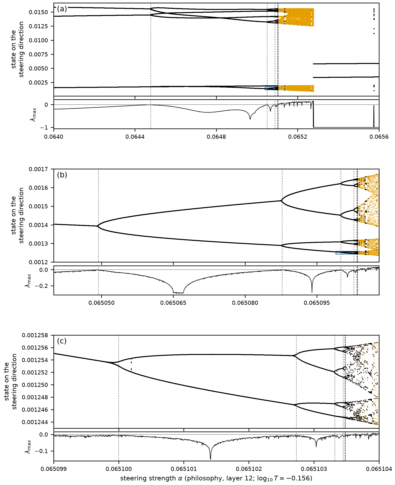
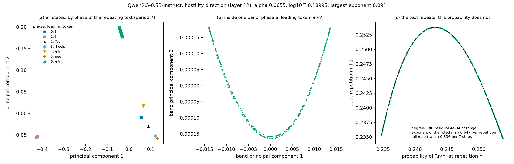
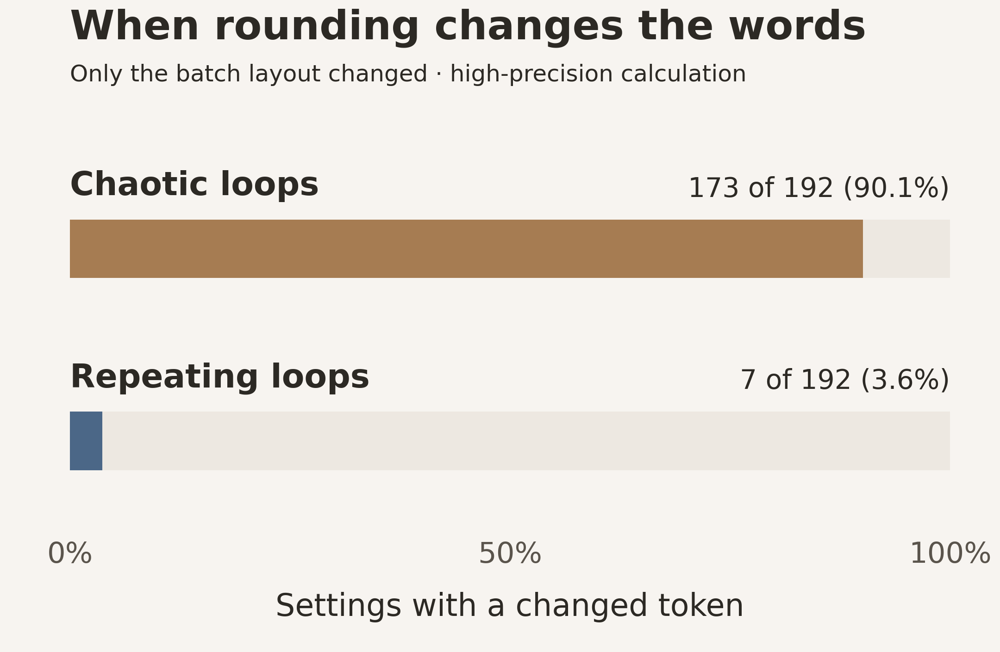
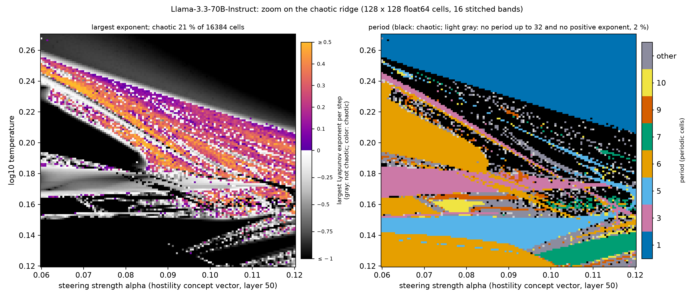


**AI-use disclosure.** Generative-AI tools helped implement, audit, execute,
interpret, visualize, review, and draft this study. The author selected the
research question, authorized the compute, has inspected the artifacts, and is
responsible for the final text and claims. This is an independent,
non-peer-reviewed Research Note. Verify numbers against the released receipts
before relying on them.




The paper in five findings

1. **Chaos and repeating text in one loop.** Fed back a blend of all token
   representations, weighted by its own next-token probabilities, a language
   model becomes a deterministic map. In released Qwen2.5, OLMo-2 and Llama-3
   models from 0.5 to 72 billion parameters, temperature and a steering vector
   move it between repeating text and chaos.
2. **A simple reason it can be chaotic.** One step’s derivative factorizes into
   the inverse temperature, the spread of the next-token probabilities over
   different tokens, and the network’s own derivative. Chaos appears where
   several next tokens compete.
3. **The classical shapes of chaos.** Windows of order crowd toward the point
   where a cycle vanishes, a period-doubling cascade approaches Feigenbaum’s
   constant (4.6688 against 4.6692), and one window has the anatomy of the
   “shrimps” of classical chaos.
4. **Predicted in advance, and proved.** Passage times predicted from the
   model’s own derivatives before the runs matched the measured ones to within
   one lap of the loop in 42 of 48 cases, and interval arithmetic proves
   attracting cycles of the complete network.
5. **Chaos decides reproducibility.** Changing only how requests were batched
   changed the text of 173 of 192 chaotic loops but only 7 of 192 repeating ones.

## Chaos and repeating text in one loop {#chaos-and-repeating-text}

Change two controls, the sampling temperature and a steering push inside the
network, and the same weights either write a fixed loop of text forever or write
text that never settles. Figure 1 of the paper maps that boundary in
Qwen2.5-0.5B, one setting per pixel.

![Figure 1 of the paper: a map over steering strength (horizontal, about 0.0625 to 0.0775) and the base-10 logarithm of temperature (vertical, −0.17 to about −0.125). Gray regions, shaded from dark to light, are settings where the loop repeats a fixed text; purple-to-orange regions are chaotic, colored by the largest Lyapunov exponent on a scale from 0 to about 0.55 per step. A broad dark-gray region fills the left, a fan of thin gray stripes rises through the middle, a gray crescent arcs across, and the lower right is mostly chaotic, with small hooked gray windows.](fig-cross512-clean.png)

<strong>Figure 1 of the paper: chaos and repeating text in one map.</strong> Each pixel is one setting of steering strength (across) and temperature (up) for Qwen2.5-0.5B-Instruct, steered along a philosophy direction at layer 12: 512 × 512 settings, each run in double precision. Colored pixels are chaotic: nearby states separate, at the rate given by the color bar, and no repeating cycle is found. In gray pixels the loop settles into a repeating text, darker where it pulls nearby states together more strongly; 4.4% of the pixels, also gray, are undecided. About 30% of the settings are chaotic, and 74% of a random sample of those stay chaotic for 100,000 steps. <a href="/blog/posts/2026/10/chaos-bifurcations-language-model-feedback/#chaos-with-periodic-windows">The map in detail →</a>

Every gray island is a text. The broad region at the left writes “ is it”
forever. Each thin stripe beside it is a longer loop that adds one more “is …”
pair. The crescent writes a blank line and then “The existence”, paragraph after
paragraph. Between them, the same phrases return in no fixed order: that is the
chaos.



<strong>Chaos you can hear.</strong> At each step, Qwen2.5-0.5B-Instruct reads back the probability-weighted blend of its next-token representations and produces the next one, after a fixed short chat prompt and with a “philosophy” steering vector added at layer 12. At this setting (steering strength 0.07248, temperature 10−0.148) the loop is chaotic: its largest Lyapunov exponent is positive, so nearby states separate exponentially while staying in a bounded region. The cloud shows states from many trajectories, projected onto three principal coordinates of the model’s 896-dimensional state and colored by the most probable next token. The bright dot follows one trajectory for 80 steps, and you hear each token as it is written (⏎ marks a line break the loop writes). The loop is a map, not a flow: each step is one full pass through the network, so the dot jumps rather than glides, and a typical jump spans much of the attractor even in all 896 dimensions. The same words keep coming back (“The existence”, “The question”, “is there”), but never in quite the same order. Computed in double precision; the narration and spoken tokens are synthetic speech. <a href="https://youtu.be/8zS9-ey3PQI">Watch on YouTube →</a>

Turn the steering up slightly, at the same temperature, and the same loop finds
order instead.



<strong>Order you can hear.</strong> Same model, same loop, slightly stronger steering (0.0734 instead of 0.07248, same temperature), and the chaos gives way to order: Qwen2.5-0.5B-Instruct falls onto an attracting cycle of eight states. The bright dot follows one trajectory from its very first step. It wanders among scattered states, then keeps landing on the same eight places, and the words repeat: “. This is there is a is a”. Each color is the most probable next token; ⏎ marks a line break the loop writes. In this run, 509 of 512 starting points reach this same cycle: one reaches a period-16 cycle, one a different period-8 cycle, and one neither. A fast single-precision (float32) run; this cycle has not been separately verified in double precision. The narration and spoken tokens are synthetic speech. <a href="https://youtu.be/7L5MehfrI3g">Watch on YouTube →</a>

### What is actually looping?

An ordinary chatbot adds tokens to a growing conversation. This experiment holds
the prompt fixed and replaces one input slot repeatedly. Instead of feeding back
only the winning token, it feeds back a probability-weighted blend of all token
representations. Temperature controls how concentrated that blend is; steering
nudges an internal activation. No random token is sampled.

That creates a controlled laboratory for continuous feedback. The displayed word
is only the leading candidate. The evolving blend is the state of the system,
and the map it follows is fixed exactly by the model’s stored weights.



<strong>Inside the loop, step by step.</strong> Each step of the loop is one full pass through Qwen2.5-0.5B-Instruct, with a “philosophy” steering vector added at layer 12. In each grid the 24 blocks are the model’s 24 layers, and each tiny dot is one of a layer’s 4,864 MLP neurons: 116,736 neurons in all, colored by their recorded activation at every step (orange positive, blue negative, black silent). Within each layer the neurons keep one fixed order, and colors are scaled per layer so that every layer is visible. At each step a wave runs up the layers (its timing is stylized), the most likely next tokens appear on top, and the state hops to its next point on the attractor drawn beside each grid. <strong>Left, periodic</strong> (steering strength 0.071674, temperature 10−0.115): the loop is on an orbit of period 8, the cycle the paper proves exists, and the same eight activity patterns come back in turn. <strong>Right, chaotic</strong> (0.07248, 10−0.148): the largest Lyapunov exponent is positive, and the pattern keeps changing, with no cycle. You hear a ping for each layer and a bell for each token. Activations recorded in double precision; the narration is synthetic speech. <a href="https://youtu.be/HypewrMDbKU">Watch on YouTube →</a>

## Islands of order take a classical shape {#shrimp}

Nonlinear dynamics has a name for one family of these islands: **shrimps**,
named by Jason Gallas in the parameter plane of the Hénon map, a textbook model
of chaos. One island in the plane of Figure 1, a loop of period 6, has a
shrimp’s anatomy. Its outline is not drawn by eye: it is computed from the
model’s own repeating states, as the curves where the cycle is born or vanishes
and where it doubles its period.

![Two panels. Left: Gallas’s period-1 cell of a textbook map, a gray main cell bounded by a black fold curve and red dashed flip curves, with dotted superstable curves crossing at the head H, and two legs crossing at the lower left in a small blue kite labeled C, A, R and B. Right: the period-6 shrimp of Qwen2.5-0.5B, a gray body on an orange and purple chaotic background over steering strength and temperature, outlined by black fold and red dashed flip curves, with two legs crossing at the lower left near a cyan diamond and a gold star.](fig-shrimp-anatomy-pair-clean.png)

<strong>Order has a shape: Figure 21 of the paper.</strong> Left: Gallas’s canonical shrimp cell, computed from a textbook map. In the gray main cell one state attracts; black fold curves mark where it is born or vanishes, red dashed flip curves where it doubles its period, and two legs cross in the blue kite C–A–R–B, where two attracting states coexist. Right: the period-6 shrimp of Qwen2.5-0.5B-Instruct, a 640 × 640 map about seven times finer than Figure 1 and colored as there, with curves continued from the model itself. As in Gallas’s cell, the fold curve bounds the body above and on the right, flip curves bound it on the left and below, and at the lower left two legs cross in a kite that lies between the crossing of the flip curves (cyan diamond) and a cusp of the fold curve (gold star). Unlike his cell, it has no head, the point H where the dotted curves cross. <a href="/blog/posts/2026/10/chaos-bifurcations-language-model-feedback/#period-6-shrimp">Explore the measured anatomy →</a>

The match is in how the computed boundaries are organized, not a claim that an
896-dimensional model reduces to Gallas’s simple map. Along its body the window
meets the paper’s numerical criteria for a shrimp, and its kite begins at a
located cusp, as in his anatomy.

## Why the loop can be chaotic {#why-chaotic}

The paper’s central formula says where chaos can live. One step of the loop
multiplies a small change of the state by three factors: the inverse
temperature; how widely the next-token probabilities spread over tokens with
different representations; and the derivative of the whole network.

**At high temperature** the first factor is small, and the loop provably
contracts: above an explicit temperature bound, every start ends at the same
state. **At low temperature** one token takes nearly all the probability, the
spread vanishes faster than the inverse temperature grows, and the loop
approaches greedy decoding, whose runs must eventually repeat. **In between**,
where several next tokens compete and the inverse temperature still amplifies
their competition, chaos becomes possible; in four long unsteered sweeps it
appears in one band of temperature per model.

The network is essential too. Remove it from the loop, and the update of
Qwen2.5-0.5B, whose input and output embeddings are shared, becomes that of a
modern Hopfield network, which lowers an energy at every step and so can never
cycle: the transformer is what makes cycles and chaos possible at all. Steering
then acts mainly at the readout: along recorded orbits of that model, the extra
growth it adds comes from wider competition among next tokens, while the
network’s factor changes little.
<a href="/blog/posts/2026/10/chaos-bifurcations-language-model-feedback/#why-the-loop-can-be-chaotic">The derivation and the three tests →</a>

## A classical route to chaos appears in a trained model

A three-step cycle becomes six steps, then twelve, then twenty-four. Each doubling
arrives after a smaller change of the control. Eventually the regular branches
break into chaotic bands. Magnify the cascade and the branching pattern appears
again.

<strong>Three views, progressively closer (Figure 18 of the paper).</strong> Read each panel from left to right as steering increases. A branch splits when the cycle doubles; each lower panel magnifies the branch boxed in the panel above it. These are projections of computed model states, not an illustration of an assumed theory. The thin strips track sensitivity: above zero, nearby states separate on average. <a href="/blog/posts/2026/10/chaos-bifurcations-language-model-feedback/#feigenbaum-ratios">Cascade, ratios and numerical limits →</a>

The agreement is numerical as well as visual. Along the cut followed furthest,
through nine doublings, the ratio of successive doubling intervals reaches
**4.6688**, within 0.008% of Feigenbaum’s constant **4.6692…**, and a second
cascade, in Qwen2.5-1.5B, ends within 0.1% of it. This is evidence consistent
with the quadratic universality class: very different systems approach chaos by
the same scaling rule. The finite cascade reaches the calculation’s precision
limit; it is not a proof of an infinite sequence.



<strong>The cascade in motion.</strong> A bifurcation diagram of the loop of Qwen2.5-0.5B-Instruct along the cut of Figure 18 (temperature fixed at log₁₀T = −0.156), with the steering strength rising from 0.064 to 0.0656 from left to right. At each strength the points are 256 states the loop keeps visiting once it has settled: height is a state’s component along the steering direction, depth its component along a second fixed direction. Orange points are chaotic (no repeat within 48 steps and a positive Lyapunov exponent); white points are not. At each flip, a period-doubling bifurcation in which a real multiplier of the orbit crosses −1, the cycle doubles, 3 → 6 → 12 → 24 → 48 and on, each doubling marked by a chime and a pulse of light; the doublings crowd together where chaos begins, so the view zooms in twice to follow them. The text hardly shows any of this: the first doubled cycles still write a blank line and then “The existence”, two and then four times over; only the probabilities behind them alternate. Of the nine doublings located in double precision, the last from period 768 to 1536, the ratios of successive gaps run 3.124, 4.4988, 4.6208, 4.6618, 4.6673 and 4.6688, the last within 0.008% of Feigenbaum’s δ = 4.6692…; the first, 14.93, depends on where this line of settings crosses the crescent. Precision stops the sequence there: the multiplier that decides whether the period-384 cycle is stable is a product of 384 steps of the model’s derivative, at the limit of double precision. The clip ends on the paper’s Figure 18. The narration is synthetic speech. <a href="https://youtu.be/rbI37jVjxAc">Watch on YouTube →</a>

## Predicted in advance, and in places proved {#predicted-and-proved}

Where a repeating loop disappears, it leaves a ghost. At a fold, the loop and an
unstable partner meet and vanish together; just past it, trajectories still
crawl through the narrow channel where the loop used to be before they escape.
The thin stripes of Figure 1 line up on such a ghost: their texts suggest that
each longer stripe makes one more pass through the channel, and the stripes
crowd toward the fold as 1/N², the signature of this bottleneck in simple maps.

The model’s own derivatives turn that picture into numbers. Two coefficients
computed at a fold predict how long a trajectory lingers in its channel. At four
new folds the forecasts were written down before the test runs, in two stages,
and the passage times they predicted matched the measured ones to within one lap
of the vanished loop in **42 of 48 cases**. The six misses, all at one period-6
fold, were 3.1 to 5.2% short, and both stages’ strict all-or-nothing criteria
failed; the paper reports them beside the successes.
<a href="/blog/posts/2026/10/chaos-bifurcations-language-model-feedback/#passage-times-predicted-in-advance">Forecasts and tests →</a>

Some results go beyond simulation. With interval arithmetic, which carries every
number as a range guaranteed to contain the true value, computer proofs show
that the complete model, all 24 layers and its full 151,936-token vocabulary,
has an attracting cycle of period 8, and that at one setting two attracting
cycles, of periods 2 and 3, coexist: the same model under the same settings has
two different stable behaviors. The proofs certify these cycles, not the chaos
around them.
<a href="/blog/posts/2026/10/chaos-bifurcations-language-model-feedback/#proof">The proofs →</a>

## The words can repeat while the state remains chaotic

At one measured setting, the displayed words repeat the same **seven-token
pattern for all 2,000 recorded steps**. Yet the probabilities keep changing and
nearby states separate. Watching the transcript alone would miss the chaos.

<strong>The transcript hides the motion (Figure 19 of the paper).</strong> Left: seven clouds correspond to the seven positions in the repeating text. Middle: one cloud resolves into a curved band. Right: successive probabilities form a single-humped <em>return map</em>, showing structure in the irregular motion. This is the strongest case in the reported search, not a typical chatbot response; the fitted curve is empirical. <a href="/blog/posts/2026/10/chaos-bifurcations-language-model-feedback/#chaos-behind-a-repeating-text">Evidence and selection →</a>

It is not a single curiosity: along the same temperature line, 65 of the 182
chaotic settings write a text that repeats exactly at every one of 2,000 steps.
**Counting repeated words is not the same as measuring the model’s dynamics.**

## Chaos decides whether a run can be reproduced {#reproducibility}

GPU kernels add numbers in different orders for different matrix shapes, so a
request’s result can depend on which other requests share its batch. Whether
that tiny rounding difference matters depends on the regime. In a high-precision
test, changing only how requests were batched changed at least one displayed
token in **173 of 192 chaotic settings**, compared with **7 of 192 periodic settings**,
over the final 500 steps of 1,500-step runs. Along a chaotic run the feedback
amplifies the difference, at about the rate its Lyapunov exponent sets; near a
repeating cycle it damps it out.

<strong>When rounding changes the words.</strong> Settings of Qwen2.5-0.5B with at least one changed token after only the batch layout changed, in double precision. With the matrix shapes held fixed, the reruns were bitwise identical; in bfloat16, a common serving precision, nearly all runs parted within a step or two, repeating ones included. <a href="/blog/posts/2026/10/chaos-bifurcations-language-model-feedback/#batch-measurement">Batching experiment and controls →</a>

The same feedback can carry such differences into answers, mainly where a
pipeline answers poorly or its reasoning runs out of budget. With Soft Thinking
at its published settings, the batch layout alone changed the answers to 21% of
256 math problems in Qwen2.5-7B.

## The landscape survives at much larger scale

The detailed orbit analysis centers on small Qwen models, but chaos threaded by
periodic windows appears across families and sizes. Without steering,
temperature alone produces it in eleven of fourteen dense models swept. Steering
widens the chaotic regions, and not because of the concept it encodes: random
directions of the same strength do it too, and turning the direction moves the
chaos around while its share of the plane stays between about 13 and 24%.



<strong>The chaos moves; its share holds.</strong> Depending on two dials, the strength of a steering vector and the sampling temperature, the loop settles into a fixed point, falls into a repeating cycle, or turns chaotic. Each frame is a map of that two-dial plane for Qwen2.5-0.5B-Instruct after a fixed short chat prompt: 296 × 512 settings, with steering strength from −0.12 to 0.12 and temperature from 10−0.45 to 100.3. The height and color of each block show the largest Lyapunov exponent: red, tall blocks are where nearby states fly apart (chaos); blue, low blocks are where the loop settles down. During the video the steering vector added at layer 12 rotates at constant length from one random direction to another, through 90 degrees. The chaotic regions drift, split and merge, but the chaotic share of the plane stays between 12.9 and 23.8% at every one of the 120 measured angles. These are fast single-precision (float32) maps with exponents from 80 measured steps, coarser than the paper’s double-precision maps. Each map continues from the final states of the previous angle, so it can jump where two attractors coexist, and frames between measured angles blend their two neighbors. The paper’s Figure 9 shows six of these angles; code and data are at <a href="https://github.com/tdj28/neural-shrimp">github.com/tdj28/neural-shrimp</a>. <a href="https://youtu.be/-VCSiNFnP2c">Watch on YouTube →</a>

The same organization holds at much larger scale. Below is a steered
**70-billion-parameter Llama model** in the same feedback experiment.

<strong>Seventy billion parameters, still an organized landscape (Figure 11 of the paper).</strong> Both panels show the same settings of Llama-3.3-70B-Instruct, steered along a hostility direction at layer 50. Left: color marks measured chaos, in 20.8% of the 128 × 128 settings. Right: black marks chaos and colors distinguish repeating cycle lengths. Thin periodic windows cut through the chaotic band. The scan uses double precision; its labels are finite-horizon measurements. <a href="/blog/posts/2026/10/chaos-bifurcations-language-model-feedback/#other-families-other-sizes">Model, precision and checks →</a>

Size alone does not remove the chaos. Larger Qwen2.5 and Llama-3 models damp a
change of the fed-back token more strongly, though not strictly with size and
not in OLMo-2. Yet in a test fixed in advance, Qwen2.5-14B was chaotic at more
temperatures than Qwen2.5-7B on all eight test prompts, and steering drives both
70B-class models we steered into chaos.

## Two coupled loops lock together where theory predicts {#coupled-loops}

The loop’s prompt tells the model it is talking with another AI, and the simplest
dynamical version of that is two copies of the loop. At every step each copy reads
a mix of its own soft token and the other’s, with one dial, the coupling c, setting
the share: at c = 0 the copies run independently, and at c = 1/2 both receive the
same input. The theory of coupled chaotic maps predicts, from the single loop’s
largest Lyapunov exponent λ₁ alone, that a small difference between the copies
grows at the rate λ₁ + ln|1 − 2c| per step, and so the coupling above which the
copies lock together. In the paper, the measured rate followed that prediction at
every coupling tried, within 0.051 per step; whether a given pair actually locks
also depends on how long it runs, how small a difference counts as none, where it
starts and which attractor it reaches.



<strong>Two loops that lock together.</strong> Both copies run Qwen2.5-0.5B-Instruct at one chaotic setting (“philosophy” steering at layer 12, strength 0.07484, temperature 10−0.1226), where a single loop’s largest Lyapunov exponent is λ₁ = 0.437 per step, so synchronization is predicted to be stable from c* = (1 − e−λ₁)/2 ≈ 0.177 up to 1 − c* ≈ 0.823. Copy A (gold, left) and copy B (cyan, right) move over the same attractor. At the top are the dial and a log gauge of their measured difference, whose two marks merge into one white mark below 10−8, the paper’s criterion for synchronization; at the bottom is the predicted growth rate. You hear each copy’s next word, A on the left and B on the right; a soft beep is a line break. At c = 0 each copy writes its own text. At 0.03 the pair falls into a joint six-step cycle, B writing A’s words three steps later, like a round. At 0.17, just below c*, the copies write the same words for 15 steps, yet their difference swings between about 10−4 and 0.1: they do not lock. At 0.25 they are synchronized, the difference below 10−10; at 0.5 it is zero; at 0.9, past 1 − c*, they are apart again (the paper tested couplings up to 0.30; this run illustrates the symmetry it states). The clip ends on the paper’s Figure 27. These are new double-precision runs of the paper’s setup, whose regimes match the paper’s; the narration and spoken words are synthetic speech. <a href="https://youtu.be/hKYShgPhkgU">Watch on YouTube →</a>

## A way to study feedback, not a claim that chaos is intelligence

The common thread is that repeated computation has an organization of its own.
Its boundaries can be followed, selected cycles can be proved, and some of its
behavior can be predicted before it is measured. These are specific, measurable
properties of feedback, not metaphors for thought.

The scope is deliberate. The loop holds the prompt fixed and feeds back
continuous blends; ordinary chatbot generation, which samples tokens into a
growing conversation, is a different system, and the maps do **not** establish
that it shares this geometry. Chaos labels come from finite runs, and the proofs
cover selected cycles. The study tested no safety property, and it found no sign
that the loop’s regime marks the accuracy of ordinary answers.

What begins as an intricate island in a map leads to a sharper way of asking why
an AI loop repeats, changes, or fails: follow the evolving state, measure what it
amplifies, and test the predictions against what the model actually does.

The full video



<strong>Chaos and bifurcations in continuous language-model feedback</strong> (17 min). <a href="https://youtu.be/1PsNrk1nqmE">Watch on YouTube →</a>

The complete investigation

<a href="https://arxiv.org/abs/2610.31692">Read the paper on arXiv →</a> <a href="/blog/posts/2026/10/chaos-bifurcations-language-model-feedback/">Read the full research note →</a>

The research note adds the methods, checks, failed predictions and numerical audits behind every result, the steering controls, the size study and a later memory experiment. <a href="revision-20261025.receipt.json">This revision’s figure and claim sources</a> · <a href="provenance.json">Original figure provenance</a>


