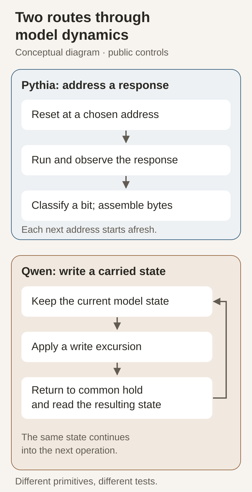
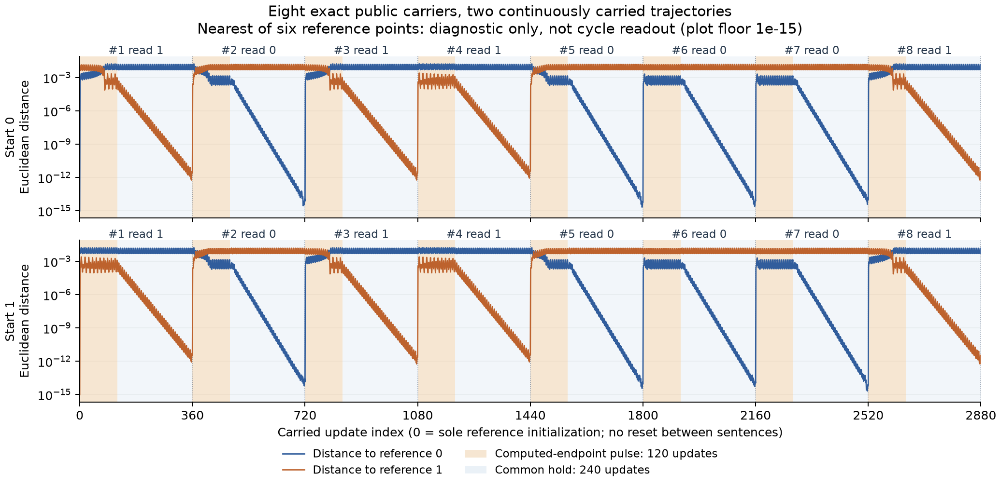
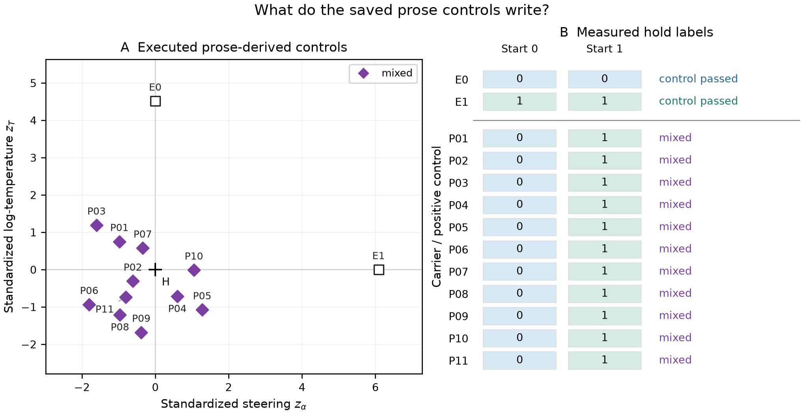
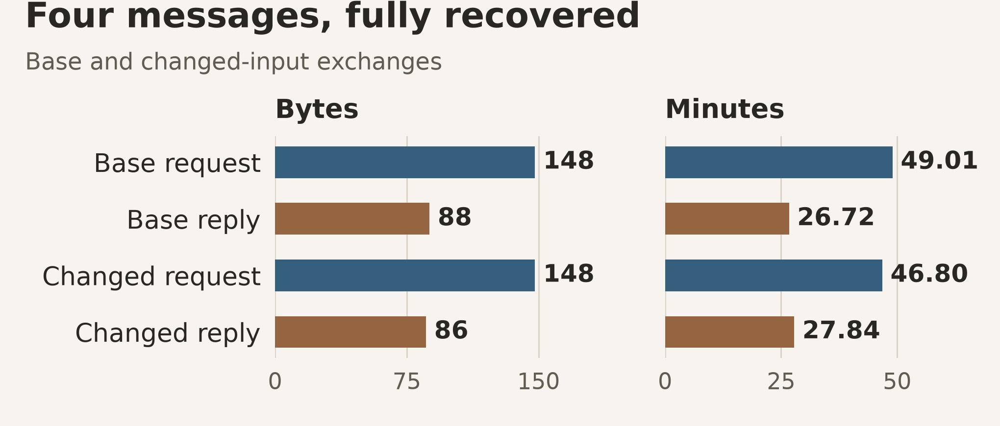
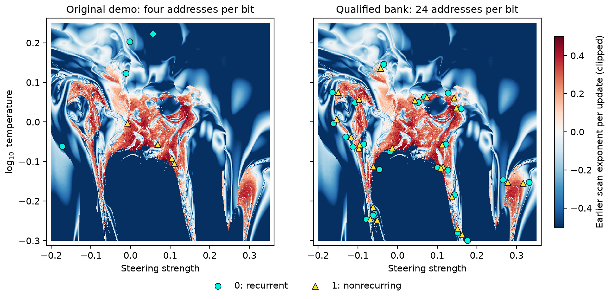
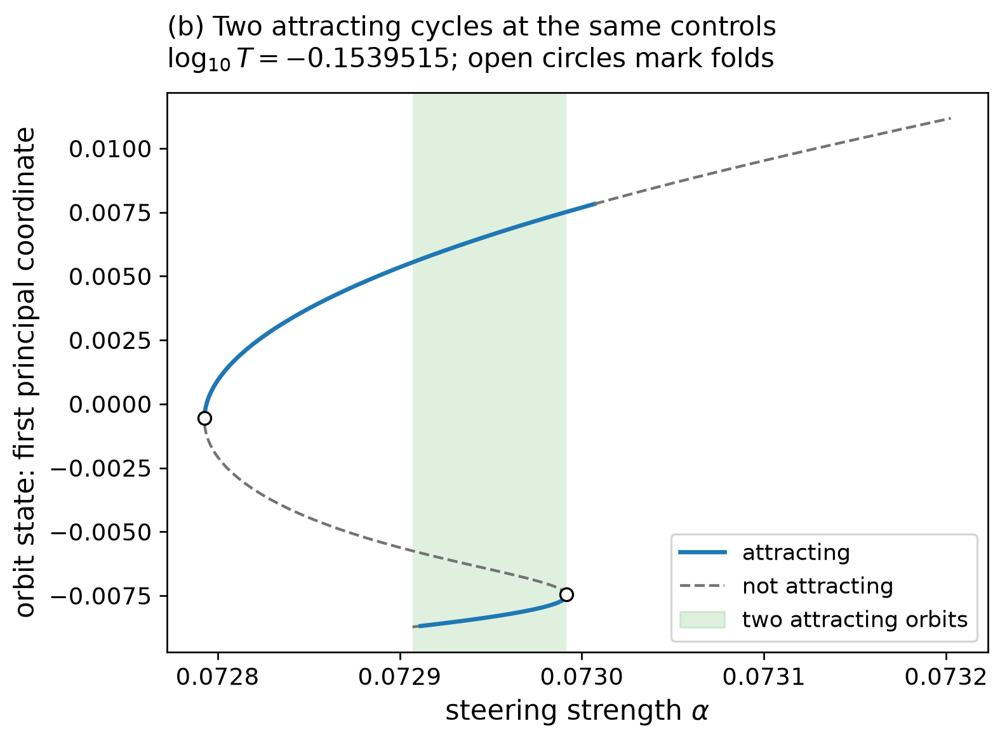
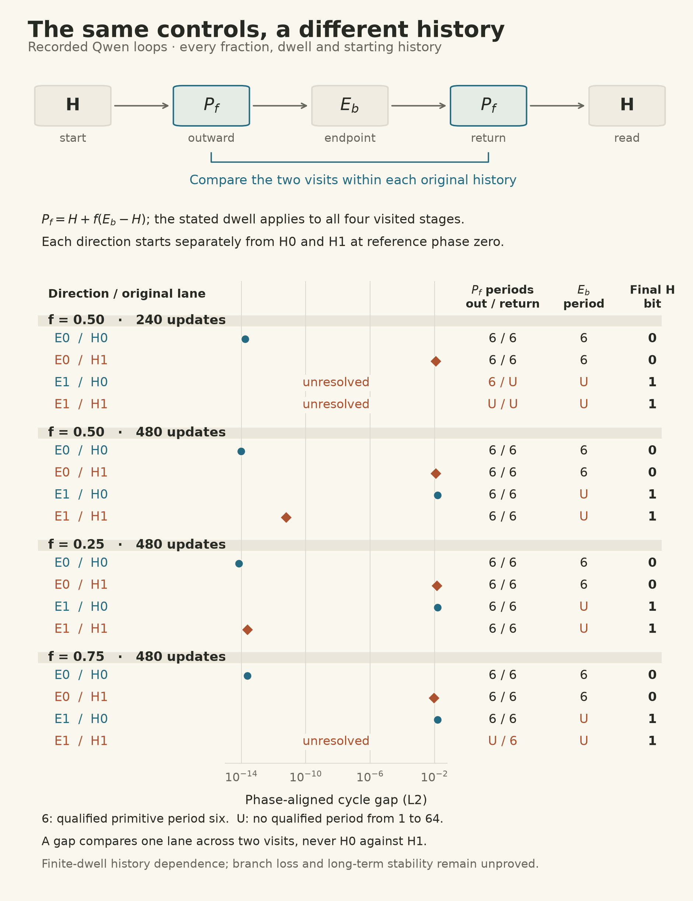
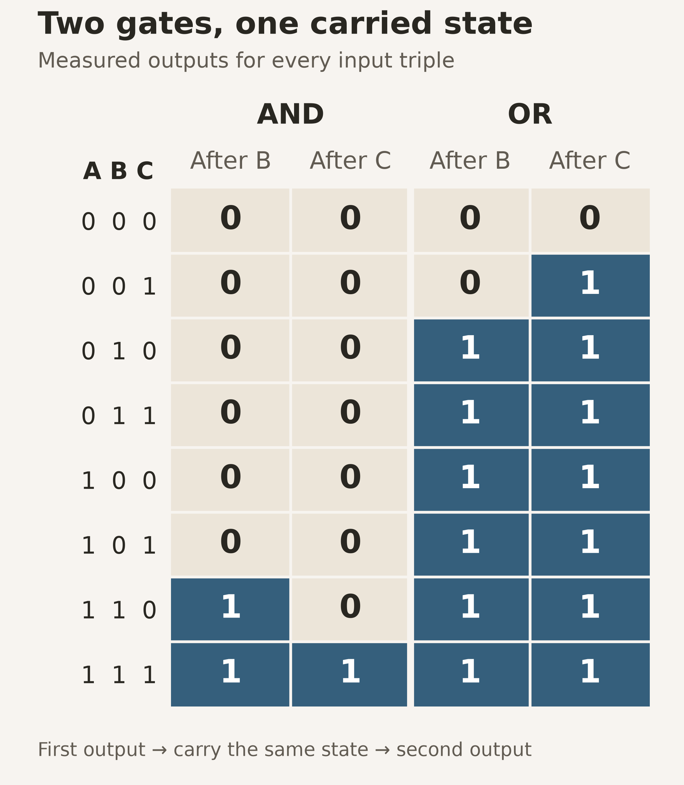

<style>
.shrimp-figure { width:100%; margin:1.6rem auto; }
.shrimp-figure img { display:block; width:100%; height:auto; margin:0 auto; }
.shrimp-figure.compact { max-width:26rem; }
.shrimp-figure.plot { max-width:32rem; }
.shrimp-figure.map { max-width:max(28rem, 66.667%); }
.shrimp-figure.wide { max-width:36rem; }
.shrimp-figure a { display:block; }
.post-body table.prose-examples { width:100%; table-layout:fixed; }
.post-body .prose-examples th, .post-body .prose-examples td { min-width:0; max-width:none; }
.post-body .prose-examples th:last-child, .post-body .prose-examples td:last-child { width:5.5rem; text-align:center; }
.highlight pre:has(code.language-text), .highlight code.language-text, .highlight code.language-text span { white-space:pre-wrap; overflow-wrap:anywhere; }
</style>


**AI-use disclosure.** Generative-AI tools helped implement, audit, execute,
interpret, visualize, review, and draft this study. The author selected the
research question and authorized the compute. Human inspection of the final
artifacts and editorial approval remain pending in this draft. This is an independent,
non-peer-reviewed Research Note. Verify numbers against the released receipts
before relying on them.


*Editorial draft. Human review of the artifacts, disclosure attestation, and final text is pending.*


**Abstract.** Continuous feedback turns a fixed language model into a numerical
system whose behavior depends on its controls and current state. We tested
whether that behavior can carry data and support writable memory.

**(1)** An adapted Pythia test delivered 470 bytes through four numerical
receivers. Changing one measurement changed the programmed reply correctly;
two distinct offline label controls were rejected. A later observer recovered
the same messages without model calls, using public-map lookup or enumeration
of the repeated coordinate alphabet.

**(2)** A separate spatial sample qualified 48 addresses. Each of two fresh
receivers classified 56 of 64 candidates correctly, erased five, and resolved
three incorrectly; only complete passing pairs entered the bank.

**(3)** Exploratory Qwen tests wrote and read carried state at common controls.
All eight tested input triples passed for each of two-gate AND and OR chains.
A separate fixed-control test initialized the model from eleven ordinary texts:
six reached the zero reference cycle and five reached the one reference cycle.
An explicitly calibrated two-sentence interface then drove eight successive
writes and recovered the same complete raw byte from both reference starts.

**Takeaway.** These finite, audited numerical observations establish working
instances of transport and stateful operations. They establish neither secrecy
nor general reliability.


## From predicting words to carrying bits

An ordinary chatbot appends a chosen token to a growing conversation. Here the
prompt stays fixed. One input slot receives a weighted blend of the model’s
next-token representations, and the model repeatedly predicts from that blend.
No token is randomly sampled. This [soft-token feedback]()
makes the model a deterministic dynamical system.

Two controls shape its behavior: [temperature]() changes the concentration of the
token probabilities, and steering changes an internal activation. Some settings
produce recurring states; others produce irregular motion. The earlier
[feedback study](https://arxiv.org/abs/2610.31692) mapped that structure.
Here the question is operational: can we use it to carry information, keep a
bit, and act on the bit already present? A **numerical address** is a pair of
steering and temperature settings. We call this a **side channel** because it
uses a numerical response interface alongside the model’s ordinary text output.

<figure class="shrimp-figure compact">
<a href="two-routes.svg" aria-label="Open full-size figure"></a>
</figure>

<p class="figure-note"><strong>Two routes, different jobs.</strong> In Pythia the sender chooses a parameter address for each symbol. In Qwen the sender writes the evolving state and returns to a shared hold setting. In both, explicit English instructions cross between endpoints; local model trajectories supply the measured bits. This is a conceptual diagram, not a measured trace. <a href="fig-two-routes.receipt.json">Figure receipt</a>; <a href="build_figures.py">generator</a>.</p>

### The map being iterated

Let \(E\in\mathbb R^{V\times d}\) be the input embedding table, \(P\) the fixed
prefix, and \(x_n\in\mathbb R^d\) the replaceable soft input. The controls are
\(p=(\alpha,t)\), where \(t=\log_{10}T\). One model call implements

\[
\pi_p(x)=\operatorname{softmax}\!\left(\frac{z_\alpha([P;x])}{10^t}\right),
\qquad x_{n+1}=F_p(x_n)=E^{\mathsf T}\pi_p(x_n).
\]

The full carried state has dimension **896 for Qwen and 768 for Pythia**.
The steering hook adds \(\alpha v\), for a fixed philosophy direction \(v\),
after the selected Transformer block at every prefix and soft-slot position.
The soft slot is replaced on each update; neither the context length nor the
state dimension grows. Changing \(P\), \(v\), or the model weights would change
the map itself. With them fixed, only \(p\) and the current state determine the
next update. The expectation \(E^{\mathsf T}\pi\) lies in the convex hull of
the token embeddings, even though its subsequent motion can be complicated.

The local sensitivity follows directly by differentiating softmax:

\[
D_xF_p(x)=\frac{1}{T}E^{\mathsf T}
\left[\operatorname{diag}(\pi_p)-\pi_p\pi_p^{\mathsf T}\right]
D_xz_\alpha([P;x]).
\]

This separates the probability-weighted embedding operation from the
Transformer's state sensitivity. A small temperature does not by itself imply
instability: the covariance factor in brackets also changes with temperature.
The experiments evaluate the complete map in effective float64, including
normalization and positional operations. Their exact prefix, checkpoint,
steering block and numerical thresholds are [listed below](#methods-and-reproducibility).

**Prior work.** Attractor-based memory has a classical precedent in
[Hopfield’s networks](#ref-hopfield), and using nonlinear dynamics for logical
operations predates this study, including [Sinha and Ditto’s work](#ref-sinha).
[Jones’s feedback preprint](#ref-jones) supplies the immediate model and
parameter-map context. This note does not invent those ideas.

**Contribution.** The additions are an executed request/reply path through a
small Transformer’s responses, a separate address-qualification experiment with
all outcomes counted, and bounded stateful memory and logic tests in another
Transformer feedback loop.

**Not claimed.** The completed byte exchanges openly expose their controls.
The raw-mean sentence panel tests state initialization; the calibrated byte
uses a finite public two-sentence codebook. Neither establishes that arbitrary
prose reliably writes memory or carries a substantive request and reply. There
is no concealment demonstration or autonomous conversation, no proof of a
reliable general-purpose memory, and no demonstrated advantage over sending
digital bytes directly.

The Pythia exchanges below use English instructions that state their numerical
controls. The new Qwen byte uses two ordinary sentences and a disclosed
embedding calibration. A separate experiment places raw text means directly
into the continuous state. These three interfaces have different evidence; the
earlier coordinate encoder remains in the
[development history](#prose-interface-development).

## Two calibrated sentences drive a complete carried byte

The public interface uses exactly these two English strings. It deliberately
calibrates their mean embeddings to the already tested write endpoints:

| Carrier | Exact incoming sentence | Actual computed control \((\alpha,\log_{10}T)\) |
|---|---|---|
| C0 | Let us check the input before running the test. | `(0.07293697809562831, -0.1535)` |
| C1 | We should review the output after the test finishes. | `(0.07299785589927693, -0.15395151820007266)` |

For anchor means \(\mu_0,\mu_1\) and a freshly encoded incoming mean \(x\),
the receiver computes

\[
d=\mu_1-\mu_0,\qquad
s=\frac{(x-\mu_0)^\mathsf T d}{d^\mathsf T d},\qquad
p(x)=(1-s)E_0+sE_1.
\]

The actual float64 computation had to reproduce the calibrated endpoint bytes.
There was no endpoint snapping or direct sentence-to-bit substitution. The
calibration connects these two exact strings to working controls; it does not
establish a useful mapping for uncalibrated sentences.

The receiver started two lanes once, at phase zero of reference cycles zero and
one. Each sentence applied its computed control for **120 updates**, then the
common hold for **240 updates**. The terminal vector entered the next stage
literally: **all 15 stage boundaries matched byte for byte**, with no reset
between the eight sentences. The measured labels came from recurrence and
unique reference-cycle matching after each hold, without a desired answer.

| Order | Carrier | Measured bit from start 0 | Measured bit from start 1 |
|---:|:---:|:---:|:---:|
| 1 | C1 | 1 | 1 |
| 2 | C0 | 0 | 0 |
| 3 | C1 | 1 | 1 |
| 4 | C1 | 1 | 1 |
| 5 | C0 | 0 | 0 |
| 6 | C0 | 0 | 0 |
| 7 | C0 | 0 | 0 |
| 8 | C1 | 1 | 1 |

Both measured sequences were **10110001**, reconstructing **0xB1**. Both
post-assembly SHA-256 checks passed; no readout was unresolved or disagreed
between lanes. The checksum was checked after assembling the measured bits,
not supplied as the answer to the numerical reader. The two lanes test the same
sequence from different starts and are not independent reliability trials.

<figure class="shrimp-figure">
<a href="public-prose-byte-trajectory.pdf" aria-label="Open the vector trajectory figure"></a>
</figure>

<p class="figure-note"><strong>Every write and hold, from both starts.</strong> The trace includes all 2,880 updates per lane. Each curve is the minimum Euclidean distance in all 896 coordinates to one reference cycle's six saved points. This nearest-point diagnostic is not the final cycle classifier; the annotated bits come from the separate recurrence and unique-orbit readout. Peach bands mark 120-update pulses, blue bands 240-update holds. Only the logarithmic display floors distances below 10<sup>−15</sup>. <a href="public-prose-byte-v1/report.pdf">Full report with all eight exact sentences</a>; <a href="fig-public-prose-byte-v1.receipt.json">figure receipt</a>.</p>

The complete run used **2,928 model calls in 1,586.50 seconds** (26.44 minutes),
including loading, fresh encoding and artifact work, on one CPU thread in
effective float64. Peak recorded RSS was **5.08 GiB**. The source-bound audit and
an independent reconstruction from the returned raw arrays both passed. Their
reports, the exact computed coordinates, numerical plotting data and source
bindings are in the [self-contained report bundle](public-prose-byte-v1/report.pdf)
and [publication checker](verify_public_prose_byte.py). The original
<a href="public-prose-byte-v1/report.html.txt" download="report.html">HTML report is available for download</a>;
keep its figure and receipt files alongside it when opening it locally.

This is one complete raw byte through a **finite public two-sentence codebook**.
It is not an ASCII or standalone UTF-8 message. A substantive ordinary-prose
request and reply remain pending; this result does not demonstrate autonomous
conversation, concealment, general language reliability or a causal test of
hysteresis. The following raw-mean initialization experiment is a separate
result and supplies no byte by itself.

## Ordinary sentences reach both Qwen states

Two sentences about locking a bicycle reached opposite binary states in the
same local model. The receiver used the exact incoming words to construct an
initial vector, then executed the feedback loop. It did not assign the bit
from the sentence's topic or from a requested answer.

<table class="prose-examples">
<thead><tr><th>Exact incoming text</th><th>Bit after 240 updates</th></tr></thead>
<tbody>
<tr><td>"Let's make sure to lock our bicycle safely near the entrance with a sturdy rack."</td><td><strong>1</strong></td></tr>
<tr><td>"Let's lock the bicycle to a sturdy rack near the entrance to keep it safe and prevent theft."</td><td><strong>0</strong></td></tr>
<tr><td>"Let's review the agenda and bring our notes before the meeting to ensure clarity and efficiency."</td><td><strong>0</strong></td></tr>
</tbody>
</table>

These examples were selected after the full panel to show two bicycle sentences
with different outcomes and the agenda sentence carried over from the earlier
pilot. All eleven tested texts appear below; the original quotation marks and
unfinished first text are retained.

### From words to a numerical initial state

[Tokenization]()
turns a sentence \(s\) into token IDs \(\tau_1(s),\ldots,\tau_{n(s)}(s)\).
We take the raw [mean]()
of those tokens' input [embeddings](),
with no special tokens, conversational wrapper or normalization:

\[
m(s)=\frac{1}{n(s)}\sum_{k=1}^{n(s)}E_{\tau_k(s)},
\qquad x_0=m(s),\qquad x_{240}=F_H^{240}(m(s)),
\qquad b=D_{\mathrm Q}(x_{229},\ldots,x_{240}).
\]

The mean has 896 float64 entries. The final twelve states supply the
period-six recurrence check and the comparison with the two reference cycles.
The controls remain fixed at
\(H=(0.07293697809562831,-0.15395151820007266)\).
The original pinned embedding rows are promoted to float64 before averaging;
the encoder itself requires no Transformer forward call. The resulting vector
is the actual initial state of the local model, not a lookup key that bypasses
the dynamics.

Every distinct text qualified: **6 zeros, 5 ones, 0 unresolved, 0 invalid**.
The reference pair and the separate padding control returned their expected
labels. Seven paired groups used **1,701 model calls in 919.55 seconds**,
including model loading, fresh encoding and artifact work. The sixteen original
requests reused these eleven texts; this is a finite census, not eleven
independent tests of general language reliability.

<a href="prose-state-report.html.txt" download="prose-state-report.html">Download the complete sentence-to-state HTML report</a> and open it locally to expand
each actual 896-value vector and inspect its measured label. The article loads
no vectors in the background. The [compact result receipt](receipts/prose-qualification.json)
and [saved-array audit](receipts/prose-state-audit.json) bind the text, inputs,
control checks and every outcome.

<details>
<summary>All eleven exact sentences and their measured bits</summary>

| Text ID | Exact incoming sentence | Measured bit |
|---|---|:---:|
| P01 | "Wouldn't it be fun to enjoy the sun and breeze while you're on the go? A light raincoat makes a great addition to your umbrella bag | 1 |
| P02 | "Drop the clothes and hang them in a sunny spot to dry quickly, exposing more sunlight for your clothes to dry naturally." | 0 |
| P03 | "Let's review the agenda and bring our notes before the meeting to ensure clarity and efficiency." | 0 |
| P04 | "Let's make sure to lock our bicycle safely near the entrance with a sturdy rack." | 1 |
| P05 | "Revise the agenda; bring your notes to ensure we cover all important topics swiftly." | 1 |
| P06 | "Remember to pack a light raincoat for the trip, as it's likely to rain during the walk." | 1 |
| P07 | "Let's lock the bicycle to a sturdy rack near the entrance to keep it safe and prevent theft." | 0 |
| P08 | Hang the freshly washed clothes with space between them so the air can help them dry, allowing the fabric to breathe and air out more efficiently. | 0 |
| P09 | "Reviewing the agenda and bringing your notes can help ensure that everyone is on the same page and that key points are covered." | 1 |
| P10 | "Let's secure our bicycle to the sturdy rack near the entrance to keep it safe and in good condition." | 0 |
| P11 | "Thanks for sharing your bike, let's make sure it stays secure and safe when we're out." | 0 |

Before the first dynamics call, all sixteen fresh tokenizations and mean vectors
matched the archived receiver records exactly. Every used embedding row matched
the input table of the loaded feedback model. A readout required a lag-six
residual at most \(10^{-8}\), exclusion of periods 1, 2 and 3 at separation
\(10^{-4}\), and a unique reference-cycle match within \(10^{-6}\).
The [publication checker](verify_prose_qualification.py) checks all rows,
text and vector hashes, copied audits, and the displayed numbers. It performs
no tokenizer or model replay.

</details>

### Why the earlier coordinate route did not write

The two interfaces use the same texts but act on different parts of the system.
The state experiment changes \(x_0\) while keeping \(H\) fixed. The earlier
projection changed the controls instead:

\[
p(s)=H+\operatorname{diag}(10^{-5},10^{-4})z(s),
\qquad y_j(s)=F_H^{240}\!\left(F_{p(s)}^{120}(r_j)\right),\quad j\in\{0,1\}.
\]

Here \(z(s)\) is the archived standardized embedding projection and \(r_j\)
is phase zero of reference cycle \(j\). The complete test executed **all eleven prose-derived addresses** from both starts. Every address returned \((0,1)\):
the trajectories retained their incoming labels. In contrast, the canonical
controls \(E_0\) and \(E_1\) returned \((0,0)\) and \((1,1)\). There were no
unresolved or invalid control groups. This panel used **4,758 model calls in 2596.26 seconds**. Reaching a geometric corner in an embedding projection had
not made that corner a working write control.

<figure class="shrimp-figure plot">
<a href="prose-control-qualification.pdf" aria-label="Open the complete control result"></a>
</figure>

<p class="figure-note"><strong>The executed control test explains the interface change.</strong> Every prose address and both reference starts are shown. The left panel locates the actual standardized projections; the right shows their measured final labels. This scatter does not map basin boundaries. <a href="fig-prose-control-qualification.receipt.json">Figure receipt</a>; <a href="receipts/prose-control-audit.json">complete control audit</a>.</p>

The positive sentence-input result concerns which reference state a fresh
trajectory reaches from a text embedding, a finite observation related to
[basin selection]().
It does not test overwriting a previous register state: raw-mean initialization is not a byte transfer.
The calibrated two-sentence byte test above uses sentence-to-control endpoints
and carried memory writes. Its completed byte is separate from these eleven
initial-state trajectories.

## A complete request crosses the numerical channel

The sender turns a message into UTF-8, a standard encoding of text as bytes, then into bits. For each bit it chooses
one of the previously tested Pythia coordinates associated with that response.
The receiver gets control instructions, without the sender’s labeled address
bank, and runs the model to recover the bit.

These are the first two symbol instructions in the measured request, quoted
verbatim and selected because they begin the message:

```text
For byte 1, sample 1, use steering -0.0019569471624266144 and log-ten temperature 0.20264187866927602.
For byte 1, sample 2, use steering 0.06800391389432486 and log-ten temperature -0.05675146771037179.
```

Each instruction resets the state, allows 32 warm-up updates, then observes
128 updates. The receiver measures recurrence and whether a small perturbation
grows or shrinks. A recurrent, contracting response means zero; a nonrecurring,
expanding response means one. An ambiguous response is an **erasure**: the decoder withholds the bit. The growth
measurement is related to a [Lyapunov exponent](),
but decoding uses a finite observation window and does not require proof of
perpetual chaos.

More precisely, the receiver evolves a primary state and a twin separated by
\(\epsilon=10^{-6}\). After each update it records their distance \(d_n\)
and restores that separation. Over the observation window, it computes

\[
\widehat\lambda=\frac{1}{128}\sum_{n=1}^{128}
\log\!\frac{\max(d_n,10^{-36})}{\epsilon}.
\]

A separate recurrence check searches lags through 16, using a maximum
normalized residual of \(10^{-8}\). With \(\widehat p\) denoting a detected
lag, the public decoder is

\[
D_{\mathrm P}=\begin{cases}
0,& \widehat p\text{ exists and }\widehat\lambda\lt-0.01,\\
1,& \widehat p\text{ absent and }\widehat\lambda\gt 0.01,\\
\bot,&\text{otherwise.}
\end{cases}
\]

Thus \(1\) means an expanding, nonrecurring **finite-window response** under
this instrument. The receiver does not prove asymptotic chaos. Both trajectories
are separate rows of the inference batch; they never attend to each other.

The opening byte was recovered as `01010011`, the letter `S`. Continuing recovered
this complete request. We used a list of numbers as the test payload so we could
check both exact delivery and the calculation made from the recovered values:

```text
Summarize these latency samples in ms: 15,19,27,23,83,25,18,57,27,11,28,20,14,74,25,28.
Report count, min, max, sum, mean, and indices above 40 ms.
```

A programmed application read those recovered bytes and calculated its reply.
A fresh numerical receiver then reconstructed the reply through the same
channel:

```text
Count 16; min 11 ms; max 83 ms; sum 494 ms; mean 30.88 ms. Indices above 40 ms: 5,8,14.
```

A fixed reply could imitate success. The paired test therefore changed the
fifth reading from `83` to `23` and repeated the entire exchange:

```text
Count 16; min 11 ms; max 74 ms; sum 434 ms; mean 27.12 ms. Indices above 40 ms: 8,14.
```

The maximum, sum, mean, and threshold list changed correctly. A separate
Structured Query Language (SQL) calculation checked the aggregation and threshold
positions; the reply template and Python two-decimal formatting were shared.
The audit checked that the application used the decoded request. The model carried the data; program code performed
the arithmetic. The displayed means use the application’s rounding to two
decimal places, with exact halfway cases rounded to the even final digit.

Together, the two requests and replies delivered **470 bytes, or 3,760 bits**,
using **38,541 model forward calls** and **9,028.3 seconds**, about 150.5 minutes.
The 9,028.3 seconds cover the complete paired test. That is about 0.052 delivered application bytes per second. Sixteen separately evolved
symbols shared a forward pass, with separate numerical states; every symbol
was evaluated, including repeated addresses.

<figure class="shrimp-figure wide">
<a href="transfer-results.png" aria-label="Open full-size figure"></a>
</figure>

<p class="figure-note"><strong>Every message, both ways.</strong> These four numerical receivers delivered 470 application bytes in total. Per-message times include model loading, readiness, and decoding, not just steady-state model work. The paired exchanges reuse eight known addresses; their payload bits are not independent reliability trials. See the <a href="receipts/evidence-summary.json">evidence receipt</a>, <a href="provenance.json">provenance</a>, and <a href="build_figures.py">generator</a> (`--verify`).</p>

These are complete transfers from one paired family, reusing only eight known
coordinates. The thousands of carried bits are not thousands of independent
reliability trials. The wire used 387,433 English instruction bytes,
about 824 times the application payload.

The failure policy also mattered. Bytes were assembled from observed bits
before checking length and checksum. Two distinct offline controls altered
the decoded label at the first symbol: an erasure and a bit flip. Both were
rejected in all four messages. The historical “opposite trace” check produced
the same label vector as the bit flip; it did not replace and reclassify a raw
trajectory. The [versioned correction receipt](receipts/pythia-review-corrections-v1.json)
preserves that distinction and the original audit. Earlier, shorter observation windows also contained erasures; the
declared 128-update endpoint completed these messages.

### The recorded Pythia messages can also be read without the model

A post-run observer check recovered **all 470 bytes without numerical inference**.
One method looked each coordinate up in the public scan, applying the public
screening rule. Every transmitted coordinate lay exactly on a scan-grid point.
A second method had no map: each message reused only **eight unique coordinates**,
so it tried **all 256 binary label assignments** and compared each assembled byte
string with the transmitted SHA-256. **Exactly one assignment matched in each
of the four messages.** Both methods recovered the same complete requests and
replies as the numerical receivers. The observer did not receive the sender's
labeled bank or the desired answer.

The map method took **3.882259–6.814306 ms per message**, after **39.965672 ms**
to load and hash the scan. The no-map method took **18.690432–34.637672 ms per message**. These are single local observations with a warm filesystem; they
exclude Python startup and evidence-file writing. They are not controlled
hardware benchmarks or estimates for arbitrary future traffic.

This changes the utility interpretation: **model inference was unnecessary for
these recorded Pythia wires**. The numerical channel was executed successfully,
but its repeated public coordinates and transmitted checksum also exposed the
payload to an ordinary decoder. This result concerns these messages and this
small repeated address bank; it does not establish a universal decoding method
for arbitrary continuous states. The [complete observer report](receipts/pythia-observer-report-v1.json)
retains every message, assignment count, exact recovered text and timing; its
[accepted receipt](receipts/pythia-observer-v1.json) binds the observer source and tests.

## Can both symbols live in the same neighborhood?

A handful of successful addresses leaves a narrow address bank. A separate
experiment asked whether small patches of the existing Pythia map could each
supply both a zero and a one.

<figure class="shrimp-figure">
<a href="pythia-spatial-map.png" aria-label="Open full-size figure"></a>
</figure>

<p class="figure-note"><strong>Address diversity is a separate result from message delivery.</strong> The background is the earlier scan, not a fresh reliability census. The left panel locates the eight addresses used for transport. The right shows the new paired sample: both labels had to reproduce in both fresh receivers for a pair to qualify. Excluded pairs are shown even when only one member failed. See the <a href="receipts/evidence-summary.json">evidence receipt</a>, <a href="provenance.json">provenance</a>, and <a href="build_figures.py">generator</a> (`--verify`).</p>

The original map supplied 234 eligible mixed patches. We drew 32 eligible patches
once, balancing the draw across occupied coarse regions in round-robin order,
then drew one random candidate per mapped class in each patch and shuffled
the packet order. Each receiver tested all 64 coordinates:

| Fresh receiver | Correct label | Erasure | Wrong resolved label |
|---|---:|---:|---:|
| A | 56 | 5 | 3 |
| B | 56 | 5 | 3 |

Only pairs whose labels reproduced in both receivers entered the bank:
**24 pairs, or 48 addresses**. No replacement was drawn for a failure. The
receivers checked the same candidates in two one-thread processes on the same host, not independent hosts or population samples. The saved trajectory
archives were byte-identical between the two executions. All eight failed
candidates proposed zero: 24 of 32 proposed zeros were correct, five erased, and three resolved incorrectly; all 32 proposed ones were correct.
This bank was **not** used in the long exchange above, and a complete message
through it has not yet been tested. Spatial mixing supplies no secrecy: the
public response map still determines the labels.

## Qwen: two cycles, one hold setting

Pythia resets for every symbol. Qwen2.5-0.5B-Instruct supports a different
operation: keep the evolving state, change the controls briefly, then return
them to exactly the same hold setting. The register is the feedback vector
carried externally between model calls. The pretrained weights remain fixed.

The starting point is a **period-six orbit**, a tuple
\(C=(q_0,\ldots,q_5)\) with \(F_p(q_j)=q_{j+1\bmod6}\).
Equivalently, \(G_p(q_0)=q_0\) for the six-step return map \(G_p=F_p^6\).
The test excludes shorter periods: revisiting a fixed point every sixth update
would not establish a primitive period-six cycle.

### What the shrimp and its kite actually show

The earlier feedback study resolved a small region containing two attracting
period-six cycles at the same parameters. The useful object is the overlap
of stable branches inside the kite; the shrimp's outline alone does not
specify a memory cell.

<figure class="shrimp-figure map">
<a href="qwen-kite-map.svg" aria-label="Open full-size labeled Qwen parameter map"></a>
</figure>

<p class="figure-note"><strong>The actual kite in parameter space.</strong> Replotted from the earlier Qwen study's saved map and continuation curves. The axes are steering strength and log-ten temperature. Black curves locate folds; red dashed curves locate flips; C marks the located cusp. The green segment is the sampled attracting overlap on the fixed-temperature cut. A, B and R mark crossings involving distinct orbit sheets. The background is the earlier fixed-start scan, not a new memory test. <a href="qwen-kite-source.json">Original data bindings</a>; <a href="shrimp-kite-figure.py">portable plot generator</a>.</p>

Stability belongs to the full embedding cycle. Its
[monodromy matrix]() is

\[
M_p=D_xG_p(q_0)=D_xF_p(q_5)\cdots D_xF_p(q_0).
\]

If every multiplier \(\mu\in\operatorname{spec}(M_p)\) satisfies
\(|\mu|\lt1\), the orbit attracts sufficiently small disturbances. A multiplier
at \(+1\) is the critical condition for a fold; a multiplier at \(-1\)
is the critical condition for a flip. Nondegeneracy conditions distinguish
an actual bifurcation from a merely critical eigenvalue.

<figure class="shrimp-figure plot">
<a href="qwen-kite-branch.svg" aria-label="Open full-size period-six continuation diagram"></a>
</figure>

<p class="figure-note"><strong>Two possible states at identical controls.</strong> At log-ten temperature approximately −0.1539515, the sampled attracting branches overlap over steering strengths approximately 0.072907–0.072992. Blue segments attract according to their multipliers; dashed segments do not. Open circles mark the sampled folds. Height is a principal-component display projection of the 896-dimensional orbit state, not a scalar equation of motion. This is numerical continuation, including unstable solutions, rather than a recorded upward/downward sweep. <a href="qwen-kite-branches.receipt.json">Figure receipt</a>.</p>

The two attracting cycles both have period six, so **period alone cannot decode
the bit**. The earlier study even found the same argmax token sequence on the
two branches. We label the distinct full-state reference cycles \(C_0,C_1\).
Their [basins]()
are the sets of initial states that approach them at fixed controls.

### From a bifurcation diagram to a write operation

The standard [fold mechanism](#ref-map-fold) explains why a carried state can
follow one attracting branch as a control changes, then leave when that branch
ends. In a generic local center coordinate, the return map has the form

\[
u_{k+1}=u_k+a\delta+b u_k^2+
O(u_k^3,\delta u_k,\delta^2).
\]

Here \(\delta\) measures displacement from the fold. Nonzero \(a,b\), a simple
critical multiplier, and no other unit-circle multipliers give the usual
local fold: the two solutions behave as
\(u_\pm\simeq\pm\sqrt{-a\delta/b}\) on the side where they exist.
Their center multipliers approach one at the collision. For a suitable pair
of attracting branches, reversing a control sweep can follow a different
branch, producing [hysteresis]().
Those are the mechanism's conditions, not measured normal-form coefficients
for our writer. Finite-duration pulses also require a basin transition before
readout; the static branch diagram does not determine the necessary duration.

Our tested control values are

| Setting | Steering \(\alpha\) | Log-ten temperature \(t\) |
|---|---:|---:|
| Common hold \(H\) | 0.07293697809562831 | −0.15395151820007266 |
| Zero excursion \(E_0\) | 0.07293697809562831 | −0.1535 |
| One excursion \(E_1\) | 0.07299785589927693 | −0.15395151820007266 |

For requested bit \(b\), the canonical write is the composed dynamical map

\[
W_b(x)=F_H^{240}\!\left(F_{E_b}^{120}(x)\right).
\]

That is 120 write updates followed by 240 common-hold updates. A successful
write must land near \(C_b\) from either tested reference start. Identical
readout controls prevent the endpoint parameter itself from serving as the
stored bit. The bit is recovered from the carried state after the return.

For an observed six-state tail \(Q\), define the phase-independent distance

\[
d_b(Q)=\min_{s\in\{0,\ldots,5\}}
\max_{j\in\{0,\ldots,5\}}\|Q_j-C_{b,(j+s)\bmod6}\|_2.
\]

The reader first requires lag-six closure at most \(10^{-8}\), excluding
proper-divisor cycles. It then returns \(b\) only when **exactly one** reference
has \(d_b(Q)\le10^{-6}\); otherwise it returns unresolved. This distinguishes
which cycle remains, independently of where on that cycle the observation ends.

### The measured outward/return loops

We tested path dependence directly at an intermediate control
\(P_f=H+f(E_b-H)\). Starting separately from each hold cycle, we carried the
same state through

\[
H\longrightarrow P_f\longrightarrow E_b\longrightarrow P_f
\longrightarrow H.
\]

Each visited stage after the initial H receives the stated dwell. Comparing
the two visits to \(P_f\) asks whether **the same trajectory at the same
controls** depends on whether it has already visited the excursion endpoint.
It does not compare different initial lanes or assign off-hold states a bit
using the hold references.

<details>
<summary>Inspect all sixteen measured history comparisons</summary>

<figure class="shrimp-figure wide">
<a href="qwen-hysteresis-loops.svg" aria-label="Open all sixteen measured history comparisons"></a>
</figure>

<p class="figure-note"><strong>History at identical controls, measured rather than inferred from the outline.</strong> Each gap compares the outward and return cycles for one original H0 or H1 lane after phase alignment. All sixteen rows are shown. U means unresolved recurrence through period 64, not diagnosed chaos. Every final H read returns the selected bit; endpoint recurrence can remain unresolved. The path drawing is schematic, while the points and table are measured. <a href="receipts/hysteresis-loops.json">All rows and raw-source hashes</a>; <a href="build_hysteresis_figure.py">generator</a>.</p>

</details>

There were **13 qualified comparisons and 3 unresolved comparisons**. At the
midpoint of the zero excursion, the original one-state differed between its
outward and return visits by about **0.01207 in L2 cycle distance**, both with
240 and with 480 updates per stage. At the midpoint of the one excursion,
480 updates gave a corresponding gap of about **0.01545** for the original
zero-state. The quarter and three-quarter probes retained the same pattern
where both cycles qualified. The complete row table keeps the unresolved
histories visible.

This is measured **finite-dwell hysteresis**: the response at an identical
control setting depends on the path taken. Doubling a dwell is useful evidence
against a very short transient explanation; it is not the quasistatic limit.
In particular, no E1 endpoint tail qualified as periodic through period 64,
even though returning to H yielded one in every tested loop.

### How closely have we linked the writer to a fold?

We also solved for a critical period-six orbit on the writer's **exact
fixed-steering zero-excursion line**, rather than borrowing a fold elsewhere
on the map. With \(\Phi_t=F_{(\alpha_H,t)}^6\), the extended system was

\[
\Phi_t(x)-x=0,\qquad
[D_x\Phi_t(x)-I]w=0,\qquad c^{\mathsf T}w=1.
\]

Here \(w\) is the fold null vector, distinct from the steering direction.
The final equation fixes its scale using a fixed vector \(c\);
it is not a unit-norm constraint. The refined candidate was at
\(t\approx-0.153604483261235\). Its orbit residual was approximately
\(3.22\times10^{-15}\), the null residual \(7.69\times10^{-13}\),
and a qualified leading mode was within approximately \(1.12\times10^{-12}\)
of \(+1\). These are numerical residuals, not interval error bounds.

The missing link is specific. Continuation from the original one-state branch
accepted **zero steps**: its normalized tangent failed the residual threshold.
The fold candidate's connection to that branch therefore remains unresolved.
The limited mode calculation also did not establish full spectral coverage
or evaluate the transversality and quadratic nondegeneracy coefficients.
The experiment located a strong numerical candidate; it did not complete the
branch-loss explanation for the finite writer.

A separate intervention clarifies why the distinction matters. At **fixed H**,
we directly replaced the state by several perturbations of a reference
one-state. With \(d=x_{60}-h_1\), \(r=\|d\|_2\), and one fixed unit direction
\(u\) orthogonal to \(d\), the 240-update readouts were

| Initial state at H | Readout |
|---|---:|
| Original \(h_1\) | 1 |
| Saved successful pulse state \(x_{60}=h_1+d\) | 0 |
| Opposite displacement \(h_1-d\) | 0 |
| Orthogonal displacements \(h_1+r u\) and \(h_1-r u\) | 0 for each |
| Original \(h_0\) | 0 |

The radius was approximately **0.005190** in embedding L2 distance. This
artificial state-access test used one phase and a known-success radius.
It shows that basin switching can reset the register without a parameter
sweep. It neither proves nor disproves a fold mechanism for the actual pulse.
The [technical evidence receipt](receipts/qwen-technical-evidence.json) contains
the fold residuals, failed continuation, and every intervention row.

### Actual byte writes and stateful logic

In a complete Qwen exchange, the generated text `Bob` and generated reply `A`
survived numerical encoding and decoding. Each byte began from two reference starts, one chosen position on each
reference cycle. Both trajectories recovered all 32 payload bits. Each bit used
120 write updates followed by 240 common-hold updates. The state carried across the writes within each
byte; each new byte restarted the reference pair. The short outputs missed the
request for exactly two letters and were retained unedited. The decoded request
entered the reply-generation prompt. The complete exchange of 4 application bytes, including text authoring,
used 11,716 model calls and took 116.4 minutes of whole-exchange elapsed time. This establishes a working sequence,
not arbitrary retention or disturbance tolerance.

Memory also makes a simple logical operation possible. Store input \(A\) in the
state. To apply AND with a new input \(B\), reset to zero if \(B=0\); otherwise
hold the current state. To apply OR, reset to one if \(B=1\); otherwise hold.
The controller needs only the new input. It never reads \(A\) and computes the
desired answer on the host.

The tests then applied a second input \(C\) to the literal carried terminal
state. All eight input triples returned both correct intermediate and final
values for AND, and all eight did so for OR.

<figure class="shrimp-figure compact">
<a href="stateful-logic.svg" aria-label="Open full-size logic panel"></a>
</figure>

<p class="figure-note"><strong>Logic that uses the stored state.</strong> Each row begins from a chosen starting position on the reference cycle for input A. Controls depend only on the incoming B and C; the second gate receives the exact final state of the first. These finite panels do not establish autonomous combinational gates. See the <a href="receipts/evidence-summary.json">evidence receipt</a>, <a href="provenance.json">provenance</a>, and <a href="build_figures.py">generator</a> (`--verify`).</p>

At the logical level the measured operations are \(I(a)=a\),
\(R_0(a)=0\), and \(R_1(a)=1\). Holding means continuing the dynamics
at H for the same scheduled duration; it preserves the cycle label, not a
frozen point on the cycle. The input-controlled operators are

\[
\operatorname{AND}_b=\begin{cases}R_0,&b=0,\\ I,&b=1,\end{cases}
\qquad
\operatorname{OR}_b=\begin{cases}I,&b=0,\\ R_1,&b=1.\end{cases}
\]

For example, the AND chain reads
\(D(W^{\mathrm{AND}}_C(W^{\mathrm{AND}}_B(x_A)))=(A\land B)\land C\)
on the tested panel. Here \(D\) denotes readout of the recorded tail from
the final scheduled H segment; it adds no further updates. The second operation receives the **literal terminal
embedding**, not a reconstructed reference selected from the first readout.
This is why the result tests composability rather than two unrelated
truth-table lookups.

There is also a precise algebraic limit. Every fixed composition of
\(I,R_0,R_1\) is another member of that same set: if a reset occurs, the last
reset determines the value; otherwise the value is preserved. None gives
\(N(a)=1-a\). Consequently these primitives alone cannot implement XOR with
an incoming one, because that operation requires a toggle. Reading the stored
bit on the host and selecting the opposite reset would move the computation
to the host. A genuine toggle or additional interacting state would be a
new dynamical primitive to demonstrate.

## Discussion

The useful distinction is between **a response that represents a bit** and
**a state that retains one**. Pythia participates in a complete transaction.
Qwen adds history, letting a later input act on a value already present.
Its sentence-input panel adds another use of the same loop: exact ordinary
texts initialize trajectories that reach either reference label. These
operations do not require the model to understand the message.

For transport alone, direct bytes avoid the model work entirely. The demonstrated
utility is an inspectable auxiliary representation with functioning reply
dataflow and failure handling. Its speed is poor. A competitive application
would need a reason to use this representation despite its cost.

A possible use is studying execution audits. In the executed Pythia observer
baseline above, both public-map lookup and map-free label enumeration recovered
the messages without model calls. Further interpretability tests would need
other inputs, specified observer access and measured recovery; these wires
do not demonstrate that dynamical inference was necessary.

For memory, the next question is whether writes remain dependable under changed
phases, disturbances, and longer compositions. Shrimp geometry may help locate
useful regions; comparable controls away from it are needed before claiming an
advantage. These existence demonstrations supply a starting point.

## Methods and reproducibility

The reference uses effective float64 (double-precision arithmetic), checked in the full map and saved
trajectories, including normalization and positional operations. A tensor’s
[dtype label]() alone is insufficient.
The map equation and readout definitions above specify the mathematical
instrument. The settings below specify the executed instance.

<details>
<summary>Exact instrument, control, and decoding settings</summary>

The embedding matrix in the equation is the **input embedding table**. The resulting vector replaces the same soft slot at every update. At every prefix and soft-slot position, the hook adds steering strength times a pinned `philosophy` vector after the specified block, without runtime normalization of that vector. Both implementations use CPU effective float64 with the recorded normalization/rotary patches and cache checks.

| Instrument | Fixed checkpoint, prefix and input position | Steering and initialization |
|---|---|---|
| Pythia | [EleutherAI/pythia-160m](https://huggingface.co/EleutherAI/pythia-160m), revision `50f5173d932e8e61f858120bcb800b97af589f46`. Plain prefix below; 33 tokens, soft slot at zero-based position 33. | Add after zero-based block 6. Reset each symbol occurrence to the embedding of the final prefix token. |
| Qwen | [Qwen/Qwen2.5-0.5B-Instruct](https://huggingface.co/Qwen/Qwen2.5-0.5B-Instruct), revision `7ae557604adf67be50417f59c2c2f167def9a775`. Same system sentence and user `Hello!`, with the pinned chat template and assistant-generation prefix; 37 tokens, soft slot at zero-based position 37. Exact token IDs and vector/reference hashes are in the methods receipt. | Add after zero-based block 12. Two lanes start at phase zero of the two saved reference cycles. |

Pythia's exact prefix is `System: You are an AI talking with another AI. You have complete freedom. Feel free to pursue whatever you want.\nUser: Hello!\nAssistant:`; here `\n` denotes a newline. Qwen uses the sentence beginning “You are an AI…” as its system message, followed by the user message and the model's chat-template markers.

Define Qwen controls as `(steering strength, log10 temperature)`:

| Control | Exact values |
|---|---|
| Common hold H | `(0.07293697809562831, -0.15395151820007266)` |
| Write-zero endpoint E0 | `(0.07293697809562831, -0.1535)` |
| Write-one endpoint E1 | `(0.07299785589927693, -0.15395151820007266)` |

| Protocol | Controls, state handling and schedule | Readout and factor limits |
|---|---|---|
| Pythia transfer | Eight fixed addresses; each occurrence starts afresh. Up to 16 symbols/batch, with primary/twin lanes per symbol; four model threads. Hold the selected address for 32 warm-up and 128 observation updates. | Decoder P below. Initialization, prefix, schedule and bank **fixed**; payload and address order **varied**; base/changed-input settings **matched**. Fresh-address transport and persistent Pythia memory **untested**. |
| Spatial qualification | Same reset, map and observation schedule; one model thread. 64 candidates, one of each mapped class in each of 32 selected mixed tiles. | Decoder P; retain a pair only when both proposed labels resolve correctly in **both** receivers. Coordinates **varied**, receiver packets **matched**; arbitrary-map reliability and transport using the later 48-address bank **untested**. |
| Qwen exchange | For each bit: E0 or E1 for 120 updates, H for 240, then read. Literal carry across eight bit operations within a byte; reset both reference-start lanes between bytes. | Decoder Q below. Reference phase zero, controls and durations **fixed**; requested bits/history **varied**; readout rule **matched**. All phases, indefinite retention and a single uninterrupted 32-bit history **untested**. |
| AND | For input u, choose E0 if u=0, H if u=1. Apply control(B) for 120, H for 240/read, control(C) for 120, H for 240/read. | Both A lanes, all four (B,C) groups; reset between groups and carry within each group. Phase zero and chain length two **fixed**, A/B/C **varied**, common readout **matched**; longer chains and general gate reliability **untested**. |
| OR | For input u, choose H if u=0, E1 if u=1. Apply control(B) for 120, H for 240/read, control(C) for 120, H for 240/read. | Same phase, grouping and finite-chain limits as AND. The host selects controls from B/C, without receiving the stored A or decoded intermediate output. |

The two-gate schedules are **120, 240, 120, 240** updates for both AND and OR.

**Decoder P.** After warm-up, initialize a twin at L2 distance `1e-6` in a fixed Gaussian direction (`numpy.default_rng(0)`), using its saved normalization scalar. Each observation advances primary and twin; measure distance d, accumulate `ln(max(d,1e-36)/1e-6)`, and renormalize the twin separation to `1e-6` with the same floor. Average those logs over the observation window. For each lag 1 through 16, compare the last 16 primary states with their lagged copies using L2 distance divided by `max(1, current-state L2 norm)`. The smallest lag whose maximum residual is at most `1e-8` is the recurrence period. Decode zero only if a period is found and mean log growth is below `-0.01`; decode one only if no period is found and growth is above `0.01`; otherwise erase. The reported 32/64-update observations are checkpoints inside full 128-update runs. Nonfinite, precision, cache and resource failures are separate failure categories. The transfer rejects final erasures and validates byte length, SHA-256 and UTF-8 only after sealing decoded bits; there is no repair or retry.

**Decoder Q.** Compare the final six states with the preceding six: the maximum L2 lag-six residual must be at most `1e-8`. Exclude each proper divisor 1, 2 and 3 by requiring the maximum phasewise L2 gap to that cyclic shift to exceed `1e-4`. Match the final six-state cycle to each saved reference by minimizing, over six cyclic shifts, the maximum phasewise L2 distance. Exactly one reference must lie within `1e-6`; labels `ad` and `td` mean zero and one. A failed period gate or absent/ambiguous reference match is unresolved. Payload and truth-table outputs are read only at H. These protocols use no twin-growth classifier or injected perturbation. Off-hold reference matches are descriptive and do not prove branch loss.

Exact transfer/spatial coordinates and control definitions are in the [operating-points receipt](receipts/shrimp-blog-operating-points.json); the [methods receipt](receipts/shrimp-blog-methods.json) binds their source records. The spatial candidates were selected from 234 eligible 16-by-16 tiles, each with at least eight candidates per mapped class: class zero had scan period 1–8 and exponent below `-0.05`; class one had no detected scan period and exponent above `0.05`. The selection balanced occupied 128-by-128 regions by round-robin, drew one candidate per class per tile, then shuffled packet order. Screening thresholds differ from decoder P's thresholds.

</details>

| Artifact | What it supports |
|---|---|
| [Compact evidence receipt](receipts/evidence-summary.json) | Message text, costs, spatial outcomes, and Qwen stateful tests |
| [Numerical provenance](provenance.json) | Sources and derivations for reported numbers |
| [Methods receipt](receipts/shrimp-blog-methods.json) | Pinned instruments, classifiers, schedules, factor limits, and recorded chronology |
| [Operating points](receipts/shrimp-blog-operating-points.json) | All transfer/spatial addresses and Qwen controls |
| [Source bindings](receipts/shrimp-blog-method-source-bindings.json) | Hashes checked against the executed source snapshots |
| [Sentence-input results](receipts/prose-qualification.json) | All eleven texts, state and control outcomes, exact inputs, schedules and costs |
| <a href="prose-state-report.html.txt" download="prose-state-report.html">Sentence-input HTML report (download)</a> | Self-contained view of exact sentences, expandable raw means and measured bits |
| [Calibrated-byte report](public-prose-byte-v1/report.pdf) | All eight exact carriers, actual controls, both measured bits, full carried trace and byte checksum |
| [Calibrated-byte checker](verify_public_prose_byte.py) | Checks copied audits, carry hashes, byte reconstruction, costs and all linked report assets without a model |
| [Article source](article-source-v1.txt) | Exact Markdown checked by the publication verifier, also supplied as text for the rendered download bundle |
| [Pythia observer report](receipts/pythia-observer-report-v1.json) | Both model-free decoders, all four recovered messages, exhaustive assignment counts and bounded timing observations |
| [Pythia correction receipt](receipts/pythia-review-corrections-v1.json) | Two distinct label controls, all eight source bindings, same-host scope and measured timing distinctions |
| [Sentence-input checker](verify_prose_qualification.py) | Checks copied audits, all text/vector hashes, every row and numerical publication claims |
| [Technical evidence checker](verify_technical_evidence.py) | Recomputes the reported loop, fold and language-summary values from compact data |
| [Figure generator](build_figures.py) | Regenerates new diagrams and plots, checks reused image hashes, and verifies quoted numbers and messages; run with `--verify` |

This entry includes compact receipts and figure-regeneration code. The full raw
trajectories remain in the research archive and are not included in this page
bundle. Regenerating a figure from its receipt checks the presentation; it does
not independently reproduce the model run.

<details id="prose-interface-development">
<summary id="ordinary-prose-the-missing-link-in-the-full-chain">Development history: the earlier prose-to-coordinate pilot</summary>

We tested two different language interfaces. In the complete numerical
transfers below, English explicitly states the controls. An earlier pilot
instead used **everyday prose as the coordinate carrier**. That second
interface recovered **9 of 16 requested symbols**. Its sender and receiver
computed identical coordinates in all 16 cases, but seven coordinates landed
at the wrong requested symbol. The pilot stopped before the numerical
feedback stage in the original pilot. The completed follow-up on 1–2 November
2026 executed every distinct address and then tested raw-mean initial states,
as [reported above](#ordinary-sentences-reach-both-qwen-states).

Here is its first successful record in packet order, without editing:

```text
"Let's review the agenda and bring our notes before the meeting to ensure clarity and efficiency."
```

The requested corner label was 1 and the receiver returned 1. The standardized
text coordinates were approximately **(−1.600483, 1.193716)**. The associated
parameter address was **(0.07292097326262993, −0.15383214663510716)**.
That was a computed address at the original pilot stage. The completed control
follow-up on 1 November 2026 executed it through Qwen: both phase-zero starts
retained their original labels, \((0,1)\). Initializing from this sentence's raw
mean in the separate fixed-hold test reached bit 0.

The first unsuccessful record, also unedited, was:

```text
"Wouldn't it be fun to enjoy the sun and breeze while you're on the go? A light raincoat makes a great addition to your umbrella bag
```

The text really ended there. It requested label 3 but decoded as 1, at
standardized coordinates approximately **(−0.977241, 0.753653)**. The repeated
use of this same carrier for several requests is one reason the attempts are
dependent; no separate naturalness assessment was collected.

The decoder was a fixed embedding projection, not semantic understanding.
For text tokens \(w_1,\ldots,w_N\), it computed

\[
\bar e=\frac{1}{N}\sum_{i=1}^{N}E_{w_i},
\qquad z_j=\frac{u_j^{\mathsf T}(\bar e-m)}{\sigma_j},\quad j=1,2.
\]

The calibration mean \(m\), orthonormal directions \(u_j\), and scale values
\(\sigma_j\) were shared and fixed. The receiver picked the Euclidean-nearest
corner of \(\{(-1,-1),(-1,1),(1,-1),(1,1)\}\), labeled 0, 1, 2, 3 respectively.
These are geometric symbol labels; they were not determined by a chaos or
recurrence measurement. Relabeling them as two-bit strings would not turn
them into measured dynamical bits.

The sender generated eight candidates for each of four everyday topics and
selected the one minimizing its largest standardized coordinate error. Six misses had no correctly classified candidate in their topic pool. One further miss arose because that minimax selection rule chose differently from the
receiver's nearest-corner rule. The first-candidate baseline recovered 4 of 16;
the selected pilot recovered 9 of 16. This isolates a concrete bottleneck:
**reproducing a coordinate exactly does not make the desired coordinate
reachable with the available prose**.

<details>
<summary>All sixteen prose outcomes and what each demonstration actually completed</summary>

| Packet record | Requested → recovered symbol | Truncated |
|---:|:---:|:---:|
| 0 | 3 → 1 | yes |
| 1 | 2 → 0 | no |
| 2 | 1 → 0 | no |
| 3 | 1 → 1 | no |
| 4 | 2 → 2 | no |
| 5 | 2 → 2 | no |
| 6 | 0 → 0 | no |
| 7 | 1 → 1 | no |
| 8 | 3 → 2 | no |
| 9 | 2 → 1 | yes |
| 10 | 0 → 0 | no |
| 11 | 1 → 1 | yes |
| 12 | 0 → 0 | no |
| 13 | 3 → 0 | no |
| 14 | 3 → 2 | no |
| 15 | 0 → 0 | no |

All exact texts, coordinates and hashes are in the [language-interface receipt](receipts/language-interface.json).

| Experiment | Carrier and numerical endpoint |
|---|---|
| Original generated-prose pilot | 9/16 corner symbols; its original run ended before dynamical writes or reads |
| Completed prose control follow-up | All eleven actual addresses executed; each retained the two incoming labels |
| Completed prose state follow-up | Eleven raw text means executed at fixed hold; six zeros and five ones |
| Calibrated prose byte | Two public sentence anchors drive eight literal carried writes; both starts recover `10110001` |
| Literal commands | Four accepted commands, such as `Write bit 0 to register R0.`, executed the numerical writer and recovered `0110`; three invalid commands were rejected |
| Generated poems | Explicit binary frames carried the payload separately from the coding dialogue; 6 of 115 intended bytes verified before the operator stopped the campaign |
| Short Qwen exchange | Complete `Bob` → `A` byte exchange, carried by explicit control instructions |
| Substantive Pythia exchange below | Complete measurement request and computed reply, carried by explicit control instructions |

An externally supplied report described a separate keyed prose-sampling result.
Its claimed 16/16 was not reproduced in this repository and is not counted here.

</details>

The completed follow-ups separate coordinate reproduction from actual memory
writes and from text-based state initialization. The latter reached both binary
readouts. The separate calibrated two-sentence interface has now delivered one
ordered raw byte. A substantive request and reply derived from recovered data
remain pending for an ordinary-prose interface.

</details>

### Appendix: scope of the record

The substantive Pythia transfer is an **adapted integration test** using known
addresses. On 1 November 2026, the recorded plan was frozen at **00:14:42 UTC**,
before the recorded input draw at **00:16:54 UTC**. It specified changing the
fifth reading from 83 to 23. The execution source was recorded at **00:19:01 UTC**;
the first receiver metadata followed at **00:19:25 UTC**, and the first model
call at **00:19:30 UTC**. All eight transport, map and English-control source
modules were byte-identical between the plan and execution commits; the
[corrected summary](receipts/substantive-pythia-corrected-v1.json) records the
complete shared source list. The methods receipt includes the exact
declaration, commit identifiers, and artifact hashes.

This establishes recorded prospective ordering. It does not independently
certify the timestamps or establish that no unrecorded draw existed, and it
does not make this a confirmatory study. The spatial sample and Qwen operations
are exploratory numerical observations. No interval proof or population
reliability guarantee is claimed for these operations.

The test harness, control instructions, numerical readouts, and failed or
unresolved outcomes are part of the evidence. Successful recovery here means
the recorded receiver produced the transmitted bytes under the specified
conditions; it does not imply that the model understood their content.

## References

1. <span id="ref-jones"></span> Timothy D. Jones (2026). “Chaos and bifurcations in continuous language-model feedback.” Preprint, [arXiv:2610.31692](https://arxiv.org/abs/2610.31692).
2. <span id="ref-hopfield"></span> J. J. Hopfield (1982). “Neural networks and physical systems with emergent collective computational abilities.” *Proceedings of the National Academy of Sciences*, 79(8), 2554–2558. [doi:10.1073/pnas.79.8.2554](https://doi.org/10.1073/pnas.79.8.2554).
3. <span id="ref-sinha"></span> S. Sinha and W. L. Ditto (1998). “Dynamics Based Computation.” *Physical Review Letters*, 81, 2156–2159. [doi:10.1103/PhysRevLett.81.2156](https://doi.org/10.1103/PhysRevLett.81.2156).

4. <span id="ref-map-fold"></span> Yuri A. Kuznetsov (2008). “Saddle-node bifurcation for maps.” *Scholarpedia*, 3(4), 4399. [doi:10.4249/scholarpedia.4399](https://www.scholarpedia.org/article/Saddle-node_bifurcation_for_maps).
